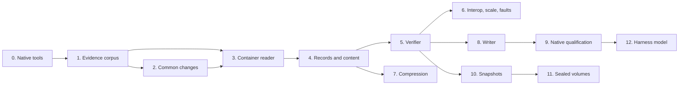

# APFS implementation plan

This plan orders the work that adds APFS to fsimg: first a reader and a
container-wide verifier for native APFS containers, then a writer whose
output macOS checks, mounts, modifies and checks again. Its input is the
research draft
[APFS on-disk format and fsimg implementation specification](../fsspecs/fsimg_apfs_spec.md)
("the draft"). The draft is not the specification. The authoritative designs
are the [format design](../specs/design-apfs.md) and the
[driver design](../specs/design-apfs-driver.md), original documents in the
present tense that cite their evidence. Section numbers below such as "draft
section 13" refer to the draft.

APFS differs from the other formats fsimg supports in three ways that shape
the plan. Its public reference is detailed but predates current macOS, so
native evidence confirms the tables before code relies on them. A container
holds several volumes sharing one allocation space, so a reader selects a
volume and verification is container-wide. Directory names are hashed and
compared under Unicode normalization and case folding, so the driver carries
normalization tables of its own. Transparent compression and sparse files
need nothing new from common code: the reader core's zero and held extents
carry holes and decoded chunks.

The working agreement applies unchanged. Designs come before code. A failing
regression test comes before any non-trivial fix. Every stage gets the review
subagent and the external `aireview` review and ends in one coherent commit,
or a few, which land on master only after the
[landing gates](#landing-gates) pass. Skipped checks are reported. No
calendar estimate substitutes for a gate.

## Goals and non-goals

Goals:

1. Read native APFS containers, bare, inside a GPT or Apple Partition Map
   partition, or inside a DMG whose chunks the layers decode, through `i`,
   `t`, `x`, `x -O` and `W`. One volume is read at a time, chosen with
   `-o volume=N` when the container holds several. Resources are bounded at
   any legal geometry, and every failure falls into the closed status
   classification. Truncated containers, `--force` and `x --salvage` behave
   as the common contracts state.
2. Verify completely: checkpoint consistency, every object and tree of every
   volume, record-level reconciliation, the selected volume's namespace, and
   container-wide allocation against the space manager.
3. Read transparently compressed files (zlib, LZVN, LZFSE), sparse files,
   clones, hard links (as separate entries), and devices and sockets as
   read-only kinds; then named snapshots and sealed system volumes.
4. Create new containers with one volume that `fsck_apfs -n` accepts without
   findings, that macOS mounts, modifies and remounts, bare or wrapped in GPT
   and DMG by the existing layers. The writer capability is registered only
   after that native cycle is recorded.

Non-goals:

* Modifying an existing container: adding volumes, appending transactions,
  repair, mounting, snapshot creation (draft sections 13.5 and 18, W1 and
  W2).
* Encryption, Fusion containers, bootable or sealed output, volume-group
  union views and firmlink resolution (draft sections 5.1, 10, 11, 12.5).
* Exposing extended attributes, resource forks, BSD flags or ACLs, and
  writing hard links: the common entry model has no representation for
  them, and each needs a common design first (see [TODO](../TODO.md)). An
  entry with such data carries the
  [extra-data mark](../specs/design-apfs.md#extended-attributes).
* Writing sparse files, clones, compressed files, devices or sockets: every
  fsimg writer allocates every logical byte, space sharing has no source in
  the catalog, and the device and socket kinds are read-only.
* A recovery scan beyond the checkpoint descriptor ring, a choice of
  checkpoint other than the selection rule, and checker modes.

## Inputs and their standing

| Input | Standing | Use |
| --- | --- | --- |
| [The draft](../fsspecs/fsimg_apfs_spec.md) | Research draft, original prose | Tiers, pitfalls (section 13.6), the test families of sections 15 and 16, open questions (section 19). Every unresolved item is a gate here, never a default |
| Apple, *Apple File System Reference* (2020-06-22) | Public documentation, kept outside the repository | Layout tables, paraphrased in the format design; checked against the document and native fixtures in stage 1 |
| macOS on the development host: `newfs_apfs`, `fsck_apfs`, `hdiutil`, `diskutil`, `ditto`, `tmutil` | Native tools, run on disposable images only | Fixture production, the writer's native layout, and the acceptance oracles. The CI macOS runner provides the same tools for scripted checks |
| `apfsprogs` (`apfsck`, `mkapfs`), `apfs-fuse`, `libfsapfs` tools | GPL-2.0 and LGPL-3.0, external programs only, built at pinned revisions outside the tree | Second structural opinion and independent readers, run on copied images. No code, declarations or identifiers enter the tree |
| Third-party APFS images | Untrusted specimens under `~/fsimg-corpus/apfs`, never attached or mounted | Images other producers and other macOS releases wrote, read by fsimg and the external checkers only |
| `go-filesystems/apfs` | BSD-3-Clause | Comparison point for structural questions the reference leaves open; nothing is imported |
| `lzfse` reference implementation | BSD-3-Clause; its decoder files are in `lib/codec/lzfse/` with their notice and audit record ([references](references.md#lzfse-and-lzvn-decoders)) | The LZFSE and LZVN decoders, reused as they stand |
| Unicode Character Database 17.0.0, the version E4 establishes | Unicode-3.0 data | Normalization and case-folding tables; `NormalizationTest.txt` as their oracle |

## Existing owners the driver reuses

The common contracts cover APFS: the
[format descriptor and probe](../specs/design-formats.md#format-descriptors-and-profiles)
with its assumed identity,
[prepared directories](../specs/design-directories.md),
[logical content](../specs/design-content.md) with zero and held extents and
decoded link targets, [emission](../specs/design-emission.md),
[sizing](../specs/design-sizing.md),
[POSIX metadata](../specs/design-metadata.md) with the extra-data bit,
[device nodes](../specs/design-device-nodes.md),
[salvage extraction](../specs/design-salvage.md), the
[truncated-volume rule](../specs/architecture.md#byte-and-object-boundaries),
the [verification helpers](../specs/design-verification-helpers.md), the
[writer loss policy](../specs/design-metadata-loss.md), the
[layers](../specs/design-layers.md) for GPT, Apple Partition Map and DMG,
and the
[metadata scratch primitives](../specs/design-storage.md#metadata-scratch-primitives).
The HFS Plus and EROFS drivers are the structural templates: HFS Plus for
B-trees, generated Unicode tables, transparent compression and the
`write-*` split; EROFS for held extents, the contract-suite profile and the
fixture tools.

The driver reuses these as they stand. Each gets an APFS test in the stage
that first uses it, and none needs a change:

| Facility | Where | APFS use |
| --- | --- | --- |
| 766-byte label | `fsimg_volume_info_t.label`, `include/fsimg.h:1210` | A 255-byte volume name reported without loss |
| Read-settings mask and its generic check | `read_settings`, `include/fsimg.h:1298`; `fsimg_read_settings_check()`, `lib/core/settings.h:320` | Carries the volume and snapshot bits; every other format refuses them with no edit of its own |
| Zero and held extents, decoded link targets | `FSIMG_EXTENT_ZERO`, `lib/meta/meta.h:113`; `reader->held` and `fsimg_reader_set_link_target()`, `lib/read/reader.h:182-188,277` | Holes, decoded 64 KiB chunks, symbolic-link targets |
| Assumed identity, salvage, truncation | `fsimg_reader_identity()` and the salvage functions, `lib/read/reader.h:207-292`; `missing_bytes`, `include/fsimg.h:1218` | `--force`, `x --salvage`, containers shorter than they declare |
| Device and socket kinds, extra-data bit | `include/fsimg.h:306,339-342` | Read-only kinds; the mark on an entry whose attributes the model cannot carry |
| CRC-32C, SHA-256 | `lib/core/crc32c.[ch]`, `lib/core/sha256.[ch]` | Name hashes; the sealed integrity chain and the container UUID |
| LZFSE and LZVN decoders | `lib/codec/lzfse.c`, `lib/codec/codec.h:197-222` | Compression types 7, 8, 11 and 12, as `lib/formats/hfsplus/compress.c` calls them |
| GPT partition type | `lib/layers/types.c:41` | `apfs/gpt` stacks |

The draft's proposed modules (section 17.1) map onto existing owners. The
driver design's [module table](../specs/design-apfs-driver.md#modules) is
the authority for file names:

| Draft module | fsimg owner |
| --- | --- |
| `core/io`, GPT, UDIF adapter | Bounded I/O and the layers: GPT, Apple Partition Map and DMG are peeled before the driver opens |
| `apfs/probe`, `apfs/checkpoint`, `apfs/object` | The driver's descriptor, checkpoint selection and one object reader |
| `apfs/omap`, `apfs/btree` | The driver's object-map lookup and the one cursor in `btree.c` |
| `apfs/volume`, `apfs/fsrecord` | Driver `volume.c`, `inode.c` and `unicode.c` |
| Directory listing and path lookup | The common walker and selector; the driver supplies `prepare`, `replay`, `keys` and `key` |
| `apfs/stream` | Driver `resolve` under common delivery |
| `apfs/compress` | Driver `compress.c` over the shared framing validator `lib/formats/decmpfs.[ch]`, zlib and `lib/codec/lzfse.c` |
| `apfs/ssv` | Driver sealed-profile code and `lib/core/sha256.c` |
| `apfs/spaceman`, `apfs/validate` | Driver `spaceman.c` and `verify.c` over the common external sort |
| `apfs/write` | The writer lifecycle (`validate`, `plan`, `emit`), the emission object and the sizing policies |
| `tests/fixtures` | Native captures and third-party specimens outside the repository, each named by an environment variable, plus the independent generator |

## Common changes

APFS needs five changes outside its driver. Each is specified in its owning
design and lands in the stage named, without an APFS-specific branch in
common code:

1. **Volume and snapshot read settings**, stage 2. `fsimg_read_options_t`
   gains `volume_index` with its presence flag `volume_index_set`, and
   `snapshot`, a borrowed UTF-8 string of at most 255 bytes
   ([API](../specs/design-api.md#reader)). `FSIMG_SETTING_VOLUME_INDEX` and
   `FSIMG_SETTING_SNAPSHOT` take the next free bits of the one
   `FSIMG_SETTING_*` namespace. The
   [settings catalogue](../specs/design-settings.md) gains the `volume` and
   `snapshot` rows, the CLI `-o volume=` and `-o snapshot=` on reading
   commands, and the worker job their encoding.
2. **Key bound**, stage 2. `FSIMG_DIRECTORY_KEY_BYTES`
   (`lib/read/directory.h`) holds the 4096 bytes the
   [directories design](../specs/design-directories.md#namespace) states,
   room for the longest APFS comparison form of a 1022-byte name.
3. **Case-sensitivity write setting**, stage 2. `fsimg_write_options_t`
   gains `case_sensitive` under `FSIMG_SETTING_CASE_SENSITIVE`, CLI
   `case=insensitive|sensitive`.
4. **Registration rows.** With the reader in stage 3, `apfs` leaves
   `reserved_filesystems` (`lib/layers/stack.c:65`) for the filesystem
   names and joins the static format list; `hfs` stays reserved. The CLI
   case that expects `-F apfs` to fail as a reserved name
   (`test/cli/option_syntax_test.rb:162`) changes with it. The cases that
   refuse `apfs` as an MBR partition type (`test/scheme-planning.c:1254`,
   `test/layers-write.c:646`) stay valid: APFS has no MBR type byte
   ([partition types](../specs/design-layers.md#partition-types)). With
   the writer in stage 8, the identifier roles
   (`lib/layers/layer.h:1210`) gain role 5 for an APFS volume UUID and the
   driver states its [sizing dimensions](../specs/design-sizing.md#dimensions-per-format).
5. **Shared compression framing**, stage 7. The `com.apple.decmpfs` header
   and the resource-fork chunk tables are one macOS format, so their
   decoders and checks move out of the HFS Plus driver into
   `lib/formats/decmpfs.[ch]`, a pure validator both drivers call
   ([driver design](../specs/design-apfs-driver.md#compression-framing)).
   From `lib/formats/hfsplus/codec.c` come `hfsplus_cmpf_decode()`,
   `hfsplus_rsrc_decode()`, `hfsplus_rsrc_table_decode()`,
   `hfsplus_chunk_pair_decode()` and `hfsplus_chunk_word_decode()` with
   their types and length constants; from `lib/formats/hfsplus/compress.c`
   the relation checks of `fork_open()`, `word_table_open()`,
   `chunk_locate()` and `word_chunk_locate()`, their fork reads replaced by
   the callback. HFS Plus accepts the same images with the same statuses;
   the framing diagnostics lose the format's name from their wording.

## Design decisions

The designs record these with their rationale.

1. **One volume per reader.** A volume shares its container's blocks, so it
   cannot be a layer slice. A read setting selects it by its stored slot
   index; a single-volume container needs none, and a multi-volume container
   without one fails giving the volume count and the lowest and highest
   occupied indexes. No synthesized root and no
   new enumeration API: `i -o volume=N` shows each volume.
2. **One bounded checkpoint rule.** The checkpoint with the largest XID
   whose descriptor run is whole is read, as macOS mounts the newest
   superblock that is not malformed. A newer one with a broken run is passed
   over and reported as not clean; a selected checkpoint whose mappings or
   mapped objects fail is corrupt, with no further fallback, so selection
   reads the descriptor ring once, the selected run again, and one data
   run. There is no recovery scan and no
   checkpoint option.
3. **Identity is the `NXSB` magic alone.** Everything else the probe checks
   is validation, so `--force` waives one check and every other one still
   runs ([probe and identity](../specs/design-apfs.md#probe-and-identity)).
4. **Truncation goes through the common read funnel.** The driver has no
   truncation check. A checkpoint candidate with missing blocks fails the
   open instead of being passed over, because falling back would present
   old state from a truncated image as current
   ([truncated containers](../specs/design-apfs.md#truncated-containers)).
5. **One object reader and one B-tree cursor.** Every reference goes through
   `apfs_object_read()` and every node through `btree.c`, so storage-class,
   checksum, ordering, height and cycle checks exist once.
6. **No caches beyond cursor paths.** Each cursor keeps its root-to-leaf
   windows, bounded by the 16-level height limit; nearby lookups reuse them.
   The driver owns no other cache, as the architecture requires.
7. **Directory cycles and sharing by the parent and name rules.** A
   directory's inode names its parent and its own name, and the reader
   requires them to be the directory holding the record that names it and
   that record's name, so a second record naming the directory is corrupt.
   A cycle would give some directory two parents, so none can be followed,
   and no claimed-object set is needed for sparse 60-bit inode numbers.
8. **Names are delivered as stored; keys follow the volume.** Every valid
   UTF-8 name is delivered, with no omitted-names profile, and the
   namespace key is the volume's comparison form, so equivalent names are
   corruption and queries match the way macOS looks names up. Length has
   one rule per side: the reader accepts 1022 UTF-8 bytes, and the writer
   255 UTF-16 code units, the limit macOS applies when it creates a name
   (E14).
9. **Unicode tables are the driver's.** `tools/gen-apfs-tables.rb`
   generates `lib/formats/apfs/unicode-tables.h` from pinned inputs whose
   digests [references](references.md) records, as HFS Plus owns its
   tables. The two formats pin different Unicode versions and folding
   rules, so a shared owner would carry two table sets behind one name.
10. **Devices and sockets are the read-only kinds.** Their inodes map onto
    the kinds of the [device node design](../specs/design-device-nodes.md#readers),
    and a device's number is its device-number field when present.
    Evidence (E16) decides only whether a device without the field
    tightens to corruption; E3 ran without root and holds no device.
11. **Unconsumed attributes set the extra-data bit.** An inode with any
    attribute other than the three the driver consumes marks each of its
    entries, so the omission is visible per entry
    ([extended attributes](../specs/design-apfs.md#extended-attributes)).
12. **The reader takes part in salvage.** The opening checks stay terminal.
    Damage met after them costs a file its tail, one child when `replay`
    rejects it, or a directory's whole listing when `prepare` rejects it
    ([driver](../specs/design-apfs-driver.md#salvage),
    [salvage](../specs/design-salvage.md)).
13. **Verification is container-wide; the walk is per volume.** Allocation is
    shared, so every volume's trees are scanned for claims; the selected
    volume's namespace goes through the common walker. Record checks that
    join different owners use sorted streams, so no table of inodes is
    resident. A container whose [reaper](../specs/design-apfs.md#reaper) is
    not idle verifies as incomplete.
14. **Compression and holes through common delivery.** Decoded chunks and
    holes are extents of their own kinds, so delivery keeps bounds, batching,
    cancellation and confirmed progress, and no driver reads on a caller's
    behalf.
15. **The writer reproduces `newfs_apfs`.** The empty-container layout,
    including the space manager, internal pool, checkpoint areas,
    [reaper](../specs/design-apfs.md#reaper) and
    [free queues](../specs/design-apfs.md#free-queues), is what the native
    formatter produces for the same size, decoded from captures; fsimg adds
    its entries in one transaction. Every emitted value is a row of the
    format design's [writer values](../specs/design-apfs.md#writer-values),
    with the experiment that closes it and its default. Every record's
    encoded length depends only on the catalog, so trees are packed in
    planning and filled with addresses in emission.
16. **A writer awaiting qualification is unregistered.** It lives in the
    second descriptor until the native cycle passes.

## Evidence questions

Stage 1 answers these, each tied to the experiment that answers it and the
stage that consumes it. A question the format design answers ahead of its
experiment is marked provisional there, with the default that applies if
the experiment cannot answer.

| Question | Evidence | Consumer |
| --- | --- | --- |
| Every layout table of the format design, and the container superblock's type word. The reaper layout, the free-queue tree subtype, the first unreserved OID and the volume-count rule are checked first | The reference, E1, E3 | Codecs, stage 3 |
| Fletcher-64 on captured blocks | E1 | Codecs, stage 3 |
| Checkpoint area sizes and placement by container size; contiguity | E1, E12 | Reader acceptance, writer layout |
| Mapped ephemeral objects and their XIDs in a checkpoint; ring states after mount cycles; torn checkpoints | E1, E8 | Selection rules |
| Descriptor and data ring slots, mapping order, the order of OIDs from 1024, and block 0 compared byte for byte with the ring superblock | E1 | [Writer values](../specs/design-apfs.md#writer-values) |
| Space manager fields, internal-pool sizing, chunk structures, address-block threshold, bitmaps of free chunks | E1, E12 | Verifier, writer |
| Bitmap bits past `N`: what the native formatter writes and whether `fsck_apfs` accepts them set | E1, E15 | Verifier, writer |
| The fixed regions as functions of `N`; the container size step | E1, E12 | Automatic sizing |
| [Free queues](../specs/design-apfs.md#free-queues): the empty form a fresh container holds, the oldest XID and node limit, empty and with entries | E1, E8 | Verifier, writer |
| [Reaper](../specs/design-apfs.md#reaper) of a fresh container: reap IDs, state buffer size, idle state | E1 | Verifier, writer |
| Blocks of a deleted volume or snapshot not yet reaped: reaper and reap-list state, and how allocation accounts them | E17 | Verification with a pending reap |
| Object-map flags and the object XID equal to its key's XID | E1, E3, E8 | Object reader |
| Tree flags, node fill and table-of-contents sizing in native nodes; alignment | E1, E3 | B-tree validation, writer packing |
| Volume features, flags, role, crypto state and formatting record of `newfs_apfs` and `hdiutil` volumes in both personalities | E1, E2 | Feature tables, writer |
| Records of an empty volume beyond the root and private directories; its next object identifier; whether the two directories count in the volume's object counts | E1, E3 | Writer |
| Directory-statistics, document-ID, purgeable and firmlink records and fields on native directories, and whether `fsck_apfs` requires them | E1, E3, E15 | Writer |
| Name hash conventions (initial value, complement, terminating NUL), full or simple case folding, Unicode version, hashed or plain keys per personality | E2, E4 | Names, stage 4 |
| Comparator tie-breaks for hashed records, attributes and snapshot names | E2, E4, E5 | B-tree ordering |
| Name length limit and its unit; refusal of invalid UTF-8 | E14 | Name rules, writer |
| Symbolic-link target limit and storage, and the mode macOS gives a new link; FIFO, device and socket encodings; whether every device carries the device-number field | E3, E14, E16 | Kinds, link limit, writer defaults |
| Name extended field on every inode; reserved inodes named by directory records; private-directory contents; internal flags and protection class of new inodes | E1, E3 | Reader, verifier, writer |
| Sibling links and maps; link counts | E5 | Verifier |
| Attribute storage, inline limit, stream-backed attributes | E5 | Reader |
| Hole representation in sparse files; clone sharing and its reference records | E6 | Content, verifier |
| Physical-extent records for unshared files; data-stream written and read totals; volume allocated-block accounting | E3, E6 | Verifier, writer |
| Compression header, inline marker bytes, resource-fork framing per codec, inline size limit, codecs `ditto` and installers choose | E7 | Stage 7 |
| Snapshot records, flags, extended metadata, dataless snapshots | E9 | Stage 10 |
| Volume roles and volume groups in multi-volume containers | E10 | Volume selection |
| Encrypted and sealed detection; sealed tree types, node flags, hash types; whether a sealed volume has an extent-reference tree | E11 | Refusal, stage 11, sealed verification |
| DMG, GPT and Apple Partition Map layouts around APFS | E13 | Layer interplay |
| Native time and owner limits; whether times are signed | E14 | Metadata mapping |
| Kinds, compression, snapshots, holes, clones and hard links on a used Data volume, and whether its reaper is idle | E16 | Stage 7 priorities, scale cases, how often verification meets a pending reap |
| Writer acceptance: XID 1 for all objects, the formatting identifier, maximum extent length, greedy node fill, minimum container size, maximum volume count rule | E1, E15 | Writer |

## Work packages

Every stage leaves `make -j32 check-quick` passing and follows the gates
below.

### 0. Native tools, oracles and harness

* Record the host's macOS build, `newfs_apfs` and `fsck_apfs` versions, and
  how each runs on an attached disposable image: `mkfile -n` or
  `truncate`, `hdiutil attach -nomount -imagekey
  diskimage-class=CRawDiskImage`, `newfs_apfs` on the attached device, and
  `fsck_apfs -n` or `diskutil verifyVolume` on it, noting which need
  administrator rights.
* Build the independent tools outside the tree at pinned revisions with
  `build-aux/build-apfs-oracles.sh`, as `build-aux/build-erofs-utils.sh`
  does: under `~/.local/share/fsimg-oracles/` on macOS for each tool that
  builds there, and in the `build-aux/linux-check.sh` environment for the
  rest. Record each revision, where it builds and its version output.
* Keep a copy of Apple's reference outside the repository and record its
  date and SHA-256.
* Add `tools/apfs/`: `capture.rb`, which makes a named capture with its
  command record, tool versions, SHA-256 and checker output; and
  `apfsdump.rb`, a structure dumper written from Apple's reference
  independently of `lib/`, which prints every field of the objects the
  format design tabulates and checks each checksum. These are project
  tools under the Ruby and style rules and the review gates. Captures live
  outside the repository in the directory named by `FSIMG_APFS_NATIVE`,
  named `apfs-KIND-SIZE-OPTION`.
* **Gate:** tool identities and procedures are recorded in
  `docs/apfs-research.md`. Stop and ask the owner, substituting nothing,
  in two cases: raw images cannot be formatted and checked natively,
  without which the writer gate cannot close; or neither `apfsck` nor
  `fsapfsinfo` builds at a pinned revision, which leaves no independent
  second opinion.

### 1. Native evidence corpus

Each experiment varies one property on disposable images and produces
captures with their command records and `fsck_apfs` output:

| Experiment | Procedure |
| --- | --- |
| E1 Empty containers | `newfs_apfs` at the minimum size, 32 MiB, 512 MiB, 1 GiB, 8 GiB and 100 GiB (sparse files), and `hdiutil create -fs APFS -layout NONE`; full dumps |
| E2 Personalities | Case-sensitive and case-insensitive volumes from `newfs_apfs` and `hdiutil`; feature and flag words |
| E3 Population | Names of 1, 255 and longer lengths; files of 0, 1, 4095, 4096, 4097, 65536 bytes and beyond 4 GiB (sparse source); nested and wide directories; symbolic links; `mkfifo`; `mknod` and a socket as root; modes, owners and times at their limits |
| E4 Names | One directory of 20000 names including composed and decomposed forms, case pairs, German sharp s, Turkish dotted and dotless I, Greek sigma, Hangul, CJK compatibility ideographs, Georgian Mtavruli, characters whose folding is not closed under decomposition, characters assigned in each recent Unicode version, and supplementary-plane characters, in both personalities; each stored hash recorded as a test vector, and collisions of the 22-bit hash |
| E5 Links and attributes | Two and three hard links across directories, unlinked back to one; attributes of 0 and 1 bytes, sizes around the inline limit with names of 1 to 127 bytes, and of 64 KiB and 1 MiB |
| E6 Sparse and clones | `truncate` and seek-writes; `cp -c` then overwrite one branch |
| E7 Compression | `ditto --hfsCompression` on small and large files; installed applications; each codec type found, inline and resource-fork |
| E8 Checkpoint history | Mount, write, unmount several times, capturing the ring; copies truncated or with the newest checkpoint's blocks zeroed |
| E9 Snapshots | A local snapshot of a disk-image volume where `tmutil` permits, or an owner-provided image; data changed after the snapshot |
| E10 Volumes | `diskutil apfs addVolume` with roles; a volume group if available |
| E11 Encrypted and sealed | `hdiutil create -encryption`; a sealed System volume from an installer or restore image if available, structure only |
| E12 Large containers | 1 TiB and 128 TiB sparse containers: address blocks, pool sizes, ring sizes |
| E13 Layers | `hdiutil` UDRW, UDZO and UDBZ images with and without GPT, and an Apple Partition Map disk holding a container (`hdiutil create -layout SPUD` if it accepts APFS, otherwise an E1 container behind a hand-built map): the layouts the layers peel. One ULFO image records the layer's refusal; a ULMO image is an xz stream at offset 0, so it is ambiguous unless the read-side stack is given, and with `-F dmg` it fails as unsupported LZMA chunk compression |
| E14 Limits | Longest accepted name in bytes and characters, invalid UTF-8 refusal, 1023- and 1024-byte link targets, times before 1970 and far ahead |
| E15 Writer probes | `fsck_apfs -n` on E1 and E3 captures altered one field at a time with checksums repaired: all XIDs set to one, another formatting identifier, a very long extent, node fill changes including a last node of one record, another maximum volume count, bitmap bits past `N` set, a directory-statistics, document-ID, purgeable or firmlink record or field removed, and the writer's first form: an E1 capture rolled back to its XID-1 checkpoint with its volume's objects added to that checkpoint |
| E16 Used Data volume | Structure-only counts from a copy of a used macOS Data volume the owner provides: entry kinds including sockets and device nodes, where they occur by depth and whether each device carries the device-number field, compression types, snapshots, holes, clones and hard links, and whether the reaper is idle. No names, contents or identities are recorded |
| E17 Pending reap | In an E10 container, delete a populated volume with `diskutil apfs deleteVolume` and, where E9 gave one, a snapshot. Copy the backing file as each command returns, after a forced detach and after a clean one; dump the reaper, reap lists and free queues of each copy and run `fsck_apfs -n` on it |

* **Third-party specimens.** Public APFS images from other producers and
  other macOS releases (forensic test images, installer and restore
  images, `mkapfs` output) are collected under `~/fsimg-corpus/apfs`,
  named by `FSIMG_APFS_CORPUS`. `SOURCES.md` there gives each specimen's
  origin, terms and SHA-256, and `MATRIX.md` the result each fsimg command
  must give on it. The specimens are untrusted: never attached or mounted,
  read only by fsimg, the dumper and the external checkers on copies.
* **Reference check.** Every offset and constant the designs cite to the
  *Apple File System Reference* (A1 in the format design) is checked
  against a copy of that document and against the captures. A
  disagreement is resolved in the designs, not in the code.
* **Deliverable:** `docs/apfs-research.md`: sources and licenses, tool
  identities, per-experiment observations, and for each evidence question
  either an answer with its capture or an open status naming the feature it
  blocks. Observations that change a rule are edited into the designs, and
  a provisional value loses its label only when its experiment has run.
  Captures, specimens, logs and raw tool output stay outside the
  repository.
* **Gate:** every evidence row is answered, or explicitly open with the
  format design's default applied, and no open row is needed by stages 3
  to 5. E17 may stay open if no copy holds a reaper that is not idle: the
  default, incomplete verification of such a container, needs no answer.
  Stages 1 and 2 may iterate.

### 2. Common changes

Separate reviewed commits, each keeping every format's behaviour and image
bytes unchanged:

* the `volume=` and `snapshot=` read settings: fields, bits, catalogue
  rows, CLI options and worker encoding, with a test that the generic mask
  check refuses a non-default value for every registered format;
* `FSIMG_DIRECTORY_KEY_BYTES` at 4096;
* the `case_sensitive` write setting, refused by every registered format.

**Gate:** the existing suites, baseline fixtures and image bytes are
unchanged; the new contracts have their own tests; manual pages and NEWS
describe the user-visible options.

### 3. Reader: container, checkpoint and volumes

* From the driver design's module table: `apfs.h`, `descriptor.c`,
  `codec.c`, `checkpoint.c`, `object.c`, node validation and seeks in
  `btree.c`, `omap.c`, `volume.c` and `read.c`.
* Registration with a reader whose directory operations fail with
  `FSIMG_EUNSUPPORTED` until stage 4, so `i` works first; build wiring and
  `EXTRA_DIST`; the registration rows of common change 4.
* `test/apfs-gen.[ch]` and `test/apfs.c`: the independent generator for
  containers, checkpoint rings, object maps, multi-level trees and volumes,
  and their mutations, shared with the contract suite and the fuzz seeds.
* `fuzz/apfs.c`: probe, selection and object-map paths with checksum repair.
* **Gate:** `i` and `i -o volume=N` match `diskutil apfs list -plist`,
  whose text form omits Update-role volumes (E10), for every capture:
  volume names, UUIDs, roles, block size and count. Every checkpoint and
  object-map mutation fails with its class. A container whose block 0 magic is damaged opens only with `--force`, and every
  other mutation still fails under it. A cut through the descriptor ring
  or the selected checkpoint's data run fails as truncated and never
  selects an older checkpoint; a cut past them opens and `i` reports the
  missing bytes.

### 4. Reader: records, directories and content

* `unicode.c`, `inode.c`, `directory.c` and `content.c`, the cursor's scan
  operations in `btree.c`, and `tools/gen-apfs-tables.rb` with the
  generated `unicode-tables.h`, which `test/apfs-unicode.c` checks against
  the recorded input digests, `NormalizationTest.txt` and the E4 vectors.
* Tests cover the format design's record, name, link and content rows,
  including hash vectors from E4 in both personalities, holes, clones, hard
  links, symbolic links of 1 and 1023 bytes, FIFOs, a socket, devices with
  and without the device-number field, the extra-data bit, and files
  beyond 4 GiB.
* The reader's profile in `test/driver-contracts.c`
  ([contract suite](../specs/design-driver-contract-tests.md#profiles-are-test-facts)),
  materialized by the generator.
* `test/apfs-salvage.c`: a damaged file-extent record, node checksum,
  inode and attribute; each file keeps the prefix before the damage, a
  damaged child is one named loss, and its siblings extract.
* **Gate:** `t`, `x -O` and `x` agree with the native manifest (names, kinds,
  sizes, modes, times, SHA-256 of contents; owners with the dump, since a
  capture mounted with ownership ignored stores 99 while `stat(2)` reports
  the mounting user; the `.fseventsd` subtree, which the system rewrites at
  unmount, left out) of every capture without
  compressed files, bare and through `apfs/gpt`, `apfs/gpt/dmg` and the
  Apple Partition Map fixture; no content byte is delivered from an
  unvalidated extent or a gap; a container cut past everything a listing
  and extraction touch lists and extracts, and a cut through a node or an
  extent fails as truncated where it is reached.

### 5. Verifier

* `verify.c` and `spaceman.c` as the driver design specifies.
* Tests: leaked, doubly claimed and wrongly shared blocks; free-count
  mismatches; link-count, child-count and stream-count errors; missing
  sibling records; equivalent sibling names in a non-selected volume;
  unsupported features in any volume, or a reaper that is not idle, making
  the report incomplete; both empty free-queue forms verifying; `W` failing
  on every truncated container and on one opened with an assumed identity,
  naming the assumed check.
* **Gate:** every capture the reader accepts verifies (E1's 91-block
  capture lies below the reader's 1 MiB minimum and is refused), or its findings are classified in the
  research record as fsimg rules widened only from evidence; every mutation
  fails with its class.

### 6. Reader interoperability, scale and faults

* `test/apfs-integration.sh.in`: the native manifest comparison and
  `fsck_apfs -n` on macOS; `apfsck`, `apfs-fuse` and `fsapfsinfo` where
  they are built; every specimen of `FSIMG_APFS_CORPUS` against its
  `MATRIX.md` row; each skipped explicitly when absent.
* Scale: a 128 TiB sparse container, a directory of a million entries, a
  file of a million extents, a tree of maximal height; I/O calls, node
  loads, peak scratch and RSS recorded. The wide directory decides whether
  replay's inode lookups need the sorted join the driver design names.
* Faults at every stage, each followed by a cleanup check.
* **Gate:** comparisons recorded in `docs/build.md` with tool versions, or
  reported as skipped with the reason; the scale figures hold within the
  session budget.

### 7. Compression

* `lib/formats/decmpfs.[ch]`: the shared framing validator, extracted from
  `lib/formats/hfsplus/codec.c` and `compress.c` in a commit of its own.
  The HFS Plus suites and fixtures pass unchanged, the cases of
  `test/hfsplus-codec.c` for the moved decoders move with them, and the
  [HFS Plus driver design](../specs/design-hfsplus-driver.md) names the
  shared module in the same commit.
* `compress.c`: the compression types, inline payloads and resource-fork
  chunks through the shared validator, over zlib and the decoders of
  `lib/codec/lzfse.c`; the capability record's `codecs`. The APFS framing
  is the HFS Plus one (E7), so `compress.c` keeps no validator of its own;
  it adds the dispatch APFS needs, the LZFSE raw marker `0xFF` and the
  `0xCC`-marked types 9 and 10, and reads the `com.apple.decmpfs` value
  from its record or a stream and a content-bearing resource fork from a
  stream.
* APFS cases in `fuzz/lzfse.c`, seeded from E7's LZVN, LZFSE and zlib
  chunks and inline payloads in `$FSIMG_APFS_NATIVE/e7-chunks`.
* Tests: every supported type with one and many chunks; truncated headers,
  overlapping or short chunks, output-size mismatches, and expansion bombs;
  a damaged last table entry leaving the earlier chunks readable and
  failing structural verification without payload read-through; LZBITMAP
  refused; a salvaged file keeping the chunks before its first bad one.
* **Gate:** every compressed file of `apfs-newfs-67108864-e7-compression`
  but the LZBITMAP ones (59 files) matches its native digest in that
  capture's `native-decmpfs.jsonl`, the 11 LZBITMAP files are refused as
  unsupported, and the HFS
  Plus compression tests and corpus results are unchanged.

### 8. Writer, unregistered

* The writer modules of the driver design's table, `write-apfs.h`,
  `write-plan.c`, `write-btree.c`, the one packer, and `write-emit.c`;
  identifier role 5 and the sizing dimensions.
* `test/apfs-write.c`: round trips through the reader, verifier and the
  independent checker; byte identity across source order, budget, scratch
  and time zone; a poison scan; faults; a non-empty placement list
  refused; `--native`, comparing an empty container field by field with
  the E1 capture of the same size in the forms the writer values cite,
  which needs a decoder for its older checkpoint. The writer joins the contract-suite
  profile.
* **Gate:** every check passes; every row of the
  [writer values](../specs/design-apfs.md#writer-values) carries its
  experiment's answer or its stated default; the stage lands with the
  writer in the second descriptor, and the gap is listed in
  [TODO](../TODO.md).

### 9. Native qualification and writer registration

* `tools/apfs/qualify.rb` runs, for each output: `fsck_apfs -n`; `hdiutil
  attach` and a manifest comparison of `find`, `stat` and SHA-256;
  creation, append, rename, `mkdir`, `rmdir`, unlink and a large file
  written natively; detach; `fsck_apfs -n` again; reattach and read; fsimg
  `W` and `t` on the result.
* Outputs cover both personalities, the minimum, a small and a multi-chunk
  size, a nearly full container, deep and wide trees forcing multi-level
  nodes, long and Unicode names, symbolic links and FIFOs, and the same
  trees wrapped as `apfs/gpt` and `apfs/gpt/dmg`. The Linux checkers run on
  the same outputs.
* Registration covers the capability record and `--formats`, and updates to
  `README.md`, `docs/fsimg.1`, `docs/libfsimg.3` and `NEWS`.
* **Gate:** every native cycle passes with no `fsck_apfs` finding; the
  record is in `docs/apfs-research.md` under fsimg writer output; the
  [landing gates](#landing-gates) have passed on this tree.

### 10. Snapshots

* The `snapshot=` setting through the volume module, snapshot claims in
  verification, and E9 fixtures.
* **Gate:** E9's snapshot reads return the old data and the live view the
  new; verification of a volume with snapshots completes.

### 11. Sealed volumes

* The sealed file-extent tree, hashed nodes and the SHA-256 integrity chain.
* **Gate:** E11's sealed volume lists and extracts with native digests; a
  modified node fails the chain; no authenticity is reported.

### 12. Specification harness model

* `test/spec/lib/fsimg_spec/apfs.rb` with `test/spec/lib/fsimg_spec/apfs/`
  and `test/spec/suite/apfs/` under the
  [specification harness](../specs/design-spec-testing.md): layouts, a
  model that builds the writer's one-volume profile, rules named from the
  format design's container, checkpoint, object-map, node, volume and
  record sections, and adapters for `fsck_apfs -n` and `apfsck`. It is
  written from the format design, independently of `lib/` and of
  `test/apfs-gen.[ch]`.
* **Gate:** `make check-spec` passes with each APFS rule witnessed valid
  and targeted, or listed as unwitnessed with its reason.

Unscheduled, each behind its own design or evidence: writing hard links and
extended attributes after the common designs, a second volume in the writer,
encryption and Fusion. ULFO and ULMO DMG chunks fail in the
[DMG layer](../specs/design-layers.md#dmg-udif) as unsupported chunk
compression; decoding them is a layer question, not APFS work.

## Dependency order

Stages 6, 7, 8 and 10 are independent once their predecessors land. Stage 9
needs a macOS host.

## Gates for every stage

### Stage gates

At each stage:

* **Commits.** A stage ends in one coherent commit, or a few. An
  implementer works in its own worktree. Its branch is rebased onto master
  and fast-forwarded, with no merge commits, only once the
  [landing gates](#landing-gates) have passed on it. Nothing is pushed;
  pushing is the owner's.
* **Who writes what.** Claude implementer subagents write engine and tool
  code. Codex `gpt-6.1-sol` writes the test code and the throwaway runs.
  Implementer subagents run no sanitizer or fuzz suite.
* **Tests.** Write a failing regression test before any non-trivial fix
  and confirm it fails against the unfixed tree. While developing run only
  the affected tests (`make -j32 check TESTS='test-apfs'`). Run
  `make -j32 check-quick` once, last, on the tree about to be committed,
  and add `make check-spec` when the commit changes a format's on-disk
  rules or the specification harness. After a later test-only edit rerun
  only the affected test; a comment or documentation edit needs no rerun.
* **Review before tests.** Launch the code-review subagent first, before
  the pre-commit test run. Ask it explicitly for bugs and design issues,
  for security and information-leak concerns with the security pass framed
  in the prompt, and for the style guide's readability review citing
  specific functions; for an architectural change, a before-and-after
  comparison of the concepts and obligations added and removed. Address
  every Critical and High finding; fix each Medium finding or record it in
  `TODO.md` or the commit message.
* **External review.** Run `aireview` with Codex `gpt-6.1-sol` at reasoning
  effort `xhigh`. Switch to zai `zai-coding-plan/glm-5.3` with `--variant
  max`, with a warning, only when Codex is out of quota, rate limited or
  refused by its content filter; the review output names the reviewer
  used. Substantive fixes are reviewed again before the commit. A failed
  or unavailable review is reported, never replaced by another provider,
  model or reasoning level.
* **Project hygiene.** New C, shell and Ruby files are ASCII with
  BSD-2-Clause headers. Every new source, test and script is in
  `EXTRA_DIST`, since the sanitizer targets build from a `make distdir`
  copy. `docs/build.md` records commands, evidence and explicit skips.

### Landing gates

A landing puts one stage, or a few consecutive stages together, on master.
Before it, the coordinating session runs once, on the integrated tree about
to land, every check the [working agreement](../CLAUDE.md) requires for
what that tree touches. Implementer subagents run none of them.

* **CI list.** `build-aux/ci-check.sh` passes in the macOS build directory
  and in the Linux container
  (`build-aux/linux-check.sh -r REV 'sh ../build-aux/ci-check.sh'`), with
  `-j16` in `MAKEFLAGS`. The script is the list every native CI job runs,
  and it is the authority for what that list holds.
* **Sanitizers.** A landing that touches image parsing, allocation, I/O
  buffers, extraction or object lifetimes has the full suite pass under
  AddressSanitizer, with UndefinedBehaviorSanitizer when it touches
  arithmetic, offsets, sizes or bit-level code, and under LeakSanitizer
  and MemorySanitizer; ThreadSanitizer joins when it changes concurrency
  or state shared between workers. A skipped or unsupported sanitizer is
  not a passing check: LeakSanitizer and MemorySanitizer do not run on
  macOS, so the Linux run is what covers them.
* **Fuzzing.** `make -j16 check-fuzz`, run on its own and not beside the
  CI list, when the landing adds or changes a parser: the reader,
  verifier, compression, snapshot and sealed-volume stages.
* **Platforms.** A landing that touches platform behaviour, such as the
  sandbox, host I/O, `compat/` or the worker, also runs on FreeBSD: the
  commands inside the `su -c` string of the FreeBSD job in
  `.github/workflows/check.yml`, on the FreeBSD host with `gmake` for
  `make` and `MAKE=gmake sh ../build-aux/ci-check.sh` as the last step.
  The run counts only when `test/spec.sh` passed rather than skipped.
  Stage 2 qualifies: it changes the worker's job encoding.
* **Report.** Every report names the platforms that ran and those that did
  not. Native macOS oracles run on macOS only, and the Linux oracles where
  stage 0 built them.

## Departures from the draft

| Draft | This plan | Reason |
| --- | --- | --- |
| Volume-separated extraction of all volumes, later a unified volume-group mode (section 5.1) | One volume per reader through `volume=` | A volume is not a slice and has no stable display name; synthesized paths would change meaning with the volume count |
| `KEY_REQUIRED`, `HARDWARE_KEY_UNAVAILABLE` and other new statuses (sections 1.5, 11.1) | `FSIMG_EUNSUPPORTED` with a diagnostic naming the feature | fsimg has no key input, so the distinction changes no caller's action |
| `recovery=strict|fallback`, bounded recovery scanning, `checkpoint=xid` (sections 2.3, 2.4, 17.2) | One selection rule over the descriptor ring | macOS mounts the newest checkpoint that is not malformed; a second rule is a second, untested format interpretation, and trying every candidate's objects is quadratic in the ring |
| Recovery from incomplete transactions (tier R4) and power-cut tests of a staged writer (section 16.5) | The reader passes over a torn newest checkpoint and repairs nothing; the writer publishes a whole image or none | fsimg neither mounts nor appends, so it has no transaction to interrupt; the output coordinator owns publication |
| Five seal states (section 10.3) | Seal details in `i` and the verification result, never an authenticity claim | The format has no trusted root fsimg could check |
| `--name-collision=fail|escape|last-wins` and sidecar metadata manifests (sections 6.7, 7.7) | Collisions fail as in every format; the existing `x --mtree` manifest | One extraction contract |
| Writer xattrs and hard links in W0/W1 (sections 13.1, 18) | Not until the common model represents them | The catalog cannot carry them |
| Multiple volumes in W1 (section 18) | One volume; a second is unscheduled | The writer reproduces the one-volume layout `newfs_apfs` gives; a second volume needs its own native evidence |
| Sparse stream encoding in W1 | Never | Every fsimg writer allocates every logical byte |
| Clone, snapshot, compressed and appending writers in W2 (section 18) | Never | A writer builds a new image from a catalog that records no sharing; changing an existing container is a mutable filesystem, which fsimg is not |
| `fsimg verify --deep`, `cat`, `tree` commands (section 17.3) | `W`, `x -O`, `t` | The tar-like CLI |
| `lzfse` as a dependency (section 9.2) | The decoder files in `lib/codec/lzfse/`, with their notice | Only the system zlib may be linked |
| Ten fuzz targets (section 16.2) | `fuzz/apfs.c` with checksum repair, plus cases in `fuzz/lzfse.c` | One target per format |
| Optional GPT wrapper inside the writer (section 13.1) | The existing GPT and DMG layers | Layers are never inside a driver |

## Owner decisions

The owner has settled these:

1. **Volume selection.** One volume per reader, chosen by `-o volume=INDEX`;
   no synthesized root and no new enumeration API.
2. **Scope and order.** Reader and verifier first, then a writer for new
   single-volume containers registered after native qualification;
   snapshots, compression and sealed volumes are reader stages.
3. **Compression codecs.** Apple's BSD-3-Clause `lzfse` decoder files are
   imported rather than written under the clean-room procedure. They are in
   `lib/codec/lzfse/`, and APFS reuses them.
4. **Label width.** The public label has the common 766-byte capacity;
   APFS volume names remain limited to 255 UTF-8 bytes.
5. **Branch.** APFS stages land on master, with no integration branch,
   each landing after its [landing gates](#landing-gates) pass.
6. **Fixed file placement.** Not offered: the writer does not carry
   `FSIMG_SETTING_PLACEMENT`, so a non-empty
   [placement](../specs/design-placement.md) list fails the common check.

## Risks

* **Format drift.** The public reference is from 2020. Current macOS may
  emit fields or flags it does not describe. The closed tables refuse them
  rather than misread, and stage 1 measures the host's macOS; every newer
  macOS release needs a fresh capture set. Stage 1 also checks every
  offset and constant the designs take from the reference against a copy
  of it and against the captures.
* **Writer acceptance.** `fsck_apfs` checks space-manager, reaper and
  free-queue state the reference documents only loosely. Reproducing the
  native empty layout is the mitigation; E15 probes which fields matter,
  and each [writer value](../specs/design-apfs.md#writer-values) states
  what a failed probe leaves: the native constant for a value of the empty
  layout, and for a value that depends on the catalog or on time a
  construction the captures confirm, without which the writer is not
  registered. Until stage 9 passes the writer stays unregistered.
* **Unicode version.** If a macOS release hashes names with another
  Unicode version than the pinned tables, names containing characters whose
  folding or decomposition differs between the versions hash differently.
  E4 establishes Unicode 17.0.0 for macOS 26.6.2 and the pinned tables
  follow it; the risk is confined to such names, and each macOS release's
  capture set rechecks it. A mismatch on a name holding a code point
  unassigned in 17.0.0 is unsupported, not corrupt; a name of characters
  assigned in 17.0.0 hashed by a release with older tables still reads as
  corrupt.
* **Extraction ceiling.** The default output limit is 16 times the selected
  volume's length ([security design](../specs/design-security.md#safe-extraction)).
  A volume whose sparse, cloned or compressed files expand further fails by
  default until the caller raises `-l output` or passes
  `-l output=unlimited`. This is the deliberate bomb defence, not a
  defect, and the manual page says so.
* **Holes under payload verification.** `W -d` synthesizes every zero
  extent it meets ([TODO](../TODO.md)), so a large sparse file costs work
  in proportion to its logical size; the work and time limits bound it
  when the caller sets them.
* **Native checks need privileges.** Attaching and checking raw images may
  need administrator rights; stage 0 records which, and the CI macOS runner
  supplies them for scripted checks.
* **Weakly specified comparators.** A wrong tie-break rule would make valid
  images fail ordering checks, never misread them; E4 settles the hashed
  directory-record rule and E5 the attribute-name rule before stage 4,
  while plain directory-record and snapshot names keep the lenient check
  (no native tool formats a plain-key volume, E2; snapshots wait on E9).
* **Pending reaps.** Verification of a container with a pending reap stays
  incomplete; `fsck_apfs -n` does not verify one completely either (E17).
  That is safe but unhelpful if volumes in daily use often hold one. E17's
  small volume deletions finished before the command returned, snapshot
  reaps are unobserved, and E16 records whether a used volume's container
  holds a pending reap.
* **Provenance.** The designs are written from facts. Research tools and
  tests import nothing from GPL, LGPL or MIT sources. The only imported
  code is the `lzfse` decoder, which is in the tree, audited file by file
  and recorded in [references](references.md#lzfse-and-lzvn-decoders); APFS
  adds no import. Native captures, third-party specimens and any personal
  data stay out of the repository.
