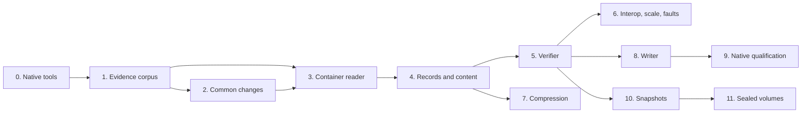

# APFS implementation plan

This plan orders the work that adds APFS to fsimg: first a reader and a
container-wide verifier for native APFS containers, then a writer whose
output macOS checks, mounts, modifies and checks again. Its input is the
research draft
[APFS on-disk format and fsimg implementation specification](../fsspecs/fsimg_apfs_spec.md)
("the draft"). The draft is not the specification. The authoritative designs
are the [format design](../specs/design-apfs.md) and the
[driver design](../specs/design-apfs-driver.md), original documents in the
present tense that cite their evidence. Section numbers below such as "draft
section 13" refer to the draft.

APFS differs from the formats fsimg already supports in four ways that shape
the plan. Its public reference is detailed but predates current macOS, so
native evidence confirms the tables before code relies on them. A container
holds several volumes sharing one allocation space, so a reader selects a
volume and verification is container-wide. Directory names are hashed and
compared under Unicode normalization and case folding, so fsimg needs
normalization tables. Transparent compression and sparse files need content
that common delivery does not yet carry: decoded bytes and interior holes.

The working agreement applies unchanged. Designs come before code. Every
stage gets the review subagent and the external `aireview` review. A failing
regression test comes before any non-trivial fix. Each stage ends in one
coherent commit, or a few, and skipped checks are reported. No calendar
estimate substitutes for a gate.

## Goals and non-goals

Goals:

1. Read native APFS containers, bare, inside a GPT partition or inside a DMG,
   through `i`, `t`, `x`, `x -O` and `W`. One volume is read at a time,
   chosen with `-o volume=N` when the container holds several. Resources are
   bounded at any legal geometry, and every failure falls into the closed
   status classification.
2. Verify completely: checkpoint consistency, every object and tree of every
   volume, record-level reconciliation, the selected volume's namespace, and
   container-wide allocation against the space manager.
3. Read transparently compressed files (zlib, LZVN, LZFSE), sparse files,
   clones and hard links (as separate entries), then named snapshots and
   sealed system volumes.
4. Create new containers with one volume that `fsck_apfs -n` accepts without
   findings, that macOS mounts, modifies and remounts, bare or wrapped in GPT
   and DMG by the existing layers. The writer capability is registered only
   after that native cycle is recorded.

Non-goals:

* Modifying an existing container: adding volumes, appending transactions,
  repair, mounting, snapshot creation (draft sections 13.5 and 18, W1 and
  W2).
* Encryption, Fusion containers, bootable or sealed output, volume-group
  union views and firmlink resolution (draft sections 5.1, 10, 11, 12.5).
* Exposing extended attributes, resource forks, BSD flags or ACLs, and
  writing hard links: the common entry model has no representation for them
  yet. Each needs a common design first (see [TODO](../TODO.md)).
* Writing sparse files, clones or compressed files: every fsimg writer
  allocates every logical byte, and space sharing has no source in the
  catalog.
* A recovery scan beyond the checkpoint descriptor ring, a choice of
  checkpoint other than the selection rule, and checker modes.

## Inputs and their standing

| Input | Standing | Use |
| --- | --- | --- |
| [The draft](../fsspecs/fsimg_apfs_spec.md) | Research draft, original prose | Tiers, pitfalls (section 13.6), the test families of sections 15 and 16, open questions (section 19). Every unresolved item is a gate here, never a default |
| Apple, *Apple File System Reference* (2020-06-22) | Public documentation | Layout tables, paraphrased in the format design; checked against native fixtures in stage 1 |
| macOS on the development host: `newfs_apfs`, `fsck_apfs`, `hdiutil`, `diskutil`, `ditto`, `tmutil` | Native tools, run on disposable images only | Fixture production, the writer's native layout, and the acceptance oracles. The CI macOS runner provides the same tools for scripted checks |
| Linux `apfsprogs` (`apfsck`, `mkapfs`), `apfs-fuse`, `libfsapfs` tools | GPL-2.0 and LGPL-3.0, external programs only | Second structural opinion and independent readers, run on copied images. No code, declarations or identifiers enter the tree |
| `go-filesystems/apfs` | BSD-3-Clause | Comparison point for structural questions the reference leaves open; nothing is imported |
| `lzfse` reference implementation | BSD-3-Clause | LZFSE and LZVN decoder files imported with their notice in stage 7, after a per-file license and dependency audit |
| Unicode Character Database, at the version E4 establishes | Unicode-3.0 data | Normalization and case-folding tables; `NormalizationTest.txt` as their oracle |

## Existing owners the driver reuses

The common contracts cover APFS: the
[format descriptor and probe](../specs/design-formats.md#format-descriptors-and-profiles),
[prepared directories](../specs/design-directories.md),
[logical content](../specs/design-content.md),
[emission](../specs/design-emission.md),
[sizing](../specs/design-sizing.md),
[POSIX metadata](../specs/design-metadata.md), the
[layers](../specs/design-layers.md) for GPT and DMG, and the
[metadata scratch primitives](../specs/design-storage.md#metadata-scratch-primitives).
The QNX6 driver is the structural template for the module split, tests and
gates. The draft's proposed modules (section 17.1) map onto existing owners:

| Draft module | fsimg owner |
| --- | --- |
| `core/io`, GPT, UDIF adapter | Bounded I/O and the layers: GPT and DMG are peeled before the driver opens |
| `apfs/probe`, `apfs/checkpoint`, `apfs/object` | Driver `descriptor.c`, `checkpoint.c`, `object.c` |
| `apfs/omap`, `apfs/btree` | Driver `omap.c` and the one cursor in `btree.c` |
| `apfs/volume`, `apfs/fsrecord` | Driver `volume.c`, `inode.c`, `names.c` |
| Directory listing and path lookup | The common walker and selector; the driver supplies `prepare`, `replay`, `keys` and `key` |
| `apfs/stream` | Driver `resolve` under common delivery |
| `apfs/compress` | Driver `compress.c` over zlib and the imported decoders in `lib/codec/` |
| `apfs/ssv` | Driver sealed-profile code and the existing SHA-256 |
| `apfs/spaceman`, `apfs/validate` | Driver `spaceman.c` and `verify.c` over the common external sort |
| `apfs/write` | The writer lifecycle (`validate`, `plan`, `emit`), the emission object and the sizing policies |
| `tests/fixtures` | Native captures outside the repository, named by an environment variable, plus the synthetic generator |

## Common changes

APFS needs these changes outside its driver. Each is specified in its owning
design and lands in stage 2 or the stage named, without an APFS-specific
branch in common code:

1. **Wider label.** `fsimg_volume_info_t.label` holds 256 bytes, 255 and a
   terminator, so APFS volume names are reported without loss; the worker
   protocol, CLI output and manual pages follow. This is a pre-stable ABI
   change like the earlier `mountpoint` addition ([API](../specs/design-api.md#reader)).
2. **Filesystem read settings.** `fsimg_read_options_t` gains
   `volume_index` with its presence flag `volume_index_set`, and `snapshot`,
   a borrowed UTF-8 string of at most 255 bytes; `fsimg_format_info_t` gains
   `read_settings`, the mask of `FSIMG_SETTING_*` read fields a format
   accepts, with `FSIMG_SETTING_VOLUME_INDEX` and `FSIMG_SETTING_SNAPSHOT`
   in the namespace the write settings use, and the common reader refuses a
   non-default value of any other one once a driver is selected.
   The [settings catalogue](../specs/design-settings.md) gains the `volume`
   and `snapshot` rows, the CLI `-o volume=` and `-o snapshot=` on reading
   commands, and the worker job their encoding.
3. **Zero and held extents.** A driver's `resolve` may return a zero extent,
   a hole inside the initialized region that delivery synthesizes without
   reading, or a held extent, bytes the driver decoded into a charged buffer
   it owns until the next resolve or advance ([content](../specs/design-content.md#operations)).
4. **Key bound.** The common namespace key buffer grows to 4096 bytes, room
   for the longest APFS comparison form of a 1022-byte name
   ([directories](../specs/design-directories.md#namespace)).
5. **Case-sensitivity write setting.** `fsimg_write_options_t` gains
   `case_sensitive` under `FSIMG_SETTING_CASE_SENSITIVE`, CLI
   `case=insensitive|sensitive`.
6. **CRC-32C and Unicode tables** in `lib/core/`, generated tables with
   their provenance in [references](references.md).
7. **Imported LZFSE and LZVN decoders** in `lib/codec/`, stage 7, under the
   [codec design](../specs/design-codecs.md#imported-lzfse-and-lzvn-decoders).
8. **Layer and sizing rows.** `apfs` moves from the reserved stack names to
   the filesystem names, the reproducible-identifier rule gains role 5 for
   an APFS volume UUID, and the sizing design gains the APFS dimensions.
9. **Extraction ceiling.** The default extraction output limit stays the
   volume's length, which an APFS volume with holes, clones, compressed
   files or hard links can exceed; such an extraction needs `-l output`, as
   the [security design](../specs/design-security.md#safe-extraction) states
   and the user documentation repeats.

## Design decisions

The designs record these with their rationale.

1. **One volume per reader.** A volume shares its container's blocks, so it
   cannot be a layer slice. A read setting selects it by its stored slot
   index; a single-volume container needs none, and a multi-volume container
   without one fails giving the volume count and the lowest and highest
   occupied indexes. No synthesized root and no
   new enumeration API: `i -o volume=N` shows each volume.
2. **One bounded checkpoint rule.** The checkpoint with the largest XID
   whose descriptor run is whole is read, as macOS mounts the newest
   superblock that is not malformed. A newer one with a broken run is passed
   over and reported as not clean; a selected checkpoint whose mappings or
   mapped objects fail is corrupt, with no further fallback, so selection
   reads the descriptor ring once and one data run. There is no recovery scan and no
   checkpoint option.
3. **One object reader and one B-tree cursor.** Every reference goes through
   `apfs_object_read()` and every node through `btree.c`, so storage-class,
   checksum, ordering, height and cycle checks exist once.
4. **No caches beyond cursor paths.** Each cursor keeps its root-to-leaf
   windows, bounded by the 16-level height limit; nearby lookups reuse them.
   The driver owns no other cache, as the architecture requires.
5. **Directory cycles and sharing by the parent and name rules.** A
   directory's inode names its parent and its own name, and the reader
   requires them to be the directory holding the record that names it and
   that record's name, so a second record naming the directory is corrupt.
   A cycle would give some directory two parents, so none can be followed,
   and no claimed-object set is needed for sparse 60-bit inode numbers.
6. **Names are delivered as stored; keys follow the volume.** Every valid
   UTF-8 name is delivered, with no omitted-names profile, and the
   namespace key is the volume's comparison form, so equivalent names are
   corruption and queries match the way macOS looks names up.
7. **Verification is container-wide; the walk is per volume.** Allocation is
   shared, so every volume's trees are scanned for claims; the selected
   volume's namespace goes through the common walker. Record checks that
   join different owners use sorted streams, so no table of inodes is
   resident.
8. **Compression and holes through common delivery.** Decoded chunks and
   holes are extents of their own kinds, so delivery keeps bounds, batching,
   cancellation and confirmed progress, and no driver reads on a caller's
   behalf.
9. **The writer reproduces `newfs_apfs`.** The empty-container layout,
   including the space manager, internal pool, checkpoint areas, reaper and
   free queues, is what the native formatter produces for the same size,
   decoded from captures; fsimg adds its entries in one transaction. Every
   record's encoded length depends only on the catalog, so trees are packed
   in planning and filled with addresses in emission.
10. **A writer awaiting qualification is unregistered.** It lives in the
    second descriptor until the native cycle passes, as the QNX writers did.

## Evidence questions

Stage 1 answers these, each tied to the experiment that answers it and the
stage that consumes it.

| Question | Evidence | Consumer |
| --- | --- | --- |
| Every layout table of the format design, and the container superblock's type word | E1, E3 | Codecs, stage 3 |
| Fletcher-64 on captured blocks | E1 | Codecs, stage 3 |
| Checkpoint area sizes and placement by container size; contiguity | E1, E12 | Reader acceptance, writer layout |
| Mapped ephemeral objects and their XIDs in a checkpoint; ring states after mount cycles; torn checkpoints | E1, E8 | Selection rules |
| Space manager fields, internal-pool sizing, chunk structures, address-block threshold, bitmaps of free chunks, bits past `N` | E1, E12 | Verifier, writer |
| Free-queue and reaper state of a fresh container | E1 | Verifier, writer |
| Object-map flags and the object XID equal to its key's XID | E1, E3, E8 | Object reader |
| Tree flags, node fill and table-of-contents sizing in native nodes; alignment | E1, E3 | B-tree validation, writer packing |
| Volume features, flags, role, crypto state and formatting record of `newfs_apfs` and `hdiutil` volumes in both personalities | E1, E2 | Feature tables, writer |
| Records of an empty volume beyond the root and private directories | E1 | Writer |
| Name hash conventions (initial value, complement, terminating NUL), full or simple case folding, Unicode version, hashed or plain keys per personality | E2, E4 | Names, stage 4 |
| Comparator tie-breaks for hashed records, attributes and snapshot names | E4, E5 | B-tree ordering |
| Name length limit and its unit; refusal of invalid UTF-8 | E14 | Name rules, writer |
| Symbolic-link target limit and storage; FIFO, device and socket encodings | E3, E14 | Kinds, link limit |
| Name extended field on every inode; reserved inodes named by directory records; private-directory contents | E1, E3 | Reader, verifier, writer |
| Sibling links and maps; link counts | E5 | Verifier |
| Attribute storage, inline limit, stream-backed attributes | E5 | Reader |
| Hole representation in sparse files; clone sharing and its reference records | E6 | Content, verifier |
| Physical-extent records for unshared files; volume allocated-block accounting | E3, E6 | Verifier, writer |
| Compression header, inline marker bytes, resource-fork framing per codec, inline size limit, codecs `ditto` and installers choose | E7 | Stage 7 |
| Snapshot records, flags, extended metadata, dataless snapshots | E9 | Stage 10 |
| Volume roles and volume groups in multi-volume containers | E10 | Volume selection |
| Encrypted and sealed detection; sealed tree types, node flags, hash types | E11 | Refusal, stage 11 |
| DMG and GPT layouts `hdiutil` produces around APFS | E13 | Layer interplay |
| Native time and owner limits; whether times are signed | E14 | Metadata mapping |
| Kinds, compression and snapshots on a used Data volume | E16 | Owner decision 5, stage 7 priorities |
| Writer acceptance: XID 1 for all objects, the formatting identifier, maximum extent length, minimum container size, maximum volume count rule | E1, E15 | Writer |

## Work packages

Every stage leaves `make -j32 check` passing and follows the gates below.

### 0. Native tools and harness

* Record the host's macOS build, `newfs_apfs` and `fsck_apfs` versions, and
  how each runs on an attached disposable image: `mkfile -n` or
  `truncate`, `hdiutil attach -nomount -imagekey
  diskimage-class=CRawDiskImage`, `newfs_apfs` on the attached device, and
  `fsck_apfs -n` or `diskutil verifyVolume` on it, noting which need
  administrator rights.
* Install the Linux oracles in the Linux check container
  (`build-aux/linux-check.sh`) and record their versions.
* Add `tools/apfs/`: `capture.sh`, which makes a named capture with its
  command record and checker output; and `apfsdump.rb`, a structure dumper
  written from Apple's reference independently of `lib/`, which prints every
  field of the objects the format design tabulates and checks each
  checksum. These are project tools under the Ruby and style rules. Captures
  live outside the repository in a directory that becomes
  `FSIMG_APFS_NATIVE`, named `apfs-KIND-SIZE-OPTION`.
* **Gate:** tool identities and procedures are recorded in
  `docs/apfs-research.md`. If raw images cannot be formatted and checked,
  stop and ask the owner: without them the writer gate cannot close.

### 1. Native evidence corpus

Each experiment varies one property on disposable images and produces
captures with their command records and `fsck_apfs` output:

| Experiment | Procedure |
| --- | --- |
| E1 Empty containers | `newfs_apfs` at the minimum size, 32 MiB, 512 MiB, 1 GiB, 8 GiB and 100 GiB (sparse files), and `hdiutil create -fs APFS -layout NONE`; full dumps |
| E2 Personalities | Case-sensitive and case-insensitive volumes from `newfs_apfs` and `hdiutil`; feature and flag words |
| E3 Population | Names of 1, 255 and longer lengths; files of 0, 1, 4095, 4096, 4097, 65536 bytes and beyond 4 GiB (sparse source); nested and wide directories; symbolic links; `mkfifo`; `mknod` and a socket as root; modes, owners and times at their limits |
| E4 Names | One directory of 20000 names including composed and decomposed forms, case pairs, German sharp s, Turkish dotted and dotless I, Greek sigma, Hangul, CJK compatibility ideographs, Georgian Mtavruli, characters whose folding is not closed under decomposition, characters assigned in each recent Unicode version, and supplementary-plane characters, in both personalities; each stored hash recorded as a test vector, and collisions of the 22-bit hash |
| E5 Links and attributes | Two and three hard links across directories, unlinked back to one; attributes of 0, 1, 3804 and 3805 bytes and larger |
| E6 Sparse and clones | `truncate` and seek-writes; `cp -c` then overwrite one branch |
| E7 Compression | `ditto --hfsCompression` on small and large files; installed applications; each codec type found, inline and resource-fork |
| E8 Checkpoint history | Mount, write, unmount several times, capturing the ring; copies truncated or with the newest checkpoint's blocks zeroed |
| E9 Snapshots | A local snapshot of a disk-image volume where `tmutil` permits, or an owner-provided image; data changed after the snapshot |
| E10 Volumes | `diskutil apfs addVolume` with roles; a volume group if available |
| E11 Encrypted and sealed | `hdiutil create -encryption`; a sealed System volume from an installer or restore image if available, structure only |
| E12 Large containers | 1 TiB and 128 TiB sparse containers: address blocks, pool sizes, ring sizes |
| E13 Layers | `hdiutil` UDRW, UDZO and ULFO images with and without GPT; the partition and DMG layouts fsimg must peel |
| E14 Limits | Longest accepted name in bytes and characters, invalid UTF-8 refusal, 1023- and 1024-byte link targets, times before 1970 and far ahead |
| E15 Writer probes | `fsck_apfs -n` on E1 captures altered one field at a time with checksums repaired: all XIDs set to one, another formatting identifier, a very long extent, node fill changes |
| E16 Used Data volume | Structure-only counts from a copy of a used macOS Data volume the owner provides: entry kinds including sockets and device nodes and where they occur by depth, compression types, snapshots, holes, clones and hard links. No names, contents or identities are recorded |

* **Deliverable:** `docs/apfs-research.md`: sources and licenses, tool
  identities, per-experiment observations, and for each evidence question
  either an answer with its capture or an open status naming the feature it
  blocks. Observations that change a rule are edited into the designs.
* **Gate:** every evidence row is answered or explicitly open, and no open
  row is needed by stages 3 to 5. Stages 1 and 2 may iterate.

### 2. Common changes

Separate reviewed commits, each keeping every format's behaviour and image
bytes unchanged:

* the wider label, the read settings with `read_settings`, their catalogue
  rows, CLI options and worker encoding; every registered format refuses a
  non-default value until APFS registers;
* zero and held extents in common delivery, exercised through a test-only
  driver, and the 4096-byte key bound;
* CRC-32C and the Unicode tables: the generator extended to emit canonical
  decompositions, combining classes and case folding with a pinned version
  and digests, and tests against `NormalizationTest.txt`, `CaseFolding.txt`
  and the CRC-32C check value;
* the `case_sensitive` write setting, refused by every registered format.

**Gate:** the existing suites, baseline fixtures and image bytes are
unchanged; the new contracts have their own tests; manual pages and NEWS
describe the user-visible options.

### 3. Reader: container, checkpoint and volumes

* `lib/formats/apfs/` modules `apfs.h`, `descriptor.c`, `codec.c`,
  `checkpoint.c`, `object.c`, `btree.c` (node validation and seeks),
  `omap.c`, `volume.c`, `read.c`, as the driver design fixes them.
* Registration with a reader whose directory operations fail with
  `FSIMG_EUNSUPPORTED` until stage 4, so `i` works first; build wiring and
  `EXTRA_DIST`; `apfs` in the stack names.
* `test/apfs.c`: the independent generator for containers, checkpoint
  rings, object maps, multi-level trees and volumes, and their mutations.
* `fuzz/apfs.c`: probe, selection and object-map paths with checksum repair.
* **Gate:** `i` and `i -o volume=N` match `diskutil apfs list` for every
  capture: volume names, UUIDs, roles, block size and count; every
  checkpoint and object-map mutation fails with its class.

### 4. Reader: records, directories and content

* `names.c`, `inode.c`, `directory.c`, `content.c`, and the cursor's scan
  operations.
* Tests cover the format design's record, name, link and content rows,
  including hash vectors from E4 in both personalities, holes, clones, hard
  links, symbolic links of 1 and 1023 bytes, FIFOs, devices and sockets
  refused, and files beyond 4 GiB.
* **Gate:** `t`, `x -O` and `x` agree with the native manifest (names, kinds,
  sizes, modes, owners, times, SHA-256 of contents) of every capture without
  compressed files, bare and through `apfs/gpt` and `apfs/gpt/dmg`; no
  content byte is delivered from an unvalidated extent or a gap.

### 5. Verifier

* `verify.c` and `spaceman.c` as the driver design specifies.
* Tests: leaked, doubly claimed and wrongly shared blocks; free-count
  mismatches; link-count, child-count and stream-count errors; missing
  sibling records; equivalent sibling names in a non-selected volume;
  unsupported features in any volume making the report incomplete.
* **Gate:** every capture verifies, or its findings are classified in the
  research record as fsimg rules widened only from evidence; every mutation
  fails with its class.

### 6. Reader interoperability, scale and faults

* `test/apfs-integration.sh.in`: the native manifest comparison and
  `fsck_apfs -n` on macOS; `apfsck`, `apfs-fuse` and `fsapfsinfo` on Linux;
  each skipped explicitly when absent.
* Scale: a 128 TiB sparse container, a directory of a million entries, a
  file of a million extents, a tree of maximal height; I/O calls, node
  loads, peak scratch and RSS recorded. The wide directory decides whether
  replay's inode lookups need the sorted join the driver design names.
* Faults at every stage, each followed by a cleanup check.
* **Gate:** comparisons recorded in `docs/build.md` with tool versions, or
  reported as skipped with the reason; the scale figures hold within the
  session budget.

### 7. Compression

* Import the `lzfse` decoder files into `lib/codec/` with their notice
  after the audit, adapt them to caller buffers and checked bounds, and add
  `fuzz/codec.c` cases; then `compress.c` with zlib and both imported
  codecs, inline and resource-fork.
* Tests: every supported type with one and many chunks; truncated headers,
  overlapping or short chunks, output-size mismatches, and expansion bombs;
  LZBITMAP refused.
* **Gate:** E7's compressed files match their native digests, and the
  imported files carry their license notice and provenance in
  [references](references.md).

### 8. Writer, unregistered

* `write-apfs.h`, `write-plan.c`, `write-emit.c`, and the packing arithmetic
  in `btree.c`.
* `test/apfs-write.c`: round trips through the reader, verifier and the
  independent checker; byte identity across source order, budget, scratch
  and time zone; a poison scan; faults; `--native`, comparing an empty
  container field by field with the E1 capture of the same size.
* **Gate:** every check passes; the stage lands with the writer in the
  second descriptor, and the gap is listed in [TODO](../TODO.md).

### 9. Native qualification and writer registration

* `tools/apfs/qualify.sh` runs, for each output: `fsck_apfs -n`; `hdiutil
  attach` and a manifest comparison of `find`, `stat` and SHA-256;
  creation, append, rename, `mkdir`, `rmdir`, unlink and a large file
  written natively; detach; `fsck_apfs -n` again; reattach and read; fsimg
  `W` and `t` on the result.
* Outputs cover both personalities, the minimum, a small and a multi-chunk
  size, a nearly full container, deep and wide trees forcing multi-level
  nodes, long and Unicode names, symbolic links and FIFOs, and the same
  trees wrapped as `apfs/gpt` and `apfs/gpt/dmg`. The Linux checkers run on
  the same outputs.
* Registration covers the capability record and `--formats`, and updates to
  `README.md`, `docs/fsimg.1`, `docs/libfsimg.3` and `NEWS`.
* **Gate:** every native cycle passes with no `fsck_apfs` finding; the
  record is in `docs/apfs-research.md` under fsimg writer output.

### 10. Snapshots

* The `snapshot=` setting through `volume.c`, snapshot claims in
  verification, and E9 fixtures.
* **Gate:** E9's snapshot reads return the old data and the live view the
  new; verification of a volume with snapshots completes.

### 11. Sealed volumes

* The sealed file-extent tree, hashed nodes and the SHA-256 integrity chain.
* **Gate:** E11's sealed volume lists and extracts with native digests; a
  modified node fails the chain; no authenticity is reported.

Unscheduled, each behind its own design or evidence: writing hard links and
extended attributes after the common designs, a second volume in the writer,
LZFSE-compressed DMG chunks through the imported decoder (a layer profile),
socket and device entry kinds, encryption and Fusion.

## Dependency order

Stages 6, 7, 8 and 10 are independent once their predecessors land. Stage 9
needs a macOS host.

## Gates for every stage

* **Review before tests.** Launch the review subagent first, before the
  pre-commit test run. Ask it explicitly for bugs and design issues, for
  security and information-leak concerns with the security pass framed in
  the prompt, and for the style guide's readability review citing specific
  functions. Address every Critical and High finding; fix each Medium
  finding or record it in `TODO.md` or the commit message.
* **External review.** Run `aireview` as the working agreement specifies.
  Substantive fixes are reviewed again. A failed or unavailable review is
  reported, never replaced.
* **Tests.** Write a failing regression test before any non-trivial fix.
  Run `make -j32 check` at every stage.
* **Sanitizers.** The coordinating session runs `check-asan`, `check-ubsan`,
  the supported LSan and MSan targets, and `check-fuzz` once on the
  integrated tree before landing; these build from a `make distdir` copy,
  so every new source, test and script is in `EXTRA_DIST`.
* **Platforms.** Linux and FreeBSD run the suite before a stage that touches
  common code lands; macOS runs the native checks.
* **Project hygiene.** New C, shell and Ruby files are ASCII with
  BSD-2-Clause headers; imported files keep their own notices.
  `docs/build.md` records commands, evidence and explicit skips.

## Departures from the draft

| Draft | This plan | Reason |
| --- | --- | --- |
| Volume-separated extraction of all volumes, later a unified volume-group mode (section 5.1) | One volume per reader through `volume=` | A volume is not a slice and has no stable display name; synthesized paths would change meaning with the volume count |
| `KEY_REQUIRED`, `HARDWARE_KEY_UNAVAILABLE` and other new statuses (sections 1.5, 11.1) | `FSIMG_EUNSUPPORTED` with a diagnostic naming the feature | fsimg has no key input, so the distinction changes no caller's action |
| `recovery=strict|fallback`, bounded recovery scanning, `checkpoint=xid` (sections 2.3, 2.4, 17.2) | One selection rule over the descriptor ring | macOS mounts the newest checkpoint that is not malformed; a second rule is a second, untested format interpretation, and trying every candidate's objects is quadratic in the ring |
| Five seal states (section 10.3) | Seal details in `i` and the verification result, never an authenticity claim | The format has no trusted root fsimg could check |
| `--name-collision=fail|escape|last-wins` and sidecar metadata manifests (sections 6.7, 7.7) | Collisions fail as in every format; the existing `x --mtree` manifest | One extraction contract |
| Writer xattrs and hard links in W0/W1 (sections 13.1, 18) | Not until the common model represents them | The catalog cannot carry them |
| Sparse stream encoding in W1 | Never | Every fsimg writer allocates every logical byte |
| `fsimg verify --deep`, `cat`, `tree` commands (section 17.3) | `W`, `x -O`, `t` | The tar-like CLI |
| `lzfse` as a dependency (section 9.2) | Imported decoder files with their notice | Only the system zlib may be linked |
| Ten fuzz targets (section 16.2) | `fuzz/apfs.c` with checksum repair, plus codec cases | One target per format, as for QNX |
| Optional GPT wrapper inside the writer (section 13.1) | The existing GPT and DMG layers | Layers are never inside a driver |

## Owner decisions

The owner has settled these:

1. **Volume selection.** One volume per reader, chosen by `-o volume=INDEX`;
   no synthesized root and no new enumeration API.
2. **Scope and order.** Reader and verifier first, then a writer for new
   single-volume containers registered after native qualification;
   snapshots, compression and sealed volumes are reader stages.
3. **Compression codecs.** Import Apple's BSD-3-Clause `lzfse` decoder
   files rather than writing decoders under the clean-room procedure.
4. **Label width.** Widen the public label to 256 bytes.

One waits for evidence:

5. **Sockets and device nodes.** The common model refuses them, failing the
   preparation of any directory holding one, so a socket blocks even `t` of
   its directory and `-k` cannot skip it. If E16 shows that used Data
   volumes keep such entries, decide whether to add the kinds to the common
   entry model or to accept that limitation for macOS system images.

## Risks

* **Format drift.** The public reference is from 2020. Current macOS may
  emit fields or flags it does not describe. The closed tables refuse them
  rather than misread, and stage 1 measures the host's macOS; every newer
  macOS release needs a fresh capture set.
* **Writer acceptance.** `fsck_apfs` checks space-manager, reaper and
  free-queue state the reference documents only loosely. Reproducing the
  native empty layout is the mitigation; E15 probes which fields matter.
  Until stage 9 passes the writer stays unregistered.
* **Unicode version.** If macOS hashes names with an older Unicode version,
  names containing characters whose folding or decomposition differs
  between versions would hash differently. E4 establishes the version and
  the pinned tables follow it; the risk is confined to such names, and
  each macOS release's capture set rechecks it.
* **Extraction ceiling.** Extracting a volume with large sparse or
  compressed files fails by default until the caller raises `-l output`.
  This is the deliberate bomb defence, not a defect, and the manual page
  says so.
* **Native checks need privileges.** Attaching and checking raw images may
  need administrator rights; stage 0 records which, and the CI macOS runner
  supplies them for scripted checks.
* **Weakly specified comparators.** A wrong tie-break rule would make valid
  images fail ordering checks, never misread them; E4 settles the rules
  before stage 4.
* **Provenance.** The designs are written from facts. Research tools and
  tests import nothing from GPL, LGPL or MIT sources; the only imported code
  is the audited `lzfse` decoder. Native captures and any personal data stay
  out of the repository.
