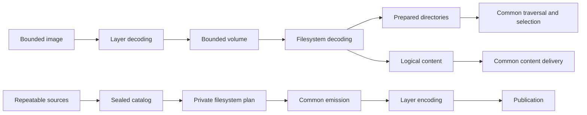

# Architecture simplification and Relic opportunities

fsimg should let a maintainer learn its common contracts once and concentrate
on format rules when adding a filesystem or container. The strongest remaining
opportunities are one description of settings, container-owned plans,
reusable verification operations, and common driver contract tests. Relic offers
a complementary route: derive static generation records through ordinary
queries and render tables or local predicates with small AWK templates.

This analysis covers FAT12/16/32, exFAT, QNX4, QNX6, ImageFS, partition schemes,
containers, and compression. It distinguishes existing foundations from proposed
changes. The [architecture](../specs/architecture.md) and
[specification index](../specs/README.md) remain authoritative. Adopted design
changes belong in those specifications, sequencing in the
[implementation plan](implementation-plan.md), and actionable defects in
[TODO.md](../TODO.md).

## Existing shared foundations

Several substantial simplifications already give additional drivers a common
execution model. Preserve these boundaries when evaluating further changes.

| Foundation | Common owner | Driver responsibility |
| --- | --- | --- |
| Format descriptors and probing | [Format registry](../lib/formats/format.c) | Identity, bounded probe, capabilities, independently optional reader and writer operations |
| Directory preparation and traversal | [Directory engine](../lib/read/directory.c) and [selector](../lib/read/selection.c) | Decode children, validate format metadata, supply namespace keys and private locators |
| Logical content delivery | [Reader](../lib/read/reader.c) | Resolve initialized content to validated physical extents |
| Optional extent storage | [Extent index](../lib/meta/extent.c) | Discover allocation and choose whether an index is useful |
| Collection and payload copying | [Catalog](../lib/write/catalog.c) and [emission](../lib/write/emit.c) | Plan placement and encode metadata |
| [Metadata-loss policy](../specs/design-metadata-loss.md) | `fsimg_writer_loss()` in the [writer](../lib/write/writer.c), with the [calendar](../lib/core/calendar.c) whole-second and DOS conversions | Encode each supported field once and state whether it is preserved |
| Layer composition | [Image reader](../lib/layers/image.c), [disk plan](../lib/layers/plan.c), and [transcode](../lib/layers/transcode.c) | Decode or encode a particular scheme, container, or compression |
| Resources and host authority | Context, bounded I/O, extractor, and publisher | Operate through their contracts |



Readers and writers have independent representations and lifetimes. Stable
catalog IDs and parent links avoid a resident object graph. Metadata streams,
paged arrays, bitsets, and external sorting provide a small vocabulary for
large inputs. None of these components needs a mutable filesystem model.

Namespace identity and allocation identity remain distinct. Several spellings,
such as a FAT long name and its short alias, may identify one directory-entry
occurrence; one comparison key cannot identify two occurrences. Several
occurrences may nevertheless name the same inode. Common namespace validation
must not mistake legal inode sharing for permission to duplicate a name.

Logical content also remains distinct from allocation. For an exFAT file with
10 KiB of logical content and 6 KiB initialized, delivery synthesizes the final
4 KiB without reading its backing storage. Allocation slack is outside the
file. A shared index or verifier must preserve that boundary, confirmed progress
on partial failure, source consistency, and cumulative resource charging.

## Priorities

The priority reflects the obligations a change removes from the next driver
author. Confidence describes the proposed boundary; it is not a performance
measurement or a claim that implementation is complete.

| Opportunity | Priority | Confidence | Main obligation removed |
| --- | --- | --- | --- |
| [Shared settings description](../specs/design-settings.md) | First | High | Repeating option identity, representation, and applicability across subsystems |
| [Private container plans](../specs/design-container-plans.md) | Next | High on ownership; prototype the interface | Extending shared state and cleanup for each container |
| [Common driver contract tests](../specs/design-driver-contract-tests.md) | Alongside each change | High | Reconstructing common acceptance coverage for each driver |
| [Verification helpers and ownership runs](../specs/design-verification-helpers.md) | Incremental | High for payload reads; narrower for ownership | Repeating bounded read, sort, cursor, and cleanup mechanics |
| [Scalar codecs and zlib allocation](../specs/design-binary-primitives.md) | Small independent changes | High | Repeating primitive byte conversion and allocation adapters |
| [Scheme-owned planning details](../specs/design-scheme-planning.md) | With another scheme | Conditional | Teaching common planning every scheme's settings and identity rules |
| [Relic table and template generation](../specs/design-relic-generation.md) | Focused experiment | Existing CLI suffices; benefit to establish | Repeating derived compatibility and local policy definitions |
| [Verification policy generation](../specs/design-generated-verification.md) | Conditional on broader policy reuse | Feasible for predicates, not whole algorithms | Repeating static policy choices; native reconciliation remains |

## Simplifications in C

### One authoritative settings description

The [settings design](../specs/design-settings.md) specifies the target
catalogue, consumers, compatibility rules, and validation criteria.

The private catalogue in [settings.c](../lib/core/settings.c) holds option
identity, value representation, defaults, presence, syntax, applicability, and
enum choices. Each layer's registry record in [stack.c](../lib/layers/stack.c)
references its slice of rows. The library's option checks, layer capability
records, option initializers, the writer's and wrap's filesystem-setting checks,
and the CLI's `-o` conversion in [options.c](../cmd/fsimg/options.c) read those
rows. A finite set of syntax classes suffices; format relationships remain
ordinary validation functions. [job.c](../cmd/fsimg/job.c) encodes and decodes
the settings for the worker explicitly; a coverage test names rows only by
catalogue identity.

The public typed options structures keep their compatibility rules. The worker protocol remains
an explicit byte representation with validated widths, flags, and lengths;
sharing option metadata does not justify copying native structs across it.
Wire-field generation is useful only if it removes another maintained mapping
without obscuring that boundary. It must preserve existing wire semantics and
must not run image-dependent driver logic in the coordinator.

A new option then has one description of its identity and applicability, one
format-specific interpretation, and an explicit transport representation. Test
absent versus explicitly zero values, enum choices, read/write restrictions,
wrong-layer settings, malformed wire values, and CLI/library agreement.

**Complexity balance:** one catalogue and a few typed consumers replace
parallel descriptions. Avoid a general configuration framework, a public
key/value plugin ABI, or callbacks for assignments that a small table expresses.

### Container-owned immutable plans

The [container-plan design](../specs/design-container-plans.md) specifies the
common summary, private extension, ownership, and encoder lifetime.

Filesystem writers embed a small common plan in a driver-owned extension;
[writer.h](../lib/write/writer.h) gives destruction one owner. Containers follow
the same pattern: each writable container embeds `fsimg_container_plan_t` from
[layer.h](../lib/layers/layer.h) first in its private plan, and its
`fsimg_container_writer_t` supplies the constructor, bound, encoder and
destructor together. VHD timestamps, DMG levels, simg blocks and CRC settings,
boot-header fields and the buffered `ifsboot` prefix stay in their drivers.

Common code reads only the summary: granularity, transfer unit, pass count,
identifier and codec dependency. `fsimg_disk_plan_codec()` in
[transcode.c](../lib/layers/transcode.c) reports zlib from that declared
dependency, and `fsimg_disk_plan_free()` in [plan.c](../lib/layers/plan.c)
dispatches destruction to the container that constructed the plan. The
encoder borrows the plan; it does not acquire a second owner for its buffers.

Keep file-setting identity checks, output-alias rejection, output budgets, and
publication common. A plan constructor must leave partial construction safe to
destroy, and every outcome must release the complete extension once. The
change should not introduce another public handle or an independently varying
lifecycle.

**Complexity balance:** one private-plan construction/destruction contract
replaces the shared accumulation of unrelated fields and cleanup knowledge.
Prototype it across fixed VHD, chunked DMG/simg, and boot-image settings before
settling the interface. Preserve deterministic multi-pass encoding and all
pre-output refusals.

### Verification operations with explicit ownership domains

The [verification-helper design](../specs/design-verification-helpers.md)
defines the concrete payload and ownership-run interfaces, failure behavior,
resource costs, and format-specific boundaries.

The payload loops in [exFAT](../lib/formats/exfat/verify.c),
[QNX4](../lib/formats/qnx4/verify.c), [QNX6](../lib/formats/qnx6/verify.c), and
[ImageFS](../lib/formats/ifs/verify.c) read initialized content in bounded
pieces through common delivery. One operation can own this loop and confirmed
byte accounting. Drivers decide whether an object needs reading, including
whether a later name refers to content already checked.

FAT's `verify_file()` fuses allocation-chain validation, ownership recording,
and payload reading. Preserve that useful fusion unless a replacement proves
it avoids a second chain walk or mandatory index.

FAT and exFAT also duplicate ownership-run encoding, sorting, cursor advancement,
bounds checking, and overlap detection. A small bounded utility can own those
mechanics. QNX6's related records include an owner identity, which its system
reservation checks need. Sharing with QNX6 is conditional on preserving those
semantics without forcing extra records or passes on every driver.

The reusable invariant is exclusivity within a driver-defined domain. The
driver identifies distinct objects, supplies every required claim, handles
repeated references, and defines legal sharing. The utility cannot infer
completeness or decide that every physical overlap is corruption. Allocation
bitmap/FAT reconciliation, reserved structures, inode counts, and checksums
remain format-specific.

**Complexity balance:** one run representation and cursor can replace duplicate
mechanics. Do not introduce a general interval database or a universal verifier.
The existing scoped-interval item in [TODO.md](../TODO.md) tracks the smallest
extraction. Result-derived verification policies can be consumed by the same
native verifiers; they do not replace reconciliation or create another store.

### Common driver contract tests

The [contract-test design](../specs/design-driver-contract-tests.md) defines
fixture profiles, capability coverage, common scenarios, fault controls,
and independently specified expectations.

[test/emit.c](../test/emit.c) runs shared emission scenarios against FAT12 and
exFAT. Newer drivers have their own fault fixtures, and
[test/posix.c](../test/posix.c) uses explicit format lists for particular
metadata behaviors. This distribution does not establish absent coverage; it
makes common coverage an obligation each driver author reconstructs.

Introduce a small test profile per applicable driver: a minimal valid fixture,
valid options, expected metadata behavior, and necessary setup. Run common
lifecycle, source failure, poisoned-output, cancellation, limits, and
reproducibility scenarios through those profiles. Compare profiles with the
registry so a newly advertised capability cannot silently miss the common
contract suite. Reader-only formats and specialized container modes need
explicit applicability rather than assumed writer support.

Keep raw-format mutations, corrupt-plan tests, and interoperability oracles
local. Production capabilities may select which tests run, but must not supply
all their expected answers. The rule-based Ruby harness under
[test/spec/](../test/spec/) is another useful declarative surface; additional
format models can reuse its runner without copying FAT's encoding assumptions.

**Complexity balance:** shared scenarios and small fixture adapters replace
copied setup and remembered coverage. A test framework that needs a large
callback interface for every format would fail this test.

### Scheme-owned planning details

The [scheme-planning design](../specs/design-scheme-planning.md) defines the
operations, ownership, normalization, placement constraints, and extension tests.

Partition schemes have operation tables, but `fsimg_disk_plan_init()` in
[plan.c](../lib/layers/plan.c) selects GPT-specific handling by name and otherwise
uses MBR handling. Writer setup in [writer.c](../lib/write/writer.c) also chooses
between their option fields.

When adding another scheme, move option resolution, identity construction, and
partition metadata conversion behind scheme operations. Common code should
continue to own placement, alignment, volume bounds, output accounting, and
publication. A scheme's table footprint remains a declared fact.

**Complexity balance:** this removes scheme identity from common planning, but
with two schemes the explicit branches are understandable. A third scheme
should demonstrate the benefit before a broader abstraction is introduced.

### Smaller shared operations and lifetime improvements

The [binary-primitives design](../specs/design-binary-primitives.md) specifies
scalar endian access and the zlib allocation adapter, including their exact
caller preconditions, ownership, and error semantics.

| Opportunity | Evidence | Smallest useful change |
| --- | --- | --- |
| Endian primitives | [Layer helpers](../lib/layers/layer.h), [QNX4 codecs](../lib/formats/qnx4/codec.c), [QNX6 codecs](../lib/formats/qnx6/codec.c), [ImageFS records](../lib/formats/ifs/records.c), and scratch codecs | Share explicit scalar loads/stores while retaining format record layouts and validation. |
| zlib allocation | [chunks.c](../lib/layers/chunks.c), [dmg.c](../lib/layers/dmg.c), [gzip.c](../lib/layers/gzip.c) | One context-backed adapter preserving checked allocation sizes and the reason allocation failed. |
| Internal header scope | [writer.h](../lib/write/writer.h) includes the broad [layer.h](../lib/layers/layer.h) | Separate stable composition contracts from chunk, plist, codec, and private profile declarations; organize by ownership. |
| Scratch-row validation | `qnx4_row_get()`, `qnx6_row_get()`, and `ifs_row_get()` in their planning modules | Validate decoded rows at their owning read boundary; the QNX4/QNX6 gap is already in TODO.md. Field-code generation must not replace semantic checks. |
| Source failure ownership | [source.c](../lib/source/source.c) and [writer.c](../lib/write/writer.c) | Have source operations report status and let the writer lifecycle own terminal failure, so cleanup timing does not depend on whether source or sink failed. |
| Raw intermediate decision | `fsimg_job_needs_raw()` in [job.c](../cmd/fsimg/job.c) and library output planning | Share the predicate over the stack, write mode, and sink kind instead of maintaining CLI and library versions. |
| Descriptor adoption | `fsimg_writer_output()` in [writer.c](../lib/write/writer.c) | One helper returns an adopted I/O object or has closed the consumed descriptor on failure. |
| Layer error attribution | `layer_failed()` calls in [image.c](../lib/layers/image.c) and chunk failures | Put attribution at narrow dispatch boundaries so new operation callers do not need a separate reporting step. |

These are independent extractions, not reasons to create a catch-all utility
module. Preserve argument order when consolidating `bcopy(src, dst, n)` calls.
Changes to failures, ownership, or scratch validation need regression evidence,
even when their interfaces are small.

## Declarative rules and Relic

The [generation design](../specs/design-relic-generation.md) uses Relic's
ordinary query results as input to small AWK renderers. The
[verification-policy design](../specs/design-generated-verification.md) applies
the same pattern to a second family of local checks. Both use the existing
engine; neither requires a new Relic compiler backend.

### Generate descriptions rather than compile rule programs

Relic evaluates trusted metadata during development. The query answers describe
what a known C template should contain: a table entry, a numeric profile, or a
local policy predicate. They do not contain the answer to checking a particular
image. A renderer instantiates a finite family of templates from those records.


For example, profiles name their timestamp encodings, and encodings name their
bounds. A join derives each profile's table row:

```prolog
profile_time(qnx4, seconds31, utc).
profile_time(qnx6, seconds32, utc).
encoding_bounds(seconds31, zero, i32_max).
encoding_bounds(seconds32, zero, u32_max).

timestamp_output(table, P, unsigned_seconds, Lo, Hi, B) :-
    profile_time(P, E, B), encoding_bounds(E, Lo, Hi).
```

An ordinary sorted TSV query returns rows such as
`table qnx4 unsigned_seconds zero i32_max utc` (spaces shown for tabs). The
renderer maps `i32_max` to a literal C constant; it does not convert it through
AWK's floating-point arithmetic. A related row selects a known whole-second
fidelity template. The emitted function accepts runtime C timestamps, including
full-width signed values, and the existing writer still selects fallback bytes
and applies loss policy.

A concrete schema belongs to its family. Timestamp and verification rows need
not be forced into a generic instruction format with anonymous parameters.
Known keys map to fixed C names; known template arguments map to fixed code.
Unknown tokens, duplicate/conflicting definitions, missing required rows and
failed queries stop generation. There is no arbitrary expression parser,
interpreter, optimizer or host command in the renderer.

### What works for each design

| Subject | Result-driven generation can do | Responsibility retained in C |
| --- | --- | --- |
| Static compatibility tables | Derive entries from shared facts and relations | Consume the typed table and enforce application semantics |
| Local validation | Select and parameterize a known predicate template | Decode inputs, own types and bounds, choose existing errors and loss behavior |
| Verification policy | Derive which finite check applies to each object class | Collect occurrences, sort, group, merge, preserve failure order and manage resources |
| General whole-image verification | No arbitrary algorithm synthesis through this mechanism | Explicit bounded algorithms remain native; a broader compiler needs a separate justification |

The first design is practical for small generated tables and template-based
predicates with the existing Relic CLI. The second works for policy selection,
but it does not remove the native reference-reconciliation algorithm. Its
potential benefit is smaller than a whole-verifier generator's and its cost
must be assessed accordingly.

### Verification example and its actual boundary

QNX6 compares a referenced allocated inode's name count with its stored link
count. QNX4's table records use that comparison for non-directories; directory
link counts follow `2 + subdirectories`, checked during directory preparation.
Static metadata can derive `all_used` versus `nondirectory` as the equality
scope. The renderer uses that scope to select one condition in a fixed C
predicate. Its key identifies a C function, not a second hardcoded policy map.
Independent expectations catch a syntactically valid but incorrect scope.

The native driver calls that predicate only after its existing record decode
and reference count succeed. It retains these operations:

* Reference occurrences retain multiplicity, including the appropriate dot
  references and omitted entries. No set of target IDs replaces them.
* QNX6 consumes a reference group and its lookahead before reading a new inode
  window. QNX4 reads the table window before consuming that slot's group.
* Successful source traversal seals the reference stream; the merge determines
  each count and handles empty groups, free records and trailing references.
* Allocation ownership, checksums, source stability, error mapping and final
  verification completion remain at their established owners.

The rule engine never sees runtime image facts, offsets or counters. Native
`uint64_t` arithmetic and bounded storage therefore retain their existing
contracts without teaching AWK large-number arithmetic or asking Relic to
execute an external-memory query plan.

These short QNX predicates alone are not a sufficient reason to add rules,
renderers and generated artifacts. Keep them handwritten unless several
consumers or a larger policy family make derived metadata worth maintaining.
The design is a viable limited pattern, not a requirement to generate every
format check.

### Tool and output contracts

The pipeline uses Relic's documented CLI rather than private AST or plan data.
One family query produces a fixed-column TSV schema with closed token domains.
The script checks the query process status before running AWK; a shell pipeline
must not hide producer failure behind the renderer's exit status. Rendering
validates the complete result set before installing artifacts. Ordinary builds
consume checked-in C and do not invoke the generator or link Relic.

The sources, renderer, query, tool identity and generated outputs have
reproducible provenance. No host path or clock value enters generated bytes.
Known C constants are emitted as text; runtime values remain C values. The
renderer cannot infer semantic truth from a row being well formed, so tests
separate transport/template correctness from format correctness.

Relic can be extended when a concrete generic need warrants it. A change belongs
in Relic only if it is useful beyond fsimg, consistent with that project's
small relational model, and supported by its own design and tests. Format names,
private record layouts, C validation templates and fsimg storage contracts stay
outside the engine. The current result-rendering workflow needs no extension;
that is a baseline capability statement, not a prohibition on future evolution.

### Evidence and adoption gate

A useful proof runs the whole development pipeline: evaluate the actual rules,
check the query rows, run the AWK renderer, compile the emitted C, and exercise
independently specified runtime values. It also checks missing/conflicting rows,
unknown tokens, a producer that prints a prefix and fails, and a schema-valid
policy mutation that must fail the semantic oracle.

A successful proof establishes a finite template family's feasibility. Native
image integration additionally requires the existing contract suites, malformed
images, resource/failure checks and independent implementations. Neither the
query's own output nor the generated function is the expected-answer oracle.

Count the rule facts, schemas, renderer cases, generated code, integration and
tests together. Adopt a family only when it removes repeated policy ownership
or derivation across the system. A direct table or shared C helper remains the
better implementation when the generation workflow merely relocates a small,
clear operation.

## Boundaries to preserve

Keep geometry construction, allocation discovery, directory interpretation,
name comparison, and native qualification explicit. FAT chains, QNX6 block
trees, QNX4 extents, and ImageFS path records are concrete evidence that one
universal filesystem model would need many exceptions.

The [sizing design](../specs/design-sizing.md) already specifies finite candidate
sets, catalog totals, and deterministic choices. Rules may check candidate
legality; replacing the search with general logical inference has no demonstrated
benefit. Similarly, a field schema can remove repetitive codec assignments,
but checksums, cross-field relations, and safe I/O scheduling need their own
clear owners.

Preserve the fixed layer slots and explicit spool/raw-intermediate budgets.
The supported containers do not justify an arbitrary recursive layer graph.
Keep extraction, publication, and CLI supervision separate: their distinct
host authorities and failure semantics explain much of their complexity.
Static registration remains sufficient; no dynamic plugin ABI is required.

## Recommended order and validation

Consolidate settings first, with common contract-test profiles accompanying
the conversion. Next prototype private container plans
and extract the narrow verification and scalar helpers. Keep the smaller
lifetime corrections independently reviewable. Revisit scheme planning with a
new scheme that can prove the abstraction useful.

Evaluate Relic generation as a separate experiment using the sequence above.
Its outcome decides which derived tables and local policies justify generation;
runtime verification algorithms remain handwritten in this design.
Before implementing an adopted architectural change, update its owning design
and the cross-subsystem contracts; major new components need the design and
index links required by the working agreement.

For each implementation, compare the concepts and obligations added and removed,
not only line counts. Preserve image bytes, traversal and selection behavior,
metadata losses, verification scope, error classes, confirmed I/O progress, and
cleanup outcomes. Measure metadata passes, I/O calls, charged work, memory,
and peak scratch on the same fixtures and budgets. Test wide directories,
fragmentation, aliases, zero tails, changed sources, reused sinks, and fault
paths relevant to the operation.

Use the commands and review requirements in [build.md](build.md) and
[AGENTS.md](../AGENTS.md): the ordinary suite, affected independent-tool checks,
required sanitizer/fuzz runs, the code-review subagent before pre-commit tests,
and the specified external reviewer. Review correctness, design, security and
information leaks, and readability with concrete functions as evidence.
Nontrivial bug fixes require a failing regression before the fix. Platform
behavior changes require Linux and FreeBSD evidence in addition to macOS;
unavailable or skipped checks are reported explicitly.

Adopt a simplification only when it removes an operation, state, cleanup rule,
or repeated decision from callers across the system. Hiding the same obligations
behind another interface is insufficient.
