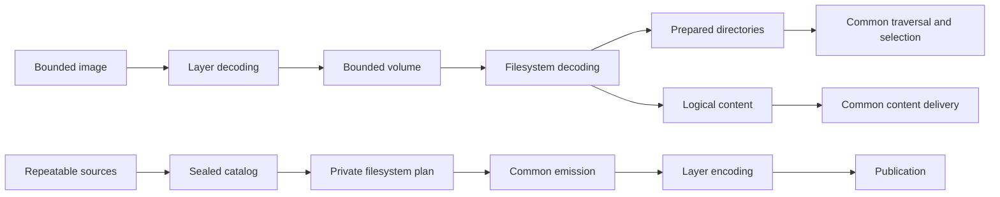
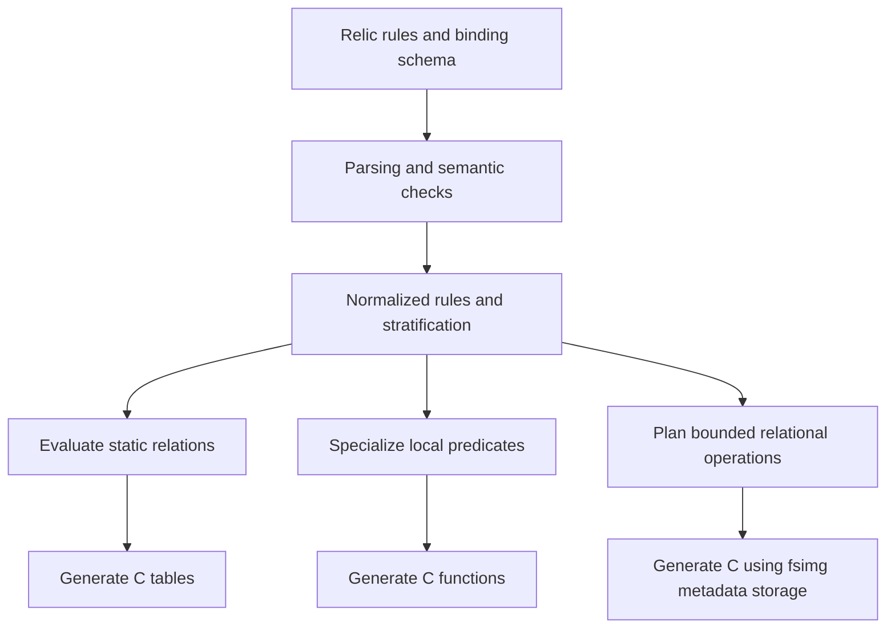

# Architecture simplification and Relic opportunities

fsimg should let a maintainer learn its common contracts once and concentrate
on format rules when adding a filesystem or container. The strongest remaining
opportunities are one description of settings, container-owned plans,
reusable verification operations, and common driver contract tests. Relic offers a complementary route: describe relational rules
once and generate tables, predicates, or bounded verification operations in C.

This analysis covers FAT12/16/32, exFAT, QNX4, QNX6, ImageFS, partition schemes,
containers, and compression. It distinguishes existing foundations from proposed
changes. The [architecture](../specs/architecture.md) and
[specification index](../specs/README.md) remain authoritative. Adopted design
changes belong in those specifications, sequencing in the
[implementation plan](implementation-plan.md), and actionable defects in
[TODO.md](../TODO.md).

## Existing shared foundations

Several substantial simplifications already give additional drivers a common
execution model. Preserve these boundaries when evaluating further changes.

| Foundation | Common owner | Driver responsibility |
| --- | --- | --- |
| Format descriptors and probing | [Format registry](../lib/formats/format.c) | Identity, bounded probe, capabilities, independently optional reader and writer operations |
| Directory preparation and traversal | [Directory engine](../lib/read/directory.c) and [selector](../lib/read/selection.c) | Decode children, validate format metadata, supply namespace keys and private locators |
| Logical content delivery | [Reader](../lib/read/reader.c) | Resolve initialized content to validated physical extents |
| Optional extent storage | [Extent index](../lib/meta/extent.c) | Discover allocation and choose whether an index is useful |
| Collection and payload copying | [Catalog](../lib/write/catalog.c) and [emission](../lib/write/emit.c) | Plan placement and encode metadata |
| [Metadata-loss policy](../specs/design-metadata-loss.md) | `fsimg_writer_loss()` in the [writer](../lib/write/writer.c), with the [calendar](../lib/core/calendar.c) whole-second and DOS conversions | Encode each supported field once and state whether it is preserved |
| Layer composition | [Image reader](../lib/layers/image.c), [disk plan](../lib/layers/plan.c), and [transcode](../lib/layers/transcode.c) | Decode or encode a particular scheme, container, or compression |
| Resources and host authority | Context, bounded I/O, extractor, and publisher | Operate through their contracts |



Readers and writers have independent representations and lifetimes. Stable
catalog IDs and parent links avoid a resident object graph. Metadata streams,
paged arrays, bitsets, and external sorting provide a small vocabulary for
large inputs. None of these components needs a mutable filesystem model.

Namespace identity and allocation identity remain distinct. Several spellings,
such as a FAT long name and its short alias, may identify one directory-entry
occurrence; one comparison key cannot identify two occurrences. Several
occurrences may nevertheless name the same inode. Common namespace validation
must not mistake legal inode sharing for permission to duplicate a name.

Logical content also remains distinct from allocation. For an exFAT file with
10 KiB of logical content and 6 KiB initialized, delivery synthesizes the final
4 KiB without reading its backing storage. Allocation slack is outside the
file. A shared index or verifier must preserve that boundary, confirmed progress
on partial failure, source consistency, and cumulative resource charging.

## Priorities

The priority reflects the obligations a change removes from the next driver
author. Confidence describes the proposed boundary; it is not a performance
measurement or a claim that implementation is complete.

| Opportunity | Priority | Confidence | Main obligation removed |
| --- | --- | --- | --- |
| [Shared settings description](../specs/design-settings.md) | First | High | Repeating option identity, representation, and applicability across subsystems |
| [Private container plans](../specs/design-container-plans.md) | Next | High on ownership; prototype the interface | Extending shared state and cleanup for each container |
| Common driver contract tests | Alongside each change | High | Reconstructing common acceptance coverage for each driver |
| Verification helpers and ownership runs | Incremental | High for payload reads; narrower for ownership | Repeating bounded read, sort, cursor, and cleanup mechanics |
| Scalar codecs and zlib allocation | Small independent changes | High | Repeating primitive byte conversion and allocation adapters |
| Scheme-owned planning details | With another scheme | Conditional | Teaching common planning every scheme's settings and identity rules |
| Relic table and predicate generation | Focused experiment | High feasibility; benefit to establish | Repeating derived compatibility and validation logic |
| Relic generation of whole-image verification | After the predicate experiment | Promising; backend work required | Handwriting relational reconciliation algorithms |

## Simplifications in C

### One authoritative settings description

The [settings design](../specs/design-settings.md) specifies the target
catalogue, consumers, compatibility rules, and validation criteria.

The library's `layer_settings` in [stack.c](../lib/layers/stack.c) describes
keys, storage, presence, and applicability. The CLI's `layer_keys` in
[options.c](../cmd/fsimg/options.c) repeats keys, field offsets, presence flags,
and read applicability while adding syntax. [job.c](../cmd/fsimg/job.c)
separately encodes and decodes the settings for the worker. Filesystem settings
have another applicability check in `settings_supported()` in
[writer.c](../lib/write/writer.c).

Introduce one private typed catalogue for option identity, value representation,
presence, applicability, and enum choices. Common code can use it for capability
enumeration, default/presence checks, and CLI conversion. Descriptors can refer
to the settings they support. A finite set of syntax classes is sufficient;
format relationships remain ordinary validation functions.

Start with the duplicated library and CLI metadata. Keep the public typed
options structures and their compatibility rules. The worker protocol remains
an explicit byte representation with validated widths, flags, and lengths;
sharing option metadata does not justify copying native structs across it.
Wire-field generation is useful only if it removes another maintained mapping
without obscuring that boundary. It must preserve existing wire semantics and
must not run image-dependent driver logic in the coordinator.

A new option then has one description of its identity and applicability, one
format-specific interpretation, and an explicit transport representation. Test
absent versus explicitly zero values, enum choices, read/write restrictions,
wrong-layer settings, malformed wire values, and CLI/library agreement.

**Complexity balance:** one catalogue and a few typed consumers replace
parallel descriptions. Avoid a general configuration framework, a public
key/value plugin ABI, or callbacks for assignments that a small table expresses.

### Container-owned immutable plans

The [container-plan design](../specs/design-container-plans.md) specifies the
common summary, private extension, ownership, and encoder lifetime.

Filesystem writers embed a small common plan in a driver-owned extension;
[writer.h](../lib/write/writer.h) gives destruction one owner. Containers use
one `fsimg_container_settings_t` in [layer.h](../lib/layers/layer.h) that combines
VHD timestamps, DMG levels, simg blocks and CRC settings, a boot-header settings
structure, and a buffered prefix.

Common code consequently knows container details. `fsimg_disk_plan_codec()` in
[transcode.c](../lib/layers/transcode.c) interprets a nonzero container level as
zlib use. `fsimg_disk_plan_free()` in [plan.c](../lib/layers/plan.c) frees a
container's buffered setting directly.

Apply the filesystem plan pattern to containers: a common summary plus private
resolved state owned and destroyed by the selected container. The summary
exposes the facts composition needs: granularity, transfer unit, pass count,
encoded-size bound, and reporting information. The encoder borrows the plan;
it does not acquire a second owner for its buffers.

Keep file-setting identity checks, output-alias rejection, output budgets, and
publication common. A plan constructor must leave partial construction safe to
destroy, and every outcome must release the complete extension once. The
change should not introduce another public handle or an independently varying
lifecycle.

**Complexity balance:** one private-plan construction/destruction contract
replaces the shared accumulation of unrelated fields and cleanup knowledge.
Prototype it across fixed VHD, chunked DMG/simg, and boot-image settings before
settling the interface. Preserve deterministic multi-pass encoding and all
pre-output refusals.

### Verification operations with explicit ownership domains

The payload loops in [exFAT](../lib/formats/exfat/verify.c),
[QNX4](../lib/formats/qnx4/verify.c), [QNX6](../lib/formats/qnx6/verify.c), and
[ImageFS](../lib/formats/ifs/verify.c) read initialized content in bounded
pieces through common delivery. One operation can own this loop and confirmed
byte accounting. Drivers decide whether an object needs reading, including
whether a later name refers to content already checked.

FAT's `verify_file()` fuses allocation-chain validation, ownership recording,
and payload reading. Preserve that useful fusion unless a replacement proves
it avoids a second chain walk or mandatory index.

FAT and exFAT also duplicate ownership-run encoding, sorting, cursor advancement,
bounds checking, and overlap detection. A small bounded utility can own those
mechanics. QNX6's related records include an owner identity, which its system
reservation checks need. Sharing with QNX6 is conditional on preserving those
semantics without forcing extra records or passes on every driver.

The reusable invariant is exclusivity within a driver-defined domain. The
driver identifies distinct objects, supplies every required claim, handles
repeated references, and defines legal sharing. The utility cannot infer
completeness or decide that every physical overlap is corruption. Allocation
bitmap/FAT reconciliation, reserved structures, inode counts, and checksums
remain format-specific.

**Complexity balance:** one run representation and cursor can replace duplicate
mechanics. Do not introduce a general interval database or a universal verifier.
The existing scoped-interval item in [TODO.md](../TODO.md) tracks the smallest
extraction. Relic-generated reconciliation is a larger alternative discussed
below; it should reuse these operations rather than create a competing store.

### Common driver contract tests

[test/emit.c](../test/emit.c) runs shared emission scenarios against FAT12 and
exFAT. Newer drivers have their own fault fixtures, and
[test/posix.c](../test/posix.c) uses explicit format lists for particular
metadata behaviors. This distribution does not establish absent coverage; it
makes common coverage an obligation each driver author reconstructs.

Introduce a small test profile per applicable driver: a minimal valid fixture,
valid options, expected metadata behavior, and necessary setup. Run common
lifecycle, source failure, poisoned-output, cancellation, limits, and
reproducibility scenarios through those profiles. Compare profiles with the
registry so a newly advertised capability cannot silently miss the common
contract suite. Reader-only formats and specialized container modes need
explicit applicability rather than assumed writer support.

Keep raw-format mutations, corrupt-plan tests, and interoperability oracles
local. Production capabilities may select which tests run, but must not supply
all their expected answers. The rule-based Ruby harness under
[test/spec/](../test/spec/) is another useful declarative surface; additional
format models can reuse its runner without copying FAT's encoding assumptions.

**Complexity balance:** shared scenarios and small fixture adapters replace
copied setup and remembered coverage. A test framework that needs a large
callback interface for every format would fail this test.

### Scheme-owned planning details

Partition schemes have operation tables, but `fsimg_disk_plan_init()` in
[plan.c](../lib/layers/plan.c) selects GPT-specific handling by name and otherwise
uses MBR handling. Writer setup in [writer.c](../lib/write/writer.c) also chooses
between their option fields.

When adding another scheme, move option resolution, identity construction, and
partition metadata conversion behind scheme operations. Common code should
continue to own placement, alignment, volume bounds, output accounting, and
publication. A scheme's table footprint remains a declared fact.

**Complexity balance:** this removes scheme identity from common planning, but
with two schemes the explicit branches are understandable. A third scheme
should demonstrate the benefit before a broader abstraction is introduced.

### Smaller shared operations and lifetime improvements

| Opportunity | Evidence | Smallest useful change |
| --- | --- | --- |
| Endian primitives | [Layer helpers](../lib/layers/layer.h), [QNX4 codecs](../lib/formats/qnx4/codec.c), [QNX6 codecs](../lib/formats/qnx6/codec.c), [ImageFS records](../lib/formats/ifs/records.c), and scratch codecs | Share explicit scalar loads/stores while retaining format record layouts and validation. |
| zlib allocation | [chunks.c](../lib/layers/chunks.c), [dmg.c](../lib/layers/dmg.c), [gzip.c](../lib/layers/gzip.c) | One context-backed adapter preserving checked allocation sizes and the reason allocation failed. |
| Internal header scope | [writer.h](../lib/write/writer.h) includes the broad [layer.h](../lib/layers/layer.h) | Separate stable composition contracts from chunk, plist, codec, and private profile declarations; organize by ownership. |
| Scratch-row validation | `qnx4_row_get()`, `qnx6_row_get()`, and `ifs_row_get()` in their planning modules | Validate decoded rows at their owning read boundary; the QNX4/QNX6 gap is already in TODO.md. Field-code generation must not replace semantic checks. |
| Source failure ownership | [source.c](../lib/source/source.c) and [writer.c](../lib/write/writer.c) | Have source operations report status and let the writer lifecycle own terminal failure, so cleanup timing does not depend on whether source or sink failed. |
| Raw intermediate decision | `fsimg_job_needs_raw()` in [job.c](../cmd/fsimg/job.c) and library output planning | Share the predicate over the stack, write mode, and sink kind instead of maintaining CLI and library versions. |
| Descriptor adoption | `fsimg_writer_output()` in [writer.c](../lib/write/writer.c) | One helper returns an adopted I/O object or has closed the consumed descriptor on failure. |
| Layer error attribution | `layer_failed()` calls in [image.c](../lib/layers/image.c) and chunk failures | Put attribution at narrow dispatch boundaries so new operation callers do not need a separate reporting step. |

These are independent extractions, not reasons to create a catch-all utility
module. Preserve argument order when consolidating `bcopy(src, dst, n)` calls.
Changes to failures, ownership, or scratch validation need regression evidence,
even when their interfaces are small.

## Declarative rules and Relic

Relic is the intended Datalog tool for this work. Use its language and semantic
analysis as the foundation for experiments. A separate fsimg rule language would
add another parser and another definition of negation, aggregation, and errors.

### Where rules help

| Subject | Useful generated result | Boundary to preserve |
| --- | --- | --- |
| Profile and feature compatibility | C tables or predicates for supported combinations | Native qualification determines which combinations are facts. |
| Settings and metadata policy | Applicability and loss predicates | Typed public options, CLI syntax, diagnostics, and transport remain explicit. |
| Record-local validation | Functions over decoded records and profile values | Checked decoding and bounds precede access; undefined input is distinct from false. |
| Inode references and link counts | Grouped references merged with inode records | Occurrence identity, implicit references, verification scope, and owner identity |
| Allocation ownership | Ordered range checks and allocation reconciliation | Compact extents, permitted sharing, reserved regions, and complete inventories |
| Geometry legality | Predicates over a bounded set of candidates | Checked arithmetic and the sizing design's search and tie-break policy |
| Field layouts | Explicit record codecs, if repetition justifies generation | A field schema is more direct than Datalog for offsets and widths. |

Relations are especially useful when several independently stated facts combine
to determine a result. A small C table remains sufficient when it already
expresses the complete relationship, as the boot-machine table does. Datalog
becomes valuable when it removes repeated implications, joins, and reconciliation
logic across profiles or formats.

Payload copying, bounded I/O, source reopening, cleanup, extraction, and
publication remain operational code. Their ordering, authority, and failure
contracts should stay visible in C.

### Relic capabilities and the generation boundary

The inspected Relic checkout is `~/relic`. The supporting files are listed
relative to that checkout so these references do not depend on one developer's
absolute home path:

| Relic evidence | Relevant contract |
| --- | --- |
| `README.md`, `specs/architecture.md` | C11 engine and library, BSD-2-Clause, direct evaluation, stratified negation and aggregates |
| `lib/plan.h`, `specs/design-planning.md` | Explicit scan, lookup, membership, filter, assignment, aggregate, and emit operations |
| `lib/exec.h` | Executor yields batches and leaves insertion to its caller; bounded execution quanta let evaluation observe interruption |
| `lib/arith.c`, `specs/language.md` | Checked signed 64-bit arithmetic and defined evaluation errors |
| `lib/relation.h`, `specs/design-storage.md` | Resident tuple arrays and indexes |
| `include/relic.h`, `specs/design-memory.md`, `specs/design-api.md` | Memory accounting, its exclusions, context lifetimes, and interruption |

The engine executes plans over its own relations. C source generation is an
additional backend; the inspected checkout provides no such emitter. Its
memory limit does not cover all allocations or peak growth, and there is no
configured general step/time limit. Those are different contracts from fsimg's
aggregate context budget and cumulative work limits.

There are three distinct uses:

1. **Evaluate static rules during generation.** Run Relic over profile facts and
   render the resulting relations as C tables. The evaluator already provides
   the logical computation; a small deterministic renderer supplies the output.
2. **Specialize dynamic predicates.** Generate ordinary C functions taking
   decoded record fields, options, and profile values. A restricted backend can
   compile supported rule shapes without a runtime relation database.
3. **Generate whole-image verification.** Lower relational rules to fsimg's
   bounded streams, external sorts, grouping, and merge operations. This needs
   a storage-aware backend as well as C emission.



Relic's execution plan is a useful model for a backend, but its operations
already contain pointers to runtime relations and physical index information.
Establish a symbolic generation boundary around normalized rules and relation
identities before committing to those objects. A C emitter that retains the
same resident relation engine also retains its storage and dependency costs.

Relic is a development dependency in this proposal. Generated code belongs to
the normal fsimg build, whose runtime dependency policy remains libc, host APIs,
and system zlib. Shipping generated C should not silently embed the entire
Relic engine. Review the provenance and license of any generated support code
as well as the generator itself.

### Example of inode reconciliation

`verify_inodes()` in [QNX6 verification](../lib/formats/qnx6/verify.c) manually
merges sorted references with a sequential inode scan. Its checks include a
referenced inode being allocated, an allocated inode having references, link
counts agreeing, and the free-inode count matching the header.

A fragment in Relic syntax expresses the first two relations:

```prolog
referenced(S, I) :- reference(S, _, I).

named_free_inode(S, I) :-
    inventory_complete(S), referenced(S, I), not allocated_inode(S, I).

unreferenced_inode(S, I) :-
    inventory_complete(S), allocated_inode(S, I), not referenced(S, I).
```

`S` is the verification domain, such as the selected snapshot. Each
`reference(S, Occurrence, I)` fact has a distinct occurrence identity, which a
link-count aggregate retains even though the `referenced` projection drops it.
The driver supplies the appropriate root, dot, and other implicit references.
The fragment assumes the format requires every allocated inode in that domain
to have a reference; another format can define a narrower inventory.

A backend can implement the rules with an external sort of references by inode,
grouped counting, and a merge against inode records. It need not retain all
facts in memory or materialize every intermediate relation. Producing that
plan is a substantive compiler feature, not an automatic consequence of writing
the rules or emitting C.

### Allocation rules and compact representations

Ownership rules can state that claimed storage is allocated, allocations
without owners need a permitted explanation, overlaps need a permitted sharing
relationship, and reserved regions admit only particular roles.

Keep claims as intervals with domain and owner identity. Expanding a large
sparse image to one fact per block merely to satisfy a rule engine defeats the
storage design. A driver may still scan a bitmap when verification requires it;
that does not require retaining each scanned bit as a fact.

An all-pairs overlap rule can have quadratic output. If the required result is
one deterministic corruption witness, a backend can choose an ordered scan when
the rule semantics permit it. Arbitrary sharing policies may need more state;
only support them when their execution strategy and bounds are explicit.
Returning the same logical answer alone does not establish acceptable resource
behavior.

### Requirements for generated validators

The production subset should begin with nonrecursive rules, stratified
negation, and a small set of aggregates whose execution plans are understood.
Reject unsupported shapes during generation. Supporting every Relic program is
not a prerequisite for useful generated validators.

* **Typed bindings and numeric ranges.** Relic deliberately has untyped columns
  and signed 64-bit integers; fsimg has unsigned 64-bit offsets and lengths.
  Define each input column's C representation and validate conversions. A pilot
  can use values proven at most `INT64_MAX`; broader arithmetic needs a defined
  unsigned mapping or a Relic extension. A binding schema need not change the
  general language's type system.
* **Safe fact extraction.** Decode framing and bounds before producing a fact
  that depends on them. Missing, malformed, and unexamined fields must not all
  become an absent tuple. An evaluation error remains an error, including an
  overflow; dropping a failed binding can make a negated rule accept bad data.
* **Complete domains for negation.** Stratification completes derived relations
  over the supplied facts; it cannot prove that a lazy scanner supplied every
  image fact. Establish inventory completeness before absence checks. Selected
  traversal cannot infer whole-volume unreferenced objects.
* **Set semantics and occurrences.** Preserve identities for distinct directory
  slots, names, and allocation claims. Set deduplication must not erase the
  multiplicity needed to detect duplicate claims or check link counts.
* **Resource ownership.** Every generated dynamic operation uses the existing
  fsimg session, context, cancellation, and scratch contracts. Plans must make
  intermediate storage and passes inspectable. No hidden resident fallback,
  duplicate full catalog, or uncharged auxiliary cache is acceptable.
* **Deterministic diagnostics.** Specify status, scope, attribution, and
  precedence when several violations apply. Rule scheduling, join ordering,
  and thread count must not choose a different public failure by accident.
  Diagnostic witnesses and provenance storage remain bounded.
* **Readable artifacts.** Emit named operations, rule identifiers, and source
  locations. Keep generated output deterministic and check regeneration in CI.
  Generated C remains ASCII-only and reviewable under the project style guide.
* **Independent evidence.** Comparing Relic evaluation with generated C tests
  the lowering. Independently authored fixtures, malformed inputs, and external
  implementations test the rules and decoders. Neither comparison replaces the
  other.

These requirements make the generation backend an explicit part of the
security boundary. A rule that needs an unsupported storage strategy should
fail generation rather than quietly select a resource-intensive algorithm.

### Relic experiments and acceptance criteria

Use Relic's existing evaluator as a reference while developing the backend.
Keep fixture facts small enough for that evaluator and exercise production
scale separately through generated C.

1. Derive static compatibility tables to establish deterministic generation,
   traceability, and ordinary builds that need no generator.
2. Select a record-local validation family with meaningful QNX4/QNX6 overlap.
   Generate C predicates and compare them with Relic on valid, invalid, and
   undefined-input cases. Use a second format to test the boundary, not merely
   a second spelling of the first predicate.
3. Express QNX6 inode reconciliation and generate its sort/group/merge path.
   Compare outcomes with the existing verifier, including damaged references,
   repeated names, omitted entries, link counts, and resource failures.
4. Express the corresponding QNX4 checks. Accept broader adoption only if the
   same small backend accommodates their different identities and implicit
   references without scattering format-specific exceptions through it.
5. Consider ownership intervals and bounded geometry constraints only after
   the earlier experiments demonstrate a maintenance benefit.

Count the rules, bindings, generator, support operations, generated artifacts,
and tests when judging complexity. The success criterion is that a new driver
states fewer rules and owns fewer mechanisms while preserving output and
resource contracts. If annotations restate the original C control flow, a shared
C operation is the simpler outcome. If C helpers and generation address the
same operation, generated code should call the helper; avoid two owners.

## Boundaries to preserve

Keep geometry construction, allocation discovery, directory interpretation,
name comparison, and native qualification explicit. FAT chains, QNX6 block
trees, QNX4 extents, and ImageFS path records are concrete evidence that one
universal filesystem model would need many exceptions.

The [sizing design](../specs/design-sizing.md) already specifies finite candidate
sets, catalog totals, and deterministic choices. Rules may check candidate
legality; replacing the search with general logical inference has no demonstrated
benefit. Similarly, a field schema can remove repetitive codec assignments,
but checksums, cross-field relations, and safe I/O scheduling need their own
clear owners.

Preserve the fixed layer slots and explicit spool/raw-intermediate budgets.
The supported containers do not justify an arbitrary recursive layer graph.
Keep extraction, publication, and CLI supervision separate: their distinct
host authorities and failure semantics explain much of their complexity.
Static registration remains sufficient; no dynamic plugin ABI is required.

## Recommended order and validation

Consolidate settings first, with common contract-test profiles accompanying
the conversion. Next prototype private container plans
and extract the narrow verification and scalar helpers. Keep the smaller
lifetime corrections independently reviewable. Revisit scheme planning with a
new scheme that can prove the abstraction useful.

Evaluate Relic generation as a separate experiment using the sequence above.
Its outcome can guide how much relational verification remains handwritten.
Before implementing an adopted architectural change, update its owning design
and the cross-subsystem contracts; major new components need the design and
index links required by the working agreement.

For each implementation, compare the concepts and obligations added and removed,
not only line counts. Preserve image bytes, traversal and selection behavior,
metadata losses, verification scope, error classes, confirmed I/O progress, and
cleanup outcomes. Measure metadata passes, I/O calls, charged work, memory,
and peak scratch on the same fixtures and budgets. Test wide directories,
fragmentation, aliases, zero tails, changed sources, reused sinks, and fault
paths relevant to the operation.

Use the commands and review requirements in [build.md](build.md) and
[AGENTS.md](../AGENTS.md): the ordinary suite, affected independent-tool checks,
required sanitizer/fuzz runs, the code-review subagent before pre-commit tests,
and the specified external reviewer. Review correctness, design, security and
information leaks, and readability with concrete functions as evidence.
Nontrivial bug fixes require a failing regression before the fix. Platform
behavior changes require Linux and FreeBSD evidence in addition to macOS;
unavailable or skipped checks are reported explicitly.

Adopt a simplification only when it removes an operation, state, cleanup rule,
or repeated decision from callers across the system. Hiding the same obligations
behind another interface is insufficient.
