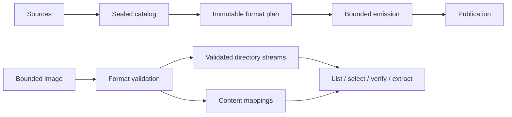

# Architecture simplification opportunities

This document analyzes opportunities to simplify fsimg's internal architecture
using the FAT and exFAT implementations as evidence. It records proposals for
evaluation; the authoritative contracts remain in
[specs/architecture.md](../specs/architecture.md). Adopting a proposal requires
the relevant specification changes before implementation.

The goal is an architecture where a maintainer can predict where every
responsibility belongs, and adding a format introduces mostly format rules.
Architectural beauty comes from a small vocabulary, visible data flow, and
contracts that remove obligations from callers.

## Foundation and central model

The existing foundation is strong: bounded resources, independent readers and
writers, immutable planning, and explicit ownership of extraction and
publication. The opportunity is to consolidate mechanics that FAT and exFAT
implement separately while keeping their filesystem rules explicit.



Readers and writers retain independent representations and lifetimes. They
share a small vocabulary and the infrastructure that gives it strong
guarantees.

## Shared extent storage

Both formats describe physical runs using the same three values. A proposed
shared representation is:

```c
typedef struct fsimg_extent {
	uint64_t logical_offset;
	uint64_t image_offset;
	uint64_t length;
} fsimg_extent_t;
```

FAT implements index construction and binary search in
[`lib/formats/fat/read.c`](../lib/formats/fat/read.c), while exFAT implements
another spillable index and lookup cache in
[`lib/formats/exfat/allocation.c`](../lib/formats/exfat/allocation.c).

One small extent-index implementation could own:

* Encoded record storage and bounded growth.
* Ordering, coverage, and checked offset arithmetic.
* Sequential lookup and binary search.
* Cleanup and session accounting.

Drivers would continue to discover and validate allocations. FAT retains its
chain rules; exFAT retains its bitmap, contiguous-stream, and preallocation
rules. Geometry-specific checks remain explicit at the driver boundary.

Sharing storage does not require sharing discovery strategy. FAT can retain
its inexpensive sequential cursor and build an index on a seek. exFAT can
prepare mappings when needed for its metadata validation. Neither path should
acquire an eager full-file index merely to fit the shared interface.

Logical length, initialized length, and allocated length must remain distinct.
Their distinction makes exFAT's zero-tail behavior understandable and prevents
allocation slack from becoming readable content. Extent lookup alone does not
authorize exposing every mapped byte as file content.

This is a high-confidence extraction because the shared representation
already exists in both drivers. Its benefit is one owner for index storage and
lookup invariants, with format validation and discovery left independent.

## One owner for directory traversal

`fsimg_fat_next()` in
[`lib/formats/fat/directory.c`](../lib/formats/fat/directory.c) and
`exfat_next()` in
[`lib/formats/exfat/directory.c`](../lib/formats/exfat/directory.c) both manage
a directory stack, deferred descent, stream exhaustion, path prefixes, and
current-entry replacement.

A common reader walker could own that state machine. A driver would prepare
a directory with this contract:

> Its children have valid framing and metadata, its lookup namespace is
> unambiguous, and its entries can be replayed in original order.

The common walker would own descent, pruning, path assembly, depth limits,
and stream lifetime. The driver would own decoding each child and interpreting
its private directory or content locator. Both existing directory prepasses
already retain entries in original order and separately validate sorted name
keys, providing a concrete starting point.

Before a directory is admitted, its namespace is validated. After admission,
every consumer uses the same traversal rules. FAT aliases and exFAT's
volume-specific upcase semantics remain driver responsibilities. A common
walker does not need to understand either representation.

The exact cursor interface needs a prototype against both formats. The
ownership split is promising, but it earns its place only if it removes both
traversal engines without replacing them with a larger callback protocol.
Host source scanning and extraction retain their separate authority and
ownership rules; this proposal concerns image-reader traversal.

## Common output initialization and payload copying

Both emitters initialize the output and implement source-copy loops in
[`lib/formats/fat/write-emit.c`](../lib/formats/fat/write-emit.c) and
[`lib/formats/exfat/write-emit.c`](../lib/formats/exfat/write-emit.c).
Those loops carry obligations every writer must get right: source opening,
declared lengths, zero ranges, short reads, bounded transfers, consistency
checks, and final validation.

Two changes would consolidate those obligations:

* The common writer initializes the bounded destination after alias and
  capability checks, before invoking format emission.
* One common source-copy operation owns the complete copying lifecycle, given
  a catalog ID, destination range, and initialized length.

The format emitter then expresses placement and encoding. Its payload
operation becomes conceptually: copy this catalog entry into this planned
region. The source-copy owner determines how to accomplish that safely.

The common operation must retain declared-length checks, confirmed byte counts
on partial I/O, validation of sources even when content is zero, cancellation,
and cleanup on every failure path. Skipping a zero range is valid only after
the destination's zero contents are established. Initialization retains the
existing distinction between fresh private outputs and reused raw sinks.

The writer lifecycle in
[`lib/write/writer.c`](../lib/write/writer.c) is the natural coordinator.
The writer-owned current source and catalog-ID lookup remain intact.

This removes the obligation for each format author to reproduce the copying
protocol and remember which zero ranges may be skipped. It is a good first
extraction because the ownership improvement is clear and the architectural
disruption is relatively limited.

## Shared ownership intervals for verification

The verifiers contain nearly identical ownership-record comparators and
cursors in [`lib/formats/fat/verify.c`](../lib/formats/fat/verify.c) and
[`lib/formats/exfat/verify.c`](../lib/formats/exfat/verify.c).

A small shared component could own this invariant:

> Claims are bounded intervals; after sorting, no two claims overlap.

It needs append, sort, and sequential iteration. The existing streams and
external sort provide its storage and resource behavior. A general interval
tree or database would introduce unnecessary machinery.

Format verifiers retain the meaningful differences. FAT reconciles ownership
with allocation-table values. exFAT reconciles ownership with its bitmap and
the relevant FAT semantics. Each format validates its own reserved structures
and contributes all of its required ownership claims.

This shares interval validation while keeping filesystem correctness visible.
It does not make global structural verification equivalent to opening a
volume, traversing a selected subtree, or reading one file.

## Format descriptors own format knowledge

The registry separates reader and writer operations, but
`fsimg_format_next()` in
[`lib/formats/format.c`](../lib/formats/format.c) interprets `variant == 0`
as exFAT and supplies format-specific capability information centrally.
The common reader structure in
[`lib/read/reader.h`](../lib/read/reader.h) also names both concrete
driver-state types.

The descriptor could own its capability information, with concrete reader
state kept private to the driver. The common plan base and driver extension
in [`lib/write/writer.h`](../lib/write/writer.h) provide a useful ownership
precedent; the exact reader representation still needs evaluation.

The practical test is whether adding a driver requires teaching common reader
structures or capability-reporting code its filesystem identity.

Detection requires a separate contract for ambiguity, bounded probing, and
unsupported features before generalizing the probe. Recognition must not
imply supported reading, writing, or complete validation.

## Existing choices to preserve

| Choice | Architectural value |
| --- | --- |
| Stable catalog IDs and parent links | Large trees remain understandable without a resident object graph. |
| Streams, paged arrays, bitsets, and external sorting | A small storage vocabulary supports bounded-memory workloads. |
| Driver-owned immutable plans | Each format expresses its geometry directly. |
| One writer-owned current source | Ownership and failure cleanup remain local. |
| Separate extractor and publisher | Image interpretation stays separate from host authority. |

Geometry selection, directory encoding, metadata fidelity, and name comparison
should remain explicit in each driver. Similar-looking loops are worth sharing
only when their contracts mean the same thing.

## Evaluation and suggested sequence

The suggested evaluation order is common emission, ownership intervals, extent
storage, and directory traversal. Descriptor cleanup can be evaluated
independently. Keep the public API stable while proving these internal
boundaries; implementation sequencing belongs in
[the implementation plan](implementation-plan.md) when proposals are adopted.

For each extraction, compare the concepts and maintenance obligations across
the whole system:

| Proposal | Adds | Removes |
| --- | --- | --- |
| Common emission operations | One initialization boundary and one source-copy contract | Per-driver output initialization and payload-copy protocols. |
| Shared ownership intervals | One bounded interval-stream contract | Duplicate ownership record sorting and cursor validation. |
| Shared extent storage | One index representation and lookup implementation | Duplicate extent storage, search, and index-lifetime rules. |
| Common directory walker | One traversal owner and a prepared-directory interface | Per-driver stacks, deferred descent, path assembly, and pruning state. |
| Descriptor-owned format knowledge | Driver-owned capability descriptions and private state | Format identity knowledge in common lifecycle and reporting structures. |

The acceptance question is: which state, cleanup rule, or caller obligation
disappears? Moving code behind an interface is insufficient on its own.

Evaluation must preserve reproducible image bytes, bounded memory and scratch,
source consistency, traversal ordering, selection semantics, and failure
reporting. Regression and interoperability checks should cover both formats;
resource measurements should catch accidental eager indexing or extra passes.
The required review and sanitizer gates apply to implementation changes.

The intended maintainer experience is: understand the core once; reading
another driver teaches the filesystem's rules.
