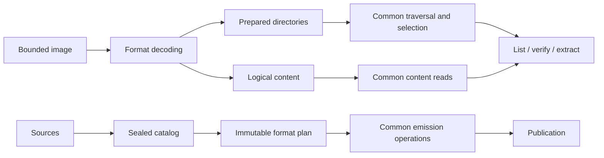

# Architecture simplification opportunities

fsimg's internal architecture should let a maintainer understand the core once
and learn filesystem rules from each additional driver. The strongest
opportunities are prepared directories, logical content, and common emission:
substantial components that own complete operations and remove obligations
from their callers.

The FAT and exFAT implementations provide concrete evidence for these
proposals. The [QNX6 design](../specs/design-qnx6.md) tests whether their
boundaries accommodate a different allocation and ownership model; it is design
evidence, not an implemented compatibility result. The authoritative contracts
remain in [specs/architecture.md](../specs/architecture.md). Adoption requires
the relevant specification changes before implementation.

## Foundation and central model

The existing foundation is strong: bounded resources, independent readers and
writers, immutable planning, and explicit ownership of extraction and
publication. Architectural beauty comes from a small vocabulary, visible data
flow, and contracts that make responsibilities predictable.



Readers and writers retain independent representations and lifetimes.
Prepared directories and logical content are reader interfaces; the catalog
and layout plan serve writing. Sharing infrastructure does not require a
mutable filesystem model or a common reader/writer object graph.

## Prepared directories and namespace validation

`fsimg_fat_next()` in
[`lib/formats/fat/directory.c`](../lib/formats/fat/directory.c) and
`exfat_next()` in
[`lib/formats/exfat/directory.c`](../lib/formats/exfat/directory.c) both manage
a directory stack, deferred descent, stream exhaustion, path prefixes,
current-entry replacement, and cleanup.

A driver could instead supply a prepared directory with this contract:

> Its children have valid framing and metadata, its lookup namespace is
> unambiguous, and its entries can be replayed in original order.

The common reader would own descent, pruning, path assembly, depth enforcement,
and directory-stream lifetime. The driver would own decoding, allocation and
parent-reference validation, and its private directory/content locators.
Both existing prepasses already retain entries in original order and validate
a separately sorted set of name keys.

The common preparation boundary would charge entries and enforce path/depth
limits before admitting children. Replay must not charge the same admitted
entries again. Validation of a parent namespace remains necessary even when
selecting one child, while unselected subdirectories remain unopened.

### A namespace maps keys to directory entries

A useful shared invariant is:

> Multiple spellings may identify one directory entry. One comparison key
> cannot identify two different directory entries.

For example, a FAT directory can contain these mappings:

```text
key("Readme.txt")   -> entry 17
key("README~1.TXT") -> entry 17
```

The driver produces comparison keys. FAT supplies its long-name and alias
keys; exFAT uses the volume's validated upcase table; the QNX6 design uses
case-sensitive UTF-8 byte keys. Shared code can store bounded key/entry records,
sort them externally, and reject equal keys belonging to different entries.
The key representation is opaque to that code.

Entry identity here means a directory-entry occurrence, such as its ordinal
within the prepared directory. It must not mean inode identity: different
directory entries can legitimately reference the same inode, and that does
not permit duplicate names in one directory. Writer-side validation can use
catalog IDs and parent scope. FAT alias generation and reservation remain
format-specific even if final ambiguity checks share this mechanism.

The existing `validate_keys()` in the FAT directory implementation and
`exfat_keys_unique()` in
[`lib/formats/exfat/names.c`](../lib/formats/exfat/names.c) demonstrate the
common operation. Driver-specific error classification and useful diagnostics
must survive the extraction.

### Preparation and lifetime

An incomplete directory is private to its preparation operation. The walker
receives it only after preparation succeeds, and owns its lifetime thereafter.
This makes namespace validation a prerequisite of traversal rather than a
protocol each traversal caller must remember.

Preparation does not make scratch bytes permanently trustworthy. Replay still
checks record framing, lengths, locators, and decoded fields. Current-entry
names and driver locators need explicit borrowing rules: advancing the reader
invalidates the current snapshot, and a retained directory cursor cannot
borrow a buffer that the next entry overwrites.

This ownership split has strong support in both implementations. The exact
cursor interface needs a prototype that removes both traversal engines without
replacing them with a larger callback protocol. Host source scanning and
extraction keep their separate authority and lifetime rules.

## Logical content and optional extent storage

Allocation and content answer different questions. Allocation identifies
storage owned by an object. Content identifies the bytes a caller may read
and their meaning.

For an exFAT file with 16 KiB allocated, a 10 KiB logical length, and 6 KiB
initialized, the distinction is:

| Logical range | Content behavior | Allocation relevance |
| --- | --- | --- |
| `[0, 6 KiB)` | Read mapped image bytes. | Owned storage. |
| `[6, 10 KiB)` | Synthesize zeros without reading backing payload bytes. | Owned storage. |
| Beyond 10 KiB | Outside the file's content. | Allocation slack or preallocation can still belong to the file. |

The common reader in
[`lib/read/reader.c`](../lib/read/reader.c) already owns content bounds,
source-stability checks, cancellation, and terminal failure. FAT and exFAT
implement separate delivery loops beneath that boundary. A common content
operation could perform bounded reads and zero synthesis while drivers resolve
initialized bytes to validated physical ranges.

Both `read_at()` and `next_range()` would use the same logical-content rules.
A range query describes data or zeros; it must not consume content or force an
otherwise unnecessary complete mapping. Physical fragmentation need not divide
an exFAT logical data range into smaller public ranges.

The common operation must preserve confirmed byte counts on partial failure,
including a request crossing a physical extent or initialized-data boundary.
Cached mappings and synthesized zeros remain subject to source consistency,
cancellation, and cumulative work limits. Complete-record metadata reads and
partial-progress content reads retain their distinct contracts.

### Shared extents without a mandatory index

Both formats describe physical runs using the same three values:

```c
typedef struct fsimg_extent {
	uint64_t	logical_offset;
	uint64_t	image_offset;
	uint64_t	length;
} fsimg_extent_t;
```

FAT implements index construction and binary search in
[`lib/formats/fat/read.c`](../lib/formats/fat/read.c), while exFAT implements
another spillable index and lookup cache in
[`lib/formats/exfat/allocation.c`](../lib/formats/exfat/allocation.c).

One shared extent-index implementation could own encoded records, bounded
growth, ordering and coverage checks, checked offset arithmetic, sequential
lookup, binary search, and cleanup under the existing session. Drivers retain
allocation discovery, geometry-specific checks, and chain/bitmap validation.

The index is an optional tool. FAT can retain its sequential cursor and build
an index on a seek. exFAT can prepare mappings when metadata validation requires
them. A block-tree driver can resolve offsets directly without building a
second index just to satisfy the interface. The QNX6 tree design makes this
distinction particularly useful.

Shared extent storage is a high-confidence extraction. Consolidating logical
content delivery needs a prototype covering mixed range/read access, validation
timing, and partial failures. Extent lookup alone never authorizes exposing
allocation slack or uninitialized backing bytes.

## Common output initialization and payload copying

Both emitters initialize output and implement source-copy loops in
[`lib/formats/fat/write-emit.c`](../lib/formats/fat/write-emit.c) and
[`lib/formats/exfat/write-emit.c`](../lib/formats/exfat/write-emit.c).
Those loops carry source opening, declared-length checks, zero handling,
bounded transfers, consistency checks, final validation, and cleanup.

A common emission object could bind the writer, bounded destination, session,
and transfer buffer. It would be available to format emission only after
alias rejection, capability and size checks, and destination initialization
succeed. It borrows the writer's lifetime and session; it does not introduce
another resource context or source owner.

Format code would express two operations: write these encoded metadata bytes
at this location, and copy this catalog entry into this planned region.
The common source-copy operation accepts a stable catalog ID, a bounded
destination region, and the planned initialized length. It owns the complete
open/copy/finish lifecycle and checks its lengths against the catalog and
destination capacity.

The operation must validate empty and zero-only sources, preserve confirmed
I/O progress, propagate cancellation, and release the current source on every
failure path. Skipping a zero range is valid only because destination zero
contents have been established. Initialization preserves the distinction
between fresh private outputs and reused raw sinks.

The lifecycle in [`lib/write/writer.c`](../lib/write/writer.c) is the natural
coordinator. Its single current source and catalog-ID lookup remain intact.
A narrow emission interface would keep the raw destination out of driver
helpers that only need bounded writes or source copying.

Format code still owns placement and encoding correctness. A range fitting
the volume does not establish that it belongs at the chosen directory or
metadata offset. The initial extraction should serve the concrete FAT/exFAT
layouts; a general emission instruction language would add another plan
representation and requires separate justification.

This is a high-confidence first implementation: it removes each driver's
copying lifecycle and its obligation to establish when zeros may be skipped.

## Ownership intervals with an explicit domain

The verifiers contain nearly identical ownership-record comparators and
cursors in [`lib/formats/fat/verify.c`](../lib/formats/fat/verify.c) and
[`lib/formats/exfat/verify.c`](../lib/formats/exfat/verify.c). Their interval
encoding, bounds checks, external sorting, and sequential cursor mechanics
can be shared.

Exclusivity needs a narrower contract:

> Within a driver-defined exclusive ownership domain, bounded claims from
> distinct owners cannot overlap.

The [QNX6 ownership design](../specs/design-qnx6.md#allocation-bitmap-and-snapshots)
distinguishes snapshots, objects, logical ranges, and roles. Separate directory
references to one supported inode do not create separate allocation owners;
cross-snapshot sharing is not itself an error. A universal rule rejecting all
overlapping physical intervals would reject that design.

The driver must define the domain, identify owners, account for repeated
references, and supply all required claims. A shared exclusivity check is
appropriate only after those semantics are established. It cannot infer
complete ownership from a list of extents.

FAT retains reconciliation with allocation-table values. exFAT retains
bitmap reconciliation and the relevant FAT semantics. Reserved structures,
legal sharing, and completeness remain format-specific. No general interval
tree or database is needed for the FAT/exFAT extraction.

This is a useful small utility, but broader verification abstraction should
be evaluated against a distinct format. Opening, selected traversal, structural
verification, and payload read-through retain their different scopes.

## Format descriptors own format knowledge

The registry separates reader and writer operations, but
`fsimg_format_next()` in
[`lib/formats/format.c`](../lib/formats/format.c) interprets `variant == 0`
as exFAT and supplies format-specific capabilities centrally.
The common [reader structure](../lib/read/reader.h) also names both concrete
driver-state types.

A descriptor could own capabilities and independently optional reader/writer
operations. One private driver-state pointer would keep concrete reader types
out of the common structure. The common plan base and driver extension in
[`lib/write/writer.h`](../lib/write/writer.h) already show how common lifecycle
ownership can coexist with a private format representation.

Detection needs an explicit bounded-probe contract before additional formats
participate: probe authority and work limits, competing matches, forced-format
behavior, and recognized unsupported features. Recognition does not establish
supported reading, writing, or complete validation. A failed or unsupported
candidate must not silently become permission to try an unrelated decoder
without the detection contract deciding that outcome.

The acceptance test is whether adding a driver requires teaching common
lifecycle or capability-reporting code its filesystem identity. Static
registration remains sufficient; this does not require a public plugin ABI.

## Data structures and boundaries to preserve

| Choice | Architectural value |
| --- | --- |
| Stable catalog IDs and parent links | Large trees remain understandable without a resident object graph. |
| Streams, paged arrays, bitsets, and external sorting | A small storage vocabulary supports bounded metadata workloads. |
| Driver-owned immutable plans | Geometry and layout remain explicit. |
| One current source and current-entry snapshot | Ownership and invalidation stay local and bounded. |
| Separate extractor and publisher | Image interpretation stays separate from host authority and publication. |

Each concrete record representation should have one owner for encoding,
decoding, and validation. Callers operate on named values through interfaces
such as `layout_get()` or extent lookup. Existing FAT/exFAT layout accessors
provide a useful pattern. Explicit wire codecs remain necessary; native C
structure padding is not a scratch representation.

Preparation should produce an object usable only in its completed state.
Directories and plans can achieve this within existing reader/writer lifetimes,
without independently managed public handles. A generic schema framework,
mutable VFS, or universal geometry model would add concepts that these
operations do not require.

Format geometry, allocation discovery, directory encoding, name comparison,
and metadata fidelity stay explicit. CLI confinement, output supervision,
host extraction, and publication enforce different authorities and failure
contracts; their size alone is not a reason to combine their owners.

## Complexity comparison

Each extraction must remove state or maintenance obligations across the whole
system, including its new interface and cleanup rules.

| Proposal | Adds | Removes |
| --- | --- | --- |
| Common emission | One scoped emission interface and complete source-copy operation | Per-driver initialization and payload-copy lifecycles. |
| Descriptor-owned knowledge | Capability descriptions and private state construction | Concrete format knowledge in common reader/reporting code. |
| Shared extent storage | One optional index representation and lookup owner | Duplicate encoding, growth, search, and index cleanup. |
| Prepared directories and namespaces | One preparation contract, key/entry validation, and traversal owner | Per-driver stacks, deferred descent, path assembly, pruning, and duplicate ambiguity checks. |
| Common logical content | One delivery operation over driver-resolved ranges | Separate bounded read loops and independently implemented zero/content rules. |
| Scoped ownership intervals | One bounded interval-stream utility | Duplicate interval sorting and cursor checks within compatible ownership domains. |

The acceptance question is: which state, cleanup rule, or caller obligation
disappears? Moving code behind an interface is insufficient. Count additional
passes, retained records, callbacks, and borrowing rules as costs even when
the implementation becomes shorter.

## Proposed execution plan

The stages below describe how to evaluate and implement these proposals.
They are not commitments or a record of completed work. When a proposal is
adopted, record its sequencing in
[the implementation plan](implementation-plan.md) and update the owning
specifications before implementing it. Keep the public API stable while
proving these internal boundaries.

### Stage 1: Specify boundaries and establish comparison fixtures

Record the chosen ownership contracts in the architecture and relevant reader,
writer, storage, and source designs. Give each major new component a design
document and link it from the specification index and architecture. Specify
borrowing, partial construction, terminal failure, validation timing, and
resource charging before defining callbacks.

Select existing FAT12/16/32 and exFAT fixtures covering fragmented content,
wide and deep directories, aliases/collisions, zero tails, source changes,
raw sinks, and callback failures. Record reproducible image bytes and traversal
results plus I/O calls, metadata work, peak memory, and peak scratch on named
fixtures. Use the same inputs and budgets for comparisons.

Completion: each proposed boundary has one named owner and explicit invariants;
comparison fixtures can detect semantic and resource regressions. Resolve
interface questions before dependent implementation.

### Stage 2: Centralize emission

Move destination initialization into the common writer after all pre-mutation
checks. Introduce the scoped emission interface and one complete source-copy
operation. Convert both drivers and remove their duplicate payload loops.
Retain format metadata encoding, layout iteration, and placement.

Exercise empty files, zero-only sources, mixed data/zero ranges, changed sources,
short reads, partial writes, cancellation, flush failures, and allocation
failures. Verify source/output aliases fail before resize, zeroing, or writes,
and reused sinks contain no stale bytes.

Completion: both drivers use the common copying lifecycle; source cleanup has
one owner; reproducible images and independent-tool acceptance are unchanged.
Commit the coherent conversion after the required reviews and checks.

### Stage 3: Make descriptors self-contained

Move capability descriptions to driver descriptors and replace the concrete
reader-state union with private driver state. Establish bounded probing,
ambiguity, forced-format, and unsupported-feature semantics before changing
automatic dispatch. Preserve independently optional reader/writer support.

Check capability enumeration, forced-format mismatches, malformed and truncated
probes, partial-open cleanup, and competing probe results. Tests for the probe
contract need not advertise an unimplemented filesystem.

Completion: common lifecycle and capability reporting contain no format-identity
branches; the registry is the intentional list of supported drivers. This stage
depends on Stage 1 and can proceed independently of emission.

### Stage 4: Extract optional extent storage

Implement one bounded extent index with checked record access, growth, lookup,
and cleanup. Convert FAT and exFAT to it while retaining their allocation
validation and discovery strategies. Keep the abstraction usable without
requiring every content provider to create an index.

Exercise sequential and random access, mixed range/read calls, fragmentation,
corrupted cached records, scratch failures, and partial I/O. Compare metadata
work and scratch use to detect a new eager index or repeated chain walk.

Completion: duplicate index machinery is removed, FAT sequential reads retain
their inexpensive path, and exFAT metadata/allocation validation retains its
coverage. This stage prepares shared storage for Stage 6.

### Stage 5: Unify directory preparation and traversal

Prototype the prepared-directory interface against both drivers, including
FAT parent-cluster checks, alias matching, exFAT private stream locators, and
current-entry invalidation. Specify entry occurrence identity separately from
allocation-owner identity.

Extract bounded namespace validation, then move the traversal state machine
into the common reader. Convert both drivers and delete their old traversal
engines. Keep any transitional adapter within this stage; reject the design
if it merely adds another layer around two retained walkers.

Exercise on-disk ordering, ambiguous long-name/alias combinations, case mapping,
selection by alias, depth/path/entry limits, directory cycles, scratch-record
corruption, preparation failure, and pruning of unselected subtrees. Re-run
extraction and worker selection coverage because they consume these semantics.

Completion: one walker owns traversal and one preparation boundary admits
children; namespaces are validated before exposure; limits are charged at
admission without replay double-counting. Demonstrate bounded wide-directory
and deep-tree behavior. This stage depends on Stage 1, not on extent storage.

### Stage 6: Consolidate logical content delivery

Define the content-resolution contract using logical length, initialized
content, and physical mappings with explicit units. Reuse Stage 4's index when
appropriate and retain direct resolution for drivers that do not need it.
Route FAT and exFAT delivery through the common operation.

Exercise reads crossing extent and initialized-data boundaries, poisoned zero
tails, EOF, empty files, interleaved range/read access, changed input, cached
lookups, cancellation, and partial failures. Check confirmed byte counts and
ensure zero-tail payload storage is never read.

Completion: content APIs agree about logical bytes and zeros, allocation slack
remains inaccessible, and metadata work stays within the recorded bounds.
Adopt this after the mapping and current-entry lifetime contracts are settled
in Stages 4 and 5.

### Optional scoped interval extraction

Extract the FAT/exFAT ownership cursor and sorting mechanics as a separate
small change when their exclusive-domain contract is explicit. Test overlap,
adjacency, empty claims, out-of-domain bounds, and arithmetic limits.

Completion: both verifiers retain their format-specific reconciliation and
scope. Evaluate snapshot/object/role semantics against the QNX6 design before
proposing broader sharing; do not make completion of QNX6 a prerequisite for
the other stages.

### Review and validation gates

Before each implementation stage's pre-commit test run, launch the required
code-review subagent. Request correctness, design, security/information-leak,
and readability review with concrete functions as evidence. Require a
before/after account of concepts, states, ownership, and caller obligations.
Address readability findings and every Critical/High finding; fix Medium
findings or record actionable residuals in `TODO.md` or the commit message.

Each implementation stage also receives the required external, read-only
OpenCode review through the Z.ai coding-plan subscription using
`zai-coding-plan/glm-5.3` and `--variant max`. Re-review substantive fixes.
Report an unavailable or failed review explicitly.

Use the actual commands and platform requirements in [build.md](build.md):
`make check` for the full ordinary suite, `make check-integration` for
independent interoperability, and the affected security/fault checks.
For allocation, parsing, I/O, extraction, or lifetime changes, run the full
suite with `make check-asan`, which combines ASan and UBSan; use the documented
standalone sanitizer targets as required, including LSan/MSan on supported
platforms. Run TSan if concurrency or state shared between workers changes.
Skipped or unavailable checks are reported as such.

For any non-trivial bug exposed by the work, add a regression first and confirm
failure on the unfixed tree before applying the fix. Each coherent stage is
committed after its reviews and relevant checks. Required fixes receive their
affected checks again before that commit.

Finish the series with the documented scale, combined CLI RSS, extended
qualification, and fuzz targets. Compare image bytes, traversal/selection
results, confirmed failure outputs, I/O calls, metadata passes/work, memory,
and scratch against Stage 1. Record measurements and actual commands alongside
the build and qualification documentation. A simplification is accepted only
when its ownership improvement survives those semantic and resource checks.
