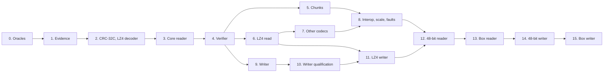

# EROFS implementation plan

This plan orders the work that adds EROFS to fsimg: a reader and verifier
for every shipped EROFS profile, then a writer for uncompressed volumes, its
LZ4 profile, and last the experimental 48-bit layout and metadata box, read
and then written. Its input is the research draft
[EROFS filesystem: on-disk specification and fsimg implementation plan](../fsspecs/EROFS_fsimg_spec.md)
("the draft"). The draft is not the specification. The authoritative designs
are the [format design](../specs/design-erofs.md) and the
[driver design](../specs/design-erofs-driver.md), original documents in the
present tense that cite their evidence. Section numbers below such as "draft
section 8.4" refer to the draft.

EROFS differs from the formats fsimg already supports in four ways that
shape the plan. It is read-only by design, so there is no allocation map,
journal or free space: verification checks reachable structures against each
other, and the writer's plan is the whole image. Its file data may be
compressed per inode with four codecs, one of which (LZ4) fsimg does not yet
have and two of which (MicroLZMA, Zstandard) live in optional libraries no
filesystem driver has used. Its compressed index formats are dense bit
packings that only producer evidence can pin down. And its newest features
are experimental upstream, so they come last and are tied to pinned producer
and kernel versions.

The working agreement applies unchanged. Designs come before code. Every
stage gets the review subagent and the external `aireview` review. A failing
regression test comes before any non-trivial fix. Each stage ends in one
coherent commit, or a few, and skipped checks are reported. No calendar
estimate substitutes for a gate.

## Goals and non-goals

Goals:

1. Read EROFS volumes, bare, inside a GPT or MBR partition, or inside a
   compressed or disk-image container, through `i`, `t`, `x`, `x -O` and
   `W`, with every shipped layout: flat, inline, chunked and compressed with
   LZ4 and DEFLATE always and MicroLZMA and Zstandard when the build has the
   optional library. Resources are bounded at any legal geometry, and every
   failure falls into the closed status classification.
2. Verify completely: every reachable structure, link counts, metadata
   ownership and the decodability of every referenced cluster.
3. Create uncompressed volumes that `fsck.erofs --extract` accepts and the
   Linux kernel mounts with every file matching its source; then the same
   with `compression=lz4`.
4. Last, read and then write the 48-bit layout and the metadata box, each
   qualified against a pinned `erofs-utils` release and a kernel that mounts
   it.

Non-goals:

* External data devices, tar-index and other metadata-only images, and
  any automatic resolution of a device tag (draft sections 9.2 to 9.4).
  They are recognized and refused; a common design for supplying a second
  input would come first.
* Exposing or writing extended attributes and writing hard links: the
  common entry model and source catalog have no representation for them.
  The reader marks entries with attributes as carrying extra data.
* Writing chunk-based files, compression other than LZ4, big physical
  clusters, compact indexes, compressed tails, fragments or shared clusters
  (draft section 14.4): each adds layout states with no qualified need.
* Image-share fingerprints, OCI layering and remote images (draft
  sections 7.4 and 9.4), which belong to other layers if anywhere.

## Inputs and their standing

| Input | Standing | Use |
| --- | --- | --- |
| [The draft](../fsspecs/EROFS_fsimg_spec.md) | Research draft, original prose | Field tables, pitfalls, the test families of sections 15 and 16, the open questions of section 20. Every unresolved item is a gate here, never a default |
| EROFS on-disk documentation (`erofs.docs.kernel.org`) | Public documentation, CC-BY-SA-4.0 | Layout facts, paraphrased in the format design; no prose or figures copied |
| `erofs-utils` 1.9.4 `include/erofs_fs.h` | MIT-licensed header | Constants and offsets restated as facts; no declarations copied |
| `erofs-utils` 1.9.4 tools (`mkfs.erofs`, `fsck.erofs`, `dump.erofs`), pinned, built with LZ4, liblzma, zlib and libzstd | External programs, run on disposable images only | Fixture production, extent and layout records, the structural and extraction oracle. Their library code is GPL-2.0+ OR MIT and is not imported |
| Linux kernel EROFS in the Linux check VM | External oracle by mounting only | The authoritative acceptance test; its GPL source is not read for code |
| `rust-fs-erofs` | MIT, independent reader | Second opinion for the shipped profiles; refuses 48-bit and the box |
| LZ4 block format and XXH32 descriptions by their author | Public format descriptions | The codec design's clean-room inputs |

## Existing owners the driver reuses

The common contracts cover EROFS: the
[format descriptor and probe](../specs/design-formats.md#format-descriptors-and-profiles),
[prepared directories](../specs/design-directories.md) with the portable
name profile, [logical content](../specs/design-content.md) with zero and
held extents, [emission](../specs/design-emission.md),
[sizing](../specs/design-sizing.md), [POSIX metadata](../specs/design-metadata.md),
[device nodes](../specs/design-device-nodes.md), the
[layers](../specs/design-layers.md) and the
[metadata scratch primitives](../specs/design-storage.md#metadata-scratch-primitives).
The HFS Plus driver is the structural template for decoded content through
held extents. The draft's proposed modules (section 13) map onto existing
owners:

| Draft module | fsimg owner |
| --- | --- |
| `descriptor.c`, `super.c` | Driver `descriptor.c` and `read.c` |
| `erofs.h` | Driver `erofs.h` and the pure decoders in `codec.c` |
| `inode.c`, `metabox.c` | Driver `meta.c`: one metadata reader over both spaces |
| `directory.c` | Driver `directory.c` under the common walker and selector |
| `xattr.c` | Driver `xattr.c`, validation and the extra-data mark only |
| `data.c`, `packed.c` | Driver `map.c`: one mapping function |
| `zmap.c` | Driver `zmap.c` |
| `decompress.c` | Driver `cluster.c` over `lib/codec/` LZ4, zlib and the optional libraries |
| `verify.c` | Driver `verify.c` over the common external sort and verification helpers |
| `write-plan.c`, `write-emit.c` | The writer lifecycle and the driver's `write-*.c` |
| `test/fixtures/erofs/manifest.tsv` | Producer fixtures outside the repository, named by an environment variable, plus the independent generator |

## Common changes

EROFS needs these changes outside its driver. Each is specified in its
owning design before its code lands, in the stage named, without an
EROFS-specific branch in common code:

1. **CRC-32C** in `lib/core/crc32c.c`, stage 2, tested against the
   published check value. The APFS design names the same file.
2. **LZ4 block codec** in `lib/codec/lz4.c`: the decoder in stage 2 and the
   destination-bounded encoder in stage 11, under a new
   [codec design](../specs/design-codecs.md) section and its clean-room
   procedure.
3. **Block decoding through optional libraries**, stage 7: MicroLZMA through
   liblzma and Zstandard through libzstd, each a private entry point in the
   library's one source file. MicroLZMA needs `lzma_microlzma_decoder()`,
   which liblzma has from 5.4; the configure probe checks for it separately,
   so an older liblzma still serves xz while MicroLZMA is reported absent.
   Both sit under a new section of the
   [compression libraries design](../specs/design-compression-libs.md) and
   the [architecture's](../specs/architecture.md) optional-integration rule.
   Capability output names the libraries, as it does for the layers.
4. **Format write settings** `compression`, `addressing` and `metabox` in
   the [settings catalogue](../specs/design-settings.md), the worker job
   and the CLI, refused by every other format, stage 9 for `compression`'s
   `none` and the later stages for each other value.
5. **Measured read and encoded copy** in the
   [emission design](../specs/design-emission.md), stage 11: a planning-time
   read of a source through the common lifecycle to an observer, and an
   emission-time copy through a driver encoder, both with the copy's
   identity checks.
6. **Registration rows**, stage 3 for the reader and stage 10 for the
   writer: `erofs` in the format and stack names; the partition type as
   `linux`; identifier role 6, an EROFS volume UUID, in the
   [identifier rule](../specs/design-layers.md#identifiers); the sizing,
   metadata-loss and device-node table rows; `README.md`, `docs/fsimg.1`,
   `docs/libfsimg.3` and `NEWS`.

## Design decisions

The designs record these with their rationale.

1. **One metadata reader, one mapper.** `meta.c` turns every NID into bytes
   and `map.c` every logical offset into storage, for both metadata spaces,
   so bounds and space checks exist once and the box nests at most one level
   by construction.
2. **The parent rule instead of a visited set.** A directory's `..` must
   name the directory being walked from, so a reachable directory has one
   parent and no cycle is reachable; verification's reference stream
   refuses a directory named twice.
3. **One decode window per reader kind, one cluster each.** Content,
   metadata and a compressed box decode into separate windows, so a
   directory lookup never invalidates bytes delivery is copying, a box read
   never evicts the directory cluster it serves, and a cluster is decoded
   once per sequential pass. A window's key is the whole normalized
   cluster, so a hit returns exactly what a fresh decode would.
4. **Ownership by class.** With no allocation map, verification claims
   metadata exclusively and lets data overlap, which is exactly what the
   format's deduplication permits.
5. **Refusal at open.** Every refused or not-yet-supported incompatible
   feature fails before the root is read, so no partial view exists. A
   missing codec is the one refusal raised later, on the content that
   needs it, so the rest of the volume stays readable.
6. **One writer layout.** Superblock, metadata area root first, data area,
   in catalog order; inline tails where a block holds them; compact inodes
   where they are exact. The layout depends only on the catalog and
   settings, and on payload bytes only through the deterministic LZ4
   encoder.
7. **Compression without staging.** The LZ4 writer encodes during planning
   to learn cluster counts and index records, and again during emission,
   instead of spooling compressed payload.
8. **Experimental features last and opt-in.** The 48-bit layout and the
   box are read and written only after every other stage, against pinned
   versions, and never chosen automatically.
9. **A writer awaiting qualification is unregistered**, as for the QNX and
   APFS writers; each later writer profile's setting value stays refused
   until its qualification lands.

## Evidence questions

Stage 1 answers these, each tied to the experiment that answers it and the
stage that consumes it. Every provisional value in the designs is listed.
E7, E13 and E14 settle no provisional value: they produce fixtures for
rules the designs state as established layout, and refusal tests for E14.
An answered row points to the research record's
[evidence answers](erofs-research.md#evidence-answers), which name the
fixture behind each answer; the designs carry the answers themselves.

| Question | Evidence | Consumer | Status |
| --- | --- | --- | --- |
| Superblock checksum range, seed and final inversion at each block size | E1 | Stage 3 | [Answered](erofs-research.md#evidence-answers) |
| Largest block size any producer emits; the superblock region's end; block count versus image length; the build-time word | E1 | Stage 3 | [Answered](erofs-research.md#evidence-answers) |
| Compact inode reserved word; the time's meaning without `MTIME`; what the inode count counts | E2 | Stages 3, 4 | [Answered](erofs-research.md#evidence-answers) |
| Flat-inline without a tail; an empty file's start block; the null flat address | E3 | Stages 3, 9 | [Answered](erofs-research.md#evidence-answers) |
| Directory block padding; dot-entry placement; directory link counts | E4 | Stages 3, 4, 9 | [Answered](erofs-research.md#evidence-answers) |
| Device-number encoding; sizes and layout words of FIFOs, sockets and devices | E5 | Stage 3 | [Answered](erofs-research.md#evidence-answers) |
| Attribute header reserved bytes; prefix table placement and units; the filter hash | E6 | Stages 3, 4 | [Answered](erofs-research.md#evidence-answers) |
| Chunk entry forms, holes, shared chunks | E7 | Stage 5 | [Answered](erofs-research.md#evidence-answers) |
| Compact group packing at every boundary; partial references; interlacing; cluster and index limits; LZ4 stream termination; the LZ4 distance field | E8 | Stages 6, 11 | [Answered](erofs-research.md#evidence-answers); `L > B` and compact advice `0x01` clear stay unobserved |
| MicroLZMA, DEFLATE and Zstandard framing, configuration records and limits; mixed head-1 and head-2 | E9 | Stage 7 | [Answered](erofs-research.md#evidence-answers); head-2 by hand-built images only |
| Every 48-bit field; the extent count's placement; encoded-extent widths; kernel acceptance of the writer's 32-byte records | E10 | Stages 12, 14, 15 | Open, runs before stage 12 |
| Kernel acceptance of writer output at 512, 1024 and 2048-byte blocks and of the writer's field choices | E11 | Stages 10, 11 | Open, runs before stage 10 |
| Metadata-box layout, root placement, box compression, shared attributes in the box | E12 | Stages 13, 15 | Open, runs before stage 13 |
| Scale: files beyond 4 GiB, a directory of 100000 entries, root NIDs and start blocks at their limits | E13 | Stage 8 | Open, runs before stage 8 |
| The fields a volume with external devices sets, so refusal names it | E14 | Stage 3 | [Answered](erofs-research.md#evidence-answers) |

## Work packages

Every stage leaves `make -j32 check` passing and follows the gates below.

### 0. Oracles and tools

* Build `erofs-utils` 1.9.4 from its release tag with LZ4, liblzma, zlib
  and libzstd under `~/.local/share/fsimg-oracles/erofs-utils` on macOS; the
  CI Linux image carries the packages the build script needs. Record
  `mkfs.erofs -V`, the configure summary and a fixture showing each codec compiled in.
* Record the Linux check VM's kernel version and EROFS configuration
  (compression codecs, sub-page block sizes, the 48-bit layout from 6.15 and
  the box from 6.17), and how a disposable image is loop-mounted read-only
  inside the VM.
* Install `rust-fs-erofs` at a pinned version beside the other oracles.
* Add `tools/erofs/`: `capture.rb`, which builds a named fixture from a
  recipe tree with its command record, tool versions, SHA-256 and
  `dump.erofs` output; and `erofsdump.rb`, a structure dumper (run as
  `ruby tools/erofs/erofsdump.rb IMAGE`) written from the format design independently of `lib/`, which prints every field the
  design tabulates, checks the superblock checksum and decodes every index
  form. These are project tools under the Ruby and style rules. Fixtures live
  outside the repository in the directory named by `FSIMG_EROFS_FIXTURES`.
* **Gate:** tool identities and procedures are in `docs/erofs-research.md`.
  If no kernel mount is available, stop and ask the owner: without it no
  writer stage can close.

### 1. Evidence corpus

Each experiment varies one property on disposable images and records the
fixtures, their command records and the oracle output:

| Experiment | Procedure |
| --- | --- |
| E1 Geometry | `mkfs.erofs -b` 512, 1024, 2048, 4096 and any larger size it accepts; checksum on and off; extension slots; each checksum-boundary byte flipped and checked by `fsck.erofs` and the kernel |
| E2 Inodes | `-E force-inode-compact` and `force-inode-extended`; owners above 65535; times before 1970, past 2038 and with nanoseconds; the oldest buildable producer for the `MTIME`-less time |
| E3 Data | Files of 0, 1, B-1, B, B+1, 2B and multi-block sizes with `inline_data` on and off; a sparse source |
| E4 Directories | 1- and 255-byte names, invalid UTF-8, names sorting before `.`, a directory filling many blocks, nested directories |
| E5 Kinds | FIFOs, sockets, character and block devices with large majors and minors, created as root in the Linux VM |
| E6 Attributes | `user.`, `trusted.`, `security.` and ACL attributes inline and shared; long prefixes in both placements; the name filter on and off |
| E7 Chunks | `--chunksize` at several sizes, `-E force-chunk-indexes`, sparse sources and identical chunks |
| E8 LZ4 | Default compact indexes and `-E legacy-compress` full indexes; `-C` big clusters; files forcing 2-byte groups and every group boundary; incompressible clusters; `-E ztailpacking`, `fragments`, `all-fragments` and `dedupe`; compressed directories; each recorded with `dump.erofs -e`; clusters rewritten by hand so a block's last sequence carries fewer than five literals, or its last match starts fewer than 12 bytes before the end, read by the kernel and `fsck.erofs`, which fixes the [LZ4 decoder's](../specs/design-codecs.md#end-of-block) end-of-block rule |
| E9 Other codecs | `-z lzma`, `deflate` and `zstd` at several levels and dictionary sizes; a mixed two-algorithm volume |
| E10 48-bit | `-E 48bit` volumes small and large through sparse files; compact times; implicit link counts; omitted dots; compressed files in every encoded-extent width the producer emits; a hand-built LZ4 file and LZ4 box mapped by 32-byte records through the independent generator, mounted by the kernel and checked by `fsck.erofs` |
| E11 Writer probes | Hand-built variants of the writer's layout through the independent generator, each mounted by the kernel and checked by `fsck.erofs`: block sizes below 4096, empty-file start blocks, inode placement at block ends |
| E12 Metadata box | Box volumes plain and LZ4-compressed, with directories, files and shared attributes inside; where the root lives |
| E13 Scale | Files beyond 4 GiB through sparse sources; a directory of 100000 entries; a tree placing the root NID and start blocks at their limits |
| E14 External devices | `--blobdev` and `--tar=i` volumes, structure only |

* **Deliverable:** `docs/erofs-research.md`: sources and licenses, tool
  identities, per-experiment observations, and for each evidence question an
  answer with its fixture or an open status naming what it blocks.
  Observations that change a rule are edited into the designs.
* **Gate:** every row consumed by stages 3 to 7 is answered or explicitly
  open with the design's safe default applied. E10 and E12 may run later,
  before stage 12, and must if the pinned release changes.

### 2. Common changes for reading

* CRC-32C in `lib/core/`, and the LZ4 decoder in `lib/codec/` with its
  codec design section, `test/codec.c` cases and `fuzz/codec.c` cases.
* **Gate:** every format's behaviour and image bytes unchanged; the new
  functions have their own tests and fuzz cases.

### 3. Reader: superblock, inodes, flat data and directories

* `erofs.h`, `descriptor.c`, `codec.c`, `read.c`, `meta.c`, `map.c` (flat
  and inline), `directory.c`, `content.c`, `xattr.c` (validation and the
  extra-data mark), with every later feature refused at open.
* Registration of the reader and its rows (common change 6); build wiring
  and `EXTRA_DIST`.
* `test/erofs-gen.[ch]`, `test/erofs.c`, the contract-suite profile,
  `fuzz/erofs.c`, and the specification harness's core model.
* **Gate:** `i`, `t`, `x -O` and `x` agree with the source manifests
  (names, kinds, sizes, modes, owners, times, SHA-256 of contents) of every
  uncompressed E1 to E6 fixture, bare and inside `gpt` and a compressed
  container; every mutation of the format design's matrix fails with its
  class.

### 4. Verifier

* `verify.c`: reference and ownership streams, link counts, attribute pool,
  prefix and filter checks, incomplete reasons.
* **Gate:** every fixture verifies, or its finding is classified in the
  research record as a rule widened from evidence; overlap, link-count and
  second-name mutations fail with their class.

### 5. Chunk-based files

* Chunk mapping in `map.c`, zero extents for holes, chunk claims.
* **Gate:** E7 fixtures match their manifests, holes are delivered as zero
  extents, and `-k` extraction of a sparse file stays sparse.

### 6. Compression: LZ4 and the index formats

* `zmap.c` (full and compact), `cluster.c`, fragments and the packed inode
  in `map.c`, compressed directories and the prefix table in the packed
  inode.
* Tests at every compact boundary E8 names, reads starting and ending inside
  clusters, partial references, hostile distances and streams.
* **Gate:** every E8 fixture's content matches byte for byte, including
  random reads across cluster boundaries; `dump.erofs -e` extents agree with
  the mapper's for every file.

### 7. Compression: DEFLATE, MicroLZMA and Zstandard

* Raw DEFLATE over zlib; the optional-library entry points (common change
  3) and their dispatch in `cluster.c`; builds with and without each
  library.
* **Gate:** E9 fixtures match in a full build, the hand-built `e9-head2-*`
  images included, since no producer writes a head-2 record; in a build
  without a library the affected files fail with `FSIMG_EUNSUPPORTED`
  naming it while the rest of the volume lists and extracts, and
  verification reports incomplete.

### 8. Reader interoperability, scale and faults

* `test/erofs-integration.sh.in`: the manifest comparison for every
  fixture; `rust-fs-erofs` listing and extraction compared with fsimg's.
* E13 scale fixtures with I/O calls, decoded bytes, peak scratch and RSS
  recorded under the minimum budget.
* `test/erofs-faults.c` across open, read and verification.
* **Gate:** comparisons recorded in `docs/build.md` with tool versions, or
  reported as skipped with the reason; the scale figures hold within the
  session budget.

### 9. Writer, unregistered

* `write-erofs.h`, `write-plan.c`, `write-dir.c`, `write-emit.c`; the
  setting rows, accepting `compression=none`, `addressing=32` and
  `metabox=none` and refusing every other value with `FSIMG_EUNSUPPORTED`
  until the stage that emits it.
* `test/erofs-write.c`: round trips through the reader and verifier; byte
  identity across source order, budget, scratch and time zone; a poison scan;
  faults.
* **Gate:** every check passes; the writer lands in the second descriptor,
  and the gap is listed in [TODO](../TODO.md).

### 10. Writer qualification and registration

* `tools/erofs/qualify.sh`, run in the Linux check VM, for each output:
  `fsck.erofs --extract` and a manifest comparison; a read-only kernel loop
  mount with `find`, `stat` and SHA-256 compared with the source;
  `rust-fs-erofs` extraction; fsimg `W` and `t`.
* Outputs: empty, small, deep, wide (multi-block directories), large-file
  and every-kind trees; names sorting before `.`; each block size E11
  accepts; wrapped as `erofs/gpt` and `erofs/mbr`.
* Writer registration rows and documentation.
* **Gate:** every output passes every oracle; the record is in
  `docs/erofs-research.md` under fsimg writer output.

### 11. LZ4 writer

* The LZ4 encoder (common change 2) with its worst-case bound and
  determinism tests; the measured read and encoded copy (common change 5);
  `write-lz4.c`.
* **Gate:** stage 10's qualification passes with `compression=lz4` on trees
  mixing compressible, incompressible and small files; the image is byte
  identical across runs and hosts; then `compression=lz4` is accepted.

### 12. 48-bit reader

* Re-run E10 against the then-current pinned release and the VM kernel.
  The 48-bit fields in `codec.c`, `read.c` and `meta.c`; encoded extents in
  `zmap.c`; omitted dots in `directory.c`.
* **Gate:** every E10 fixture matches its manifest and verifies; sparse
  fixtures with start blocks beyond 2^32 read correctly; mutations of every
  widened field fail with their class.

### 13. Metadata-box reader

* Re-run E12. Box reads in `meta.c`, box claims in `verify.c`, shared
  attributes in the box in `xattr.c`.
* **Gate:** every E12 fixture, plain and compressed, matches and verifies;
  box recursion mutations fail with their class.

### 14. 48-bit writer

* The `addressing=48` profile in planning and emission, including encoded
  extents for LZ4 files.
* **Gate:** stage 10's qualification at `addressing=48`, with and without
  LZ4, including a sparse output beyond 2^32 blocks where the kernel mounts
  it; then `addressing=48` is accepted.

### 15. Metadata-box writer

* The `metabox=plain` and `metabox=lz4` profiles.
* **Gate:** stage 10's qualification for both, with the kernel mounting
  and `fsck.erofs --extract` matching; then both values are accepted,
  `metabox=lz4` only when E10 has confirmed the 32-byte records.

## Dependency order

Stages 5, 6 and 9 are independent once stage 4 lands. Stages 12 to 15
start only after every earlier stage has landed, by the owner's decision,
and run in order.

## Gates for every stage

* **Review before tests.** Launch the review subagent first, before the
  pre-commit test run. Ask it explicitly for bugs and design issues, for
  security and information-leak concerns with the security pass framed in
  the prompt, and for the style guide's readability review citing specific
  functions. Address every Critical and High finding; fix each Medium
  finding or record it in `TODO.md` or the commit message.
* **External review.** Run `aireview` as the working agreement specifies.
  Substantive fixes are reviewed again. A failed or unavailable review is
  reported, never replaced.
* **Tests.** Write a failing regression test before any non-trivial fix.
  While developing run the affected tests (`make -j32 check
  TESTS='test-erofs'`); run `make -j32 check-quick` once on the tree about
  to be committed, plus `make check-spec` when the harness's EROFS model or
  a rule changes.
* **Sanitizers.** The coordinating session runs `check-asan`,
  `check-ubsan`, the supported LSan and MSan targets, and `check-fuzz` with
  `-j16` once on the integrated tree before landing; these build from a
  `make distdir` copy, so every new source, test and script is in
  `EXTRA_DIST`.
* **Platforms.** Linux and FreeBSD run the suite before a stage that touches
  common code or the optional libraries lands; the Linux VM runs the kernel
  oracle.
* **Project hygiene.** New C, shell and Ruby files are ASCII with
  BSD-2-Clause headers. `docs/build.md` records commands, evidence and
  explicit skips.

## Departures from the draft

| Draft | This plan | Reason |
| --- | --- | --- |
| A positional external-device API and `--erofs-blob` options (section 9.3) | External devices refused at open | The owner's decision; no common design for a second input exists |
| Xattr API extension, writer xattrs (sections 7.5, 14.4) | Validation and the extra-data mark only | The common model has no attribute representation |
| Writer chunk dedupe, compact indexes, compressed tails, fragments, other codecs (section 14.4) | LZ4 with full indexes and one-block clusters only | Each adds layout states with no qualified need; the reader covers them all |
| Separate `super.c`, `inode.c`, `data.c`, `packed.c`, `metabox.c`, `decompress.c` (section 13) | `meta.c`, `map.c`, `zmap.c`, `cluster.c` | One owner per decision: NID to bytes, offset to storage |
| An LRU cache keyed by inode and cluster (section 13) | One decoded cluster per window | Sequential reads decode each cluster once; a cache adds eviction state for random-read speed only |
| Visited-NID sets for cycle detection (section 13.3) | The parent rule; a reference stream in verification | Cycles become unreachable by construction |
| A strict and a permissive reader for nonzero compact reserved words (section 4.3) | One rule: the word at `0x0C` is the inode's time after the epoch, as the kernel reads it on every volume (E2); `0x1C` nonzero is corrupt | Two interpretations are two formats to test |
| `--erofs` libFuzzer targets per module (section 16.4) | `fuzz/erofs.c` plus codec cases | One target per format, as for the other drivers |
| An LZ4 library or import (section 8.1) | Project-owned clean-room decoder and encoder | The owner's decision, as for LZO1X |
| 48-bit and metabox writer not planned (sections 11, 14.4) | Read, then write, as the last stages | The owner's decision |

## Owner decisions

The owner has settled these:

1. **Codecs.** LZ4 and DEFLATE always; MicroLZMA and Zstandard through the
   optional liblzma and libzstd, refused as unsupported without them.
2. **Writer.** Uncompressed first, then LZ4 with a project-owned
   deterministic encoder.
3. **LZ4 source.** Project-owned and clean-room, in `lib/codec/`.
4. **External devices.** Refused and unscheduled.
5. **48-bit layout and metadata box.** Read, then write, after everything
   else.

## Risks

* **Experimental drift.** Upstream marks the 48-bit layout and the box
  experimental. Their designs are provisional as a whole, and stages 12 to
  15 re-run E10 and E12 against the then-current release; a changed layout
  is edited into the design before code.
* **Kernel availability.** The check VM's kernel must mount every profile
  the writer emits. If it lacks a codec, sub-page block sizes, the 48-bit
  layout (Linux 6.15) or the box (Linux 6.17), the affected writer profile
  stays refused until a VM with a newer kernel is provided; the owner
  decides.
* **Shared-library oracles.** `fsck.erofs`, `dump.erofs` and `mkfs.erofs`
  share one library and may share a bug. The kernel is the authority and
  `rust-fs-erofs` the independent second opinion where it applies.
* **Compact index edge cases.** Older producers wrote corner cases the
  current packing rules may not describe (draft section 20 item 5). A
  disagreement is resolved from a fixture, recorded in the research record,
  and never by widening the rules without one.
* **Large decoded clusters.** A 12 MiB cluster with an 8 MiB MicroLZMA
  dictionary exceeds the 16 MiB minimum budget. Such a volume fails with the
  budget error and the manual page says to raise `-l memory`.
* **Provenance.** The designs are written from facts. No code, declarations
  or identifiers from the kernel or `erofs-utils` enter the tree; the LZ4
  codec follows the clean-room procedure.
