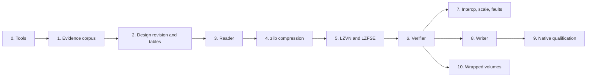

# HFS Plus implementation plan

This plan defines and orders the work that adds HFS Plus and HFSX to fsimg:
first a reader and full verifier for native volumes, compressed files
included, then a writer whose output native macOS checks, mounts, modifies
and remounts. Its input is the research draft
[HFS+ / HFSX on-disk filesystem specification](../fsspecs/HFSPLUS_HFSX_FSIMG_SPEC.md)
("the draft"). The draft is not the specification. The authoritative designs
are [the format design](../specs/design-hfsplus.md) and
[the driver design](../specs/design-hfsplus-driver.md), original documents in
the present tense that cite their evidence. They are written ahead of the
native evidence, which HFS Plus's public documentation makes possible, and
name the observations that close each open value; stage 2 revises them where
the evidence differs. Section numbers such as "draft section 11" refer to
the draft.

The concrete targets are volumes that macOS creates with `hdiutil` and
`newfs_hfs`, volumes Linux `mkfs.hfsplus` creates, and fsimg volumes that
macOS accepts as ordinary data volumes. Bootable system volumes are not a
target.

The working agreement applies unchanged. Every stage gets the review
subagent and the external `aireview` review. A failing regression test comes
before any non-trivial fix. Each stage ends in one coherent commit, or a few,
and skipped checks are reported. No calendar estimate substitutes for a gate.

## Goals and non-goals

Goals:

1. Read native HFS Plus and HFSX volumes, bare, through the layers (GPT,
   MBR, DMG) or in a legacy HFS wrapper, through `i`, `t`, `x`, `x -O` and
   `W`. Resources are bounded at every legal geometry and catalog size, and
   every failure falls into the closed status classification.
2. Deliver the true content of transparently compressed files of every
   common type (zlib, LZVN, LZFSE), never an empty or short file.
3. Verify completely: every B-tree's structure and node map, catalog
   thread pairing and counts, hard-link counts, attribute ownership, and the
   bitmap against every fork's storage.
4. Make the Apple data the entry model cannot carry visible: an entry with a
   resource fork or stored attributes is marked in listings, and the
   extraction loss report names the omission for that entry.
5. Create unjournaled HFS Plus and case-sensitive HFSX volumes that
   `fsck_hfs -n` accepts without findings and that macOS mounts, modifies and
   remounts. The writer capability is registered only after that native
   cycle is recorded.

Non-goals:

* Journal replay, repair, in-place modification and mounting: the
  [architecture](../specs/architecture.md#product-and-scope) excludes them.
  A journal with transactions is refused.
* Writing resource forks, extended attributes, Finder information, BSD
  flags, compression or hard links: the common model has no representation
  for them. Each needs its own common design first.
* Directory hard links, sockets and device nodes, which are refused as
  unsupported kinds.
* Writing journaled volumes, HFS wrappers, case-insensitive HFSX, startup
  files or bootable volumes.
* Classic HFS, whose name `hfs` stays reserved in the layer design.
* The Apple Partition Map. Older Mac disk images use it; it is a scheme for
  the [layer design](../specs/design-layers.md), tracked separately.
* Expanded timestamps, content protection and Fusion placement.

## Inputs and their standing

| Input | Standing | Use |
| --- | --- | --- |
| [The draft](../fsspecs/HFSPLUS_HFSX_FSIMG_SPEC.md) | Research draft, original prose | Questions, invariants (section 15), test matrix (section 17). Every uncertainty in its section 20 is a gate here, never a default |
| Apple TN1150 | Vendor documentation; facts paraphrased, no text or sample code reproduced | Layout, B-trees, catalog, Unicode rules, hard links, journal, wrapper |
| Apple `hfs_format.h`, `hfs_catalog.c`, `hfs_link.c` and xnu `decmpfs.h` | APSL 2.0; facts only, no code or declarations | Modern flags, the attribute key and records, private names, the link-stub tests and dates, the compression header and types |
| NetBSD `sys/fs/hfs/libhfs.c` | BSD-2-Clause | A second, independent derivation of the folding table, compared, not imported |
| Unicode 3.2.0 character data | Unicode license, notice already in `third-party/Unicode-LICENSE.txt` | Input of the table generator |
| Apple `lzfse` at a pinned commit | BSD-3-Clause | The imported LZFSE and LZVN decoders, under the [codec design](../specs/design-codecs.md#imported-lzfse-and-lzvn-decoders) |
| macOS `hdiutil`, `newfs_hfs`, `fsck_hfs`, `diskutil`, `ditto`, `xattr` | Native tools on the development host and the CI runner | Captures and native qualification |
| `afsctool` (Homebrew) | External tool | Compressed files of each chosen type |
| hfsprogs `mkfs.hfsplus` and `fsck.hfsplus` | APSL-derived binaries, external | Linux formatter and checker oracle |
| hfsfuse `hfsdump`, built from a pinned revision outside the tree | MIT and bundled terms, external | Independent reader |
| The Sleuth Kit `fls`, `istat`, `icat` | Mixed licenses, external | Independent forensic reader |
| Linux kernel `hfsplus` | GPL-2.0, reference only | Read-only mount comparison where a root Linux host exists; no code, declarations or identifiers enter the tree |

## Existing owners and common changes

The common contracts cover HFS Plus: the
[descriptor and probe](../specs/design-formats.md#format-descriptors-and-profiles),
[prepared directories](../specs/design-directories.md),
[logical content and the extent index](../specs/design-content.md),
[emission](../specs/design-emission.md), [sizing](../specs/design-sizing.md),
[POSIX metadata](../specs/design-metadata.md), the
[verification helpers](../specs/design-verification-helpers.md) and the
[writer loss policy](../specs/design-metadata-loss.md). Five common changes
come with this work, each specified by its owning document and landing in
the stage that first needs it:

| Change | Owner | Stage |
| --- | --- | --- |
| `FSIMG_META_EXTRA_DATA`: the bit, its extraction loss, its JSON field and worker encoding | [Metadata](../specs/design-metadata.md#metadata-fields) | 3 |
| A 765-byte label in `fsimg_volume_info_t`, the writer state and the worker job record | [C API](../specs/design-api.md) | 3 |
| Decoded content spans in common delivery | [Content](../specs/design-content.md#decoded-spans) | 4 |
| The imported LZFSE and LZVN decoders and their wrapper | [Codecs](../specs/design-codecs.md#imported-lzfse-and-lzvn-decoders) | 5 |
| An origin for the unsigned-seconds helper | [Loss policy](../specs/design-metadata-loss.md#unsigned-whole-second-selection) | 8 |

The stack's filesystem slot gains `hfsplus` and `hfsx` with the reader in
stage 3, and the partition type table gains their rows, which share the
`hfs` GUID and MBR byte as the FAT rows share `basic`'s, with the writer in
stage 8. `hfs` stays a reserved filesystem name, so the
tests that use it as one (`test/cli.c`, `test/layers.c`) keep their meaning.

The draft's proposed modules (section 14.1) map onto existing owners:

| Draft module | fsimg owner |
| --- | --- |
| `hfs_probe` | The descriptor's probe; partitions and DMG belong to the layers |
| `hfs_io` | Bounded I/O and slices; the driver's codecs |
| `hfs_volume` | `volume.c` |
| `hfs_btree` | `btree.c` for reading, `write-btree.c` for the bulk packer |
| `hfs_unicode` | `unicode.c` and the generated tables |
| `hfs_catalog`, `hfs_special` | `catalog.c`, `attributes.c`, `compress.c`, `directory.c` |
| `hfs_extents` | `fork.c` feeding the common extent index |
| `hfs_attributes` | `attributes.c`; no virtual attribute projection |
| `hfs_verify` | `verify.c` over the common walk, the exclusive run utility and the common external sort |
| `hfs_create` | The writer lifecycle, `write-plan.c`, `write-btree.c`, `write-emit.c` and the sizing policies |

## Design decisions

The designs record these with their rationale. Most remove a class of
special cases rather than handling each case.

1. **Reader and verifier before the writer.** The writer is checked against
   a validated reader and a verifier, and its profile copies observed native
   choices, so both depend on the reader stages and the evidence corpus.
2. **One driver, two names.** `hfsplus` and `hfsx` share one descriptor, as
   FAT12, FAT16 and FAT32 do. The signature selects the variant; the catalog
   header, never the signature, selects the comparison.
3. **A probe signature that is exclusive by construction.** The signature at
   offset 1024 is paired with a boot area that is zero or begins with `LK`,
   which no other registered format can have, so a FAT12 or FAT16 table that
   happens to hold `H+` at 1024 is never a second claim.
4. **Threads make the namespace a tree.** Preparing a folder first validates
   its own thread, which names exactly one parent and one name. A folder can
   therefore be entered from one place only, so cycles, second parents and
   reused folder IDs fail at entry without a visited set.
5. **Key order bounds every scan.** Directory scans require strictly
   ascending keys under the volume's comparator and a child count equal to
   `valence`, which ends a scan along a corrupt sibling chain and checks
   `valence` where it is cheapest.
6. **One fork resolver, one node reader.** Only `fork.c` turns extents and
   overflow records into storage, and only `btree.c` interprets nodes, so
   every range, continuity, claim and framing check exists once.
7. **The catalog leaf sequence is the verification inventory.** Every file
   record appears exactly once in the leaves, which the level iteration
   proves, so claiming forks there claims every fork once, with one funnel
   into the strict run utility. Reachability is then one count comparison.
8. **Comparators are proven against macOS.** The fold and decomposition
   tables are generated from pinned Unicode data and accepted only when an
   exhaustive native observation agrees row for row. A writer whose order
   differs from macOS's would emit catalogs macOS cannot search.
9. **Names are stored decomposed and displayed as macOS shows them.** `/` and
   `:` are exchanged at the boundary, as macOS does. Namespace keys decompose
   and fold, so every spelling selects the same entry.
10. **Apple data is a marked loss, not a silent one.** One common bit marks
    entries whose resource fork or stored attributes are not delivered;
    extraction counts it under the existing loss policy. A full Apple data
    representation is a later common design.
11. **Compressed content is decoded spans.** Common delivery copies from one
    65536-byte decode window, one chunk decoded at a time, so memory never
    grows with the file and delivery keeps its single owner.
12. **No journal replay.** An empty or uninitialized journal is read through;
    one with transactions is refused, because its base structures may be
    stale.
13. **The writer bulk-builds and never fragments.** Sorted records are packed
    into complete trees and every fork is one extent, so there is no node
    split, rebalancing, overflow record or journal in the writer.
14. **Wrappers are read, never written.** A usable wrapper is a whole classic
    HFS volume.

## Evidence questions

Each question is tied to the experiment that answers it (stage 1) and the
stage that consumes it.

| Question | Evidence | Consumer |
| --- | --- | --- |
| Boot area bytes of every formatter's output | E1 | Probe identity |
| Volume attribute bits, catalog flags, B-tree flags, `keyCompareType`, `maxKeyLength` and node sizes on native volumes, before and after use | E1, E2, E10 | Reader closed tables |
| Header fields the alternate header keeps equal after native use | E1, E2 | Verification |
| `newfs_hfs` empty-volume layout: object order, tree sizes and node sizes per block size, clump sizes, `writeCount`, `encodingsBitmap`, Finder information, the unused-node bit, root owner, mode and dates, `createDate` semantics | E1 | Writer profile |
| Whether `newfs_hfs` creates the private folders and an attributes tree, and sets folder counts on HFS Plus and HFSX | E1 | Writer profile |
| Map-node record length | E9 | Reader, writer packer |
| Fold table, ignorable units, U+0000 ordering, decomposition table, combining order, supplementary characters | E3 | Unicode tables |
| Attribute name comparison; whether flag `0x0004` stays in step with the tree after the last attribute is removed | E5 | Reader, verification |
| Hard-link stub and indirect-node fields; the stub test (codes, dates, flag); whose metadata macOS reports; link counts; chain fields; hard-linked symbolic links; macOS's own attributes on indirect nodes | E4 | Reader |
| Directory hard-link stub test, against Finder aliases | E4 | Unsupported-kind detection |
| Whether a formatter clears another volume's boot sector | E1 | Probe identity |
| Longest symbolic-link target macOS stores; Finder codes it writes | E2 | Capability, writer |
| Compression header, the types `ditto` and `afsctool` write, raw markers including LZFSE's, the type 4, 8 and 12 framings, the largest inline size, the data fork's size | E6 | Compression stages |
| Journal info block flags from `newfs_hfs -J` and `hdiutil`, the header's byte order, the journal files' presence and forks, the state after an interrupted session, the files after journaling is disabled | E8 | Journal policy |
| Index keys equal to their child's first key after native deletions; whether `fsck_hfs` accepts a one-record non-root index node, which greedy packing can produce and which gains a packer rule only if refused | E9, stage 9 | Verifier, writer packer |
| Names and BSD information on volumes from Mac OS 9 and early Mac OS X | E10 | Reader tables, name rules |
| Wrapper layout | E11 | Stage 10 |
| `fsck_hfs` and macOS acceptance of fsimg's choices: `fsim`, the smallest volume, a one-node extents tree, the attributes tree choice, the private folders choice | Stage 9 | Writer registration |

## Work packages

Every stage leaves `make -j32 check` passing and follows the gates below.

### 0. Tools and oracles

* Record on the macOS development host and the `macos-15` CI runner:
  `sw_vers`, and the identities of `hdiutil`, `newfs_hfs`, `fsck_hfs`,
  `diskutil` and `ditto`. Establish:
  - how an unprivileged user attaches a raw image (`hdiutil attach
    -imagekey diskimage-class=CRawDiskImage -nomount`), and whether
    `fsck_hfs -n` on the attached raw device needs `sudo`;
  - that `afsctool` from Homebrew writes each compression type on demand.
* On Linux, install `hfsprogs` and `sleuthkit` in the CI job and in the
  `build-aux/linux-check.sh` environment, and add
  `build-aux/build-hfsfuse.sh`, which builds `hfsdump` from a pinned hfsfuse
  revision outside the tree, as `build-aux/build-fatcat.sh` does for
  fatcat. On FreeBSD, record which of these the ports provide.
* Keep captures outside the repository in `~/hfsplus-captures/`, which
  becomes `FSIMG_HFSPLUS_NATIVE`, named `h-VARIANT-BYTES-OPTION`, for
  example `h-hfsx-134217728-newfs`. Each capture has a manifest of names,
  sizes, modes, times and checksums, and its creation commands.
* **Gate:** the tool identities are recorded in `docs/hfsplus-research.md`.
  If native `fsck_hfs` cannot check an attached image on either macOS host,
  stop and ask the owner: without it the writer gate cannot close.

### 1. Native evidence corpus

The research tools are project-owned Ruby under `tools/hfsplus/` and follow
the style guide and the review gates; unlike `tools/qnx/` they are not
exempt. They are written independently of `lib/`:

* `tools/hfsplus/capture.rb` creates, populates and unmounts a volume
  through the native tools and writes its manifest.
* `tools/hfsplus/fields.rb` decodes a capture's headers, tree headers, node
  maps and catalog leaf order for the record.
* `tools/hfsplus/unicode-probe.rb` runs E3 on an attached volume.

Each experiment varies one property on disposable volumes:

| Experiment | Procedure |
| --- | --- |
| E1 Empty volumes | `newfs_hfs` at 1, 32, 128 and 1024 MiB with block sizes 512 to 65536, `-s` and `-J`; `hdiutil create` with `HFS+`, `HFS+J`, `HFSX` and `JHFS+X`; `mkfs.hfsplus` with `-b`, `-s`, `-J` and `-n`; each formatter also over an image that held a FAT volume, to see whether it clears the old boot sector; every header field, tree header, node size, layout position, boot area and private folder recorded |
| E2 Population | Files of 0, 1, `B - 1`, `B` and `B + 1` bytes; nested folders; names of 1, 254 and 255 units; names with `:`; symbolic links of 1, 1023 and 1024 bytes; a FIFO; owners, modes and times at 1904, 1969 and 2040; volume bits and the alternate header after mount and unmount |
| E3 Unicode | On case-insensitive HFS Plus and case-sensitive HFSX, a name for every valid BMP scalar value and every supplementary value Unicode 3.2 assigns, each alone and between ASCII letters; pairs to expose combining order and ignorable units; Hangul syllables; record the stored units `readdir` returns, the names that collide with `EEXIST` and the catalog order from the leaves |
| E4 Hard links | Two and three names across folders, unlinked back to one; a hard link to a symbolic link; a directory hard link where macOS allows one; a Finder alias to a folder and a file whose Finder information carries `hlnk`/`hfs+`, which must read as ordinary files; the stub dates, flags and fields, and the attributes macOS keeps on indirect nodes |
| E5 Attributes | Small, largest inline and fork-backed attributes, with odd value lengths; names differing only in case; an ACL; Finder information set through `xattr`; a resource fork through `..namedfork/rsrc`; removal of the last attribute; every attribute name macOS adds by itself |
| E6 Compression | `afsctool` with zlib, LZVN and LZFSE, and `ditto --hfsCompression`, on content of 0, 1, 65535, 65536, 65537 and 200000 bytes, incompressible content, and highly compressible content large enough to probe the inline limit |
| E7 Fragmentation | Data and resource forks of at least 9 and 17 extents, built by filling and deleting |
| E8 Journal | A clean journaled volume; an interrupted session (`hdiutil detach -force` during writes) that leaves transactions; journaling disabled after use |
| E9 Large trees | 100000 files for index depth three or more; `newfs_hfs` with 4096-byte catalog nodes and a catalog clump large enough that its node map needs map nodes |
| E10 Old volumes | Mac OS 9 and early Mac OS X images where the owner can supply them: zero BSD information, Unicode 2.1 names, older flag sets |
| E11 Wrapper | Wrapped volumes from `mkfs.hfsplus` options or archival images |

* **Deliverable:** `docs/hfsplus-research.md`: sources and licenses, tool
  identities, per-experiment observations, the Unicode observation and its
  table digests, and for each evidence question either an answer with its
  capture or an open status naming the feature it blocks.
* **Gate:** every evidence row is answered or explicitly open, and no open
  row is needed by stages 3 to 7. E3 must be complete.

### 2. Design revision and tables

* Revise both designs where the evidence differs: the closed tables, the
  compression layouts and limits, the writer profile's native values, the
  alternate header comparison. Present tense, citing the captures.
* `tools/gen-hfsplus-tables.rb` generates `lib/formats/hfsplus/unicode-tables.h`
  from the pinned Unicode 3.2.0 file and `tools/hfsplus-unicode-exceptions.txt`,
  rejecting unpinned inputs and emitting their digests, as
  `tools/gen-fat-tables.rb` does. Each exceptions row names its observation.
  `docs/references.md` records the inputs, digests and regeneration
  command.
* **Gate:** the generated tables equal the E3 observation row for row on
  both comparators, the NetBSD comparison's differences are each explained
  in the research record, and the review subagent has checked the designs
  against the record, the common contracts and the readability standard.

### 3. Reader: probe, open, trees, forks, catalog and names

* `lib/formats/hfsplus/` as the driver design splits it, without
  `compress.c` decoding and `verify.c`. Registration of the reader for both
  names, the stack names, the build wiring and `EXTRA_DIST`.
* The extra-data bit end to end: the header, the reader's entries, the
  extractor's loss, `t --json`'s `extra_data` field, the worker's entry
  record, the CLI's loss notice naming the field, and the manual pages,
  which also list the HFS Plus fields outside the entry model: Finder
  information, BSD flags and the backup date. The 765-byte label in the volume
  information, the writer state and the job record.
* A compressed file fails its directory with `FSIMG_EUNSUPPORTED` naming it
  until stage 4 lands, never an empty file.
* The [driver contract-test profile](../specs/design-driver-contract-tests.md)
  for both names, which every registered capability needs.
* `test/hfsplus.c`: the independent generator and mutations for the
  acceptance matrix's probe, header, fork, B-tree, catalog, name, link,
  kind, attribute-mark and journal rows. `fuzz/hfsplus.c` with run-time
  seeds.
* **Gate:** `i`, `t`, `x -O` and `x` match on the synthetic fixtures and on
  every uncompressed native capture's manifest, and compressed files fail
  explicitly. No byte reaches delivery unvalidated. This stage may land as
  three commits: codecs, generator, probe, open and `i`; trees, forks and
  directories; names, links and the extra-data bit.

### 4. Compression: decoded spans and zlib

* The decoded-span operation in common delivery, with its contract tests.
* `compress.c` with the decode window, types 1, 3 and 4 over the system
  zlib, the raw marker, the chunk tables and every bound.
* Tests: the generator writes zlib-compressed files with the system zlib
  and stored chunks; truncated and overlapping tables; chunks that decode
  short and long; a decompression bomb bounded by the window; sequential
  reads decode each chunk once, counted.
* **Gate:** every zlib capture from E6 extracts identical to its manifest.

### 5. LZVN and LZFSE

* Import the decoders of Apple's `lzfse` at a pinned commit into
  `lib/codec/lzfse/` with their notice, under the codec design's
  [import rules](../specs/design-codecs.md#imported-lzfse-and-lzvn-decoders), and add the
  project-owned wrapper and `third-party/lzfse-LICENSE.txt`. Record the
  commit, file digests and adaptations in `docs/references.md`.
* Types 7, 8, 11 and 12 in `compress.c`.
* Tests: small vectors encoded once with the upstream `lzfse` command and
  kept as byte arrays beside the content they decode to; the raw markers;
  every wrapper bound. `fuzz/lzfse.c` through the wrapper.
* **Gate:** every native capture of every compression type extracts
  identical to its manifest; the provenance review confirms that the
  imported files match the pinned commit apart from the recorded
  adaptations; the fuzz smoke runs clean under the sanitizers.

### 6. Verifier

* `verify.c` as the driver design specifies: tree structure by level
  iteration, the catalog and attributes passes, the merges, reachability,
  the bitmap comparison through the exclusive run utility, and the
  alternate header.
* Tests: every verification row of the acceptance matrix, each corruption
  failing with its class; a report never complete after a skip; an absent
  label and a nonempty private directory folder refused before any work.
* **Gate:** every native capture verifies, journaled ones included; every
  corruption case fails with its class.

### 7. Reader interoperability, scale and faults

* `test/hfsplus-integration.sh.in` runs the oracles the build finds and
  skips the others explicitly: fsimg on the native captures and on
  `mkfs.hfsplus` volumes; `hfsdump` and the Sleuth Kit compared with fsimg
  on the same volumes; the Linux kernel mount where a root Linux host
  allows it.
* Scale cases, each recording I/O calls, metadata passes, peak scratch and
  RSS: a catalog of ten million entries from a streaming generator; one
  directory wide enough to spill; a file whose fork has a million extents
  in overflow records; a deep tree; `N` near `2^32` on a sparse fixture,
  whose verification streams a 512 MiB bitmap.
* Faults: allocation, scratch, short read, EOF and cancellation at every
  stage, each followed by a cleanup check.
* **Gate:** the oracle comparisons are recorded in `docs/build.md` with
  versions, or reported as skipped with the reason; the scale figures hold
  within the session budget.

### 8. Writer, unregistered

* `write-hfsplus.h`, `write-plan.c`, `write-btree.c` and `write-emit.c`,
  the seconds helper's origin, the partition type defaults, the settings,
  in the unregistered writer descriptor.
* `test/hfsplus-write.c`: round trips through the reader, the verifier and
  an independent checker written from the format design; byte identity
  across source order, cache size, scratch path and time zone; a poison
  scan of every unused byte; the packer at node-filling boundaries, the
  last-node cases of each index level and map nodes; sizing at bitmap-block
  boundaries for
  every block size and under minimization; faults at every stage.
* Integration: `fsck.hfsplus -n`, `hfsdump` and the Sleuth Kit on writer
  output on Linux; `fsck_hfs -n` on macOS.
* **Gate:** every check passes. The stage lands with the writer
  unregistered, as the QNX writers did, and the gap is listed in
  [the HFS Plus TODO](todo-hfsplus.md).

### 9. Native qualification and writer registration

* `tools/hfsplus/qualify.rb` runs this cycle on macOS:
  1. attach the raw image without mounting and run `fsck_hfs -n`;
  2. mount, and compare `find`, `stat` and checksums with the manifest;
  3. create, append until a file fragments, rename, `mkdir`, `rmdir`,
     unlink, set an attribute, write a resource fork, make a hard link and
     a compressed file with `ditto --hfsCompression`;
  4. unmount and detach;
  5. run `fsck_hfs -n` again, then remount and read again.
* The images cover both variants; every block size of the writer profile;
  the smallest volume; a nearly full volume; a catalog with map nodes;
  names at every length after decomposition and the E3 collision sets;
  symbolic links and FIFOs; nondefault owner, mode and times.
* fsimg reads and verifies every image after the native cycle, so the loop
  is bidirectional; the extra-data marks on the attribute and resource
  fork appear as expected.
* The record goes into `docs/hfsplus-research.md` under fsimg writer output.
  Registration covers the capability record, `--formats`, `README.md`,
  `docs/fsimg.1`, `docs/libfsimg.3` and `NEWS`.
* **Gate:** every native cycle passes with no `fsck_hfs` finding. The
  writer is registered only after that record exists.

### 10. Wrapped volumes

* The wrapper path of `volume.c`; generator fixtures with the embedded
  volume at the start, middle and end of the outer volume; E11 captures.
* **Gate:** wrapped fixtures read and verify as their embedded volume, and
  the manual states that the outer HFS volume is not checked.

Unscheduled, each behind its own design: a common representation of
resource forks, attributes, Finder information and BSD flags, and the HFS
Plus reading and writing of it; writing hard links after the common
hard-link design (the Medium "Hardlink topology" item in
[the QNX6 TODO](todo-qnx6.md)); reading directory hard links; LZFSE-
compressed DMG chunks through the imported decoder; the Apple Partition
Map; the specification-driven harness for HFS Plus.

## Dependency order

The verifier follows every codec, so its gate covers every native capture,
compressed ones included. Stage 7, stage 8 and stage 10 are independent
once the verifier exists.

## Gates for every stage

* **Review before tests.** Launch the review subagent first, before the
  pre-commit test run. Ask it explicitly for:
  - bugs and design issues;
  - security and information-leak concerns, with the security pass framed in
    the prompt;
  - the style guide's readability review, citing specific functions.

  Address every Critical and High finding. Fix each Medium finding or record
  it in `TODO.md` or the commit message.
* **External review.** Run the external review with `aireview` over
  `git diff HEAD`. Substantive fixes are reviewed again. A failed or
  unavailable review is reported, never replaced.
* **Tests.** Write a failing regression test before any non-trivial fix.
  Run `make -j32 check` at every stage.
* **Sanitizers.** The coordinating session runs `check-asan`, `check-ubsan`,
  the supported LSan and MSan targets, and `check-fuzz` once on the
  integrated tree before landing. These targets build from a `make distdir`
  copy, so every new source, test and script must be in `EXTRA_DIST`.
* **Platforms.** Stages 3 to 9 run the suite on macOS, Linux through
  `build-aux/linux-check.sh` and FreeBSD, and each report names the
  platforms that ran. Native macOS oracles run on macOS only; Linux oracles
  on Linux only.
* **Project hygiene.** New C, Ruby and shell files are ASCII with
  BSD-2-Clause headers; the imported decoders keep their own notice.
  `docs/build.md` records the commands, the evidence and any explicit
  skips.

## Departures from the draft

| Draft | This plan | Reason |
| --- | --- | --- |
| Validator severities fatal, invalid, incomplete, warning and info, and a salvage mode (section 15) | One `verify` with closed status classes | One checker contract across formats |
| `open_fork`, `open_raw_fork`, raw resource-fork and attribute access, `backing_kind` (section 14.1) | Data fork content and the extra-data mark | The entry model has no named streams; a later common design adds them |
| `--ignore-journal` and a later replay overlay (section 12.3) | Refusal of a journal with transactions | A stale base state is never presented as a volume; the architecture excludes replay |
| A configurable colon and slash translation (section 7) | The macOS convention, fixed | One rule; it is what macOS users see |
| Configurable exposure of private folders (section 9.4) | Hidden format-owned objects | One profile, as QNX4's format-owned files |
| Raw expanded timestamps with an annotation (section 2.3) | `FSIMG_EUNSUPPORTED` | Closed tables; no guessed time base |
| Escaped invalid names in a recovery reader (section 7) | `FSIMG_ECORRUPT` or `FSIMG_EUNSUPPORTED` | No salvage reads |
| Stage 1 writer: reject hard links or expand them under a lossy option (section 9.2) | The catalog has no hard links; the host scan copies them as independent files | The common model |
| A test-mode fragmentation map in the writer (section 14.3) | Fragmentation from the generator and native captures | No test-only production paths |
| A writer that self-verifies before publishing (section 14.3, step 19) | `cW` verifies on request | The existing CLI contract |
| `nextAllocation` range check (section 15.1, H-05) | Ignored as a hint | The technical note calls it a hint |
| Optional case-insensitive HFSX writer (section 0) | Not written | `hfsplus` is the case-insensitive volume |

## Owner decisions

The owner has settled the first four:

1. **Order.** Reader and verifier first; the writer registered after native
   qualification.
2. **Apple data.** A visible loss now through one common bit; a full common
   representation later.
3. **LZVN and LZFSE.** Import Apple's BSD-3-Clause decoders.
4. **Names.** `hfsplus` and `hfsx`; `hfs` stays reserved for classic HFS.

Two remain open:

5. **Volume identifier.** The design takes the 64-bit identifier in Finder
   information words 6 and 7 from the first eight bytes of `volume_uuid`,
   so the existing setting, the CLI's random default and `-R` all apply. The
   alternatives are a dedicated 64-bit setting or always zero. The reader
   reports the identifier as a detail in either case. Decide before stage 8.
6. **Reader registration before compression.** Stage 3 registers a reader
   that refuses compressed files explicitly; the alternative is to hold
   registration until stage 5. Decide before stage 3 lands.

## Risks

* **Comparator exactness.** A fold or decomposition row that differs from
  macOS makes valid volumes fail as corrupt and writer catalogs unsearchable.
  The exhaustive E3 observation and the row-for-row gate address it; a later
  macOS that changes its tables would be noticed by the integration script.
* **HFS Plus support on macOS.** Current macOS still mounts HFS Plus read and
  write. If a future release drops write support, native qualification
  needs an older macOS installation, which stage 0 should then record.
* **Privileges on macOS.** `fsck_hfs` on an attached image may need `sudo`.
  The CI runner has it; a developer host may prompt. Qualification scripts
  are not ordinary tests.
* **Imported decoder security.** fsimg owns fixes to the imported decoders.
  Fuzzing and sanitizers cover them, the wrapper bounds every input and
  output, and the pinned commit is compared with upstream fixes at each
  release.
* **Compression variants.** Newer systems use types beyond the table, such
  as dataless files. They are refused explicitly; a corpus that needs them
  widens the table from evidence.
* **Time Machine volumes.** Their directory hard links are refused, so such
  a volume cannot be listed past the first one. That is explicit, and a
  later design can follow links under a visited set and a path-explosion
  bound.
* **Unknown flags.** Fusion-era and later volumes may set bits the closed
  tables refuse. Each widens only from evidence.
* **Provenance.** The designs paraphrase facts. TN1150's text and sample
  code, the APSL headers and the GPL implementations never enter the
  repository; the decoders are the one import, under their notice.
