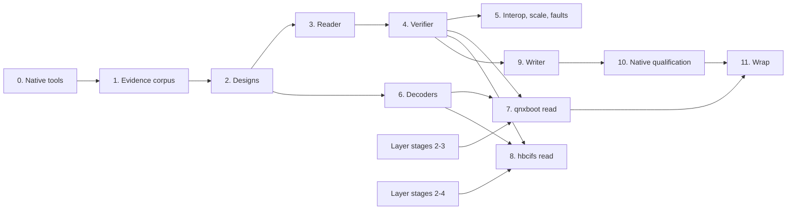

# QNX IFS implementation plan

This plan defines and orders the work that adds QNX image filesystems to
fsimg. The work comes in three parts:

* a reader and full verifier for ImageFS bodies, bare or inside QNX boot
  images;
* a writer for standalone, nonbootable ImageFS volumes;
* a gated wrap of a new ImageFS in an existing boot image's
  startup section.

Its input is the research draft
[QNX IFS / ImageFS interoperability specification](../fsspecs/QNX_IFS_fsimg_spec.md)
("the draft"). The draft is not the specification. Stage 2 writes the
format, driver, layer-profile and codec designs. These are original designs
in the present tense that cite their evidence, and they become
authoritative. Section numbers such as "draft section 6" refer to the draft.

The concrete targets are the images on the Porsche PCM 3.1 update disc
(H3 in the [QNX6 research record](qnx6-research.md#pcm-31-update-disc)):

* eight boot images: the main image `PCM3_IFS1.ifs` and its five variants,
  and the recovery image `PCM3_Emergency.ifs` and its `_LOW` variant;
* the application image `PCM3_IFS2.ifs`, which a Harman-Becker `hbcifs`
  header wraps.

The QNX 6.5.0 live CD (X1) adds three x86 boot images, and its running guest
adds the native producer and reader, `mkifs` and `dumpifs`. The owner keeps
a separate plan, outside the repository, for a QEMU board that boots a
trimmed PCM recovery image. That board needs exactly the wrap of stage
11, and it is the only SH-4 boot evidence in reach.

The working agreement applies unchanged:

* Designs come before code.
* Every stage gets the review subagent and the OpenCode GLM 5.3 max review.
* A failing regression test comes before any non-trivial fix.
* Each stage ends in one coherent commit, or a few, and skipped checks are
  reported.

No calendar estimate substitutes for a gate. Command options are named by
role, such as "the slice offset", because the
[tar-like command line](../specs/design-cli.md) replaces the current
spellings before the container stages run.

## Goals and non-goals

Goals:

1. Read ImageFS volumes through info, listing, content, extraction and
   verification, bare or as a byte slice. Resources are bounded at any legal
   geometry, up to a body of `2^32 - 4` bytes and a record table of the same
   size, and every failure falls into the closed status classification.
2. Read QNX boot images through a `qnxboot` container layer: the startup
   header, the opaque startup section, a closed set of boot prefixes, and
   uncompressed, LZO and UCL bodies, with the startup and stored-image
   checksums.
3. Read `PCM3_IFS2.ifs` through an `hbcifs` container layer.
4. Verify completely: header geometry, the record table and its
   terminator, data ranges, the derived hierarchy, the boot and script
   references, and the ImageFS checksum. Each layer adds its own checks.
5. Create standalone, nonbootable ImageFS volumes that QNX 6.5.0's
   `dumpifs` lists, checks and extracts identically to `mkifs` output of the
   same tree. The writer capability is registered only after that native
   record exists.
6. Wrap a new ImageFS in an existing boot image's startup section. The
   derived sizes and both checksums are recomputed, and the body is stored
   uncompressed or LZO-compressed. Each machine profile is registered only
   after a native boot: x86 in the QEMU VM, SH-4 on the PCM QEMU board.

Non-goals:

* Generating startup programs, boot prefixes or compiled boot scripts, that
  is, new bootable images without a template (draft section 11.3).
* Processing executables. Members are bytes. fsimg never strips, relocates
  or links ELF files.
* Chained images, IFSCSA arrays, signed images, and ELF, UEFI or S-record
  wrappers (draft section 9). No layer claims them.
* zlib-compressed bodies and a UCL encoder. Both stay unscheduled behind
  their own evidence.
* In-place modification, byte-exact "no-change" repacks, and a forensic or
  relaxed checker mode.
* Inferring hard links from shared data ranges or repeated inode numbers.
* Device nodes, named-special files and sockets, until a native fixture
  shows their encoding and the common metadata model carries them.

## Inputs and their standing

| Input | Standing | Use |
| --- | --- | --- |
| [The draft](../fsspecs/QNX_IFS_fsimg_spec.md) | Research draft, original prose | Layout, open questions (section 17), test matrix (section 14.1) and malformed cases (section 15). Its D, O, P and V marks map onto the design's established layout, observation, fsimg policy and evidence gates. Every V item is a gate, never a default |
| QNX 6.5 to 8.0 documentation (draft section 18.1) | Vendor prose; facts paraphrased | Field purposes, `mkifs` attributes, utilities |
| QNX 6.5.0 guest ([infrastructure](qnx6-infrastructure.md)) | Licensed, not redistributable | Native `/bin/mkifs` (one binary with `/bin/mkxfs`), `/bin/dumpifs` and `/bin/mkifsf_elf`, and the `startup-*` and `procnto` builds in `/boot/sys`. The guest has no `mount_ifs` |
| X1 live CD `boot/fs/qnxbase*.ifs` | Licensed, not redistributable | Three native x86 boot images with a BIOS prefix and a UCL body |
| H3 update disc, `HEADUNIT/ADR*/` | Owner's disc image, structure only | Eight SH-4 LZO boot images and one `hbcifs` image |
| `lclevy/dumpifs` (BSD-2-Clause), `qnxprobe` and `qnx_dumpers` (MIT) | External tools | Comparison only, at pinned revisions, outside the repository. No code is imported: the design is written from facts |
| `liblzo2` and `libucl` (GPL-2.0-or-later) | Black-box development oracles | Differential codec checks and the IFS2 reference decode, built outside the tree; never linked, and never read by a codec implementer (see [codecs](#codecs-and-dependencies)) |
| `~/pcm31/tools/ifs.py` | Owner's research script; its LZO decoder has no reviewed provenance | Neither an oracle nor a source. The preliminary decoded figures below came from it; stage 1 replaces them |

## Preliminary observations

These figures come from structure-only surveys and are preliminary. Stage 1
repeats them on the evidence path and records them in
`docs/ifs-research.md`. That path is native `dumpifs -u` for the boot images
and the `liblzo2` oracle for IFS2.

Measured directly on the stored bytes, with no decoding:

| Image | Layer | Machine | Prefix | `flags1` | Stored body |
| --- | --- | --- | --- | --- | --- |
| H3 `PCM3_IFS1*.ifs` (6) | Boot image | 42 (SH) | none | `0x09` (virtual, LZO) | 16-bit big-endian framed chunks |
| H3 `PCM3_Emergency*.ifs` (2) | Boot image | 42 (SH) | none | `0x09` | Framed chunks |
| H3 `PCM3_IFS2.ifs` | `hbcifs` | n/a | n/a | n/a | One unframed LZO1X stream |
| X1 `qnxbase*.ifs` (3) | Boot image | 3 (x86) | 1088 bytes, equal to `preboot_size` | `0x0d` (virtual, UCL) | 51 framed chunks in `qnxbase.ifs` |

* **Startup header.** All eleven boot images have version 1, a 256-byte
  header, and a stored image that ends exactly at the end of the file.
  `ram_size = startup_size + imagefs_size` holds in all of them.
* **Checksums.** The 32-bit little-endian words of `[startup_base,
  startup_base + startup_size)` sum to zero, and so do those of
  `[startup_base, startup_base + stored_size)`. This holds in every boot
  image checked, which answers draft question 1 for these producers: both
  trailers use the ImageFS additive rule.
* **Stored body.** The chunk framing ends with a zero length. Padding to a
  4-byte boundary follows, then the 4-byte stored trailer.
* **False magic.** The string `imagefs` occurs at offset 45368, inside the
  SH-4 startup code of all eight PCM boot images. A magic scan would misfire
  there.
* **`hbcifs` header.** It is 64 bytes: `hbcifs` and two NUL bytes, the
  decoded size, the payload length (the file length minus 64), the value 32,
  and a 32-bit field that is neither the CRC-32 nor the additive sum of the
  payload. Then come the bytes `02 01 01 00`, four more bytes, and zeros.

Measured on bodies decoded by the unreviewed `ifs.py` decoder, so stage 1
must confirm each one:

* **Chunk sizes.** Decoded chunk sizes are not uniform. `PCM3_IFS1` has 291
  chunks: 286 of 65536 bytes, two of 61440, two of 4096 and a final 14408.
  Decoded offsets can therefore be learned only by decoding.
* **ImageFS header.** All three decoded PCM bodies are little-endian, with
  header flags `0x04`. Each has a 92-byte header, a mountpoint of `/` (boot)
  or empty (IFS2), and records whose lengths are multiples of 4. Their
  checksums sum to zero, and there are no extended attributes.
* **Table end.** In each body the records tile `[dir_offset,
  hdr_dir_size - 4)`, and four zero bytes end the table.
* **Boot references.** The boot images carry `boot_ino[0] = 0xe0000002` and
  `script_ino = 3`; IFS2 carries zeros.
* **Hierarchy.** `PCM3_IFS1` has 230 records and one directory record, so
  parent directories are mostly implicit. There are no device, FIFO or
  socket records.
* **Symbolic links.** In all 214 symbolic links,
  `sym_offset = name_length + 1`: the target starts right after the name's
  NUL. `sym_size` excludes the target's own NUL, and padding to 4 bytes
  follows.
* **Inode flags.** The inode's top nibble takes the values 0, `0x8`, `0xc`
  and `0xe`. Flagged (processed ELF) members start on 4-byte boundaries, and
  none is page-aligned.

## Placement and owners

The ImageFS body and the machinery around it have separate owners, as draft
section 19 recommends and the [layer design](../specs/design-layers.md)
requires:

| Concern | Owner |
| --- | --- |
| ImageFS header, record table, hierarchy, names, content, checksum | The `ifs` filesystem driver (`lib/formats/ifs/`), on an ordinary `fsimg_io_t` |
| Startup header, boot prefix, startup section, chunk framing, startup and stored checksums, wrap | The `qnxboot` container layer |
| The 64-byte Harman-Becker header and its unframed stream | The `hbcifs` container layer |
| LZO1X decode and encode, UCL NRV2B decode | Project-owned compression codecs with no knowledge of IFS |
| Random access to a framed compressed body | The layer chunk index and decoded-chunk cache, filled by a decoding pass at peel |
| Random access to an unframed stream | The layer spool |
| Hierarchy from a flat path table | The driver, over the common external sort and the common directory walker |

The stacks are `ifs/qnxboot` and `ifs/hbcifs`. Both are containers: each
packages an ImageFS for one loader, QNX's startup code or Harman-Becker's
flash loader, with metadata and integrity fields of its own, and the
compression inside each is a property of the container, as zlib chunks are
of DMG. Compression in the layer design is a payload-agnostic encoding
around any stack; neither wrapper is that.

The layer contract carries the two containers with six changes, which
stage 2 makes in the layer design and records in the architecture:

* **Prefix probe.** The probe reads at fixed offsets from a closed table of
  boot prefixes, not only the file's prefix and last 512 bytes.
* **Opaque section.** A container may hold an opaque, executable startup
  section that is neither a table nor a chunk.
* **Learned index.** The chunk index is filled by a decoding pass rather
  than from tables.
* **Template input.** The wrap encoder takes a second, read-only input: the
  template boot image.
* **Header after body.** The startup header at the front carries
  `stored_size`, and the startup checksum covering it precedes the body, so
  a single sequential pass cannot emit the first bytes. The encoder makes
  two deterministic passes: one compresses the body to learn its stored
  length, as simg's inspection pass counts chunks, and the second emits.
  Stage 2 chooses between that and compressing once into the staged raw
  intermediate.
* **Spool-backed peel.** A container whose payload is one sequential stream
  that cannot be indexed, as `hbcifs`'s is, peels through the spool rather
  than the chunk index. Its read side is still a positional I/O object over
  the volume.

Both containers also declare that they carry a volume. A scheme in a
create stack is then refused, and on read a scheme probe already fails on an
ImageFS body, so no new rule is needed there.

The layer machinery implements stacks and partition schemes; its container
stages are specified but not implemented. Two stages wait for them:

* the `qnxboot` read stage, on layer stage 3 (containers and the chunk
  index);
* the `hbcifs` stage, on layer stages 3 and 4 (containers and the spool).

The bare ImageFS stages depend on neither. Until the container layers land,
the reader is qualified on uncompressed copies made by native `dumpifs -u`,
read as byte slices.

The draft's proposed model (section 10.3) maps onto these owners:

| Draft field | fsimg owner |
| --- | --- |
| `image_root`, `entries[]` | The common catalog and entries |
| `ifs.header` | Driver volume state; info |
| `ifs.startup`, `ifs.compression`, `ifs.security` | `qnxboot` peel state; info |
| `entry.ifs_raw`, `ifs.layout` | Not retained. Records are decoded and validated, never quoted |
| `ifs.validation` | The common verification report and status classes |

## Design decisions

Stage 2 records these in the designs, with their rationale. Most of them
remove a class of special cases rather than handling each case.

1. **Probes have fixed offsets and named identities.**
   * **`ifs`.** The identity is the seven bytes `imagefs` at volume offset
     0. The probe reads the descriptor's fixed prefix, which covers the
     88-byte header. A flags byte outside the closed table is unsupported.
     A violated bound is corrupt: `0x58 <= dir_offset <= hdr_dir_size - 4 <=
     image_size - 8`, `image_size % 4 == 0`, and `image_size` within the
     volume. The mountpoint's NUL, the record table and the checksum belong
     to open and verification.
   * **`qnxboot`.** The identity is the startup signature `0x00FF7EEB`
     (bytes `eb 7e ff 00` little-endian) followed by `header_size` 256. The
     probe looks only at the offsets in a closed table of boot prefixes:
     none at offset 0, and the 1088-byte x86 BIOS loader. A header is a
     claim only where `preboot_size` equals its offset. After the identity
     matches:
     * an unobserved version, `flags1` value or machine is unsupported;
     * a bounds violation is corrupt: `startup_size` or `stored_size` outside
       the file, or a stored image that does not end at the end of the file.

     The probe never scans for magic.
   * **`hbcifs`.** The identity is `hbcifs` and two NUL bytes at offset 0.
     A payload length other than the file length minus 64 is corrupt.
2. **The hierarchy comes from sorted paths.** The record table is a flat
   list of full relative paths. Open makes one pass over it and puts each
   record's path and byte offset into the metadata store. The common
   external sort orders them by path components, and the sorted run feeds
   the common walker's `prepare` and `replay` per directory. A duplicate
   path appears as adjacent equal keys; the stable sort keeps table order
   among them, so the last is the entry and the others are shadowed (owner
   decision 10). A record below a non-directory entry is shadowed the same
   way (owner decision 11). Missing parents are synthesized with the
   values `mkifs` gives an explicit directory record: mode `040755`, uid 0,
   gid 0, time 0.
   Nothing holds the record table in RAM.
3. **One table rule and one range rule.**
   * **Table.** The records tile `[dir_offset, hdr_dir_size - 4)` and four
     zero bytes end the table. A record that crosses the end, a zero length
     before the end, or a missing terminator is corrupt. A record with a
     zero inode word is unsupported. Padding bytes are not interpreted.
   * **Ranges.** Every regular file's data lies in
     `[hdr_dir_size, image_size - 4)`. Ranges may overlap each other
     (deduplication), and each record stays its own entry. Content goes
     through the common extent index as one extent per file. A zero-length
     file's offset is not interpreted.
4. **Acceptance tables are closed.** These values are accepted only in the
   tuples observed natively in stage 1:
   * ImageFS header flags;
   * the inode-flag nibble;
   * record kinds and their payload lengths;
   * the symbolic-link layout (decision 5);
   * a zero extended-attribute offset;
   * for `qnxboot`: `flags1`, machine values and boot prefixes.

   An unobserved value is `FSIMG_EUNSUPPORTED`, and a contradiction is
   `FSIMG_ECORRUPT`. Big-endian bodies are accepted only if stage 1
   produces one natively.
5. **Symbolic links have one layout.** The target starts at
   `name_start + sym_offset`, with `sym_offset = name_length + 1`. It is
   `sym_size` bytes long, followed by a NUL and then padding inside the
   record. Any other relationship is unsupported. E4 tests the rule against
   dangling, absolute and long targets.
6. **Names use one profile.** Path components are compared byte for byte
   under the QNX fsimg name profile: strict UTF-8, no NUL, slash, control
   byte or `0x7f`, and neither `.` nor `..`. A stored path that is absolute,
   has an empty component or has a `.` or `..` component is unsupported
   (owner decision 11). A natively legal component outside the profile
   omits its node and everything below it, counted, never fatal to the
   image and refused by extraction without the skip option, under
   the [cross-reader rule](../specs/architecture.md#names-and-metadata).
   The root is the empty path.
7. **Boot-specific state stays visible but inert.** Info reports:
   * the mountpoint and mount flags;
   * `boot_ino[]`, `script_ino` and `chain_paddr`;
   * the inode-flag counts;
   * for `qnxboot`: the decoded startup fields and the chunk statistics.

   `.script` and the boot programs are ordinary file entries, delivered as
   bytes. Verification checks that each nonzero boot or script reference
   names exactly one record, under the matching rule stage 1 establishes.
   The startup section is never an entry.
8. **A framed body has a learned index.** Decoded chunk lengths vary, so
   peel decodes every chunk once to learn the decoded offsets. Each chunk's
   stored offset, stored length and decoded range go into the layer chunk
   index, and reads then go through the decoded-chunk cache, as for DMG.
   Opening a compressed boot image therefore costs one full decode; the
   ImageFS checksum is the driver's and costs a second pass under
   verification.

   The pass enforces:
   * the framing ends with a zero length;
   * every non-final chunk decodes to at most 65536 bytes, and to at least
     the smallest non-final size stage 1 observes. A smaller chunk is
     unobserved, so it is `FSIMG_EUNSUPPORTED` under decision 4, not
     corrupt;
   * the padding up to the stored trailer is zero;
   * the decoded total equals `imagefs_size`.

   Output beyond `imagefs_size` stops decoding. These bounds also limit the
   index. The chunk count is at most `imagefs_size` divided by the smallest
   non-final size, plus one, so the index is a fixed small fraction of the
   declared decoded size and never scales with the stored length. Each
   chunk's stored length is at most 65535, and its work is charged to the
   work counter. The other failures are corrupt.
9. **The writer has one deterministic layout.** The layout:
   * the header and the mountpoint, padded to 4;
   * the record table, each record padded to 4 bytes, then the terminator;
   * file data on 4-byte boundaries;
   * zero padding, then the checksum trailer.

   Stage 1 sorts every layout property into one of two classes:
   * **Conventions** that a reader could depend on. Examples are whether
     directories have explicit records, the root record, padding and
     alignment. The writer follows `mkifs` for each of these.
   * **Free choices.** Examples are inode numbering, record order and data
     order. The writer uses its own deterministic order for these.

   Sizes, uid, gid and times must fit 32 bits, and the whole image must fit
   `2^32 - 4` bytes. An unrepresentable entry fails and is never truncated.
10. **A wrap keeps the template's startup section.** The `qnxboot` encoder
    copies the template's prefix and startup section. It recomputes only
    the derived fields:
    * `imagefs_size`;
    * `stored_size`;
    * `ram_size`, as `startup_size + imagefs_size`;
    * the compression value in `flags1`;
    * the startup checksum;
    * the stored trailer.

    Every other startup byte is the template's. The encoder refuses:
    * a template with any unobserved `flags1` bit;
    * an IFSCSA or signature marker;
    * a decoded ImageFS larger than the template's `imagefs_size`, until
      E8's growth case shows that `mkifs` changes no other startup field
      when an image grows. The stored length may differ freely, since it
      depends on the codec.

    The body is stored uncompressed or as LZO chunks of at most 65536
    decoded bytes. If E8 shows that processed members depend on their image
    offset, a wrap may not move them, and this decision reopens with owner
    decision 6.

## Codecs and dependencies

The compression codecs are project-owned C. `liblzo2` and `libucl` are not
linked, even optionally:

* **License.** Both are GPL-2.0-or-later. Linking either into libfsimg
  would bind every distributed fsimg binary to the GPL, which a
  BSD-2-Clause library and command cannot carry.
* **Dependencies.** The working agreement keeps the core free of runtime
  dependencies beyond libc, host APIs and the system zlib. Neither library
  is a system library on macOS or FreeBSD.
* **Default build.** An optional link-time integration would leave the
  default build unable to read any PCM image, the main target. The draft's
  licensing gate (draft section 6) reaches the same conclusion.
* **Size.** The decoders are small. LZO1X and NRV2B decoding each take a
  few hundred lines. The work is in bounds checks, overlap-safe copies and
  tests, which fsimg needs whichever code decodes.

Provenance follows a clean-room split:

* **LZO1X.** The factual source is the stream-format prose of the Linux
  kernel's `Documentation/staging/lzo.rst` (draft reference 26), paraphrased
  into `specs/design-codecs.md`.
* **NRV2B.** No permissively licensed format description is known.
  The bitstream semantics are written into the codec design by a describer
  who may study GPL or MIT implementations. The describer writes only
  facts: the bit order, the gamma codes, offset and length rules and the
  end marker, and no code or code-shaped pseudocode. A review checks that
  before the design is accepted.
* **Implementers.** Whoever writes the codecs works from the design and
  black-box tests alone, and reads no GPL or MIT codec source. When agents
  do the work, the describer and the implementer are separate sessions that
  share no context beyond the accepted design.
* **Oracles.** The GPL libraries serve only as compiled black boxes. They
  are built outside the tree, under `~/.local/share/fsimg-oracles` as the
  exFAT oracles are, into a small differential checker and decoder. The
  integration script runs them when it finds them and reports a skip
  otherwise. They never enter the repository or the link.

Codec contracts, written in stage 2:

* **Decoders.** Input and output bounds are explicit, and the output bound
  is the caller's, never a value from the stream. Three cases are corrupt:
  a match distance before the output start, a literal or match past either
  bound, and an unterminated stream. Decoding never reads past the input or
  writes past the output, and the work counter limits CPU.
* **LZO1X encoder.** It is deterministic: the same input gives the same
  stream on every host. Three checks validate it: the project's own
  decoder, the `liblzo2` oracle, and the native startup code in stage 11.
  It need not match `mkifs`'s compressed bytes.

## Evidence questions

These are the draft's section 17 questions plus those this plan adds. Each
is tied to the experiment that answers it and the stage that consumes it.
Experiments E1 to E12 and the surveys S1 and S2 are defined in stage 1.

| Question | Evidence | Consumer |
| --- | --- | --- |
| Root record presence and path; explicit versus implicit directories; metadata native readers give implicit parents | E1, E3, S1 | Hierarchy (decision 2), writer layout |
| Header flags, mountpoint default, `dir_offset` padding, mount flags | E1, E2, S1 | Probe tables, writer header |
| Table terminator; zero-length and zero-inode records | E1, S1 | Decision 3 |
| Whether nonbootable `mkifs` output ends at `image_size`; padding contents | E1, E6 | Volume length rule, verifier |
| Inode numbering, the flag nibble, and how `boot_ino[]` and `script_ino` match a record | E1, E8, S1 | Verifier references, writer numbering |
| Which layout properties are conventions and which are free choices | E1, E6, S1 | Decision 9 |
| Name and path limits; non-ASCII; the 16-bit record-length limit | E3 | Name profile, writer limits |
| Symbolic-link layout for relative, absolute, dangling and long targets (draft question 5) | E4, S1 | Decision 5 |
| FIFO, device, named-special and socket encodings (draft question 8) | E4 | Entry kinds |
| uid, gid, mode and time limits; the effect of `-n` and `-nn` | E5 | Writer representability, reproducibility comparison |
| Duplicate content, shared-range counts and hard links (draft question 7) | E6, S1 | Range rule; the default extraction ceiling on deduplicated images |
| Extended-attribute use (draft question 6) | E1 to E8, S1 | Acceptance tables |
| Compression values 6.5.0 accepts; chunk sizing and the smallest non-final chunk; padding after the terminator (draft question 4) | E7, S1, S2 | Decision 8, encoder |
| Whether the x86 startup accepts uncompressed and LZO bodies | E8, E12 | Wrap profiles |
| Startup and stored checksum domains (draft question 1) | S1, S2, E8 | `qnxboot` verification, wrap |
| Which startup fields change when the same buildfile gains a file | E8 | Decision 10's growth refusal |
| Whether processed members' bytes depend on their image offset (draft question 9) | E8 | Decision 10, owner decision 6, writer layout |
| Whether `procnto` needs a member's processed-ELF flag, or a raw member runs unflagged | E8, E12 | Owner decision 6 |
| Header tail variant in 6.5.0 and 6.3.2 images (draft question 2) | S1, S2 | Opaque-tail policy |
| Big-endian bodies: whether 6.5.0 `mkifs` can produce one | E9 | Byte-order support |
| Whether `dumpifs` checks the ImageFS and stored checksums | E10 | Oracle sensitivity |
| A native way to mount a nonbootable image on 6.5.0, given no `mount_ifs` | E11 | Owner decision 7 |
| How to boot an x86 image in QEMU, and how a successful boot is detected | E12 | Stage 11 x86 gate |
| How `procnto` resolves a path below a symbolic-link record (files and FIFOs follow by policy) | E12 | Owner decision 11 |
| `hbcifs` header fields and checksum | S1 | `hbcifs` verification, owner decision 8 |

## Work packages

Every stage leaves `make -j32 check` passing and follows the gates below.

### 0. Native tools and harness

* In the running guest, record:
  * `use mkifs` and `use dumpifs`, including whether `dumpifs` has `-m`;
  * `cksum` and SHA-256 of `/bin/mkifs`, `/bin/dumpifs`, `/bin/mkifsf_elf`
    and the `startup-bios` and `procnto` builds;
  * the buildfile attributes 6.5.0's `mkifs` accepts, from its
    documentation and by trial.

  Copies go to `~/qnx65-vm/bin-ifs/`.
* Establish the transport and record it:
  * **Into the guest.** An image of at most 3 MiB encoded goes through
    `capture.sh -i`. Larger images, such as the PCM files and IFS2's
    reference decode, are written into the sparse `big.img` while the VM is
    stopped and read with `dd` from `/dev/hd1`. The guest's block cache
    does not see host writes while the VM runs.
  * **Out of the guest.** A `capture.sh` image of `hd0` or `hd1`, with the
    IFS at a recorded offset and length.
* The x86 boot method (E12): the guest's `mkifs` builds a `bios.boot`
  image whose startup puts the console on COM1, the image replaces the
  boot image inside a copy of the live CD's El Torito floppy, a separate
  headless QEMU boots that floppy with the serial port written to a file,
  and the build script's `display_msg` markers in that file detect the
  boot. The [research record](ifs-research.md#paths-below-a-link-at-boot-e12)
  gives the exact attributes, offsets and commands.
* Build the out-of-tree `liblzo2` and `libucl` oracles. The `liblzo2`
  decoder turns IFS2's payload into a bare ImageFS, whose own checksum
  witnesses the decode.
* Keep IFS captures in `~/qnx65-vm/captures-ifs/`, which becomes
  `FSIMG_IFS_NATIVE`. Name captures `ifs-KIND-OPTION`, for example
  `ifs-pop-nn`.
* **Gate:** the tool identities, both transport methods and the oracle
  builds are recorded in `docs/ifs-research.md`. If `mkifs` cannot build a
  nonbootable image in the guest, stop and ask the owner: the writer gate
  needs it.

### 1. Native evidence corpus

The scripts under `tools/qnx/` are exempt from the style guide and the
review gates. They are research aids that trust their input, are used only
on the owner's images, and are never test oracles.

* `tools/qnx/decode/ifsdump.py`: dumps an uncompressed boot image or ImageFS.
  It covers the startup fields, both checksums, the ImageFS header, the
  record table with kinds, flags and ranges, the terminator, the
  symbolic-link layout, the hierarchy, and padding. It is written
  independently of `lib/` and decodes no compression. Its input is a
  `dumpifs -u` copy, or the oracle's decode for IFS2.
* `tools/qnx/decode/ifschunks.py`: reads the chunk framing without decoding.
  It reports stored chunk lengths, the terminator, the padding and the
  trailer, and checks both startup checksums.
* `tools/qnx/guest/popifs.sh`: builds the buildfiles and trees for the
  population cases.
* `tools/qnx/pcm/pcmifs.py`: structure-only statistics for one image.

Native experiments vary one property at a time. Each produces one capture,
with its buildfile, its command record and `dumpifs -v` output:

| Experiment | Procedure |
| --- | --- |
| E1 Minimal | Nonbootable images of one file, of an empty tree if accepted, and of a nested tree; `-n` and `-nn` builds twice for reproducibility |
| E2 Header | Each mountpoint attribute and the buildfile's entry-name `prefix` attribute; an empty mountpoint |
| E3 Names | Components of 1, 255 and 256 bytes and the longest accepted; paths near the record-length limit; non-ASCII names; deep nesting; parents listed and unlisted |
| E4 Kinds | Relative, absolute, dangling and 1 KiB symbolic links; directories; FIFOs, devices and other types if the buildfile accepts them |
| E5 Metadata | uid and gid of 0, 65535 and the largest accepted; modes 0000, 0644, 0755, 4755 and 7777; times 0 and the largest accepted |
| E6 Data | Sizes 0, 1, 3, 4, 65535, 65536, 65537, and above 16 MiB; identical contents; alignment attributes |
| E7 Compression | Each compression value 6.5.0 accepts, on bootable images (and nonbootable ones if accepted): chunk sizes, padding and the trailer |
| E8 Boot images | x86 `startup-bios` and `procnto` images: uncompressed and with each accepted codec; with and without the BIOS prefix; `boot_ino[]` and `script_ino`. Two variants of one buildfile: one with a file added after the executables, one with a file added before them. The first shows which startup fields grow; the second shows whether processed members' bytes depend on their offset. Members marked raw (unprocessed) show their flags and whether they run |
| E9 Byte order | A big-endian nonbootable image, if any attribute or target produces one |
| E10 Oracle sensitivity | One flipped byte each in a record, in file data, in the ImageFS trailer and in the stored trailer: what `dumpifs` reports |
| E11 Mounting | Whether 6.5.0 mounts a nonbootable image (`procnto` options, `mount` types) |
| E12 Boot | The stage 0 method on records below a symbolic link, which `procnto` shadows; on a duplicated path; on an unmodified `qnxbase.ifs`, on each E8 image, and on the E8 raw-member image |

The surveys are:

* **S1**, over the eight H3 boot images (through `dumpifs -u` copies made in
  the guest) and IFS2 (through the oracle's decode);
* **S2**, over the three X1 images.

Both record:
* the startup fields and their relationships;
* checksum results;
* chunk statistics, including the smallest non-final decoded size;
* ImageFS header tuples and the table terminator;
* kind, flag-nibble and alignment histograms;
* the symbolic-link layout;
* path depth and length histograms, and how many names are valid UTF-8;
* explicit versus implicit directories;
* boot and script reference matching;
* data-range overlap counts;
* padding contents;
* the `hbcifs` header fields.

The surveys record no names, contents, identities or timestamps, under the
QNX6 record's research boundary. Each image's manifest of names, sizes and
checksums stays outside the tree, beside its capture or copy under
`~/qnx65-vm/captures-ifs/`. Gates compare against it there, and the
repository records only pass and fail counts.

* **Deliverable:** `docs/ifs-research.md`, the evidence record. It holds
  sources and licenses, tool identities, the transport and boot methods,
  per-experiment observations, and S1 and S2. For each evidence question it
  gives either an answer with its capture or an open status naming the
  feature it blocks.
* **Gate:** every row of the evidence table is answered or explicitly open,
  and no open row is needed by the reader. Stages 1 and 2 may iterate, since
  the designs cite the observations.

### 2. Designs, indices and TODO

* `specs/design-ifs.md`, the format design. It covers:
  * scope and evidence vocabulary;
  * the ImageFS header and record offset tables;
  * kinds and their payloads, the symbolic-link rule, inode flags, and boot
    and script references;
  * the table terminator and the checksum;
  * hierarchy derivation, names and the profile;
  * reader and writer profile tables, and the PCM images;
  * deterministic planning and emission;
  * resource and failure requirements;
  * the acceptance matrix, adapted from draft sections 14.1 and 15;
  * source keys.

  Rules carry stable anchors so that the
  [specification-driven harness](../specs/design-spec-testing.md) can cite
  them when it reaches IFS. ImageFS's scalar ranges and nested bounds suit
  it well (draft section 15).
* `specs/design-ifs-driver.md`, the driver design. It covers modules,
  record codecs, probe and open, the path sort and hierarchy, names,
  content, verification, writer settings, planning, emission, resource
  bounds, failure classification and tests.
* Layer design updates:
  * a `qnxboot` profile: probe and the boot-prefix table, the closed
    `flags1` and machine tables, peel through the learned chunk index and
    its bounds, both checksums, info fields, and the wrap encoder with its
    template input;
  * an `hbcifs` container profile: the probe, header checks, and peel
    through the spool;
  * the six contract changes listed under
    [placement](#placement-and-owners);
  * `ifs` added to the filesystem slot.
* `specs/design-codecs.md`: the LZO1X and NRV2B decoders and the LZO1X
  encoder. It covers the factual stream descriptions, bounds, the work
  counter, determinism, the clean-room procedure, and the differential
  oracles. The codecs are new mechanism, so the layer design's "later
  profiles" rule requires their own design.
* Index and contract updates:
  * `specs/README.md`: rows for the new designs;
  * `specs/architecture.md`: the format list, the layer-contract changes,
    and project-owned compression codecs in the dependency contract;
  * `specs/design-formats.md`: `ifs` among the public names, and an IFS
    section;
  * `specs/design-sizing.md`: the ImageFS writer has an exact derived size
    and no free space;
  * `specs/design-cli.md`: any filesystem and layer settings.
* Plan and TODO updates:
  * `docs/implementation-plan.md`: keep the extension-sequence pointer
    current;
  * `TODO.md`: replace the "QNX IFS image support" feature item with a
    major-initiative summary linking `docs/todo-ifs.md`.
* **Gate:** the review subagent checks the designs against the research
  record, against the common contracts, and for readability. The NRV2B
  description gets a separate provenance review. The owner accepts the
  designs.

### 3. Reader: probe, open and traversal

* `lib/formats/ifs/`, split as the driver design fixes it. The expected
  modules:
  * `ifs.h`: private types and prototypes;
  * `descriptor.c`: `fsimg_ifs_format`, the capability record and the probe;
  * `records.c`: pure decoders and encoders for the header and every record
    kind;
  * `volume.c`: header validation and the record-table pass;
  * `tree.c`: the path sort, the derived hierarchy and synthesized parents;
  * `names.c`: components and the profile;
  * `directory.c`: `prepare`, `replay`, `keys` and `key`;
  * `read.c`: the reader operations, content ranges and volume information.
* Registration in the static descriptor list. The reader capability names
  files, directories and symbolic links, plus FIFOs if E4 finds the
  encoding. It also names owner, mode and modification time. Build wiring
  and `EXTRA_DIST` come with it.
* `test/ifs.c`: an independent synthetic generator. It uses its own offset
  tables written from the design and shares no code with
  `lib/formats/ifs/`. It builds bodies in memory, from the header through
  the record kinds, implicit parents, shared ranges, boot references, the
  terminator and the trailer, and it mutates them.
* `fuzz/ifs.c`: probe, open, traversal and content under finite budgets,
  with seeds generated at run time.
* Tests cover the acceptance matrix:
  * **Probe and header:** probe exclusivity in both directions against FAT,
    exFAT, QNX6 and QNX4 fixtures; each bounds relation at `x - 1`, `x` and
    `x + 1`; a missing mountpoint NUL; unknown flags; truncation below 88
    bytes and below `image_size`.
  * **Records:** lengths 0, 1, 23 and 24, below the kind's minimum, and
    crossing the table end; a missing or nonzero terminator; a zero inode
    word; nonzero extended-attribute offsets.
  * **Hierarchy:** implicit parents at depth 1 and depth 32; a duplicate
    path; a path below a file, shadowed; an absolute path, `..` and empty
    components; the root record present and absent.
  * **Ranges:** a range ending exactly at the trailer; a range including
    the trailer; a range inside the record table; start plus length
    overflowing 32 bits; shared ranges, including extraction of a heavily
    shared image under the default ceiling; zero-length files with
    arbitrary offsets.
  * **Symbolic links:** each off-by-one candidate, a target crossing the
    record, a missing NUL.
* **Gate:**
  * Info, listing, content and extraction agree with the native manifests
    of names, sizes and checksums. This holds on the synthetic fixtures, on
    every uncompressed nonbootable E capture, and on `dumpifs -u` copies of
    the compressed and boot captures and of S1 and S2, read as slices.
  * No byte reaches delivery unvalidated.

  The stage may land as two commits: the record codecs, generator, probe,
  open and info; then the hierarchy, names and content.

### 4. Verifier

* `verify.c` runs the common walker once and checks:
  * the ImageFS checksum, in one sequential pass;
  * the table rule and the range rule (decision 3);
  * the boot and script references, each matching one record's full inode
    word;
  * shadowed records, the earlier records of duplicate paths and the
    records below a non-directory, reported by count; a reference that a
    shadowed record also carries waits on the owner's answer to the
    [references item](todo-ifs.md).
* Tests cover:
  * a flipped byte in each region;
  * a trailer of the wrong byte order;
  * dangling and duplicate boot references;
  * a reference to a directory;
  * nonzero padding, which verifies;
  * a shadowed duplicate path and a record shadowed below a link;
  * verification incomplete after an unsupported record.
* **Gate:**
  * every well-formed native capture and every S1 and S2 copy verifies;
  * every E10 capture and every corruption case fails with its class;
  * a report is never marked complete after skipping a record.

### 5. Reader interoperability, scale and faults

* `test/ifs-integration.sh.in` runs the oracles it finds and skips the
  others explicitly:
  * the native manifests;
  * `lclevy/dumpifs` and `qnxprobe`, as comparisons only, when their paths
    are given;
  * the S1 and S2 copies, whose paths come from the environment. On these
    the script runs only info and verification and prints counts. A
    mismatch against an out-of-tree manifest reports counts only, never a
    member name.
* Scale cases, on sparse fixtures:
  * a body of `2^32 - 4` bytes;
  * a record table of a million entries, which must spill to scratch;
  * a flat root of a million files;
  * a path at the record-length limit;
  * depth 512, the most a 1024-byte path holds.

  Each records I/O calls, metadata passes, peak scratch and RSS.
* Faults: allocation, scratch, short read, EOF and cancellation at every
  stage, each followed by a cleanup check.
* **Gate:** the scale figures hold within the session budget, and the
  comparisons are recorded in `docs/build.md` or reported as skipped with
  the reason.

### 6. Compression decoders

* The LZO1X and NRV2B decoders, under the module path the codec design
  fixes, written under the clean-room procedure. They have no knowledge of
  IFS.
* `test/codec.c`:
  * hand-built streams for every instruction form and boundary: literal
    runs, every match class, distances at their limits, and the end marker;
  * truncation at every byte;
  * distances before the output start;
  * output one byte past the bound;
  * a decompression-bomb ratio under the work counter.
* `fuzz/codec.c` for both decoders.
* The out-of-tree differential checker: random and corpus-derived streams
  decode identically under the project's decoders and under the oracles.
* **Gate:**
  * every chunk of the eight S1 boot images decodes to the bytes of its
    `dumpifs -u` copy;
  * IFS2's stream decodes to the oracle's bytes;
  * every S2 chunk decodes likewise under NRV2B;
  * the differential checker agrees, or is reported as skipped.

### 7. `qnxboot` read

Depends on stages 4 and 6 and on layer stages 2 and 3.

* The container descriptor:
  * the probe (decision 1);
  * peel, through the learned chunk index (decision 8), or through a slice
    for an uncompressed body;
  * verification: the startup and stored checksums, `imagefs_size`
    against the ImageFS's `image_size`, and `ram_size` against its rule.
* Info reports the decoded startup fields, the codec and the chunk
  statistics.
* Tests:
  * generator-built boot images with opaque startup bytes, for each prefix
    and codec;
  * mutations of every header field, of the framing (a missing terminator,
    a short non-final chunk, an over-long decode), of the padding and of
    both trailers;
  * a stored body of minimum-size chunks, which must fail within the index
    bound before scratch grows;
  * random-access reads that touch at most the decoded-chunk cache's
    budget.
* **Gate:** listing and extraction of the eight H3 boot images and the
  three X1 images agree with their native manifests directly, without
  `dumpifs -u`. Verification passes, and every mutation fails with its
  class.

### 8. `hbcifs` read

Depends on stages 4 and 6 and on layer stages 2 to 4.

* The container descriptor: the probe (decision 1), the header checks S1
  establishes, then peel through the spool, bounded by the header's decoded
  size.
* Until evidence identifies the header's checksum field, verification
  reports it as unverified, and a full verification is therefore
  incomplete (owner decision 8). Every other check runs.
* **Gate:** `PCM3_IFS2.ifs` lists and extracts against its manifest, and
  verification passes every check it makes and names the unverified field.
  A spool-limit test fails at the step that crosses the limit.

### 9. Writer, unregistered

* `write-ifs.h`, `write-plan.c` and `write-emit.c`.
* Settings:
  * `mountpoint`: at most the length the header layout allows; the default
    from E2;
  * `endian`: little, or big if E9 qualified it;
  * epoch: within 32 bits.

  The ImageFS has no free space or geometry, so a requested volume size or
  minimum free space is refused.
* Planning passes:
  * **Entries.** Check names against the profile, kinds and metadata
    against representability, and sizes.
  * **Records.** Compute each record's length and the table size.
  * **Layout.** Assign data offsets after the table is sized (decision 9).
  * **Summary.**

  Rows live in one paged array, as in QNX4 and QNX6.
* Emission writes:
  * the header;
  * the record table, computed from the rows, and its terminator;
  * payload copies at their offsets;
  * zeroed padding;
  * the checksum, accumulated over the emitted words.

  Every byte comes from a row, the layout or a profile constant.
* `test/ifs-write.c`:
  * round trips through the reader, the verifier and an independent checker
    written from the design;
  * byte-identical output across source order, cache size, scratch path and
    time zone;
  * a poison scan of every padding byte;
  * faults at every stage;
  * `--native`, which compares a writer image with the E1 capture of the
    same tree. The comparison is field by field, apart from the free
    choices decision 9 lists.
* **Gate:** every check passes. The stage lands with the writer capability
  unregistered, as the QNX4 and QNX6 writer stages did, and the gap is
  listed in `docs/todo-ifs.md`.

### 10. Native qualification and writer registration

* `tools/qnx/guest/qualifyifs.sh` runs this cycle in the guest, for each
  fsimg image:
  1. `dumpifs -v`, and `dumpifs -m` if stage 0 found it, compared with
     fsimg's manifest;
  2. `dumpifs -x` into a scratch directory, then `find`, `ls -l` and
     `cksum` compared with the source tree;
  3. `mkifs -nn` of the same tree, its `dumpifs -v`, and a comparison of
     both listings;
  4. the E11 mount, if one exists, then a listing and read-back of the
     mounted tree.
* The images cover:
  * one file;
  * the E3 name limits;
  * the E4 kinds;
  * the E5 metadata limits;
  * the E6 data sizes and shared contents;
  * an empty mountpoint.
* The record goes into `docs/ifs-research.md` under fsimg writer output,
  with captures in `~/qnx65-vm/writer-captures-ifs/`.
* Registration covers the capability record and the formats output, plus
  updates to `README.md`, `docs/fsimg.1`, `docs/libfsimg.3` and `NEWS`.
* **Gate:** every cycle passes, and the registration bar of owner decision
  7 is met.

### 11. Boot-image wrap

Depends on stages 7 and 10, on E8's answers for owner decision 6, and on
the layer design's command-line spelling of wrap.

* The LZO1X encoder, with determinism tests and the differential checker.
* The `qnxboot` wrap encoder (decision 10): the template input, read and
  verified through the stage 7 peel; the recomputed fields; chunked LZO or
  uncompressed emission; and the refusals.
* The ImageFS writer gains the boot-specific settings that owner decision 6
  chooses.
* Tests:
  * a wrap of a standalone writer image, peeled again, yields exactly that
    writer image's bytes: the container never alters the body;
  * each refusal;
  * byte-identical output across hosts;
  * a stored trailer and startup checksum that verify.
* **x86 gate (E12):** a wrap of `qnxbase.ifs`'s own tree, rebuilt by the
  writer, boots to a shell in QEMU. If the writer's image of that tree is
  larger than the template's decoded ImageFS, this gate waits for E8's
  growth evidence. If decision 10's growth refusal is
  lifted, so does one with an added file, which the shell reads back. The
  same holds for an E8 template, uncompressed and with LZO if E8 shows that
  `startup-bios` accepts it. The x86 profile is registered then.
* **SH-4 gate:** a wrapped, trimmed `PCM3_Emergency.ifs` boots on the PCM
  QEMU board. Until that board exists, the SH-4 profile stays unregistered
  and the gap is listed in `docs/todo-ifs.md`.

Unscheduled, each behind its own evidence:
* zlib bodies;
* a UCL encoder;
* big-endian bodies, if E9 finds no producer;
* device nodes and the other special kinds;
* chained images;
* IFSCSA;
* signed images;
* ELF and S-record wrappers;
* an `hbcifs` writer;
* boot-script decoding.

## Dependency order

Stages 3 to 6 and 9 to 10 need no layer machinery. Stages 5, 6 and 9 are
independent once their inputs exist. If the layer stages have not landed
when stage 6 completes, stages 9 and 10 go first.

## Gates for every stage

* **Review before tests.** Launch the review subagent first, before the
  pre-commit test run. Ask it explicitly for:
  * bugs and design issues;
  * security and information-leak concerns, with the security pass framed
    in the prompt;
  * the style guide's readability review, citing specific functions.

  Address every Critical and High finding. Fix each Medium finding or
  record it in `TODO.md` or the commit message.
* **External review.** Run the OpenCode review through
  `build-aux/opencode-review.sh` with `zai-coding-plan/glm-5.3 --variant max`
  over `git diff`. Substantive fixes are reviewed again. A failed or
  unavailable review is reported, never replaced.
* **Tests.** Write a failing regression test before any non-trivial fix.
  Run `make -j32 check` at every stage.
* **Sanitizers.** The coordinating session runs `check-asan`,
  `check-ubsan`, the supported LSan and MSan targets, and `check-fuzz` once
  on the integrated tree before landing. These targets build from a
  `make distdir` copy, so every new source, test and script must be in
  `EXTRA_DIST`. The decoder stage gets the longest fuzz run: its decoders
  parse every compressed byte of an untrusted image.
* **Project hygiene.** New C and shell files are ASCII with BSD-2-Clause
  headers. `docs/build.md` records the commands, the evidence and any
  explicit skips. `tools/qnx/` stays exempt. Native images, startup bytes,
  member files, buildfile outputs and member-name manifests never enter the
  repository.

## Departures from the draft

| Draft | This plan | Reason |
| --- | --- | --- |
| A format-private envelope retaining raw records, layout and gaps (section 10.3) | Decoded, validated fields; info reports them; records are never quoted | Information-leak policy; no byte-preserving repack |
| Strict, forensic and relaxed modes; `dumpifs -z`-style relaxed search | One verification with closed status classes; probes use fixed offsets | One checker contract across formats |
| Magic search in a caller-supplied window (section 10.1) | A closed table of boot prefixes at fixed offsets | `imagefs` occurs inside every SH-4 startup section |
| Ambiguous symbolic links reported as such (section 5.2) | One layout; others unsupported | The preliminary survey shows it in every PCM link; S1 and E4 confirm |
| Startup checksum algorithm unknown (section 3.5) | The additive rule over both domains | Observed in every boot image checked; S1 and S2 confirm |
| Compressed body decoded into a temporary file (section 6) | The learned chunk index for framed bodies; the spool for `hbcifs` | Both owners exist in the layer design |
| `hbcifs` as an OEM container to keep out of the core (section 9) | A container profile in the layer registry, read only | The PCM application image needs it |
| Adapting the BSD-3-Clause `go-compressions/lzo` decoder (section 6) | A decoder written from the stream description | A Go source is a rewrite either way, and a decoder written from the description keeps one provenance story for both codecs |
| Byte-exact no-change repack (section 14.2) | A wrap with recomputed fields | The output is a new image, not a preserved one |
| Big-endian reading in stage A2 | Only if a native producer exists | Closed tables accept only observed values |
| Hard links inferred from aliases, or a sidecar manifest | Never inferred; every record is an entry | No common hardlink representation; draft question 7 |
| `fsimg -t ifs -l` and similar | The tar-like CLI | The flags in the draft are not normative (section 12) |
| BSD `lclevy/dumpifs` as a possible code source (section 13.2) | Comparison only | Designs are written from facts; nothing is imported |
| Stage order A0 to D (section 16) | Reader, verifier and writer on bare ImageFS first; layers after the layer stages | The container layers are not yet implemented |

## Owner decisions

The owner has settled all eleven.

1. **Writer scope.** A standalone, nonbootable ImageFS writer first, then a
   gated wrap of a new ImageFS in an existing boot image (stages 9 to 11).
2. **Placement.** `ifs` is the filesystem and the boot machinery is the
   `qnxboot` container layer. Bare ImageFS lands first.
3. **Codecs.** LZO1X decode, UCL NRV2B decode and LZO1X encode are in scope.
   zlib is not scheduled.
4. **Native producer.** The guest's 6.5.0 `mkifs` and `dumpifs` are the
   oracle. No licensed SDP beyond the live CD is needed.
5. **Codec provenance.** The codecs are project-owned, written under the
   clean-room split, with `liblzo2` and `libucl` used only as out-of-tree
   black-box oracles. No GPL library is linked, even optionally
   ([codecs](#codecs-and-dependencies)).
6. **Boot attributes in a wrapped image.** The writer takes typed settings:
   up to four boot programs and one script, named by path, plus an
   inode-flag rule that E8 must justify. The writer never reads an image,
   and the template supplies only the startup section. Inheriting flags by
   path from the template was rejected because it makes the writer plan
   against a reader's catalog. If E8 finds members whose bytes depend on
   their image offset, a wrap must keep them at the template's offsets, and
   the wrap's scope returns to the owner.
7. **Writer registration bar.** `dumpifs` acceptance in the stage 10 cycle,
   plus the E11 mount if one exists. QNX 6.5.0 has no `mount_ifs`, so
   without an E11 mount the bar is `dumpifs` acceptance alone.
8. **`hbcifs` checksum.** Until evidence identifies the header's checksum
   field, IFS2 is read, and verification reports that field as unverified
   and the verification as incomplete.
9. **`hbcifs` layer kind.** A container, peeled through the spool
   ([placement](#placement-and-owners)). It packages an ImageFS for one
   loader with metadata of its own, as `qnxboot` does, and only one file on
   the examined disc variant carries its header. If stage 1 finds the
   header on non-IFS payloads, this returns to the owner.
10. **Duplicate paths.** Native images store some paths twice (every H3
    boot image has a link record and a file record for one to three paths).
    The last record with a path is the entry, as `dumpifs -x` leaves it;
    earlier records with that path are shadowed: counted by info, reported
    by verification, never delivered. A boot test showing that `procnto`
    resolves differently reopens this.
11. **Paths `mkifs` writes but fsimg does not represent.** A stored path
    with a `.` or `..` component, an empty component or a leading slash
    makes the image `FSIMG_EUNSUPPORTED`, not corrupt: `mkifs` writes such
    paths verbatim. A record whose path lies below a non-directory entry (a
    symbolic link, a regular file or a FIFO, the last record at that path)
    is shadowed, exactly like the earlier records of a duplicate path:
    never delivered, counted in info's `shadowed` detail, reported by
    verification, never an error, whatever the table order. The
    non-directory entry itself is delivered normally. Boot test E12 shows
    `procnto` hiding the records below a symbolic link in every table
    order tested, and six of the eight H3 boot images hold two such
    records; files and FIFOs follow the same rule as fsimg policy, so that
    one rule covers every non-directory.

## Risks

* **The layer schedule.** The `qnxboot` and `hbcifs` stages wait for layer
  stages 2 to 4. The bare ImageFS stages and the decoders do not, and
  `dumpifs -u` copies stand in for compressed images until then.
* **QNX 6.5.0 is not the head unit.** The PCM images come from a 6.3.2-era
  SH-4 toolchain that is not available. `mkifs` 6.5.0 output qualifies the
  writer's ImageFS. Only the PCM QEMU board, or a bench unit, qualifies an
  SH-4 wrap, and that board is a separate plan whose own risks apply.
* **Offset-dependent members.** If processed members encode their image
  offset, a free layout cannot wrap them, and the wrap narrows to keeping
  those members in place (owner decision 6). E8 tests this before any wrap
  code exists.
* **Undocumented startup coupling.** The loader may depend on physical
  placement, `ram_size` or `imagefs_paddr` in ways the header does not show.
  Decision 10's refusals and the boot gates contain this. A wrap never
  claims bootability without a recorded boot.
* **Implicit directories.** If native readers derive implicit parents
  differently from each other, the synthesized metadata becomes a
  documented fsimg policy rather than an observation.
* **Big-endian and special kinds.** With one native producer for x86, E9
  and E4 may find no big-endian body or device encoding. Those features
  then stay unsupported.
* **Codec hardening.** The decoders parse every compressed byte of an
  untrusted image. A wrong bound is a memory-safety bug, not a format error.
  The decoder stage has its own fuzz targets, the differential oracles, and
  the longest sanitizer run.
* **NRV2B provenance.** Without a permissive format description, the
  clean-room description is the only clean path. If the provenance review
  cannot accept it, UCL reading stops and the X1 images are read only
  through `dumpifs -u` copies.
* **Image transport.** The serial loader limits guest input to about 3 MiB
  encoded. PCM-sized images go through `big.img` with the VM stopped.
* **Provenance.** The designs are written in project prose from facts.
  Research decoders and tests import nothing from GPL or MIT sources, and
  no stage uses the owner's unreviewed `ifs.py` decoder. Native images,
  startup bytes and member files never enter the repository.
