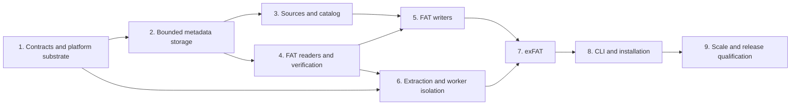

# fsimg implementation plan

This plan implements the target [specification](../specs/README.md). It orders
work and records completion gates; it does not narrow the specification to a
partial implementation. Each work package is split into reviewable commits
that keep existing checks passing. No calendar estimate substitutes for an
acceptance gate.

## Implementation status

| Package | Status | Evidence or next gate |
| --- | --- | --- |
| 1. Contracts and platform substrate | Implemented with actual-kernel confinement checks | macOS, Linux and FreeBSD suites; confined image/source scans and publication evidence in [platform-evidence.md](platform-evidence.md); UFS immediate-reader handoff remains a Medium investigation |
| 2. Bounded metadata storage | Implemented and validated on the native host | Shared cache, private scratch, record streams, arrays/bitsets, stable external sort, fault tests, ASan/UBSan, and above-budget scale checks in [build.md](build.md) |
| 3. Sources and catalog | Implemented and validated on the native host | Descriptor-relative scanning, source providers, deterministic catalog, common writer lifecycle, fault regressions, and scale/sanitizer checks in [build.md](build.md); confined source-profile checks also run on Linux/FreeBSD |
| 4. FAT readers and verification | Implemented and validated on macOS | FAT12/16/32 external fixtures, bounded traversal/indexing and full verification, corruption/fault tests, ASan/UBSan, instrumented fuzzing, and above-budget directory checks in [build.md](build.md) |
| 5. FAT planning and writing | Implemented and validated on macOS | FAT12/16/32 emission, independent fsck/mtools validation, fault regressions, sanitizer and above-budget planning checks; local and OpenCode GLM 5.3 max reviews and follow-ups found no remaining Critical/High or readability findings |
| 6. Safe extraction and worker integration | Implemented and reviewed | Safe extraction, shared selection, bounded protocol/output supervision, actual Linux/FreeBSD confinement and mount tests, native FreeBSD/mtools/fatcat interoperability, sanitizers and protocol fuzzing; local and GLM 5.3 max follow-ups have no remaining Critical/High or readability finding; explicit tool/platform skips in [build.md](build.md) |
| 7. exFAT and gigantic volumes | Implemented and reviewed | Independent driver, poisoned-tail extraction and worker tests, exfatprogs/Linux-kernel interoperability, actual 128 TiB APFS/ZFS sparse volumes at 64 MiB, cross-platform sanitizers and fuzz smoke tests; local and GLM 5.3 max reviews have no remaining Critical/High/Medium finding; evidence and explicit skips in [build.md](build.md) |
| 8. CLI, examples and installation | Implemented and reviewed | All seven commands, streaming NDJSON and bounded output, public-API examples/manuals, static/shared C/C++ install consumers, configure refusal/relocation/dependency checks, release archive without generators, three-host ordinary/sanitizer suites; local and GLM 5.3 max follow-ups resolve Critical/High/Medium and readability findings; the Low later-clock-query residual is tracked in TODO.md |
| 9. System qualification | Implemented and reviewed | Actual ten-million-file exFAT planning, wide-directory and million-fragment checks, 1000-fold capacity comparison, combined CLI memory on three hosts, sustained instrumented fuzzing, full ordinary/sanitizer and install/archive gates; local and exact-model GLM 5.3 max follow-ups have no remaining Critical/High/Medium or readability finding; measured evidence and explicit skips in [qualification.md](qualification.md) |

Development and qualification use macOS, a Linux guest, and both guest and
user-provided FreeBSD kernels. Evidence identifies the filesystem, toolchain, checks, and explicit
skips; it does not promise enforcement on untested architectures or kernels.
UFS publication identity and other actionable residual work remain in
`TODO.md`.

All nine functional packages meet their completion gates. The
[system qualification record](qualification.md) distinguishes measured RSS from
the enforced FreeBSD VM bound, sparse capacity from payload transfer, and
supported checks from explicit skips. The extension sequence below is separate
future work; actionable defects retain their severity and component pointers in
`TODO.md`.

## Dependency order

The dependency diagram permits independent work; it does not authorize
unrequested agent delegation. Reviews follow the working agreement. In
particular, launch the required reviewer before the pre-commit test run and
ask explicitly about correctness, architecture, security/information leaks,
and the style guide's readability criteria. For an architectural change, the
review compares concepts and maintenance obligations removed and introduced.
Each stage also receives a read-only external review run with `aireview`, as
[build.md](build.md) describes. Substantive fixes receive another external
review before committing.

## 1. Contracts, build, and platform substrate

Build and validation commands are in [build.md](build.md); host-specific
mechanism evidence and outstanding qualification are in
[platform-evidence.md](platform-evidence.md).

Prerequisite: the specifications and principles define the target contracts.

Deliver in small increments:

1. Establish BSD-2-Clause licensing, attribution conventions, directory layout,
   Autoconf/Automake/Libtool build, installation rules, a public `fsimg.h`, and
   native C test/fault-injection support. Keep the ordinary build dependency-free
   beyond host tools, libc and the system zlib. Compile public-header
   examples as C11 and C++.
2. Implement status/error values, context initialization, charged allocation,
   checked arithmetic, progress/cancellation, descriptor accounting, and explicit
   ownership. Make allocation failure injectable from the start.
3. Implement FD and callback positional I/O, checked slices, partial-I/O loops,
   zero ranges, and exact-read/write helpers. Test before any format parser
   exists, including nested slices and boundary values near the host offset
   limit. Reject writable append-mode descriptors without changing shared flags.
   Test fixed memory sinks, slices without parent resize, and logical completion
   separately from durable flush.
4. Prototype sandbox profiles on actual FreeBSD and Linux kernels and detect
   the macOS unavailable case. Exercise no-network/no-exec/no-outside-access
   behavior, not merely the setup syscalls. Audit the libc syscall surface,
   inherited descriptor behavior, and metadata operations.
5. Prototype no-replace regular-file publication and directory-sync outcomes
   on supported host filesystems. Verify existing-target races and failure
   reports; do not use a check-then-rename fallback.

The sandbox/publication prototypes are narrowly scoped tests for mechanisms
the architecture depends on. Resolve any mismatch in the owning specification
before format implementation depends on it. In particular, determine the
actual capability matrix, required Landlock rights/ABI, seccomp architectures,
and filesystem publication primitives from tested behavior.

Validation: arithmetic boundary/property tests; callback scripts for EINTR,
short I/O, zero progress, EOF, and failures; allocation accounting; safe output
publication races; header compilation; sandbox adversarial subprocess tests.
Exercise session quotas across many incremental API calls and aggregate budgets
across simultaneous live handles. Run ASan and UBSan for these ownership and
arithmetic paths.

Completion gate: malformed sizes cannot reach an adapter outside its slice;
failure leaves no unaccounted allocations/descriptors; unsupported security
facilities and enforcement failures are distinguishable. The build documents
working test commands instead of assuming targets exist.

## 2. Bounded metadata storage

Prerequisite: context, checked I/O, and error propagation from package 1.

Implement private scratch creation, length-checked record streams, paged arrays
and bitsets, and external run generation/merge. Start with one shared page-cache
owner and one charge path. Keep a resident small-input representation with the
same ordering and record semantics; add spill through the same interfaces.

Account for run registries, merge heaps, temporary replacement files, strings,
dirty pages, and descriptors. Do not introduce a general key/value database or
durability/recovery protocol for disposable metadata. Establish cancellation
points in sorting and page I/O.

Validation uses an independent in-memory oracle on small generated datasets
and deterministic generators for large streams. Vary memory budgets, run sizes,
fan-in, duplicate keys, record lengths, and cancellation points. Inject failures
while flushing dirty pages, opening runs, merging, and replacing streams.
Assert quotas for simultaneous input/output files and handle sparse logical
lengths correctly. Run ASan and UBSan.

Completion gate: sorting and random fixed-record lookup operate above the RAM
budget, produce identical results across spill configurations, and either finish
within scratch limits or return a precise limit/I/O error. No O(number-of-runs)
RAM registry remains. Scratch cleanup and data initialization are verified.

## 3. Source scanning and deterministic catalog

Prerequisite: bounded metadata primitives and I/O.

Implement descriptor-relative host scanning, stable source identity records,
reopening without a descriptor per file, zero sources, and the single-provider
callback model. Add entries to an append-only catalog. Implement component-tuple
sorting, stable IDs, parent validation, collision streams, and paged result
records. Introduce the writer's closed lifecycle without an on-disk format yet.

Pin generic UTF-8/UTF-16 validation and the metadata validity/required policy.
Document timestamp basis and resolution in the public header. Identify scratch
and output objects by identity, never by a broad filename exclusion pattern.
Do not follow source symlinks. Detect ordinary source identity/size changes and
document why concurrent hostile mutation requires a snapshot.

Validation: unordered additions, missing/duplicate/conflicting parents, prefix
names such as `/a`, `/a-`, and `/a/b`, deep trees, wide directories, invalid
encodings, callback lifetime errors, source replacements, short content reads,
source/scratch overlap, cancellation, and low descriptor limits. Use a generated
source provider so ten million entries do not require ten million host files
for every scale run. Run ASan and UBSan.

Completion gate: deterministic catalogs fit the configured resident budget
regardless of input order or width, with no retained per-entry object/FD. The
writer rejects mutation after sealing and releases all source roots on failure.

## 4. FAT readers and full structural verification

Prerequisite: I/O, bounded metadata storage, codecs, and public reader contracts.

Use the author's libarchive msdosfs reader as sample code, with provenance and
adaptation rules in [references.md](references.md).

Implement explicit FAT codecs and geometry checks, starting with the simplest
independent FAT16 read fixture, then FAT12 packed entries and FAT32 variants.
Keep decoding helpers shared where the on-disk rules actually coincide.
Add bounded probes, lazy directory cursors, current-entry snapshots, chain
cycle/step checks, paged directory-ownership bitsets, and sequential content
cursors. Add the disk-backed current-file fragment index for nonsequential
reads without a per-buffer chain restart. Add the bounded directory prepass:
retain entry records in on-disk order, sort effective names/aliases externally,
and reject ambiguity before exposing children or resolving a selection.

Pin the supported short-name codepage and versioned name-comparison tables
against the reference specification and an interoperability corpus before
advertising Unicode/collision behavior. Review long-name/short-alias namespace
collisions explicitly. Do not treat host locale behavior as an oracle.

Implement verification as traversal plus external sorting of allocation
ownership records and streamed allocation-table checks. Distinguish successful
opening, selected-entry reading, complete structural verification, and payload
read-through in results. Add fixed-size public volume information and bounded
format-capability enumeration so the CLI uses the same inspection API as
embedding applications.

Validation: independently generated/populated images, fragmented files,
FAT12 page-boundary decoding, variant thresholds, reserved cluster values,
malformed long-name chains, table-copy policy, ancestor/shared-directory cycles,
duplicate and case-equivalent sibling names, long-name/short-alias collisions,
cross-linked regular data, truncated images, out-of-slice references, and
unsupported features. Assert chain-step/I/O counts during repeated sequential
reads and random access. Add parser fuzz targets with finite budgets. Run ASan
and UBSan.

Completion gate: all three variants read external fixtures correctly; corrupt
inputs cannot hang or escape a slice; full verification finds global allocation
defects without storing the entire FAT or ownership map in RAM.

## 5. FAT planning and writing

Prerequisite: validated catalog, FAT codecs/readers, and publication substrate.

Use the author's libarchive msdosfs writer as sample code, with provenance and
adaptation rules in [references.md](references.md).

Implement format planning and emission independently of reader structures.
Complete a FAT16 vertical slice, then FAT12/FAT32 geometry and directory variants.
The plan stores geometry and streamed/paged layout records, not payloads.
Implement deterministic alias assignment with sorted conflict handling,
directory sizing, bounded geometry search, automatic/exact sizing, minimum free
reserve, contiguous allocation, FAT generation, defined zero regions, and
single-use emission.

Add plan introspection and reproducibility. Validate sources before/after
bounded copying. Reuse the output coordinator for `write_at()` and CLI image
publication; raw sinks retain their explicit partial-output contract. Ensure
existing output aliases cannot be truncated, and stage no payload copy beyond
the one destination image. Test direct FD aliases, alternate hardlink names,
and aliases through slices, and prove rejection precedes resizing/zeroing.
Document the disjoint-storage obligation for opaque callback sources and sinks.

Validation: independently check emitted images with mtools and dosfstools,
then read them with fsimg. Compare full image bytes across source orders,
memory budgets, merge fan-in, locale/timezone settings, and scratch paths.
Test empty images, fixed-root exhaustion, type thresholds, metadata padding,
nearly full volumes, zero sources, maximum legal file size, impossible geometry,
and all output-finalization failure points. Check an existing destination's
contents and metadata remain unchanged. Run ASan and UBSan.

Completion gate: all FAT variants create and extract independently accepted
images, sizing is deterministic and terminating, image bytes do not expose
stale memory/file content, and emission scales with transferred bytes/required
metadata rather than resident image capacity.

## 6. Safe extraction and worker integration

Prerequisite: reader, bounded host operations, sandbox/publication prototypes.

Implement exclusive creation of a fresh private destination, component-relative
path handling, regular-file/directory-only policy, output quotas including holes,
bounded copying, and explicit partial-output reporting. Add library extraction
and its timestamp option without implying that embedding calls sandbox their
host. Keep CLI content extraction within the portable minimal sandbox profile.

Implement the same-executable worker launch, minimal environment, descriptor
allowlist, pre-parser confinement, readiness handshake, framed diagnostics,
separate raw-data channel, signal/cancellation supervision, and success/exit
validation. All image-consuming commands use this path, including probes.
Creation receives only its selected source roots and staging authority. Verify
nonblocking/no-controlling-terminal source opens, special-file rejection before
reads, and the advertised limits of source-root confinement. Do not claim
device-open exclusion without testing a mechanism that enforces it.

Implement all three user-facing sandbox policies. Automatic mode warns when a
supported profile is unavailable and never silently downgrades an unexpected
setup failure. Required mode refuses unconfined execution; off mode remains
subject to every parser, path, and quota check.

Validation: attack outside sentinels through traversal, aliases, symlink pivots,
hardlinks, special files, metadata mutation, and inherited descriptors. Race
creation of the final image pathname. Fuzz the control protocol, including
forged completion, maximum-length chunked names, and terminal escapes. Assert
that unavailable-sandbox warnings precede the acknowledgement permitting parsing.
Kill the worker at each output stage.
Test absent backend, partial backend failure, denied syscalls, and actual
confinement on FreeBSD/Linux; verify the explicit macOS warning/refusal cases.
Run ASan and UBSan. Run TSan if concurrency is introduced beyond process
isolation; do not claim processes require shared-memory thread machinery.

Completion gate: no raw parser runs in the unrestricted coordinator; workers
cannot request new host authority; successful operation and successful
publication are distinct verified states. The safe profile rejects all tested
breakouts, and unconfined operation is never mislabeled as sandboxed.

## 7. exFAT and gigantic-volume qualification

Prerequisite: common reader/writer/extraction infrastructure, FAT acceptance.

Implement exFAT as an independent driver: boot regions, geometry, allocation
bitmap, FAT, upcase table, directory entry sets, checksums, hashes, timestamps,
and contiguous/chained streams. Reuse resource, codec, source, sorting, and
I/O machinery; do not disguise exFAT allocation semantics as FAT variants.

Implement initialized-data versus logical-length semantics before extracting
file content. Zero tails must never expose existing cluster bytes. Stream FATs
and allocation bitmaps from plan runs, keeping format-bounded tables charged
to the shared cache/budget. Select legal large-volume geometry without forcing
allocation-unit-sized transfer buffers.

Validation: independent exfatprogs checks and external fixtures; >4 GiB files;
bad boot and directory checksums; malformed upcase tables; contiguous-range
overflow; fragmented streams; invalid data-length ordering; zero tails containing
poison bytes underneath; wide-directory limits; and unsupported TexFAT cases.
Exercise the 128 TiB sparse-volume case at a 64 MiB library budget, including a
multi-terabyte zero source and nonzero boundary markers. Full multi-terabyte
payload transfer is a separate benchmark, not disguised as a cheap sparse test.
Run ASan and UBSan on bounded fixtures and non-sanitized measured scale tests.

Completion gate: FAT and exFAT share infrastructure without growing a mutable
filesystem abstraction, and gigantic logical capacity is demonstrated separately
from entry-count and fragmentation scalability.

## 8. CLI, library examples, and installation

Prerequisite: format, extraction, worker, and publication acceptance.

Implement the exact command/flag contract, common numeric parsing, geometry and
capability output, selection, dry-run plans, structured errors, bounded progress,
NDJSON records, safe terminal formatting, and exit status. Reject unknown options,
overflow, contradictory flags, and unsupported streaming inputs without spooling.

Provide manual pages and small checked C examples for host-tree creation,
provider-backed content, bounded-slice reading, extraction, and error handling.
Document source stability, partial extraction, safe output publication,
metadata fidelity, scratch placement, and the library/CLI sandbox distinction.
Ensure version/capability output does not overstate compile-time or runtime
support.

Validate install/uninstall, static/shared library use, C/C++ public headers,
relocation where supported, and building from release archives without
Autotools installed. Verify the ordinary executable has no unexpected dynamic
dependencies. Audit imported tables/fixtures and notices. Exercise all examples
as integration checks, including human and machine-readable error paths.

Completion gate: documented commands and examples execute as written; large
listings stream without an accumulated JSON tree; users can identify resource,
format, safety, and publication failures from the result.

## 9. System qualification and release gate

Prerequisite: all functional work packages and security profiles.

Run the complete matrix below. Compare peak resource use and operation counts
against specification bounds; investigate regressions before accepting the
release. Perform a final independent architecture/security/readability review
with specific code and contract evidence. Resolve every Critical/High finding;
fix or record actionable Medium findings in `TODO.md` as the working agreement
requires.

| Test family | Routine gate | Extended gate |
| --- | --- | --- |
| Unit and property tests | Every affected change and full pre-commit suite | Boundary generators near format/host limits |
| Sanitizers | ASan for ownership/storage/lifetimes; UBSan for arithmetic/bit operations | TSan for shared-worker state if introduced; LSan/MSan on supported Linux configurations |
| Independent interoperability | Small FAT/exFAT images with external tools | OS-reader checks on isolated hosts and broader external corpus |
| Security | Extraction/protocol/fault-injection regressions | Actual-kernel confinement and publication-race matrix |
| Fuzzing | Seed corpus and bounded smoke runs | Sustained parser, chain, name-codec, and protocol campaigns |
| Resource scale | Forced spills and small-budget synthetic tests | 128 TiB sparse volume, ten-million-entry catalog, extreme fragmentation and wide directories |
| Portability | Supported host compilation and ordinary tests | Host/filesystem capability and install matrix |

The build exposes `check`, `check-asan`, `check-ubsan`, `check-lsan`,
`check-msan`, `check-security`, `check-integration`, `check-scale`,
`check-cli-rss`, `check-extended`, `check-fuzz`, and `check-fuzz-extended`.
Missing tools are installed through the development
environment or explicitly requested, not bypassed. Unsupported sanitizer or
host capabilities are reported as skipped with a reason, never passed. Resource
benchmarks distinguish accounting from RSS, sparse logical bytes from physically
transferred bytes, and fsimg memory from a RAM-backed scratch filesystem.

Completion gate: the [acceptance contract](../specs/architecture.md#acceptance-contract)
has reproducible evidence, no unresolved Critical/High defect, complete user/API
documentation, a reviewed license manifest, and a release archive that builds
and operates without third-party runtime libraries other than the system zlib.

## Architecture consolidation

The [architecture analysis](architecture-analysis.md) motivates moving shared
reader and writer mechanisms to single owners. The target contracts are in
[prepared directories](../specs/design-directories.md),
[logical content](../specs/design-content.md),
[emission](../specs/design-emission.md), and the
[descriptor and probe contract](../specs/design-formats.md#format-descriptors-and-profiles).
The public API stays unchanged. Each stage removes driver obligations instead of
wrapping them, and it is accepted only if the comparison baseline shows
identical image bytes and traversal results and resource counters within
tolerance (see [build.md](build.md)).

| Stage | Work | Depends on |
| --- | --- | --- |
| 1 | Contracts in the specifications; comparison baseline in `make check` | - |
| 2 | Common emission: initialization after pre-mutation checks, emission object, one source copy; delete both driver copy loops | 1 |
| 3 | Self-contained descriptors: capability records, private driver state, bounded probe contract; no format branches in common code | 1 |
| 4 | Shared optional extent index; convert FAT and exFAT, keeping their discovery and validation | 1 |
| 5 | Prepared directories, common namespace validation, one walker and selector; delete both driver traversal engines | 1 |
| 6 | Common logical content delivery over driver resolution | 4, 5 |
| - | Scoped ownership-interval utility for the FAT/exFAT verifiers | 1 |

Stage 5 is prototyped first against both drivers. It is rejected if it only
adds a layer around the retained walkers. Code that a stage rewrites or moves
leaves it readable: any complicated passage without comments gains comments
stating its purpose, invariants, and failure paths, and the stage review checks
for this. Every stage follows the review and
validation gates above, including the external review, and ends with
one coherent commit.

## Settings and plan consolidation

The [architecture analysis](architecture-analysis.md) identifies three
consolidations with target designs. Their implementations preserve public
options and image bytes and follow the review gates above. They do not depend
on the separate Relic experiments in that analysis.

| Stage | Design and work | Completion evidence |
| --- | --- | --- |
| Shared settings | [Settings catalogue](../specs/design-settings.md): replace duplicate key, type, default and applicability descriptions in library and CLI; keep the explicit wire codec | Independent CLI/library cases agree; presence/default distinctions, capability ordering and wire vectors are unchanged; adding a setting needs no parallel consumer key list |
| Writer loss policy | [Metadata losses](../specs/design-metadata-loss.md): one writer count/refusal/report operation, disjoint omissions and encoding losses, narrow seconds helper and DOS conversion reuse | Complete: exact field counts and callback ordering, required refusals and partial-failure observations, format time semantics and reproducible bytes match the contract |
| Container plans | [Private plans](../specs/design-container-plans.md): convert VHD, DMG, simg and ifsboot to descriptor-owned extensions and explicit common summary facts | Create, wrap and compose retain bytes and bounds; allocation/open/bound/emission failures release partial and complete state once; codec reporting and file-setting borrowing agree |

The first two stages are independent. Container plans consume the same typed
options, so their private ownership work can be evaluated independently of the
catalogue representation. Common contract-test profiles accompany each
conversion. Record remaining implementation work in `TODO.md`; design documents
state the target contract rather than implementation status.

## Driver contracts and shared verification primitives

The next three [analysis priorities](architecture-analysis.md#priorities)
have separate designs. Their common test scenarios retain independent expected
answers; their runtime helpers keep format interpretation and resource owners
explicit. None depends on Relic generation.

| Stage | Design and work | Completion evidence |
| --- | --- | --- |
| Driver contract suites | [Test profiles](../specs/design-driver-contract-tests.md): filesystem and layer inventories, bidirectional registry reconciliation, shared lifecycle/fault scenarios and bounded fixtures | Every advertised operation executes its mandatory coverage; faults prove reachability; documented bounded fallbacks are distinguished from required failures; local malformed-input and independent-tool checks remain intact |
| Verification helpers | [Payload and exclusive runs](../specs/design-verification-helpers.md): common initialized-content loop and FAT/exFAT interval storage, sorting and cursor | Confirmed progress, omitted-entry scope and failure semantics agree; byte counters never wrap; FAT chains are walked once; record size, sort passes and scratch remain bounded; QNX/IFS ownership models stay independent |
| Scalar and zlib support | [Binary primitives](../specs/design-binary-primitives.md): shared explicit-endian functions and one context-backed zlib allocation adapter | Literal byte vectors and full records remain identical, including signed wire cases; zlib failures retain the first allocation cause and release state once; poison, short buffers at checked boundaries and independent gzip/DMG checks pass |

Establish representative contract profiles before migrating the runtime helpers
so the same witnesses compare behavior and resource costs. The scalar and zlib
facilities are independently reviewable changes within their design; neither
requires a shared codec lifecycle. Verification can use the existing scalar
functions until their callers are converted mechanically. Implementation uses
the review, regression-first, sanitizer and platform gates above, with actual
checks recorded alongside the build commands.

## Extension sequence

QNX6 follows the [format design](../specs/design-qnx6.md), the
[driver design](../specs/design-qnx6-driver.md) and the
[qualification work](todo-qnx6.md), with Porsche PCM 3.1 HDD use driving the
corpus. Each stage ends with one coherent commit after the review and
validation gates above:

1. **POSIX metadata.** Implement the [metadata design](../specs/design-metadata.md):
   the entry kinds and fields in the public header, catalog encoding and
   validation, symbolic-link sources and `-p` import in the scanner, the
   common loss policy for fields a format does not store, the extractor's
   fail-or-skip rule with `-k`, capability records with `max_label_bytes`,
   and the CLI and worker-protocol records. FAT and exFAT tests show that
   trees without the new fields plan exactly as before and that the new
   fields are counted losses by default and failures when a caller forbids
   losses. Complete: every
   format test passes, the baseline fixtures are unchanged, and `--formats`
   reports the new masks.
2. **QNX6 reader and verifier.** Implement codecs, header validation and
   selection, the tree walker, the bitmap self-check, inodes, directories,
   names, content and snapshot-aware verification as the driver design
   specifies, with the synthetic generator covering the format design's
   acceptance matrix for both byte orders and every classic block size, the
   Linux reader comparison where a Linux host exists, the research fixture
   from an environment path, and the fuzz target. Complete: listing, `x -O`,
   extraction, info and verification on synthetic and native fixtures under
   ASan/UBSan, with no unvalidated zero-fill anywhere. Implemented, with the
   evidence in [build.md](build.md); the Linux reader comparison is scripted,
   and recording its result is open in [the QNX6 TODO](todo-qnx6.md).
3. **QNX6 writer.** Implement settings, the planning passes, the system-run
   and tree-shape arithmetic, and emission; add round-trip, determinism,
   poison-scan, fault-injection and scale tests. Register the writer
   capability in the same stage only once the QNX 6.5.0 harness has run the
   native `chkqnx6fs`, mount, create, grow, delete, sync, unmount and remount
   cycle on fsimg output in both byte orders and recorded the result in the
   qualification documentation; without that record the stage lands the
   code and tests with the capability unregistered and the gap listed in
   `TODO.md`. Implemented and registered: the native cycle passed at every
   classic block size and in both byte orders, as the
   [research record](qnx6-research.md#fsimg-writer-output) documents, with
   the test evidence in [build.md](build.md).
4. **Automotive composition.** Use the layer design's disk composition, add
   a separate QNX4 design where the target HDD needs it, and extend MMI,
   bootless and modern Power-Safe features under independent evidence and
   acceptance gates, each with its own header decoder and reservation model
   in the driver's module structure.

Specification-driven testing follows its own
[plan](spec-testing-plan.md) and [design](../specs/design-spec-testing.md):
a Ruby harness that derives FAT cases from cited rules, checks fsimg's
per-stage results against the outcome the rules derive, records independent
tools' observations, and later serves a second format.

The [command-line contract](../specs/design-cli.md) and the
[layer design](../specs/design-layers.md) follow their own sequence, each
stage again one reviewed commit:

1. **Tar-like CLI.** Replace the subcommands with the mode letters, the
   first-argument bundle parser and the option map; multi-root create
   operands with the merge rule; extraction into a fresh stem directory or,
   with `-E`, an existing empty private directory, including the ACL checks;
   `x -O`; the human and JSON outputs; and the sandbox grants split to the
   [authority mapping](../specs/design-security.md#coordinator-and-worker),
   with staging separate from the extraction destination. The specification
   harness invocation, the manual page, README and NEWS move with it. Complete:
   every suite passes through the new spelling, and the destination fixtures
   of the [security evidence](../specs/design-security.md#required-security-evidence)
   pass on each platform.
2. **Stacks and schemes.** Stack parsing, the layered reader with GPT and MBR
   detection, partition selection and the stack in info; creation into a
   staged raw disk with a scheme; wrap of a raw volume in a scheme, unwrap
   and compose as library operations with no command-line form. Complete:
   sgdisk/gdisk and fdisk read fsimg disks, and fsimg reads theirs.
3. **Containers.** Reading first: fixed VHD, simg, and DMG with the
   bounded plist parser, chunk index, chunk cache and zlib chunks, the
   system zlib as a required dependency, and its version in capability
   output. Then writing: the transcode pass, the raw intermediate, stream
   output and wrap into a container. Complete: the hdiutil, qemu-img and
   simg2img gates of the layer design, both directions.
4. **Compression.** gzip output, and the budgeted spool with the
   coordinator's stdin pipe for gzip and stream input; the sandbox admits pipe input and rights-limits the handed-over
   spool and raw-intermediate descriptors. Complete: `gzip -t` and `zcat`
   oracles, bomb and spool-limit tests, byte-identical output under one zlib
   version.

Later container and compression profiles each need their own profile in the
layer design first.

QNX4 follows its own [plan](qnx4-plan.md): native evidence from QNX 6.5.0 and
the PCM 3.1 navigation partition, a format and a driver design, a reader and
verifier, and a writer registered only after native qualification.

Manifest import and export follow [the manifest design](../specs/design-mtree.md),
each stage one reviewed commit:

1. **SHA-256.** FreeBSD's `sha256c.c` imported into `lib/core/` with its
   notice, adapted to the build, to a 32-bit `size_t` and to empty updates.
   Complete: the FIPS 180-4 vectors pass.
2. **Parser.** The bounded mtree subset as a self-contained parser: escapes,
   `/set` and `/unset`, continuations, the keyword classes and every bound.
   Complete: valid and malformed unit cases, and `fuzz/mtree.c` runs.
3. **Source root.** `fsimg_writer_add_manifest()`, generated content through
   the source cursor, host bytes beneath the content directory with digests
   checked during the copy, and merging with other roots. Complete: library
   round trips against `mtree -c` and `bsdtar --format=mtree`.
4. **Command line.** The `@file` operand and the worker's second descriptor,
   with the manual page. Complete: the CLI tests create from manifests of
   generated and of host content, merged with host operands, through the
   worker, confined on every host that has a sandbox.
5. **Export.** `x --mtree=FILE` through the output coordinator. Complete: an
   extracted tree and its manifest re-create an image with equal contents and
   metadata.

The harness's creation stages (B1f and B1g of the
[specification-testing plan](spec-testing-plan.md)) follow stage 4.

QNX IFS follows its own [plan](ifs-plan.md): native evidence from QNX
6.5.0's `mkifs` and `dumpifs` and the PCM 3.1 update-disc images, format,
driver, layer-profile and codec designs, a reader and verifier for bare
ImageFS, project-owned codecs, the `ifsboot` and `hbcifs` containers
after the layer stages they need, a standalone writer
registered after native qualification, which writes nonbootable bodies,
and boot-gated wraps of a bootable body, built by `mkifs` or unwrapped
from an existing boot image, behind its startup section.

Other extensions receive their own designs before code: a
reader-only NTFS profile with an independent corpus; additional
offline-writable formats; and optional archive integration. Their order
follows concrete user needs. They cannot weaken the core budgets; the only
image spool is the explicit, budgeted one of the layer design. One-shot
input construction and richer extraction policies are separate contracts,
not flags that bypass invariants in the planned writer or safe extractor.
