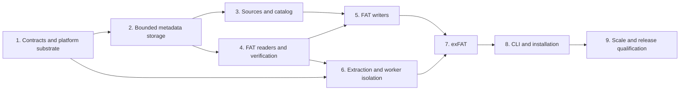

# fsimg implementation plan

This plan implements the target [specification](../specs/README.md). It orders
work and records completion gates; it does not narrow the specification to a
partial implementation. Each work package is split into reviewable commits
that keep existing checks passing. No calendar estimate substitutes for an
acceptance gate.

## Implementation status

| Package | Status | Evidence or next gate |
| --- | --- | --- |
| 1. Contracts and platform substrate | Implemented; kernel qualification remains open | Native build, I/O, publication, and sanitizer checks; Linux/FreeBSD confinement requires actual-kernel evidence in [platform-evidence.md](platform-evidence.md) |
| 2. Bounded metadata storage | Implemented and validated on the native host | Shared cache, private scratch, record streams, arrays/bitsets, stable external sort, fault tests, ASan/UBSan, and above-budget scale checks in [build.md](build.md) |
| 3. Sources and catalog | Implemented and validated on the native host | Descriptor-relative scanning, source providers, deterministic catalog, common writer lifecycle, fault regressions, and scale/sanitizer checks in [build.md](build.md); source-profile integration remains part of platform qualification |
| 4. FAT readers and verification | Implemented and validated on macOS | FAT12/16/32 external fixtures, bounded traversal/indexing and full verification, corruption/fault tests, ASan/UBSan, instrumented fuzzing, and above-budget directory checks in [build.md](build.md) |
| 5–9 | Pending | Follow the dependencies and completion gates below |

Development and qualification currently target macOS. Linux/FreeBSD kernel
qualification and confined source-scanner integration remain open in `TODO.md`;
they do not block native library format work. The portable target contracts
remain in force, and this sequencing does not qualify either sandbox backend.

## Dependency order

The dependency diagram permits independent work; it does not authorize
unrequested agent delegation. Reviews follow the working agreement. In
particular, launch the required reviewer before the pre-commit test run and
ask explicitly about correctness, architecture, security/information leaks,
and the style guide's readability criteria. For an architectural change, the
review compares concepts and maintenance obligations removed and introduced.
Each stage also receives a read-only OpenCode review with the Z.ai coding-plan
subscription, `zai-coding-plan/glm-5.3`, and `--variant max`. Substantive fixes
receive another external review before committing.

## 1. Contracts, build, and platform substrate

Build and validation commands are in [build.md](build.md); host-specific
mechanism evidence and outstanding qualification are in
[platform-evidence.md](platform-evidence.md).

Prerequisite: the specifications and principles define the target contracts.

Deliver in small increments:

1. Establish BSD-2-Clause licensing, attribution conventions, directory layout,
   Autoconf/Automake/Libtool build, installation rules, a public `fsimg.h`, and
   native C test/fault-injection support. Keep the ordinary build dependency-free
   beyond host tools and libc. Compile public-header examples as C11 and C++.
2. Implement status/error values, context initialization, charged allocation,
   checked arithmetic, progress/cancellation, descriptor accounting, and explicit
   ownership. Make allocation failure injectable from the start.
3. Implement FD and callback positional I/O, checked slices, partial-I/O loops,
   zero ranges, and exact-read/write helpers. Test before any format parser
   exists, including nested slices and boundary values near the host offset
   limit. Reject writable append-mode descriptors without changing shared flags.
   Test fixed memory sinks, slices without parent resize, and logical completion
   separately from durable flush.
4. Prototype sandbox profiles on actual FreeBSD and Linux kernels and detect
   the macOS unavailable case. Exercise no-network/no-exec/no-outside-access
   behavior, not merely the setup syscalls. Audit the libc syscall surface,
   inherited descriptor behavior, and metadata operations.
5. Prototype no-replace regular-file publication and directory-sync outcomes
   on supported host filesystems. Verify existing-target races and failure
   reports; do not use a check-then-rename fallback.

The sandbox/publication prototypes are narrowly scoped tests for mechanisms
the architecture depends on. Resolve any mismatch in the owning specification
before format implementation depends on it. In particular, determine the
actual capability matrix, required Landlock rights/ABI, seccomp architectures,
and filesystem publication primitives from tested behavior.

Validation: arithmetic boundary/property tests; callback scripts for EINTR,
short I/O, zero progress, EOF, and failures; allocation accounting; safe output
publication races; header compilation; sandbox adversarial subprocess tests.
Exercise session quotas across many incremental API calls and aggregate budgets
across simultaneous live handles. Run ASan and UBSan for these ownership and
arithmetic paths.

Completion gate: malformed sizes cannot reach an adapter outside its slice;
failure leaves no unaccounted allocations/descriptors; unsupported security
facilities and enforcement failures are distinguishable. The build documents
working test commands instead of assuming targets exist.

## 2. Bounded metadata storage

Prerequisite: context, checked I/O, and error propagation from package 1.

Implement private scratch creation, length-checked record streams, paged arrays
and bitsets, and external run generation/merge. Start with one shared page-cache
owner and one charge path. Keep a resident small-input representation with the
same ordering and record semantics; add spill through the same interfaces.

Account for run registries, merge heaps, temporary replacement files, strings,
dirty pages, and descriptors. Do not introduce a general key/value database or
durability/recovery protocol for disposable metadata. Establish cancellation
points in sorting and page I/O.

Validation uses an independent in-memory oracle on small generated datasets
and deterministic generators for large streams. Vary memory budgets, run sizes,
fan-in, duplicate keys, record lengths, and cancellation points. Inject failures
while flushing dirty pages, opening runs, merging, and replacing streams.
Assert quotas for simultaneous input/output files and handle sparse logical
lengths correctly. Run ASan and UBSan.

Completion gate: sorting and random fixed-record lookup operate above the RAM
budget, produce identical results across spill configurations, and either finish
within scratch limits or return a precise limit/I/O error. No O(number-of-runs)
RAM registry remains. Scratch cleanup and data initialization are verified.

## 3. Source scanning and deterministic catalog

Prerequisite: bounded metadata primitives and I/O.

Implement descriptor-relative host scanning, stable source identity records,
reopening without a descriptor per file, zero sources, and the single-provider
callback model. Add entries to an append-only catalog. Implement component-tuple
sorting, stable IDs, parent validation, collision streams, and paged result
records. Introduce the writer's closed lifecycle without an on-disk format yet.

Pin generic UTF-8/UTF-16 validation and the metadata validity/required policy.
Document timestamp basis and resolution in the public header. Identify scratch
and output objects by identity, never by a broad filename exclusion pattern.
Do not follow source symlinks. Detect ordinary source identity/size changes and
document why concurrent hostile mutation requires a snapshot.

Validation: unordered additions, missing/duplicate/conflicting parents, prefix
names such as `/a`, `/a-`, and `/a/b`, deep trees, wide directories, invalid
encodings, callback lifetime errors, source replacements, short content reads,
source/scratch overlap, cancellation, and low descriptor limits. Use a generated
source provider so ten million entries do not require ten million host files
for every scale run. Run ASan and UBSan.

Completion gate: deterministic catalogs fit the configured resident budget
regardless of input order or width, with no retained per-entry object/FD. The
writer rejects mutation after sealing and releases all source roots on failure.

## 4. FAT readers and full structural verification

Prerequisite: I/O, bounded metadata storage, codecs, and public reader contracts.

Use the author's libarchive msdosfs reader as sample code, with provenance and
adaptation rules in [references.md](references.md).

Implement explicit FAT codecs and geometry checks, starting with the simplest
independent FAT16 read fixture, then FAT12 packed entries and FAT32 variants.
Keep decoding helpers shared where the on-disk rules actually coincide.
Add bounded probes, lazy directory cursors, current-entry snapshots, chain
cycle/step checks, paged directory-ownership bitsets, and sequential content
cursors. Add the disk-backed current-file fragment index for nonsequential
reads without a per-buffer chain restart. Add the bounded directory prepass:
retain entry records in on-disk order, sort effective names/aliases externally,
and reject ambiguity before exposing children or resolving a selection.

Pin the supported short-name codepage and versioned name-comparison tables
against the reference specification and an interoperability corpus before
advertising Unicode/collision behavior. Review long-name/short-alias namespace
collisions explicitly. Do not treat host locale behavior as an oracle.

Implement verification as traversal plus external sorting of allocation
ownership records and streamed allocation-table checks. Distinguish successful
opening, selected-entry reading, complete structural verification, and payload
read-through in results. Add fixed-size public volume information and bounded
format-capability enumeration so the CLI uses the same inspection API as
embedding applications.

Validation: independently generated/populated images, fragmented files,
FAT12 page-boundary decoding, variant thresholds, reserved cluster values,
malformed long-name chains, table-copy policy, ancestor/shared-directory cycles,
duplicate and case-equivalent sibling names, long-name/short-alias collisions,
cross-linked regular data, truncated images, out-of-slice references, and
unsupported features. Assert chain-step/I/O counts during repeated sequential
reads and random access. Add parser fuzz targets with finite budgets. Run ASan
and UBSan.

Completion gate: all three variants read external fixtures correctly; corrupt
inputs cannot hang or escape a slice; full verification finds global allocation
defects without storing the entire FAT or ownership map in RAM.

## 5. FAT planning and writing

Prerequisite: validated catalog, FAT codecs/readers, and publication substrate.

Use the author's libarchive msdosfs writer as sample code, with provenance and
adaptation rules in [references.md](references.md).

Implement format planning and emission independently of reader structures.
Complete a FAT16 vertical slice, then FAT12/FAT32 geometry and directory variants.
The plan stores geometry and streamed/paged layout records, not payloads.
Implement deterministic alias assignment with sorted conflict handling,
directory sizing, bounded geometry search, automatic/exact sizing, minimum free
reserve, contiguous allocation, FAT generation, defined zero regions, and
single-use emission.

Add plan introspection and reproducibility. Validate sources before/after
bounded copying. Reuse the output coordinator for `write_at()` and CLI image
publication; raw sinks retain their explicit partial-output contract. Ensure
existing output aliases cannot be truncated, and stage no payload copy beyond
the one destination image. Test direct FD aliases, alternate hardlink names,
and aliases through slices, and prove rejection precedes resizing/zeroing.
Document the disjoint-storage obligation for opaque callback sources and sinks.

Validation: independently check emitted images with mtools and dosfstools,
then read them with fsimg. Compare full image bytes across source orders,
memory budgets, merge fan-in, locale/timezone settings, and scratch paths.
Test empty images, fixed-root exhaustion, type thresholds, metadata padding,
nearly full volumes, zero sources, maximum legal file size, impossible geometry,
and all output-finalization failure points. Check an existing destination's
contents and metadata remain unchanged. Run ASan and UBSan.

Completion gate: all FAT variants create and extract independently accepted
images, sizing is deterministic and terminating, image bytes do not expose
stale memory/file content, and emission scales with transferred bytes/required
metadata rather than resident image capacity.

## 6. Safe extraction and worker integration

Prerequisite: reader, bounded host operations, sandbox/publication prototypes.

Implement exclusive creation of a fresh private destination, component-relative
path handling, regular-file/directory-only policy, output quotas including holes,
bounded copying, and explicit partial-output reporting. Add library extraction
and its timestamp option without implying that embedding calls sandbox their
host. Keep CLI content extraction within the portable minimal sandbox profile.

Implement the same-executable worker launch, minimal environment, descriptor
allowlist, pre-parser confinement, readiness handshake, framed diagnostics,
separate raw-data channel, signal/cancellation supervision, and success/exit
validation. All image-consuming commands use this path, including probes.
Creation receives only its selected source roots and staging authority. Verify
nonblocking/no-controlling-terminal source opens, special-file rejection before
reads, and the advertised limits of source-root confinement. Do not claim
device-open exclusion without testing a mechanism that enforces it.

Implement all three user-facing sandbox policies. Automatic mode warns when a
supported profile is unavailable and never silently downgrades an unexpected
setup failure. Required mode refuses unconfined execution; off mode remains
subject to every parser, path, and quota check.

Validation: attack outside sentinels through traversal, aliases, symlink pivots,
hardlinks, special files, metadata mutation, and inherited descriptors. Race
creation of the final image pathname. Fuzz the control protocol, including
forged completion, maximum-length chunked names, and terminal escapes. Assert
that unavailable-sandbox warnings precede the acknowledgement permitting parsing.
Kill the worker at each output stage.
Test absent backend, partial backend failure, denied syscalls, and actual
confinement on FreeBSD/Linux; verify the explicit macOS warning/refusal cases.
Run ASan and UBSan. Run TSan if concurrency is introduced beyond process
isolation; do not claim processes require shared-memory thread machinery.

Completion gate: no raw parser runs in the unrestricted coordinator; workers
cannot request new host authority; successful operation and successful
publication are distinct verified states. The safe profile rejects all tested
breakouts, and unconfined operation is never mislabeled as sandboxed.

## 7. exFAT and gigantic-volume qualification

Prerequisite: common reader/writer/extraction infrastructure, FAT acceptance.

Implement exFAT as an independent driver: boot regions, geometry, allocation
bitmap, FAT, upcase table, directory entry sets, checksums, hashes, timestamps,
and contiguous/chained streams. Reuse resource, codec, source, sorting, and
I/O machinery; do not disguise exFAT allocation semantics as FAT variants.

Implement initialized-data versus logical-length semantics before extracting
file content. Zero tails must never expose existing cluster bytes. Stream FATs
and allocation bitmaps from plan runs, keeping format-bounded tables charged
to the shared cache/budget. Select legal large-volume geometry without forcing
allocation-unit-sized transfer buffers.

Validation: independent exfatprogs checks and external fixtures; >4 GiB files;
bad boot and directory checksums; malformed upcase tables; contiguous-range
overflow; fragmented streams; invalid data-length ordering; zero tails containing
poison bytes underneath; wide-directory limits; and unsupported TexFAT cases.
Exercise the 128 TiB sparse-volume case at a 64 MiB library budget, including a
multi-terabyte zero source and nonzero boundary markers. Full multi-terabyte
payload transfer is a separate benchmark, not disguised as a cheap sparse test.
Run ASan and UBSan on bounded fixtures and non-sanitized measured scale tests.

Completion gate: FAT and exFAT share infrastructure without growing a mutable
filesystem abstraction, and gigantic logical capacity is demonstrated separately
from entry-count and fragmentation scalability.

## 8. CLI, library examples, and installation

Prerequisite: format, extraction, worker, and publication acceptance.

Implement the exact command/flag contract, common numeric parsing, geometry and
capability output, selection, dry-run plans, structured errors, bounded progress,
NDJSON records, safe terminal formatting, and exit status. Reject unknown options,
overflow, contradictory flags, and unsupported streaming inputs without spooling.

Provide manual pages and small checked C examples for host-tree creation,
provider-backed content, bounded-slice reading, extraction, and error handling.
Document source stability, partial extraction, safe output publication,
metadata fidelity, scratch placement, and the library/CLI sandbox distinction.
Ensure version/capability output does not overstate compile-time or runtime
support.

Validate install/uninstall, static/shared library use, C/C++ public headers,
relocation where supported, and building from release archives without
Autotools installed. Verify the ordinary executable has no unexpected dynamic
dependencies. Audit imported tables/fixtures and notices. Exercise all examples
as integration checks, including human and machine-readable error paths.

Completion gate: documented commands and examples execute as written; large
listings stream without an accumulated JSON tree; users can identify resource,
format, safety, and publication failures from the result.

## 9. System qualification and release gate

Prerequisite: all functional work packages and security profiles.

Run the complete matrix below. Compare peak resource use and operation counts
against specification bounds; investigate regressions before accepting the
release. Perform a final independent architecture/security/readability review
with specific code and contract evidence. Resolve every Critical/High finding;
fix or record actionable Medium findings in `TODO.md` as the working agreement
requires.

| Test family | Routine gate | Extended gate |
| --- | --- | --- |
| Unit and property tests | Every affected change and full pre-commit suite | Boundary generators near format/host limits |
| Sanitizers | ASan for ownership/storage/lifetimes; UBSan for arithmetic/bit operations | TSan for shared-worker state if introduced; LSan/MSan on supported Linux configurations |
| Independent interoperability | Small FAT/exFAT images with external tools | OS-reader checks on isolated hosts and broader external corpus |
| Security | Extraction/protocol/fault-injection regressions | Actual-kernel confinement and publication-race matrix |
| Fuzzing | Seed corpus and bounded smoke runs | Sustained parser, chain, name-codec, and protocol campaigns |
| Resource scale | Forced spills and small-budget synthetic tests | 128 TiB sparse volume, ten-million-entry catalog, extreme fragmentation and wide directories |
| Portability | Supported host compilation and ordinary tests | Host/filesystem capability and install matrix |

The build exposes documented targets such as `check`, `check-asan`,
`check-ubsan`, `check-security`, `check-integration`, and `check-scale` when those
suites are implemented. Missing tools are installed through the development
environment or explicitly requested, not bypassed. Unsupported sanitizer or
host capabilities are reported as skipped with a reason, never passed. Resource
benchmarks distinguish accounting from RSS, sparse logical bytes from physically
transferred bytes, and fsimg memory from a RAM-backed scratch filesystem.

Completion gate: the [acceptance contract](../specs/architecture.md#acceptance-contract)
has reproducible evidence, no unresolved Critical/High defect, complete user/API
documentation, a reviewed license manifest, and a release archive that builds
and operates without third-party runtime libraries.

## Extension sequence

Extensions receive their own designs before code: manifest import and bounded
partition selection; reader-only NTFS, QNX4, and QNX6 profiles with independent
corpora; additional offline-writable formats; optional archive integration; and
capability-gated sequential output. Their order follows concrete user needs.
They cannot weaken the core budgets or introduce implicit image spooling.
One-shot input construction and richer extraction policies are separate
contracts, not flags that bypass invariants in the planned writer or safe
extractor.
