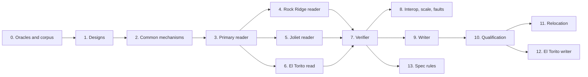

# ISO 9660 implementation plan

This plan defines and orders the work that adds ISO 9660 to fsimg:

* a reader and full verifier for ISO 9660 volumes in three views, Rock
  Ridge, Joliet and the plain primary hierarchy, including multi-extent
  files, Rock Ridge relocation and El Torito boot catalogs;
* a writer for ISO 9660 volumes with a Rock Ridge primary hierarchy at a
  selectable interchange level and a Joliet hierarchy, deep trees through
  relocation, and El Torito boot entries for BIOS and EFI images.

Its input is the research draft
[ISO 9660, Rock Ridge, Joliet, El Torito specification](../fsspecs/fsimg_iso9660_spec.md)
("the draft"). The draft is not the specification. The
[format design](../specs/design-iso9660.md) and the
[driver design](../specs/design-iso9660-driver.md) are, written in the
present tense from the references and the draft's findings; section
numbers such as "draft section 10" refer to the draft.

The concrete targets are:

* the owner's Porsche PCM 3.1 update disc, H3 in the
  [QNX6 research record](qnx6-research.md#pcm-31-update-disc), a plain
  ISO 9660 image whose flash payloads the QNX work already reads, so that
  fsimg can list and extract it directly;
* the data and install media that `xorriso`, `genisoimage`, `makefs` and
  libarchive produce, read in each view;
* creating data discs from host trees and manifests, and EFI-bootable
  media whose EFI system image fsimg itself creates as a FAT volume.

The working agreement applies unchanged:

* Designs come before code.
* Every stage gets the review subagent and the external `aireview` review.
* A failing regression test comes before any non-trivial fix.
* Each stage ends in one coherent commit, or a few, and skipped checks are
  reported.

No calendar estimate substitutes for a gate.

## Goals and non-goals

Goals:

1. Read ISO 9660 volumes through info, listing, content, extraction and
   verification, bare or as a slice, in the view the image's evidence
   selects or the caller forces. Resources are bounded at any legal
   geometry, up to `2^32 - 1` blocks, a directory of millions of records
   and a file of terabytes, and every failure falls into the closed status
   classification.
2. Read Rock Ridge completely: names, kinds, owner, mode and times,
   symbolic links, bounded continuation, and relocated deep trees.
3. Read Joliet levels 1 to 3, with names as UTF-8 and the long and
   non-BMP names producers write.
4. Inspect and verify El Torito boot catalogs: every platform section and
   entry, reported by info, checked by verification, never shown as files.
5. Verify completely: the descriptor set, every view's tree, both path
   tables of each hierarchy against its directories, record order, block
   ownership with the sharing ISO allows, relocation consistency and the
   boot catalog.
6. Create ISO 9660 volumes that the Linux and FreeBSD kernels, libarchive,
   `isoinfo`, `isovfy` and `xorriso` read identically in all three views,
   byte-identical across hosts and source orders. The writer capability is
   registered only after that record exists.
7. Create deep trees through Rock Ridge relocation and bootable media
   through El Torito entries naming files of the tree, with a QEMU boot of
   each platform as the gate.

Non-goals:

* The ISO 9660:1999 enhanced descriptor as a view, interleaved files,
  extended attribute record interpretation, associated files, record
  formats and protection. Each is refused or skipped as the format design
  states, never read as something else.
* Multisession discs, multi-volume sets, CD-ROM XA, raw 2352-byte sectors,
  BIN/CUE and other optical containers, compressed `.cso` images. A future
  container layer can bring raw sectors; nothing here infers one.
* zisofs and other compressed files, sparse files, AAIP ACLs and extended
  attributes, Apple extensions. A file whose content they change is
  refused.
* UDF, including the UDF half of a bridge disc. A UDF driver is its own
  design; its ISO hierarchy reads here.
* Writing hybrid system areas: isohybrid MBR or GPT, protective MBR, APM.
  The writer's system area is zero.
* Boot information tables, emulation boot, and boot images outside the
  tree. fsimg packages boot images unchanged, as it does ImageFS bodies.
* Editing or appending to an existing image, and hard-link topology, which
  the common model does not represent.

## Inputs and their standing

| Input | Standing | Use |
| --- | --- | --- |
| [The draft](../fsspecs/fsimg_iso9660_spec.md) | Research draft, original prose | Layout tables, rule inventory (section 17.2), generator families (17.3), oracle matrix (18, 19), adversarial list (16.3), open questions (22) |
| ECMA-119 6th edition, Annex C | Published standard; facts paraphrased | Volume and file structure, Joliet |
| IEEE P1281 and P1282 drafts 1.12 | Copyrighted drafts; facts paraphrased | SUSP and Rock Ridge entries |
| El Torito 1.0; UEFI 2.10 media chapter | Published specifications; facts paraphrased | Boot record, boot catalog, EFI entries |
| libarchive ISO reader and writer (BSD-2-Clause); FreeBSD `cd9660` and `makefs` (BSD) | Permissive implementations | Behavioural reference for edge cases and as oracles; no code imported (owner decision 5) |
| `xorriso`/libisofs, `genisoimage`, `isoinfo`, `isovfy` (GPL family) | External tools | Producers and consumers run as programs, at recorded versions, outside the repository |
| `pycdlib` (LGPL-2.1) | External tool | Optional producer for unusual combinations, run as a process |
| Linux `isofs`, FreeBSD `mount_cd9660` | Kernel readers | Consumers in disposable VMs or containers that allow loop mounts |
| `7z`, macOS `hdiutil` | External tools | Additional consumers where installed |
| QEMU with SeaBIOS and OVMF | External tools | Boot smoke tests of El Torito entries, not structure proof |
| H3 PCM 3.1 update disc | Owner's disc image, structure only | Real-world read target; never enters the repository |

## Placement and owners

| Concern | Owner |
| --- | --- |
| Descriptors, hierarchies, names, SUSP, Rock Ridge, Joliet, El Torito, content, verification | The `iso9660` filesystem driver (`lib/formats/iso9660/`), on an ordinary `fsimg_io_t` |
| A partition table or container around a volume | The [layer design](../specs/design-layers.md), unchanged |
| An isohybrid image's MBR or GPT | Detection's ambiguity rule: `-F iso9660/-` reads the ISO, `--partition` a partition |
| Traversal, paths, selection, namespace validation | The common walker |
| Delivery of file bytes and decoded link targets | Common content |
| Source copies and link-target reads | The common writer |

`iso9660` fills the filesystem slot of the stack. It declares no exact
volume, so `iso9660/gpt`, `iso9660/dmg` and gzip all compose; no new layer
is needed. A raw-sector or BIN/CUE container would be a later layer
profile beneath the same driver.

## Common contract changes

Stage 1 records these in their owning designs, and stage 2 implements
them, each with its tests, before any driver code depends on it:

1. **Decoded link targets.** A Rock Ridge target is assembled from `SL`
   components, so it is not a range of image bytes. The
   [content design](../specs/design-content.md#decoded-link-targets) gains
   one alternative to resolution: a driver may declare a symbolic link's
   target as bytes it decoded at replay into the reader's charged
   link-target buffer, and common delivery copies from it under the same
   stability, work and cancellation rules. Files never use it.
2. **The portable name profile.** The QNX-family name profile is
   format-neutral already: strict UTF-8 without controls, slash or the dot
   names. It is renamed the portable name profile
   (`FSIMG_NAME_PROFILE_PORTABLE`) and declared by the ISO reader, so a Rock
   Ridge name in a legacy 8-bit encoding is
   [omitted](../specs/design-directories.md#omitted-names), counted and
   refused by extraction without `-k`, instead of making the image
   unreadable.
3. **Several walks.** Full verification of an image with several trees
   walks each with the one walker, releasing a finished walker before the
   next root, as the
   [prepared-directory design](../specs/design-directories.md#several-walks)
   states. No second traversal engine exists.
4. **Link-target reads in planning.** `SL` sizes depend on the target's
   bytes, so the writer gains one operation, the
   [link-target read](../specs/design-emission.md#encoded-link-targets), that reads
   an entry's target into a bounded buffer through the common source
   lifecycle, at planning and again at emission.
5. **The view read option.** `fsimg_read_options_t` gains `iso_view`, an
   enum whose zero is `auto`; `fsimg_format_info_t` gains a
   `read_settings` mask, the read-side counterpart of `write_settings`,
   with the bit `FSIMG_SETTING_ISO_VIEW`; the settings catalogue gains
   the read-side filesystem row `view`, refused after detection for a
   format that lacks the bit; the reader keeps a copy of the decoding
   options for its driver; the worker job carries the field. No common
   code names a format.
6. **ISO write options.** `fsimg_write_options_t` gains `iso_level`,
   `boot_bios`, `boot_efi` and `boot_load_sectors` behind the new bits
   `FSIMG_SETTING_ISO_LEVEL` and `FSIMG_SETTING_ELTORITO`, with catalogue
   rows `level`, `boot`, `efiboot` and `bootload` and their job fields.
   The record is pre-stable, as when `mountpoint` was added.

The ISO probe declares 34816 bytes because its identity sits at
block 16. That is no contract change, but stage 3 measures detection time
and memory before and after on the existing fixtures and records it.

## Design decisions

The designs record these with their rationale. Most remove a class of
special cases rather than handling each case.

1. **One descriptor, one public name.** `iso9660` names the format for
   reading and writing. Views and levels are settings, not variants, so the
   format list does not multiply by extension combinations.
2. **The probe claims on `CD001` at block 16.** The identity is fixed
   bytes at a fixed offset; a primary descriptor at block 16 is checked
   further, any other first descriptor is left to open. No scan for the
   signature elsewhere, so `CD001` inside another format's data cannot
   create a claim except at block 16, where it is an ambiguity to force.
3. **One view per session.** The view is chosen at open from header
   evidence, Rock Ridge over Joliet over primary, or forced. A view never
   borrows names or metadata from another tree and never changes after a
   failure, so a reader cannot hide corruption by switching trees.
4. **Strict structure, lenient spelling.** The reader rejects every
   structural contradiction, framing, both-order copies, extents, dot
   records, sections, SUSP, and accepts relaxed identifiers, every
   interchange level, long Joliet names and both `PX` lengths, because the
   level is not recorded and qualified producers write them. Verification
   adds order and path tables. The writer is strict about everything.
5. **Closed acceptance tables.** Descriptor types, versions, geometry,
   continuation counts, `ER` identifiers, `PX` lengths, kinds and boot catalog
   platforms are accepted only from the tables in the format design. An
   unlisted value is unsupported; a contradiction is corrupt.
6. **Directory records are the authority.** Traversal reads directory
   records only. Path tables are a redundant index that verification
   proves equal to the directories, so listing does not depend on them and
   a broken path table is reported, never followed. Three local rules, the
   dot records naming the one possible parent, no child naming the root,
   and an extent key per directory child in the common namespace check,
   make every view a tree by construction, so no walk keeps a record of
   visited directories.
7. **Ownership with sharing.** Verification sorts claims externally and
   sweeps them with constant state: data may share data, the boot catalog may
   be a file, a hierarchy's directory is one object however often it is
   claimed, and everything else is exclusive. No whole-volume bitmap is
   needed, and duplicate references, which ISO uses legitimately, are not
   errors.
8. **Every tree is verified.** `W` walks each view the image offers, the
   selected one counted, so a corrupt Joliet tree fails verification of an
   image read as Rock Ridge.
9. **Deterministic projections.** The writer's primary and Joliet
   identifiers come from one natural-then-alias rule with a reserved
   numbered family, as FAT's aliases do. Collisions are impossible by
   construction, including after the reader's display rule removes `;1`,
   and no directory is searched repeatedly.
10. **Fixed-width sizing.** Every record and continuation size is fixed
    before any block number, so planning sizes once, lays out once and
    emits once; nothing iterates to a fixed point or patches written bytes.
11. **Boot images are tree files.** El Torito entries name regular files of
    the tree by image path, so a boot image's bytes are copied once and the
    file and the entry share its extent. The boot catalog is hidden.

## Evidence questions

The designs fix every rule; these experiments confirm the rules against
the oracles before the stage that depends on them lands. A rule the
evidence contradicts changes in its design, with the evidence recorded,
before that stage lands; until the experiment has run, the gap is listed
in [the ISO TODO](todo-iso9660.md).

| Question | Evidence | Consumer |
| --- | --- | --- |
| Every Rock Ridge consumer reads the writer's `RRIP_1991A` with the 36-byte `PX` | Writer images read by Linux, FreeBSD, libarchive, `isoinfo -R`, `7z` | Writer stage 10 |
| Consumers accept an empty file's record naming block 0 | The same consumers; what `xorriso`, `genisoimage`, `makefs` and libarchive write | Writer stage 10 |
| Consumers read a multi-extent file's Rock Ridge entries from its first section alone, and producers' later sections carry nothing the reader needs | Producers at `-iso-level 3`; Linux, FreeBSD and libarchive reading writer images | Reader rule, writer |
| OVMF boots an EFI entry whose sector count is the image's 512-byte sectors, or 0 above 16 bits | `xorriso -e` output; OVMF booting writer images of both sizes | El Torito writer |
| Producers' directories and path tables are sorted as ECMA-119 orders them, ties included | Corpus `W` runs | Verification's order check, owner decision 8 |
| Real images carry no records with volume sequence number 0, no nonzero `SP` skip with Rock Ridge, no continuation area crossing a block, no invalid dates and no nonzero Joliet volume flags | Corpus survey, the H3 disc | Reader profile tables |
| Producers write relocation placeholders with a directory `PX` and a clear flag, as the reader expects | `xorriso`, `genisoimage`, `makefs` deep trees | Relocation reading |
| Consumers show the logical tree of a relocated writer image, and show or hide `.rr_moved` without depending on it | Linux, FreeBSD, libarchive | Relocation stage |
| Joliet consumers accept 62-unit file names with `;1` and 64-unit directory names | Linux `isofs`, libarchive, Windows where available | Writer |
| Every isohybrid image in the corpus draws both claims and reads with `-F iso9660/-` | Distribution ISOs | Owner decision 7 |
| Consumers read a hierarchy with 65535 directories | `xorriso` and writer images of a wide tree | Writer limit |

## Work packages

Every stage leaves `make -j32 check` passing and follows the gates below.

### 0. Oracles and corpus

* Install and record the versions of `xorriso`, `genisoimage`, `isoinfo`
  and `isovfy`, `bsdtar` with ISO support, `7z`, QEMU with SeaBIOS and
  OVMF, and `pycdlib`; FreeBSD hosts add `makefs` and `mount_cd9660`;
  Linux uses `kusumi/makefs` where FreeBSD is absent, counted as the same
  family. [build.md](build.md) records the commands.
* A corpus script, `test/iso9660-corpus.sh`, generates images from a
  manifest of source trees and producer invocations: minimal, empty,
  levels 1 to 3, Rock Ridge with every kind, long names spanning
  continuation, deep trees needing relocation, Joliet levels 1 to 3 with
  non-BMP names, multi-extent files from sparse sources, El Torito BIOS,
  EFI and both, `boot.cat` visible and hidden, and isohybrid outputs. It
  records each image's tool, version, command and digest. Images are
  generated, never committed.
* The H3 disc is surveyed by path from the environment: descriptor set,
  views, counts, El Torito presence. Only counts are recorded.
* The evidence questions above are answered where the corpus can, and the
  answers recorded in [build.md](build.md).
* **Gate:** every producer in the matrix runs, or its absence is recorded
  with the reason.

### 1. Designs, indices and TODO

* `specs/design-iso9660.md` and `specs/design-iso9660-driver.md`.
* The [common contract changes](#common-contract-changes) in their owning
  designs: content, directories, emission, settings, API, CLI, layers,
  metadata, sizing and formats.
* Index and plan updates: `specs/README.md`, `specs/architecture.md`,
  `docs/implementation-plan.md`, `docs/references.md`, `TODO.md` and
  [docs/todo-iso9660.md](todo-iso9660.md).
* **Gate:** the review subagent checks the designs against the references,
  the draft and the common contracts, and for readability. The owner
  accepts the designs and settles the [open decisions](#owner-decisions).

### 2. Common mechanisms

* The six contract changes, each with tests that exercise it without the
  ISO driver:
  * decoded link targets, through a test driver that declares one,
    covering `read_at`, `next_range`, payload verification, `x -O` of a
    link, terminal failure and the buffer's release on advance;
  * the profile rename, with the QNX omitted-name tests unchanged;
  * several walks, through a test driver with two roots, covering
    namespace validation in both, omission scope and accounting;
  * the link-target read at planning and emission, including a target
    changed between the two;
  * `view` and the ISO write settings through the catalogue, the
    library's applicability checks, the CLI and the job codec's wire
    vectors.
* **Gate:** every existing suite passes with identical baseline bytes; the
  new mechanisms' tests pass under the sanitizers.

### 3. Reader: probe, descriptors and the primary view

* `lib/formats/iso9660/` modules `iso9660.h`, `descriptor.c`, `codec.c`,
  `volume.c`, `names.c`, `directory.c` and `read.c` as the driver design
  fixes them, for the `primary` view: the probe, the descriptor scan,
  geometry, the system-area check, preparation and replay, section runs,
  extended attribute records skipped, the section index, info.
* Registration in the static list with the read capability, build wiring
  and `EXTRA_DIST`.
* `test/iso9660.c`: the independent generator and the acceptance rows for
  probe, descriptor set, geometry, records, dot records, sections, extended
  attributes and primary names.
* `fuzz/iso9660.c` over probe, open, traversal and content, with seeds
  generated at run time.
* A detection measurement: the existing fixtures' detection time and peak
  memory with the shared maximum descriptor prefix (131072 bytes for UDF), recorded in [build.md](build.md).
* **Gate:** listing and extraction in the primary view agree with the
  corpus manifests for every producer; probe exclusivity holds in both
  directions against every registered format's fixtures; no byte reaches
  delivery unvalidated.

### 4. Rock Ridge reader

* `susp.c` and `rockridge.c`: the cursor, the handshake, every entry, the
  link-target assembly, relocation in `directory.c`, the `rockridge` view
  and automatic selection.
* Tests: the SUSP and Rock Ridge rows of the acceptance matrix, including
  continuation chains at the 16-area bound and one past it, an area
  crossing a block, self and overlapping continuations, a directory whose
  every record continues into one block, every link-component flag, both
  `PX` lengths, relocation at depths 9 to 20, a `PL` on an ordinary
  directory and relocation loops, and omitted 8-bit names.
* `fuzz/iso9660-susp.c` over the cursor and decoding with a synthetic
  block map.
* **Gate:** names, kinds, owner, mode, times and targets agree with
  `isoinfo -R` and `bsdtar -tv` on every Rock Ridge corpus image; the
  malformed-entry corpus fails with its classes; no continuation chain
  costs more than its bound.

### 5. Joliet reader

* Joliet identification and geometry checks in `volume.c`, UTF-16BE names
  in `names.c`, the `joliet` view.
* Tests: the Joliet rows, levels 1 to 3, surrogate pairs and unpaired
  surrogates, odd lengths, long names, two Joliet descriptors.
* **Gate:** names agree with `isoinfo -J` on every Joliet corpus image, and
  the three views of each combined image deliver identical content for
  the same files.

### 6. El Torito read

* `eltorito.c`: the boot record and boot catalog at open, info details.
* Tests: the El Torito rows, BIOS, EFI and both, section counts at the
  bounds, every checksum and signature mutation, a boot catalog that is also a
  file.
* **Gate:** entries agree with `xorriso -report_el_torito plain` on every
  bootable corpus image.

### 7. Verifier

* `verify.c`: header claims, the walk plan, the claim sort and sweep, path
  tables, order, relocation matching, the report.
* Tests: the ownership, path table and order rows; a corrupt Joliet tree
  under a Rock Ridge view; verification incomplete never reported
  complete; payload read-through across sections.
* **Gate:** every corpus image verifies; every mutation fails with its
  class; the claim sort spills to scratch on a million-entry fixture.

### 8. Reader interoperability, scale and faults

* `test/iso9660-integration.sh.in`: the producers' images read in each
  view against their manifests; the H3 disc through `i`, `t` and `W` by
  path from the environment, printing counts only, never a member name.
* Scale cases: a directory of a million entries; a 256-level Rock Ridge
  tree; a 4 TiB sparse multi-extent file; a `2^32 - 1`-block volume with a
  small tree. Each records I/O calls, metadata passes, peak scratch and
  RSS.
* Faults: allocation, scratch, short read, EOF and cancellation at every
  stage, each with a cleanup check; the driver contract profile in
  `test/driver-contracts.c`.
* Linux and FreeBSD runs per the working agreement.
* **Gate:** the scale figures hold within the session budget, the
  comparisons are recorded in [build.md](build.md) or reported as skipped
  with the reason, and H3 lists and verifies.

### 9. Writer, unregistered

* `write-iso9660.h`, `write-names.c`, `write-susp.c`, `write-plan.c` and
  `write-emit.c`: settings, the planning passes and emission for levels 1
  to 3, Rock Ridge, Joliet and multi-extent files. The relocation pass
  lands in stage 11; until then planning refuses a tree that needs it with
  `FSIMG_EUNSUPPORTED` naming the first directory to relocate, and the
  refusal is listed in [the ISO TODO](todo-iso9660.md).
* `test/iso9660-write.c`: round trips through the independent checker and
  the reader in all three views; byte identity across source order, cache
  size, scratch path and time zone; a poison scan of every padding byte;
  the alias rules on colliding names; the continuation split at every
  boundary; faults at every stage; a sparse source above 4 GiB at level 3
  and its refusal at levels 1 and 2.
* **Gate:** every check passes. The writer capability stays unregistered
  and the gap is listed in [the ISO TODO](todo-iso9660.md).

### 10. Writer qualification and registration

* The integration script feeds writer images to every consumer: `isovfy`
  without findings, `isoinfo -d`, `-f`, `-R -f`, `-J -f` and `-p`
  listings, `xorriso -indev ... -check_media` and `-ls_r`, `bsdtar -x` in
  each namespace option, `7z x`, and the Linux and FreeBSD kernels mounting
  the image in each view and comparing an `lstat` manifest and digests
  with the source.
* Registration covers the capability record and the formats output, plus
  `README.md`, `docs/fsimg.1`, `docs/libfsimg.3` and `NEWS`.
* **Gate:** every consumer agrees in every view on the qualification
  trees: one file, the name families, every kind and metadata limit, a
  wide directory, sections above 4 GiB, and every level. This is the
  registration bar of owner decision 12.

### 11. Deep trees by relocation

* The relocation pass: physical level and path length, the `RR_MOVED`
  directory and the adoption of an empty source `.rr_moved`, placeholders,
  `CL`, `PL` and `RE` in planning and emission, and the Joliet tree at full
  depth.
* Tests: depths 8, 9, 16 and 256; relocation by path length at levels 1
  and 3; several relocations under one parent; relocation inside a
  relocated subtree; the reserved names; extracting a relocated image and
  creating it again.
* **Gate:** Linux, FreeBSD and libarchive show the logical tree without
  `RR_MOVED` duplicates; `isoinfo -f` shows the conforming physical tree;
  fsimg reads the image identically in its `rockridge` view.

### 12. El Torito writer

* The `boot`, `efiboot` and `bootload` settings, the boot record, the
  catalog and its checks against the catalog's read rules before any byte
  is written.
* Tests: each setting's refusals; BIOS, EFI and both; the boot catalog through
  the reader and `xorriso -report_el_torito`.
* **BIOS gate:** a project-owned 2048-byte no-emulation boot sector,
  generated by a test script, that prints a marker on the serial port,
  boots in QEMU with SeaBIOS from an fsimg image, and does not with its
  boot catalog checksum flipped.
* **EFI gate:** an fsimg-created FAT image holding a UEFI shell or a
  project-owned test application as `/EFI/BOOT/BOOTX64.EFI`, named by
  `efiboot=`, boots in QEMU with OVMF to a serial marker. The application's
  license is recorded; a binary that cannot be redistributed is supplied
  from the environment and never committed.
* **Gate:** both boots pass, or the platform stays unregistered for
  writing with the gap listed in [the ISO TODO](todo-iso9660.md).

### 13. Specification-driven rules

* An `iso9660` plug-in under `test/spec/lib/fsimg_spec/iso9660/` following
  the [harness design](../specs/design-spec-testing.md): BinData layouts,
  a total decoder, the format design's rules by anchor, generators and
  mutations from the acceptance matrix, and tool adapters. It shares no
  code with the C generator.
* **Gate:** every rule has a valid and an invalid witness with its stage
  and class, and the quick profile runs in `make check`.

## Dependency order

Stages 4 to 6 are independent once stage 3 lands, and stage 13 can run
beside the writer stages. Stage 0's corpus grows as each stage needs it;
only the producers must exist before stage 3.

## Gates for every stage

* **Review before tests.** Launch the review subagent first, before the
  pre-commit test run. Ask it explicitly for:
  * bugs and design issues;
  * security and information-leak concerns, with the security pass framed
    in the prompt;
  * the style guide's readability review, citing specific functions.

  Address every Critical and High finding. Fix each Medium finding or
  record it in `TODO.md` or the commit message.
* **External review.** Run the external review with `aireview` over the
  stage's diff. Substantive fixes are reviewed again. A failed or
  unavailable review is reported, never replaced.
* **Tests.** Write a failing regression test before any non-trivial fix.
  Run `make -j32 check` at every stage.
* **Sanitizers.** The coordinating session runs `check-asan`,
  `check-ubsan`, the supported LSan and MSan targets, and `check-fuzz` once
  on the integrated tree before landing. These targets build from a
  `make distdir` copy, so every new source, test and script must be in
  `EXTRA_DIST`. The SUSP and directory stages get the longest fuzz runs:
  they parse every system-use byte of an untrusted image.
* **Platforms.** Linux through `build-aux/linux-check.sh` and FreeBSD by
  the CI job's procedure for every stage that touches host I/O or the
  worker, and for the oracle runs; every report names the platforms that
  ran and those that did not.
* **Project hygiene.** New C and shell files are ASCII with BSD-2-Clause
  headers. [build.md](build.md) records the commands, the evidence and
  any explicit skips. Producer images, the H3 disc and member names never
  enter the repository.

## Departures from the draft

| Draft | This plan | Reason |
| --- | --- | --- |
| A 128 KiB probe window scanning sectors 16 to 79 (sections 1.3, 14.2) | A 34816-byte prefix with the identity at block 16; open scans up to 64 descriptors | The identity is at a fixed offset; open, not the probe, needs the rest |
| Non-UTF-8 Rock Ridge names refuse the view and auto falls back to Joliet (section 22) | Such names are omitted under the portable name profile, counted, and refused by extraction without `-k` | The cross-reader omission rule exists; auto must decide at open, before names are seen |
| `namespace=` and `version=keep|strip-single` reader keys (section 20.2) | `view=` only; `;1` is always stripped and other versions kept | One display rule needs no setting and never merges versions |
| Separate `rockridge=` and `joliet=` writer switches (section 20.2) | Both hierarchies always written; `level=` the only name setting | Owner decision 2: one profile to qualify |
| A Level 1 strict default writer (section 1.2) | Level 3 default | Owner decision 2: large files work by default |
| Enforce Joliet's 240-byte path accounting (section 11.2) | Not enforced | No qualified reader enforces it, and enforcing it would refuse ordinary trees |
| Writer reports `ERANGE` or `EUNSUPPORTED` for deep trees without relocation (section 10.7) | Relocation by depth and by path length, as its own stage | Owner decision 4; relocating on path length too removes the 255-byte path refusal |
| A charged quota of decoded continuation bytes per entry (sections 10.2, 14.6) | Continuation areas within one block and at most 16 per stream | Two fixed bounds cap one record's stream at 32 KiB with no counter, and the kernel readers keep areas within a block |
| Display names that strip `;N` only for a unique single version, from a directory pre-scan (section 7.2) | `;1` is always removed and nothing else; identifiers must differ after it | One rule needs no pre-scan, keeps conforming images unambiguous, and the writer's identifiers satisfy it by construction |
| Cycle detection keyed by hierarchy and resolved relocation (section 5.3) | The dot-record rules and an extent key per directory make each view a tree | No set of visited directories, sized by the volume, is kept |
| Non-UTF-8 Joliet handled by refusal (section 11.4) | Surrogate pairs decoded; an unpaired surrogate omits its entry | Producers write pairs for non-BMP names, and omission is the cross-reader rule |
| Boot catalog and images from explicit streams (section 12.5) | Boot images are files of the tree named by image path; the catalog is hidden | One payload copy, no file settings for a filesystem, no hidden-byte input path |
| A versioned `fsimg_reader_get_boot_info()` (section 12.5) | Boot facts in the volume information's details | The bounded detail table already carries per-format values |
| Verify a selected hierarchy, others optionally (section 14.3) | Every offered tree is walked | A corrupt tree must fail `W` whichever view the caller reads |
| An interval stream with per-object identities and alias maps (section 16.4) | One sorted claim stream with class rules and constant-state sweep | Sharing in ISO follows from classes; no alias map is needed |
| pycdlib among required oracles (section 18) | Optional | LGPL process oracle; three permissive and GPL families already cover each direction |
| Interleaving and XAR reading (section 9, M7) | Refused or skipped, unscheduled | No target image needs them |

## Owner decisions

The owner settled the first four in the planning session:

1. **Scope.** A reader and writer, with El Torito read and written, in
   the stages above. Enhanced descriptors, XAR interpretation,
   multisession, zisofs, raw sectors and hybrid system areas are
   unscheduled.
2. **Writer profile.** Rock Ridge and Joliet are always written; the one
   setting is `level=1|2|3`, default 3.
3. **View selection.** Automatic at open, Rock Ridge over Joliet over
   primary, with `-o view=` forcing one; a forced view never falls back.
4. **Deep trees.** Rock Ridge relocation as its own writer stage; until
   it lands, a tree that needs relocation is refused naming the first
   directory to relocate.

These carry a recommendation and need the owner's confirmation at the
stage 1 gate:

5. **Provenance.** Write the driver from the references and black-box
   oracle behaviour; consult libarchive and FreeBSD only for behaviour, as
   oracles, and import no code. Adapting a BSD file is permitted by the
   working agreement with its notice, but one provenance story for the
   whole driver is simpler to audit.
6. **No boot information table.** The writer never patches a boot image.
   EFI boot and boot loaders that do not need the table work; `isolinux`
   and GRUB BIOS images that do need it are a recorded limitation. Adding
   it later means a member's bytes differ from its source, which needs its
   own design.
7. **Hybrid images.** An isohybrid image is ambiguous under the detection
   rule, and `-F iso9660/-` resolves it. No rule ranks a filesystem claim
   above a scheme claim.
8. **Strict order.** Full verification fails an unsorted directory or
   path table. If the corpus shows a qualified producer writing unsorted
   records, this returns to the owner before stage 7 lands.
9. **One Joliet descriptor.** Two are unsupported rather than resolved by
   a precedence rule.
10. **Joliet path length.** Annex C's 240-byte accounting is not enforced
    by the writer or the reader.
11. **The relocation directory.** Named `.rr_moved` in Rock Ridge,
    `RR_MOVED` in the primary hierarchy, hidden, and absent from Joliet;
    an empty source `.rr_moved` in the root is adopted, so an extracted
    relocated tree creates again.
12. **Writer registration bar.** Every consumer in stage 10 agrees in
    every view, including both kernel readers; Windows is welcome evidence
    but not required.
13. **Where `view` applies.** The format record gains a `read_settings`
    mask, so `-o view=` works on a detected ISO 9660 image and an image of
    another format refuses it after detection. The alternative, requiring
    `-F iso9660` beside `view`, needs no new record field but makes common
    option checks name a format.
14. **Rock Ridge 1.10 output.** The writer writes `RRIP_1991A` with the
    36-byte `PX`, the combination every Rock Ridge reader accepts, rather
    than RRIP 1.12's `IEEE_1282` and 44-byte `PX`, whose serial numbers
    have no use without hard links.

## Risks

* **Oracle disagreement.** Consumers differ on edge cases such as long
  Joliet names, empty files and `PX` length. The evidence questions settle
  the writer's choices; where consumers disagree among themselves, the
  writer takes the choice all of them read, and a disagreement is triage,
  not proof that fsimg is wrong.
* **Real-world leniency.** Strict structure checks may reject images that
  other readers accept, such as a slightly unsorted directory or an
  invalid date. The corpus survey is the guard; a rule relaxes only by
  editing the format design with its evidence.
* **Hostile system-use data.** SUSP is the densest untrusted parser in the
  driver. The cursor's fixed bounds, the dedicated fuzz target and the
  longest sanitizer runs contain it.
* **Boot gates need binaries.** The EFI gate needs a UEFI application;
  its license decides whether it can enter the tree. If none can, the
  binary comes from the environment and CI skips the gate explicitly.
* **Kernel readers need privileges.** Loop mounts need a VM or a
  privileged container. Without one, the kernel rows are skipped with the
  reason, and the writer is not registered until a run records them.
* **Detection cost.** The larger prefix is read for every image. The
  stage 3 measurement records it; if it matters, the remedy is a common
  staged-probe design, not an ISO exception.
* **Provenance.** Designs and code are written from facts; GPL and LGPL
  tools stay external programs, and no producer image, H3 byte or member
  name enters the repository.
