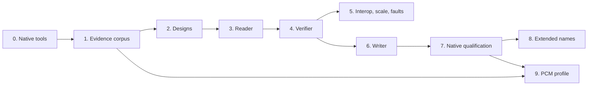

# QNX4 implementation plan

This plan defines and orders the work that adds the QNX4 filesystem to fsimg:
first a reader and full verifier for native volumes, then a writer whose
output native QNX checks, mounts, modifies and remounts. Its input is the
research draft [QNX4 disk format and fsimg plan](../fsspecs/QNX4_fsimg_spec.md)
("the draft"). The draft is not the specification. Stage 2 writes
`specs/design-qnx4.md` and `specs/design-qnx4-driver.md`. These are original
designs in the present tense that cite their evidence, and they become
authoritative. Section numbers below such as "draft section 16" refer to the
draft.

The concrete target is the navigation partition of the Porsche PCM 3.1 HDD.
It is partition 3 of the [measured drive](qnx6-research.md#measured-pcm-31-hdd)
H1: type `0x4f`, 102767805 sectors (52.6 GB), with a root directory `040775`
owned by uid 0 and link count 4. The head unit mounts it as `/mnt/nav`, trying
QNX4 before QNX6 ([device mapping](qnx6-research.md#device-mapping)). Its
recovery software formats it with `dinit -hq /dev/hd0t79`
([recovery formatting](qnx6-research.md#recovery-partitioning-and-formatting)).
Reproducing a complete replacement HDD also needs disk composition. That is a
separate design and is not part of this plan.

The working agreement applies unchanged. Designs come before code. Every
stage gets the review subagent and the external `aireview` review. A failing
regression test comes before any non-trivial fix. Each stage ends in one
coherent commit, or a few, and skipped checks are reported. No calendar
estimate substitutes for a gate.

## Goals and non-goals

Goals:

1. Read native QNX4 volumes, bare or as a slice given with `--offset=` and `--length=`,
   through `info`, `ls`, `cat`, `extract` and `verify`. Resources are bounded
   at any legal geometry, and every failure falls into the closed status
   classification.
2. Verify completely: an ownership ledger of every reachable block compared
   with the bitmap, extent chains, link counts, `.inodes` occupancy, special
   files and long-name back-references.
3. Create new volumes that QNX 6.5.0's `chkfsys` accepts without findings, and
   that its `fs-qnx4.so` mounts, modifies and remounts. The writer capability
   is registered only after that native cycle is recorded (draft section 18,
   "shipping bar").
4. Qualify the reader on H1's partition 3. Qualify the writer at that
   partition's geometry against the head unit's formatter defaults.

Non-goals:

* In-place modification, repair, mounting, and crash-consistent update
  ordering (draft section 12.3).
* Strict, compatible and forensic checker modes, salvage reads, a raw
  structure-dump command, and diagnostics that quote record bytes. fsimg has
  one `verify` with closed failure classes.
* Bootable images and loader bytes, `.bad_blks` handling, device nodes and
  volume labels, until evidence and a design exist.
* Partition-table selection and disk composition. Slices cover the reading
  need.
* Writing hard links. The common model has no hardlink representation yet;
  see the Medium "Hardlink topology" item in [the QNX6 TODO](todo-qnx6.md).
* Pre-Neutrino QNX 4.x formatter profiles. The reader accepts such a volume
  only where it matches the qualified structure tables.

## Inputs and their standing

| Input | Standing | Use |
| --- | --- | --- |
| [The draft](../fsspecs/QNX4_fsimg_spec.md) | Research draft 1.0, original prose | Layout, open questions (section 16) and test matrix (section 15.2). Its A, B and C marks map onto the design's established layout, observation and compatibility gates. Every C item is a gate, never a default |
| QNX 4.25 and Neutrino 6.4 to 6.6 documentation (draft section 17.1) | Vendor prose; facts paraphrased | Layout, utilities, limits |
| Linux `qnx4` driver and header | GPL-2.0, reference only | External read-only oracle on a Linux host. No code, declarations or identifiers enter the tree |
| qnxprobe (MIT), dissect.qnxfs (AGPL-3.0), FsRover (GPL-3.0) | External tools | Comparison only, at pinned revisions, outside the repository. qnxprobe and Linux count as one oracle family (draft section 15.1) |
| QNX 6.5.0 live CD and VM ([infrastructure](qnx6-infrastructure.md)) | Licensed, not redistributable | Native `dinit`, `chkfsys` and `fs-qnx4.so`. The CD's runtime-kit file lists name `x86/sbin/dinit`, `x86/sbin/chkfsys` and `x86/lib/dll/fs-qnx4.so`. Whether the live shell can run them is checked first in stage 0 |
| H1 partition 3 | Owner's drive image, structure only | The native populated volume to read and to reproduce |
| `dinit` in H1 partition 1 `/tools`; boot images on the update disc (H3) | Head-unit SH-4 binaries, disassembly only | The head unit's formatter defaults, as H2 established for `mkqnx6fs`, and the identity of the `fs-qnx4.so` that `hddmounter` loads |

## Existing owners the driver reuses

The common contracts cover QNX4 without exceptions:
[format descriptor and probe](../specs/design-formats.md#format-descriptors-and-profiles),
[prepared directories](../specs/design-directories.md),
[logical content and the extent index](../specs/design-content.md),
[emission](../specs/design-emission.md),
[sizing](../specs/design-sizing.md) and
[POSIX metadata](../specs/design-metadata.md). The metadata extension already
carries owner, mode, all four timestamps, symbolic links and FIFOs. So common
code needs only the descriptor registration. The one other common change is
test-side: `test/fat.c` uses `qnx4` as its example of an unknown format name,
and that test must switch to another name.

The QNX6 driver is the structural template for the module split, the test
layout and the gates. The two drivers share no code, because QNX4 is not a
QNX6 variant and decodes different records. The draft's proposed components
(section 12.4) map onto existing owners:

| Draft component | fsimg owner |
| --- | --- |
| `BlockView` | Bounded I/O and slices |
| `RootLayout`, `Inode64`, `DirLink64` | Driver codecs and volume open |
| `ExtentMap` | One driver extent walker feeding the common extent index |
| `Bitmap` | A driver bitmap pager modelled on the QNX6 one |
| `InodeTable`, `LongNames` | Driver inode and name modules |
| `DirectoryWalk` | The common walker; the driver supplies `prepare`, `replay`, `keys` and `key` |
| `ImagePlanner` | The writer lifecycle (`validate`, `plan`, `emit`), the emission object and the sizing policies |
| `QNX4Verifier` | A driver verifier over the walk's claimed-block set and the common external sort |
| `CompatibilityHarness` | The `tools/qnx/vm` capture harness, `test/qnx4-integration.sh` and capture records |

## Design decisions

Stage 2 records these in the designs, with their rationale. Most of them
remove a class of special cases rather than handling each case.

1. **The probe reads 1024 bytes; `open` completes recognition.** QNX4 has no
   magic number, and the root directory's position depends on the volume
   size. On H1 the default layout would put it at block 25093, 12847104 bytes
   into the partition, beyond any fixed probe prefix. So the probe inspects
   the loader block and the root block only. Its identity signature is the
   root record of block 2:
   * the name `/` followed by fifteen NUL bytes;
   * a direct-record status and a directory mode;
   * a first extent inside the slice;
   * any fixed names and values that stage 1 shows the other three special
     records carry.

   `open` then does the rest of draft section 11: it reads the root
   directory, finds a coherent `.bitmap` record, and checks the `.inodes`
   signature. Any failure there is `FSIMG_ECORRUPT`. Probe exclusivity is
   tested in both directions against FAT, exFAT and QNX6 fixtures. This
   includes native QNX6 boot areas and fsimg's zeroed one.
2. **One extent walker.** Only the extent walker interprets an extent or an
   extent block. That covers the bitmap, `.inodes`, `.longfilenames`,
   directories, symbolic links and payload. Range, overflow, chain-length,
   loop, `entries_used`, `blocks_covered`, signature and claim checks
   therefore exist once.
3. **Identity is physical; ordinary links point only into `.inodes`.** A
   direct record's identity is its `(block, slot)` position, and an indirect
   record's is its `.inodes` position. An ordinary link record must name a
   used slot inside the `.inodes` extents. Dot entries are validated against
   the objects the design says they name, and are never admitted. Only
   `.inodes` objects can have several names. So the bitset that tracks the
   first exposure of a multiply named object covers `.inodes` slots, not
   every block. A directory reached twice is corruption, as in QNX6.
4. **Geometry is derived, not stored.** No record stores the block count `N`.
   The reader derives it from the `.bitmap` record and the slice length,
   using the rule stage 1 establishes. On H1, `ceil(N / 8)` would be 12845976
   bytes with three padding bits. Bits at or past `N` must be set. Checked
   64-bit arithmetic handles every 1-based block-to-offset conversion.
5. **Format-owned files are not entries.** `.bitmap`, `.inodes` and
   `.longfilenames` describe the volume. The reader validates them and `info`
   reports their figures, but `ls`, `cat` and `extract` do not expose them,
   and the writer refuses catalog entries with those root names. `.boot` and
   `.altboot` are content. They are exposed as regular files, and a catalog's
   `/.boot` or `/.altboot` regular file supplies the matching root-block
   record. Without one, that record has zero length. `.diskroot` and
   `.bad_blks` are ordinary files.
6. **Acceptance tables are closed.** The following are accepted only in the
   tuples observed natively in stage 1:
   * status bytes;
   * the type byte at record offset `0x3e`;
   * the reserved bytes of inode and link records;
   * special-record values;
   * the busy, modified and clean flags.

   An unobserved value is `FSIMG_EUNSUPPORTED`. A value that contradicts the
   format is `FSIMG_ECORRUPT`. `LINK` together with `USED` is always corrupt.
7. **Allocation beyond EOF.** Native QNX4 can keep blocks past a file's size.
   When stage 1 shows this, the reader claims and verifies that allocation as
   the object's own and never delivers it.
8. **The writer gives every object one contiguous run.** An offline plan can
   give every object its final size as a single extent. This includes the
   root directory, `.inodes`, `.longfilenames` and `.bitmap`. A file of at
   most `2^31 - 1` bytes needs at most 4194304 blocks, which fits a 32-bit
   extent length. So the writer never emits an extent block or a test-only
   fragmenting mode. Extent chains are tested through the synthetic
   generator and native captures. Stage 7 confirms that native QNX accepts a
   long single extent.
9. **The writer's layout is the native default.** The writer reproduces what
   the target's `dinit` produces. Stage 1 decides whether that includes an
   empty `.longfilenames`: draft section 5 says QNX 6.5's `dinit -N`
   suppresses it, so it is created by default. Names are encoded by length:
   * 1 to 16 bytes: direct records;
   * 17 to 48 bytes: link records with an `.inodes` record;
   * 49 to 505 bytes: deferred to stage 8.

   A name the profile cannot store fails. It is never truncated.
10. **One name profile.** Names are compared byte for byte and case-sensitively
    under QNX6's fsimg profile: strict UTF-8, no NUL, slash, control byte or
    `0x7f`, and neither `.` nor `..`. A name that QNX allows but the profile
    does not is `FSIMG_EUNSUPPORTED`. The H1 survey shows whether that is
    enough for the navigation data.

## Evidence questions

These are the draft's section 16 questions plus those this plan adds, each
tied to the experiment that answers it and the stage that consumes it. The
experiments (E1 to E10) and the H1 survey are defined in stage 1.

| Question | Evidence | Consumer |
| --- | --- | --- |
| Block 2 bytes `0x100` to `0x1ff`; label position and terminator | E1, E2 | Writer bytes and label support |
| Special records in block 2: names, modes, link counts, status, times, type byte | E1, H1 | Probe signature, open, writer |
| Root directory slot order; `.` and `..` encoding; offset of the `I`, `0x03`, `QNX` signature; root versus subdirectory cases | E1, E3 | Dot-entry validation; writer subdirectories |
| `.bitmap` size for `N` not divisible by 8 or 4096; padding bits | E1 (4095, 4096, 4097, 8193 blocks), H1 | Geometry rule |
| `.inodes` default size; first slot beyond the signature; used-slot status and internal name; free-slot contents | E1, E3, E6 | Identity rules, verifier occupancy, writer |
| `.longfilenames` default, effect of `-N`, initial size, mode and owner | E1, H1 | Writer default layout |
| Extent block header: previous pointer, `blocks_covered`, signature tail, first-extent copy in later blocks | E5, H1 | Extent-walker checks |
| Directory size convention and growth; multi-extent directories | E4, H1 | Reader; writer directory sizing |
| Link counts of directories and of indirect files | E3, H1 | Verifier, writer |
| Busy, modified and clean flag lifecycle | E8, H1 | Clean report in `info`; emitted values |
| Whether a zero loader block mounts and checks | E9 | Writer loader policy |
| Long-name pointer (physical or logical), record state byte, trailing byte, prefix collisions, reuse | E7 | Stage 8 |
| Allocation beyond EOF | E10, H1 | Reader policy (decision 7) |
| `.inodes` growth into further extents | E6 | Reader |
| FIFO and device encodings; type byte | E3 | Entry kinds |
| Native uid, gid and time limits | E3 | Writer representability |
| Head-unit `dinit` defaults compared with QNX 6.5.0's | Disassembly, H1 | Stage 9 |
| Name encodings on H1 | H1 | Name profile (decision 10) |

## Work packages

Every stage leaves `make -j32 check` passing and follows the gates below.

### 0. Native tools and harness

* Boot the QNX 6.5.0 VM with `tools/qnx/vm/vmstart.sh`. Record `which dinit
  chkfsys`, `use dinit`, `use chkfsys`, the checksums of both binaries and
  `fs-qnx4.so`, and whether `mount -t qnx4` mounts a volume on `/dev/hd0`.
* Establish two methods and record the one used:
  - how to make volumes of exact block counts: `dinit -S` file targets
    copied to `hd0` with `dd`, or `fdisk` partitions of those sizes (which
    also gives the partitioned case);
  - which `chkfsys` flags scan a raw device without repairing it (`-f -u`,
    and whether `-m` applies).
* Identify the head unit's QNX4 tooling:
  - the `dinit` in H1 partition 1 `/tools`: build mark, usage text, and its
    defaults by disassembly with `tools/qnx/pcm/shdis.py`;
  - the `dinit` that the recovery image's `dinit -hq` runs;
  - the `fs-qnx4.so` in the main boot image. Record identities only.
* Keep QNX4 captures in their own directory, `~/qnx65-vm/captures-qnx4/`,
  which becomes `FSIMG_QNX4_NATIVE`. Name captures
  `q4-KIND-BLOCKS-OPTION`, for example `q4-empty-131072-default`.
* **Gate:** the tool identities are recorded in `docs/qnx4-research.md`. If
  `dinit` or `chkfsys` cannot run in the guest, stop and ask the owner:
  without them the writer gate cannot close.

### 1. Native evidence corpus

The scripts under `tools/qnx/` are exempt from the style guide and the review
gates. They are research aids that trust their input, are used only on the
owner's images, and are never test oracles.

* `tools/qnx/decode/q4dump.py`: dumps the root block, special records, root
  directory slots, `.inodes` slots, extent-block chains and a bitmap
  summary. It marks which bytes `dinit` wrote over the harness's `0xaa`
  fill. It is written independently of `lib/`.
* `tools/qnx/guest/pop4.sh`: the population cases.
* `tools/qnx/pcm/pcmq4.py`: structure-only statistics for one QNX4 partition.

Native experiments vary one property at a time on disposable `hd0` contents.
Each produces one capture with its command record and `chkfsys` output:

| Experiment | Procedure |
| --- | --- |
| E1 Empty volumes | Default `dinit -h` at 64 MiB; `-N`; `-i` at the minimum and at 16 blocks; without `-h`; exact sizes of 4095, 4096, 4097, 8192 and 8193 blocks and one size that is not a multiple of 8 |
| E2 Label | `-l` and `-L` with two different labels; diff block 2 |
| E3 Population | Names of 1, 15, 16, 17, 47, 48, 49, 504 and 505 bytes, and a refused 506; files of 0, 1, 511, 512, 513 and 1024 bytes; directories nested three deep; relative, absolute and dangling symbolic links and one to a directory; `mkfifo`; a `mknod` attempt; modes 0000, 0644, 0755 and setuid; owners 0, 65534 and an attempted 65535; boundary times; two and three hard links across directories, then unlinked back to one; renames |
| E4 Directory growth | More than 30 entries in the root and in a subdirectory, including long names |
| E5 Fragmentation | Fill with one-block files, delete alternate ones, then write files that need 2, 60, 61, 62, 121 and 122 extents |
| E6 `.inodes` growth | Minimum `-i`, then more long-named files than its slots hold |
| E7 Long names | 49- and 505-byte names; two names sharing a 48-byte prefix; rename and delete; `.longfilenames` growth and slot reuse |
| E8 State flags | Captures while mounted after `sync`, after `umount`, and after stopping the VM before `sync` |
| E9 Zero loader | Zero block 1 of an E1 volume, then mount and run `chkfsys` |
| E10 Overallocation | Append, truncate and the `fs-qnx4.so` overallocation setting; whether blocks past the end remain |

The H1 survey runs `pcmq4.py` on partition 3 and records only counts and
histograms:
* the `.bitmap` size against the partition length;
* special-record tuples;
* `.longfilenames` presence and record count;
* name lengths (lengths only) and how many names are valid UTF-8;
* kinds and modes;
* extents per file and extent-block counts;
* link records and link counts;
* status-byte and type-byte tuples;
* `.inodes` capacity and use;
* directory sizes;
* allocation past the end of files;
* reachable allocation compared with the bitmap.

It records no names, contents, identities or personal timestamps, under the
research boundary of the QNX6 record.

* **Deliverable:** `docs/qnx4-research.md`, the evidence record: sources and
  licenses, tool identities, per-experiment observations, H1 structure, and
  for each evidence question either an answer with its capture or an open
  status naming the feature it blocks.
* **Gate:** every row of the evidence table is answered or explicitly open,
  and no open row is needed by the reader. Stages 1 and 2 may iterate, since
  the design cites the observations.

### 2. Designs, indices and TODO

* `specs/design-qnx4.md`, the format design. It covers:
  - scope and evidence vocabulary (established layout, observation, fsimg
    policy);
  - volume layout and derived geometry;
  - offset tables for the 64-byte inode record, the 64-byte link record, the
    512-byte extent block and the 512-byte long-name record;
  - status semantics, extents and chain rules, the bitmap, directories and
    dot entries, names and the profile, `.inodes`, `.longfilenames`, special
    files and their exposure;
  - reader and writer profile tables, and the PCM navigation partition;
  - deterministic planning and emission;
  - resource and failure requirements;
  - the acceptance matrix, adapted from draft section 15.2;
  - source keys.

  Rules carry stable anchors so that the
  [specification-driven harness](../specs/design-spec-testing.md) can cite
  them when it reaches QNX4.
* `specs/design-qnx4-driver.md`, the driver design: modules, codecs, probe
  and open, the extent walker, the bitmap pager, identity and link
  resolution, directories and names, content, verification, writer
  settings, planning, emission, resource bounds, failure classification and
  tests.
* Index and contract updates:
  - `specs/README.md`: rows for both designs;
  - `specs/architecture.md`: the format list and its references;
  - `specs/design-formats.md`: `qnx4` added to the public names, and a QNX4
    section that replaces the sentence that QNX4 needs a separate reader-first
    design;
  - `specs/design-sizing.md`: the QNX4 dimensions;
  - `specs/design-cli.md`: any `-O` settings.
* Plan and TODO updates:
  - `docs/implementation-plan.md`: point the extension sequence at this plan;
  - `TODO.md`: a QNX4 major-initiative summary linking `docs/todo-qnx4.md`,
    which holds the qualification items with severities and components.
* **Gate:** the review subagent checks the designs against the research
  record, against the common contracts, and for readability. The owner
  accepts them, and the open owner decision below is closed.

### 3. Reader: probe, open and traversal

* `lib/formats/qnx4/`, split as the driver design fixes it. The expected
  modules:
  - `qnx4.h`: private types and prototypes;
  - `descriptor.c`: `fsimg_qnx4_format`, the capability record and the
    probe;
  - `codec.c`: pure decoders and encoders for the four record types;
  - `volume.c`: the root block, special records, discovery of `.bitmap`,
    `.inodes` and `.longfilenames`, and geometry;
  - `extent.c`: the extent walker;
  - `bitmap.c`: the pager and its self-check;
  - `inode.c`: identity, link resolution and the record-to-entry mapping;
  - `names.c`: the 16-, 48- and, if in scope, 505-byte names and the
    profile;
  - `directory.c`: `prepare`, `replay`, `keys` and `key`, and dot entries;
  - `read.c`: the reader operations and volume information.
* Registration in the static descriptor list. The reader capability names
  files, directories, symbolic links and FIFOs (if E3 finds the encoding),
  owner, mode and all four timestamps. Also the build wiring, `EXTRA_DIST`,
  and the `test/fat.c` unknown-name change.
* `test/qnx4.c`: an independent synthetic generator. It uses its own offset
  tables written from the design, and shares no code with
  `lib/formats/qnx4/`. It builds volumes in memory from the loader and root
  block through bitmaps with chosen padding, root and nested directories,
  `.inodes`, direct and link records and extent-block chains, to long-name
  records, and it mutates them.
* `fuzz/qnx4.c`: probe, open, traversal and content under finite budgets,
  with seeds generated at run time.
* Tests cover the acceptance matrix:
  - **Probe and geometry:** probe exclusivity in both directions; forced
    format; truncation below 1024 bytes and a root directory past the slice;
    1, 2 and 3 bitmap blocks; padding bits.
  - **Names:** 1, 15, 16, 17, 47 and 48 bytes, with exactly 16 and exactly 48
    unterminated; duplicates; invalid bytes.
  - **Records:** every status combination; links out of range, with index 8
    or above, into the loader, root or bitmap, outside `.inodes`, or to a
    free slot.
  - **Extents:** 0, 1, 2, 60, 61, 62, 121 and 122 extents; each malformed
    extent block (loop, repeat, pointer disagreement, zero or more than 60
    entries, count mismatch, bad signature, first-copy mismatch); an extent
    crossing `N`; a zero start with a nonzero length; a size short of its
    allocation, exact, and overallocated.
  - **Directories:** a size that is not a multiple of 64; wrong dot entries;
    cycles; a second parent; hard links exposed twice with their content
    walked once.
  - **Kinds and metadata:** symbolic links, FIFOs, unsupported kinds, and the
    owner and time boundaries.
* **Gate:** `info`, `ls`, `cat` and `extract` match on the synthetic fixtures
  and on every stage 1 capture read through `FSIMG_QNX4_NATIVE`. The
  comparison uses the manifest of names, sizes and checksums that each
  capture records. No block reaches delivery unvalidated. This stage may land
  as two commits: codecs, generator, probe, open and `info`; then
  directories, names and content.

### 4. Verifier

* `verify.c` runs the common walker once. Every object's storage is
  claimed exactly once by the walk or at open, so the claimed-block set is
  the ownership record, and the verifier:
  - compares the claimed set with the bitmap in pages;
  - checks each directory's link count against its own slots and each
    single-name record's count where its slot is scanned;
  - sorts the link records' `.inodes` targets externally and checks link
    counts and `.inodes` occupancy in one pass, against the stage 1
    conventions;
  - checks that every used long-name record was named, and reports the
    free count. Payload read-through uses common delivery.
* Tests cover each failure the draft lists in section 13.2:
  - missing and orphan allocation, double ownership, and an overlap between
    an extent block and data;
  - a metadata block used as payload;
  - link-count mismatches, and an unreferenced used `.inodes` slot;
  - clear padding bits;
  - verification incomplete after an unsupported object.
* **Gate:**
  - every native capture verifies;
  - H1 partition 3 verifies, or its failures are classified in the research
    record. H1's orphan blocks or allocation past EOF decide whether
    decision 7 widens;
  - every corruption case fails with its class;
  - a report is never marked complete after skipping an object.

### 5. Reader interoperability, scale and faults

* `test/qnx4-integration.sh.in` runs the oracles the build finds and skips
  the others explicitly:
  - the Linux `qnx4` reader on a Linux host (root, loop device, read-only),
    compared with `fsimg t` and `fsimg x -O`;
  - qnxprobe, as a comparison only, when its path is given;
  - the native captures;
  - H1 partition 3. The image path and slice bounds come from the
    environment, and the script runs only `info` and `verify` and prints
    counts.
* Scale cases:
  - `N` at `2^31` blocks on a sparse fixture, whose 256 MiB claimed bitset
    stays in scratch;
  - a directory wide enough to spill to scratch;
  - a file of 65535 extents, the most the record's 16-bit count holds;
  - a deep tree.

  Each records I/O calls, metadata passes, peak scratch and RSS.
* Faults: allocation, scratch, short read, EOF and cancellation at every
  stage, each followed by a cleanup check.
* **Gate:** the Linux comparison is recorded in `docs/build.md` with its
  kernel revision, or reported as skipped with the reason. The scale figures
  hold within the session budget.

### 6. Writer, unregistered

* `write-qnx4.h`, `write-plan.c` and `write-emit.c`.
* Settings:
  - `sector_bytes` and `allocation_unit_bytes`: zero or 512;
  - `label`: at most 48 bytes at root-block offset `0x1c0`, as E2 shows;
  - epoch: within 32 bits;
  - `volume_bytes`: a multiple of 512, between the fixed-metadata minimum and
    the native maximum;
  - `inode_capacity` (`inodes=`): the `.inodes` slot count. It defaults to
    the native size raised to the number of indirect records the catalog
    needs.
* Planning passes:
  - **Entries.** Check each name's length and profile, and choose a direct
    record or a link plus an `.inodes` slot. `.inodes` slots are assigned in
    catalog ID order. Check kind and metadata representability: uid and gid
    at most 65534, unsigned 32-bit times, sizes at most `2^31 - 1`. Count
    directory slots, including the dot entries.
  - **Geometry.** Exact, or a first-fit search over `N`. It is monotone
    because the bitmap grows by one block per 4096 blocks.
  - **Layout.** A fixed order: the loader, the root block, the bitmap, the
    root directory, `.inodes`, `.longfilenames`, then entries in catalog ID
    order, each in one run.
  - **Summary.**

  Rows live in one paged array, as in QNX6.
* Emission writes:
  - payload copies;
  - directory slots, and the dot entries computed from the planned
    positions;
  - root-block records;
  - the `.inodes` signature and its records;
  - the bitmap as ones for the allocated prefix, zeros up to `N`, and ones
    for the padding.

  Every byte comes from a row, the geometry or a profile constant.
* `test/qnx4-write.c`:
  - round trips through the reader, the verifier and an independent checker
    written from the design;
  - byte-identical output across source order, cache size, scratch path and
    time zone;
  - a poison scan of every unused byte and slack;
  - faults at every stage;
  - `--native`, which compares an empty volume byte for byte with the E1
    capture of the same geometry, apart from times and any loader bytes;
  - `--create`, which builds the stage 7 tree.
* A Linux mount check of writer output in the integration script.
* **Gate:** every check passes. The stage lands with the writer capability
  unregistered, as the QNX6 writer stage did, and the gap is listed in
  `docs/todo-qnx4.md`.

### 7. Native qualification and writer registration

* `tools/qnx/guest/qualify4.sh` runs this cycle in the guest:
  1. `chkfsys` without repair;
  2. mount, and compare `find`, `ls -l` and `cksum` output with the
     manifest;
  3. create, append until a file fragments, rename, `mkdir`, `rmdir`, unlink
     and long-name creation;
  4. `sync` and `umount`;
  5. `chkfsys` again, then remount and read again.
* Each run uses `capture.sh -i` with images that stay under the serial
  loader's 3 MiB encoded limit. The images cover:
  - the default 64 MiB geometry;
  - the smallest volume;
  - 1, 2 and 3 bitmap blocks;
  - a nearly full volume;
  - names of 16, 17 and 48 bytes;
  - nested directories, symbolic links and FIFOs;
  - nondefault owner, mode and times.
* fsimg reads every post-native image back with `verify` and `ls`, so the
  loop is bidirectional (draft section 16, gate step 6).
* The record goes into `docs/qnx4-research.md` under fsimg writer output,
  with captures in `~/qnx65-vm/writer-captures/`.
* Registration covers the capability record and the `formats` output, plus
  updates to `README.md`, `docs/fsimg.1`, `docs/libfsimg.3` and `NEWS`.
* **Gate:** every native cycle passes with no `chkfsys` finding. The writer
  is registered only after that record exists.

### 8. Extended names, 49 to 505 bytes

* Reading moves into stage 3 if H1 uses these names. Writing follows E7:
  `.longfilenames` records, the link pointer, back-references and the
  native prefix-collision behavior. Until E7 settles collisions, the writer
  refuses two names that share their first 48 bytes.
* The Linux comparison states its 48-byte truncation explicitly.
* **Gate:** native create, read, rename and delete of fsimg-written long
  names passes `chkfsys`.

### 9. PCM navigation-partition profile

* Compare H1 partition 3's structure with two references and record every
  difference:
  - QNX 6.5.0 `dinit -h` at the same block count, on a sparse disk;
  - the head unit's `dinit` defaults from stage 0.
* Write an fsimg volume at H1's exact `volume_bytes` onto a sparse guest
  disk while the VM is stopped. The guest cache does not see host writes
  while it runs, and the serial loader cannot carry this image. Run the
  native cycle on it.
* Define the compatibility-manifest fields for the partition: geometry,
  profile and namespace statistics. Disk composition stays its own TODO item.
* **Gate:** native acceptance at the PCM geometry. Head-unit-only questions
  remain in `docs/todo-qnx4.md` with their severities.

Unscheduled, each behind its own evidence: writing hard links after the
common hardlink design, labels after E2, a caller-supplied loader block if E9
requires one, `.diskroot`, and device nodes.

## Dependency order

Stage 5 and stage 6 are independent once the verifier exists. Stage 8's
reader half moves into stage 3 if the H1 survey requires it.

## Gates for every stage

* **Review before tests.** Launch the review subagent first, before the
  pre-commit test run. Ask it explicitly for:
  - bugs and design issues;
  - security and information-leak concerns, with the security pass framed in
    the prompt;
  - the style guide's readability review, citing specific functions.

  Address every Critical and High finding. Fix each Medium finding or record
  it in `TODO.md` or the commit message.
* **External review.** Run the external review with `aireview` over
  `git diff HEAD`. Substantive fixes are reviewed again. A failed or
  unavailable review is reported, never replaced.
* **Tests.** Write a failing regression test before any non-trivial fix.
  Run `make -j32 check` at every stage.
* **Sanitizers.** The coordinating session runs `check-asan`, `check-ubsan`,
  the supported LSan and MSan targets, and `check-fuzz` once on the
  integrated tree before landing. These targets build from a `make distdir`
  copy, so every new source, test and script must be in `EXTRA_DIST`.
* **Project hygiene.** New C and shell files are ASCII with BSD-2-Clause
  headers. `docs/build.md` records the commands, the evidence and any
  explicit skips. `tools/qnx/` stays exempt.

## Departures from the draft

| Draft | This plan | Reason |
| --- | --- | --- |
| R0 delivers an inspect-style dump with byte locations | `info` reports decoded fields; byte-level dumps stay in `tools/qnx/decode/q4dump.py` | No raw-dump command or buffer-quoting diagnostics in the product |
| Strict, compatible and forensic checker modes; machine-readable findings with offsets | One `verify` with closed status classes; tolerated native variations are accepted by the profile tables | One checker contract across formats |
| A test-only `fragmentation_pattern` allocator in the writer | Fragmentation comes from the generator and E5 | No test-only production paths |
| W1 multi-extent writer | Contiguous single-extent objects | An offline plan never needs extent blocks |
| `qnx4-legacy` writer without `.longfilenames` first | The native `dinit` default, subject to stage 1 | The target is formatted by `dinit -hq`. QNX 6.5 documents `.longfilenames` as created unless `-N` is given; the head unit's 6.3.2 `dinit` is unmeasured |
| `experimental_compatibility` result | An unregistered writer until stage 7 | Capabilities are registered or absent |
| Preserve raw root-block bytes for diagnostics | Decode and validate; never quote record bytes | Information-leak policy |
| Hard links in W1 | Reader only; the writer waits for the common hardlink design | No common representation exists |

The draft's own uncertainties are carried in the evidence table rather than
resolved by assumption. These include the `-N` documentation conflict
(section 5), the `.bitmap` length rule (section 7), the offset of the dot
signature (section 8.2) and the long-name pointer's meaning (section 5).

## Owner decisions

The owner has settled the first five; the sixth waits for the H1 survey.

1. **Scope and order.** The reader, verifier and interoperability stages
   (3 to 5) come before the writer (6 and 7). The writer is in scope
   because the navigation partition must be reproduced.
2. **Long-name reading.** The H1 survey decides where it lands. If H1 holds
   names longer than 48 bytes, reading them moves into stage 3; otherwise it
   stays in stage 8.
3. **Writer default layout.** The writer follows the native `dinit` default,
   including an empty `.longfilenames` if stage 1 confirms it, not the
   draft's legacy layout.
4. **Format-owned files.** `.bitmap`, `.inodes` and `.longfilenames` are
   hidden; `.boot` and `.altboot` are exposed (design decision 5).
5. **One checker without modes.** The draft's strict, compatible and
   forensic modes are dropped (see the departures table).
6. **Names outside the profile.** H1's names are all ASCII. A natively
   legal name outside the profile omits its entry and subtree, counted,
   never fatal to the image and refused by extraction without the skip
   option, under the
   [cross-reader rule](../specs/architecture.md#names-and-metadata) all
   three QNX readers share.

## Risks

* **Native tools.** `dinit` or `chkfsys` may be missing from the live shell,
  or may differ from their documentation. Stage 0 finds this out before any
  design depends on it.
* **QNX 6.5.0 is not the head unit.** QNX 6.5.0's `fs-qnx4.so` is not the
  head unit's 6.3.2 module. Native qualification on 6.5.0 does not prove
  that the head unit accepts the volume. Disassembly of the head unit's
  `dinit` and filesystem module is the substitute evidence, and a target
  run stays a TODO item.
* **Dot-entry encoding.** Until E1 and E3 settle it, the writer cannot emit
  subdirectories.
* **Native leftovers on H1.** Orphan blocks, allocation past EOF, or busy
  flags may force acceptance rules wider than the synthetic profile. These
  rules are widened only from evidence.
* **Image transport.** The serial loader limits native qualification images
  to about 3 MiB encoded. Large geometries need the offline disk write in
  stage 9.
* **Weak recognition.** Without a magic number, unrelated data that begins
  block 2 with `/` and fifteen NULs and passes the probe's structural checks
  is claimed and then reported as corrupt. The ambiguity rule prevents
  misdetection between registered formats. The effect is a misleading
  diagnostic, not unsafe parsing.
* **Provenance.** The design is written in project prose from facts.
  Research decoders and tests import nothing from GPL, AGPL or MIT sources.
  Native captures, loader bytes and head-unit binaries never enter the
  repository.
