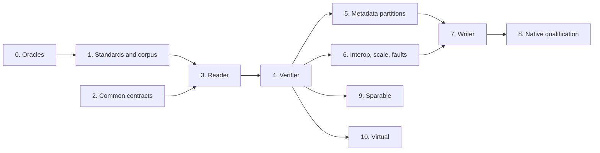

# UDF implementation plan

This plan defines and orders the work that adds the Universal Disk Format to
fsimg: first a reader and full verifier for the DVD and Blu-ray images found
in the wild, then a writer whose output independent checkers accept and
native systems mount, modify and remount, then the packet-media partition
types. Its input is the research draft
[UDF filesystem format specification and fsimg implementation plan](../fsspecs/fsimg-udf-spec.md)
("the draft"). The draft is not the specification. The authoritative
designs are [`specs/design-udf.md`](../specs/design-udf.md) and
[`specs/design-udf-driver.md`](../specs/design-udf-driver.md), original
designs in the present tense that cite their evidence; the
[research record](udf-research.md) holds that evidence and the open
questions. Section numbers such as "draft section 4.4" refer to the draft.

The working agreement applies unchanged. Designs come before code. Every
stage gets the review subagent and the external `aireview` review. A failing
regression test comes before any non-trivial fix. Each stage ends in one
coherent commit, or a few, and skipped checks are reported. No calendar
estimate substitutes for a gate.

## Goals and non-goals

Goals:

1. Read UDF volumes, bare or as a slice, through `i`, `t`, `x`, `x -O` and
   `W`: physical partitions at every revision from 1.02 to 2.60, ISO 9660
   bridges through their UDF view, and 2.50 and 2.60 metadata partitions.
   Resources are bounded at any legal geometry, and every failure falls into
   the closed status classification.
2. Verify completely: anchors and the reserve sequence, ownership of every
   reachable block against the space bitmap or table, link counts, unique
   IDs, the integrity descriptor, streams, metadata mirrors.
3. Create UDF 2.01 volumes that NetBSD `fsck_udf -fn` accepts without
   findings, that Linux, NetBSD, Windows and macOS read, and that Linux and
   NetBSD mount read-write, modify and remount. The writer capability is
   registered only after that record exists for every advertised block size.
4. Read sparable and VAT volumes from packet and write-once media images.

Non-goals:

* In-place modification, repair, mounting, packet writing, session append
  and optical drive control (draft section 0, decision 6).
* Reading with degraded fallback to the reserve sequence, another anchor or
  a metadata mirror when the primary copy is damaged. Verification reports
  the damage; recovery reading needs its own design.
* Secure UDF, real-time files, multisession images whose latest session does
  not start at the slice origin, block sizes above 4096, strategy-4096 ICBs
  and named streams as entries. The format design states them as
  limitations.
* Writing hard links. The common model has no hardlink representation yet;
  see the Medium "Hardlink topology" item in [the QNX6 TODO](todo-qnx6.md).
* Writing 1.02, read-only (DVD-ROM-style), metadata-partition, sparable or
  VAT volumes. Each is unscheduled work behind its own evidence.
* Choosing between the UDF and ISO 9660 views of a bridge automatically.
  Both readers claim a bridge, so the existing ambiguity rule requires
  `-F udf` or `-F iso9660` until a view-selection design says otherwise.

## Inputs and their standing

| Input | Standing | Use |
| --- | --- | --- |
| [The draft](../fsspecs/fsimg-udf-spec.md) | Research draft, original prose | Layout tables, the threat model (section 9), the fixture dimensions and reader, mutation and writer matrices (section 12). Its observed-contracts table (section 0.1) predates several fsimg contracts and is superseded by the designs |
| ECMA-167 3rd edition and ECMA TR/112 parts 2 to 7 | Public standards, not code; facts paraphrased | The normative layout and rules. Unreachable from the environment that wrote the designs; stage 1 confirms every rule marked E1 or U1 |
| NetBSD `sys/fs/udf/ecma167-udf.h` | BSD-2-Clause | Offset cross-check only. Per-file license review precedes any adaptation of NetBSD code, and none is planned |
| udftools (`mkudffs`, `udfinfo`), genisoimage, pycdlib, 7-Zip, the Linux driver, libudfread | GPL or LGPL | Black-box oracles outside the repository. No code, declarations or identifiers enter the tree |
| NetBSD `makefs -t udf`, `newfs_udf`, `fsck_udf`, `mount_udf` | BSD; run in a guest | The strongest independent writer, formatter and checker (draft section 11.3) |
| Windows `format /FS:UDF` and its reader; macOS `hdiutil makehybrid -udf` and its reader | Proprietary executables | Black-box writers and readers on disposable VM volumes |
| DVD-Video and BD-ROM discs the owner holds | Not redistributable | Structure-only surveys, as the QNX research did with the PCM drive |

## Existing owners the driver reuses

The common contracts cover UDF, with the five format-neutral additions the
format design lists. The draft's proposed components (sections 3.1, 4.1 and
8.4) map onto existing owners:

| Draft component | fsimg owner |
| --- | --- |
| Bounded slice I/O, "volume-space LBA" | Bounded I/O and slices; byte 0 is the volume origin |
| `udf_state` | The immutable volume model built by `open` |
| `map_block`, `map_run` resolver with a `purpose` | The translators of `map.c`; no purpose argument, since every caller gets the same checks |
| VAT, sparing and metadata helper structures | Translator state, tables in scratch |
| FID decoder in `prepare`, `replay` re-check | The common prepared-directory contract |
| DATA/ZERO extent protocol | [Zero extents](../specs/design-content.md#zero-extents) in common delivery and the shared extent index |
| Driver-supplied interval set for the content domain | One content domain per volume; ownership verification catches in-domain cross-links |
| Scratch-backed ownership sort | Claimed-block bitsets per ownership domain, as QNX4 keeps |
| `udf_plan` with scratch rows | One paged array of plan rows keyed by catalog ID |
| Fixture sidecar metadata | The integration script's per-image manifest |
| `test/spec/lib/fsimg_spec/udf/` | Later work of the [specification-testing plan](spec-testing-plan.md); the C generator in `test/udf.c` comes first, as for QNX4 |

## Design decisions

The designs record these with their rationale. Most remove a class of
special cases rather than handling each case.

1. **One public name, one writer profile.** `udf` is the only name. The
   reader accepts every qualified revision; the writer emits 2.01 only. Until
   native qualification the writer lives in the second, unregistered
   descriptor that [format contracts](../specs/design-formats.md#format-descriptors-and-profiles)
   define for writers awaiting qualification, which resolves the draft's
   concern (section 15.1) that variants share operations.
2. **Three single owners.** Only `map.c` translates addresses, only
   `alloc.c` interprets allocation descriptors and only `space.c` records
   ownership. Range, overflow, tag-location space, AED-chain and cross-link
   rules exist once for every partition type.
3. **An acyclic bootstrap by construction.** Translators are built in
   dependency order, physical first, and a Type-2 map's backing file is
   decoded through the physical map, so no translator can consult itself.
   This replaces the draft's cycle checks (section 4.4, "Bootstrap").
4. **Ownership by claims during the walk.** Every directory claims its
   storage when entered and every other object under its first name, in a
   bitset per ownership domain. A directory with two names, a cycle, an AED
   loop and a cross-link fail by one rule; verification compares the
   claimed set with the space bitmap in one pass.
5. **Zero extents in common delivery, coarse ranges.** Unrecorded and
   unallocated extents are zero extents that delivery fills without reading
   storage. A range query still answers from lengths alone, so it reports
   the whole body as data; the draft's open question (section 5.5) closes
   in favour of the existing range contract.
6. **The writer allocates every byte.** The architecture forbids sparse
   writer output, so the writer never emits extent types 1 or 2 (draft
   section 8.4 step 4 is dropped).
7. **No degraded reading.** `open` uses the anchor at 256 and the main
   sequence; verification examines the other anchors and the reserve
   sequence. One path, no recovery state.
8. **Reserve-sequence equivalence on consumed fields.** Verification
   compares the fields the reader consumes, not bytes, because genisoimage's
   main and reserve PVDs differ in the volume set identifier ([G1]).
9. **The writer's layout follows mkudffs.** Main sequence at 96, integrity at
   128, partition from 257, reserve sequence at `N - 17`, anchors at 256 and
   `N - 1` ([M1]). Two anchors satisfy UDF and keep the partition whole.
10. **Two allocation regions.** The writer puts every directory, ICB and AED
    before the file bodies, so a later metadata-partition writer moves the
    first region into a metadata file without reordering the plan.
11. **Portable name profile.** UDF declares the profile the QNX readers
    declare, renamed to a format-neutral name in stage 2. Names outside it
    are omitted and counted; NUL, slash and the dot names are refused.
12. **The VAT is the last block.** A flat write-once image ends with its VAT
    ICB, as mkudffs's images do ([M1]), so no tail search is needed (draft
    section 4.2). An image whose last block holds no FE or EFE tag is
    unsupported until Q17 shows how other writers' images end.

## Evidence questions

The [research record](udf-research.md#open-questions) lists questions Q1 to
Q17 with the evidence that closes each. Their consumers:

| Question | Stage |
| --- | --- |
| Q1 standards confirmation | 1 |
| Q2, Q3, Q10, Q13, Q15 corpus behaviour | 1, consumed by 3 and 4 |
| Q12 an independent metadata-partition image | 1, gate of 5 |
| Q4, Q5, Q6, Q9, Q11, Q14 native acceptance of writer choices | 8 |
| Q7 symbolic-link component types | 1 for reading, 8 for writing |
| Q8 LVID counts | 1 |
| Q16 whole-disk MBR | owner decision at the stage 1 review, before stage 3 tests it |
| Q17 how write-once images from other writers end | 1, consumed by 10 |

## Work packages

Every stage leaves `make -j32 check` passing and follows the gates below.

### 0. Oracle environment

* Pin the Linux oracles on the Linux CI image: udftools, genisoimage,
  pycdlib and 7-Zip, recording versions in [build](build.md).
* Establish a NetBSD guest with `makefs`, `newfs_udf`, `fsck_udf` and
  `mount_udf`, modelled on the QNX harness under `tools/`, and record which
  `makefs -t udf` options and revisions its release supports.
* Establish how to capture Windows- and macOS-written images on disposable
  VM volumes, with manifests, outside the repository; the path becomes
  `FSIMG_UDF_CORPUS`.
* Record whether the Linux host can loop-mount images, which needs
  privileges the ordinary suite never requires.
* **Gate:** tool identities are recorded in the research record. If no
  NetBSD guest can run `fsck_udf`, stop and ask the owner: the writer gate
  needs it.

### 1. Standards confirmation and corpus

* Read ECMA-167 parts 1, 3 and 4 and TR/112 parts 2 to 7 and confirm every
  E1 and U1 rule in both designs, editing the designs where the text
  differs (Q1).
* Build the corpus with manifests: the mkudffs matrix of media types,
  revisions, block sizes, space forms (`--space`), allocation forms (`--ad`)
  and `--noefe`; NetBSD `makefs` populated images at each revision it
  writes, including a metadata partition (Q12); genisoimage and pycdlib
  bridges; Windows 2.01 and 2.50 volumes; macOS `makehybrid` 1.02 and 1.50
  bridges; structure-only surveys of owned DVD-Video and BD-ROM discs.
* Answer the corpus questions (Q2, Q3, Q7, Q8, Q10, Q13, Q15).
* **Deliverable:** the research record updated with every observation and
  each question answered or still open with the feature it blocks.
* **Gate:** no open question blocks the physical reader; the designs and the
  record agree. Stages 1 and 3 may iterate.

### 2. Common contract changes

* [Zero extents](../specs/design-content.md#zero-extents): the extent kind,
  delivery's zero fill, the extent index's zero records.
* [Decoded link targets](../specs/design-content.md#decoded-link-targets):
  the reader-owned buffer and delivery from it.
* Storage-byte counting in the payload helper.
* [Link-target reads](../specs/design-emission.md#encoded-link-targets) for
  writers.
* The common 766-byte label capacity everywhere a label is stored: `fsimg_volume_info_t`,
  the writer's copied label and its common capacity check, and the worker's
  job and information records, with the C API and protocol documentation
  and a writer test of a 252-byte UTF-8 label through the library and the
  CLI.
* The rename of `FSIMG_NAME_PROFILE_QNX` and `fsimg_name_in_qnx_profile()` to
  `FSIMG_NAME_PROFILE_PORTABLE` and `fsimg_name_in_portable_profile()`, with
  the comments in `lib/read/directory.h`.
* Tests through a test driver for each addition; every existing format's
  suite and fixtures are unchanged.
* **Gate:** all suites pass with byte-identical writer output and unchanged
  reader results for every existing format.

### 3. Reader: probe, open, physical profile, traversal and content

* `lib/formats/udf/` as the driver design fixes it, with the sparable,
  virtual and metadata translators returning `FSIMG_EUNSUPPORTED`.
* Registration in the static descriptor list with the reader capability,
  the build wiring and `EXTRA_DIST`.
* `test/udf.c`: the independent synthetic generator with its own offset
  tables and CRC, sharing no code with `lib/formats/udf/`, and its
  mutations.
* `fuzz/udf.c`: probe, open, traversal and content under finite budgets.
* Tests cover the acceptance matrix's probe, anchor, sequence, descriptor,
  file set, ICB, allocation, directory, name, symbolic-link and metadata
  areas.
* **Gate:** `i`, `t`, `x` and `x -O` match the manifests on the synthetic
  fixtures and on every stage 1 physical-partition image, bridges included.
  No byte reaches delivery unvalidated, and no zero extent reads storage.
  This stage may land as two commits: codecs, generator, probe, open and
  `i`; then directories, names and content.

### 4. Physical verifier

* `verify.c` for physical volumes: anchors, the reserve sequence, volume
  space, ownership against the space bitmap or table, link counts, unique
  IDs, the integrity descriptor, stream directories, payload read-through.
* Tests cover the acceptance matrix's space and ownership area and every
  verification rule.
* **Gate:** every stage 1 physical image verifies, or its failures are
  classified in the research record and decide whether a rule widens; every
  corruption case fails with its class; a report is never marked complete
  after skipping an object.

### 5. Metadata-partition reader and verifier

* The metadata translator and its bootstrap, the mirror comparison and the
  bitmap-file reconciliation.
* **Gate:** the independent metadata-partition images of stage 1 read and
  verify, with the acceptance matrix's metadata-partition cases. Without an
  independent image (Q12) the stage does not land.

### 6. Reader interoperability, scale and faults

* `test/udf-integration.sh.in` runs the oracles the build finds and skips the
  others explicitly: mkudffs and udfinfo, genisoimage and pycdlib, 7-Zip,
  the Linux reader where the host permits a mount, the NetBSD guest, and the
  corpus through `FSIMG_UDF_CORPUS`.
* Scale cases of the driver design, recording I/O calls, metadata passes,
  peak scratch and RSS.
* Faults: allocation, scratch, short read, EOF and cancellation at every
  stage, each followed by a cleanup check.
* **Gate:** the comparisons are recorded in [build](build.md) with tool and
  kernel versions, or reported as skipped with the reason; the scale figures
  hold within the session budget.

### 7. Writer, unregistered

* `write-udf.h`, `write-plan.c` and `write-emit.c` for the 2.01 profile.
* `test/udf-write.c`: round trips through the reader, the verifier and an
  independent checker written from the design; byte identity across source
  order, cache size, scratch path and time zone; a poison scan; faults at
  every stage; `--create` for the stage 8 images.
* udfinfo, 7-Zip and NetBSD `fsck_udf -fn` on writer output in the
  integration script.
* **Gate:** every check passes. The stage lands with the writer capability
  unregistered, and the gap is listed in [the UDF TODO](todo-udf.md).

### 8. Native qualification and writer registration

* For every block size the capability will advertise:
  1. NetBSD `fsck_udf -fn` without findings;
  2. read-only mounts on Linux and NetBSD, and reads on Windows and macOS,
     comparing trees, sizes, checksums, names and metadata with the
     manifest;
  3. read-write mounts on Linux and NetBSD that create, append until a file
     needs several extents, rename, make and remove directories and unlink;
  4. unmount, `fsck_udf -fn` again, remount and read again;
  5. fsimg `W` on every post-native image.
* The images include a 1024-byte symbolic-link target, so the advertised
  link limit rests on native reads, and names of 254 eight-bit characters
  and 127 UTF-16 units.
* The cases answer Q4, Q5, Q6, Q9, Q11 and Q14; a writer choice a native
  system rejects changes in the designs before registration.
* Registration covers the capability record and `--formats` output, plus
  `README.md`, `docs/fsimg.1`, `docs/libfsimg.3` and `NEWS`.
* **Gate:** every native cycle passes. The writer is registered only after
  that record exists.

### 9. Sparable reader

* The sparable translator, table-copy verification and the spare area's
  ownership.
* **Gate:** mkudffs `cdrw` images and an image with active relocations,
  synthetic and from a NetBSD or Linux packet-writing oracle, read and
  verify, with the acceptance matrix's sparable cases.

### 10. Virtual-partition reader

* The VAT translator with both codecs, the write-once partition rule and
  the single-anchor acceptance.
* **Gate:** mkudffs `cdr` and `bdr` images, a 1.50 VAT from an independent
  writer, and the acceptance matrix's virtual cases read and verify.

Unscheduled, each behind its own evidence: a `revision=` setting for 1.02
output, a read-only writer profile for optical masters, a 2.50
metadata-partition writer, hard links after the common hardlink design, an
automatic bridge view selection, degraded reading, and layer
partition types for UDF volumes.

## Dependency order

Stage 2 is independent of stages 0 and 1. The graph shows data
dependencies only; the owner's order schedules metadata partitions before
the writer and the writer before stages 9 and 10, which could otherwise run
beside it once the verifier exists.

## Gates for every stage

* **Review before tests.** Launch the review subagent first, before the
  pre-commit test run. Ask it explicitly for:
  - bugs and design issues;
  - security and information-leak concerns, with the security pass framed
    in the prompt: hostile descriptors, translation overflow, AED and
    directory cycles, unbounded VAT and sparing tables, CS0 expansion,
    component streams, zero extents that could expose storage;
  - the style guide's readability review, citing specific functions.

  Address every Critical and High finding. Fix each Medium finding or record
  it in `TODO.md` or the commit message.
* **External review.** Run the external review with `aireview` over
  `git diff HEAD`. Substantive fixes are reviewed again. A failed or
  unavailable review is reported, never replaced.
* **Tests.** Write a failing regression test before any non-trivial fix.
  Run `make -j32 check` at every stage.
* **Sanitizers.** The coordinating session runs `check-asan`, `check-ubsan`,
  the supported LSan and MSan targets, and `check-fuzz` once on the
  integrated tree before landing. Every new source, test and script is in
  `EXTRA_DIST`.
* **Platforms.** Stages that touch common I/O, the worker or `compat/` run
  the Linux container check and the FreeBSD procedure, and each report names
  the platforms that ran.
* **Project hygiene.** New C and shell files are ASCII with BSD-2-Clause
  headers. `docs/build.md` records the commands, the evidence and any
  explicit skips.

## Departures from the draft

| Draft | This plan | Reason |
| --- | --- | --- |
| First writer emits 1.02 (sections 0 and 8.2) | First writer emits 2.01 with EFE | Owner decision: creation time in the EFE, mkudffs's default, readable by every current system |
| Writer may emit unrecorded extents for zero ranges (section 8.4 step 4) | Every byte allocated and recorded | The architecture forbids sparse writer output |
| `next_range` may report interior holes (section 5.5) | Coarse data ranges | A range query answers from lengths alone |
| A driver-supplied interval set as content domain (section 5.5) | One contiguous domain, widened for spare packets | Ownership verification already catches in-domain cross-links |
| Recovery from the reserve sequence or mirror for reading (sections 2.3, 3.6, 4.4) | No degraded reading | One path; damage is a verification finding |
| Bounded tail search for the VAT (section 4.2) | The VAT ICB is the last block | Observed on mkudffs's write-once images |
| Three anchors with the reserve sequence near the end (section 8.3) | Two anchors, reserve sequence at `N - 17` | mkudffs's layout; a whole partition |
| `udf102` and `udf201` public profiles (section 8.2) | One `udf` name; an unregistered writer descriptor until qualified | The existing registry mechanism |
| Changed time conditional or lost (section 7.1) | Changed time is the attribute time both ways | The Linux and NetBSD practice, pending Q1 |
| An explicit normalization and escape policy for names (sections 5.4, 6.1) | Exact code points; omitted or refused names | The common omitted-names contract; no escaping in stored names |
| `fsimg info -i` command spellings (section 11.3) | `i`, `t`, `W`, `x -O` | The tar-like CLI |
| pycdlib as a UDF 2.60 oracle (section 11.2) | pycdlib is a 1.02 bridge oracle | Its `udf='2.60'` output is 1.02 ([P1]) |
| mkudffs for 2.50 metadata images (section 11.1) | NetBSD or Windows for metadata partitions | mkudffs writes a VAT for its 2.50 `bdr` profile ([M1]) |
| Ruby rule harness first (section 12.5) | C generator first; the harness later | The specification-testing plan's order |

## Owner decisions

The owner has settled the first four; the rest are proposed in the designs
and close at the stage 1 design review.

1. **Scope and order.** Reading DVD and Blu-ray images comes first: the
   physical reader and verifier, then metadata partitions, then the writer,
   then sparable and virtual partitions.
2. **Writer profile.** UDF 2.01 with extended file entries.
3. **Long labels.** `fsimg_volume_info_t.label` uses the common 766-byte capacity,
   including a terminator, so every valid UDF label reports exactly.
4. **Names outside the profile.** Characters U+0001 to U+001F, U+007F and
   unpaired surrogates are omitted and counted, as in the QNX readers; NUL,
   slash and the dot names fail their directory with `FSIMG_EUNSUPPORTED`.
5. **Default block size.** 2048 when `sector_bytes` is zero, the optical
   convention; 512 and 4096 for hard-disk media on request.
6. **Inline regular files.** Bodies up to `B - 216` bytes are stored in the
   EFE, matching the Linux kernel's default; if a native reader rejects them
   (Q5) the writer stops inlining regular files.
7. **Whole-disk MBR (Q16).** mkudffs's `--bootarea=mbr` writes an MBR whose
   one entry starts at LBA 0, which the MBR probe claims and finds corrupt,
   so detection fails on such a disk. Either the MBR probe makes no claim
   for an entry at LBA 0 that spans the disk, a layer-design change, or the
   image reads only with the scheme forced empty.
8. **No degraded reading** (design decision 7).

## Risks

* **Standards not yet read.** The designs' standard rules come from the
  draft, the NetBSD offsets and observation. Offsets and the CRC are
  confirmed by observation; semantics such as timestamp types, component
  types and count rules may differ. Stage 1 gates the reader on Q1.
* **Metadata-partition oracle.** No Linux tool writes one. Without a NetBSD
  guest or a Windows volume, stage 5 cannot land, which delays the writer
  under the owner's order.
* **Real-world writers.** Authoring tools for DVD and Blu-ray, and Windows,
  may record values the closed tables refuse. Rules widen only from
  evidence, never by guess.
* **Native mounts.** Linux mounts need privileges the ordinary suite never
  has; the integration script runs them only where the host allows and
  reports skips.
* **Bridges.** UDF and ISO 9660 both claim a bridge; the caller forces
  the desired format until an automatic view-selection design exists.
* **Provenance.** The designs are written in project prose from facts.
  Nothing from GPL or LGPL sources enters the tree; captured images and
  disc surveys never enter the repository.

[M1]: udf-research.md#observations
[G1]: udf-research.md#observations
[P1]: udf-research.md#observations
