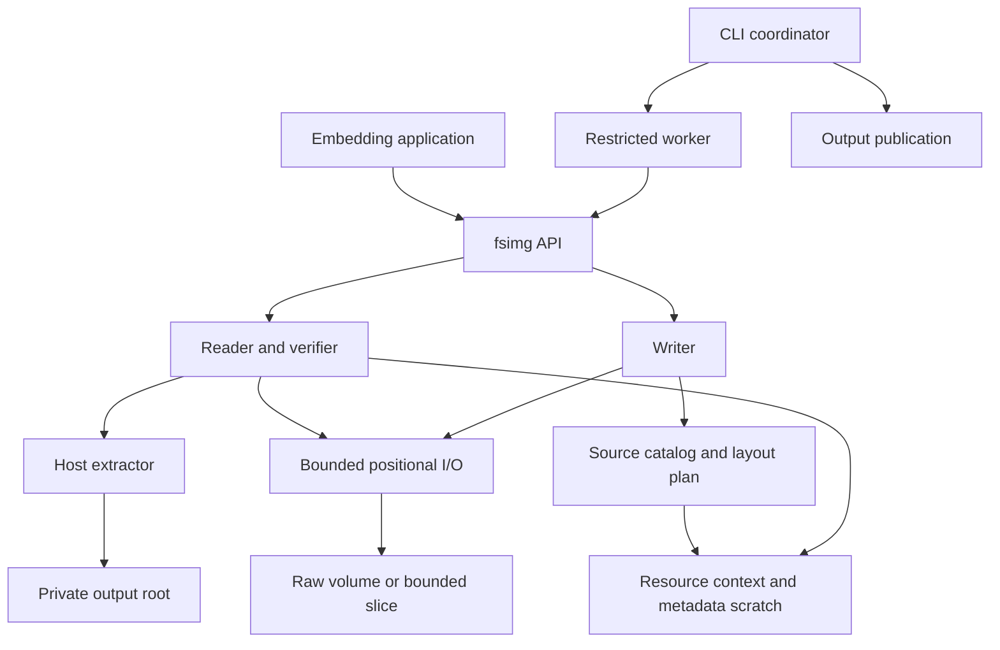

# fsimg architecture and product specification

## Product and scope

**fsimg** is the project name and command name. Its C library is also part of
fsimg; the installed linker artifact is conventionally `libfsimg` and the
public header is `fsimg.h`. New project-owned code is BSD-2-Clause. Public
functions and constants use `fsimg_` and `FSIMG_`; all project-defined C types
have `_t` typedefs, including opaque handles. The creation object is a
**writer**.

fsimg creates, inspects, lists, verifies, and extracts filesystem volumes
without mounting them. It accepts regular image files, finite read-only disk
devices, explicitly bounded regions of those objects, memory supplied by an
embedding application, and positional I/O callbacks. The CLI's named image
inputs accept regular files and the endpoints in the
[device-input design](design-device-input.md); standard input remains a
stream. Ordinary file use requires no privileges, kernel filesystem driver,
or external formatter. Device use requires permission to read that endpoint.

The format contract covers FAT12, FAT16, FAT32, exFAT, the qualified QNX6
Power-Safe profiles, QNX4, the QNX image filesystem (ImageFS), HFS Plus,
HFSX and APFS with independent read and write support. The CLI is
tar-like: the modes `c` (create), `x` (extract, or one member to stdout with
`-O`), `t` (list), `W` (verify, also combined as `cW`) and `i` (info), plus
`--formats` for capabilities, with `-f` naming the image. Each format
declares supported features; no mode claims support based only on
recognizing a boot record.

The supported host baseline is a 64-bit FreeBSD, Linux, or macOS environment
with C11, 64-bit file offsets, and positional file I/O. A format's legal limits,
the adapter's representable range, and configured resource limits all apply.
Using `uint64_t` does not promise that a host can create a file of every
representable size. Windows and 32-bit hosts require separate portability work.

The CLI build requires complete descriptor closure during process startup,
provided by `POSIX_SPAWN_CLOEXEC_DEFAULT` or
`posix_spawn_file_actions_addclosefrom_np`. Configure checks this capability
before accepting the host: a successful build must not install a command that
cannot safely start its required worker and output relay. Descriptor-limit
loops do not establish closure because open descriptors can outlive a lowered
limit. This requirement uses native OS/libc interfaces, without a helper library.

The product does not modify existing volumes, emulate a POSIX filesystem,
repair corruption, replay journals, or mount images. Partition tables,
disk-image containers, compression, stream input and whole-disk composition
are covered by the [layer design](design-layers.md): an image is a stack of
slots, filesystem inside partition scheme inside container, with compression
applied separately to the whole; emission is random-access into a staged
result followed by one sequential transcode, and reading peels each layer
down to a bounded I/O slice, so filesystem drivers never see a layer. A
bounded volume slice is supported independently of partition discovery.
Additional filesystems and archive integration have separate designs and
acceptance gates. These scope boundaries do not justify shortcuts in the
common API.

## Priorities and design choices

The [principles](principles.md) govern tradeoffs. In particular:

* Large payload support alone is insufficient: catalogs, FATs, bitmaps,
  directories, and fragmentation indexes also have bounded resident storage.
* Metadata scratch files are an explicit resource. They contain records,
  indexes, and sort runs, never a second image or copied file payloads. The
  only payload-sized temporary files are the spool and the raw intermediate,
  two separately named and budgeted resources whose placement the
  [storage design](design-storage.md#resource-model) states.
* CLI image parsing runs in an isolated worker. The default uses OS confinement
  when available and warns when it is unavailable. A required mode refuses
  unconfined execution. In-process library calls provide the same validation
  but do not sandbox their host application.
* Extraction writes beneath one private destination that the coordinator has
  checked empty: a fresh directory it creates inside the user's `-C`
  directory, or with `-E` the user's own directory after the checks in the
  [security specification](design-security.md#safe-extraction). Merging
  into a populated tree, overwriting files, and restoring privileged metadata
  are outside the extraction contract.
* Every directory fsimg creates to write into, CLI or library alike, comes
  from one libfsimg routine that creates it with mode 0700, reopens it
  no-follow and checks that it is private on that descriptor by the rule the
  [security specification](design-security.md#safe-extraction) states,
  subject to the residuals it names.
  Output staging, extraction destinations and CLI scratch therefore share
  one check, and no library or CLI entry point creates such a directory
  without it. The extractor's own directories are created beneath a root
  that passed the check, which their privacy follows from.
* A writer consumes known-length, repeatable sources. It freezes its catalog
  before planning and emits one image. Removing mutation and retry states
  makes failure and source ownership easier to reason about.
* External sorting and paged arrays serve metadata workloads. There is no
  embedded database, persistent transaction log, or general-purpose storage
  engine for disposable planning data.

## Components and data flow



| Owner | Owns | Does not own |
| --- | --- | --- |
| Resource context | All fsimg allocations, scratch files, limits, counters, cancellation | Application allocations and global process policy |
| I/O adapter | Byte ranges, exact I/O, host offset conversion, zeroing, knowledge of which of its own ranges read as zero | Filesystem geometry or image paths |
| Source catalog | Target entries, stable source identities, external ordering | File payload storage |
| Writer | Collection, immutable planning, emission order, sink initialization, payload copying and its source lifecycle | Format placement or metadata encoding; editing an existing image |
| Reader | Probe dispatch, directory preparation and namespace validation, traversal and selection, current entry, logical content delivery | Format fields or name folding; host path creation |
| Format driver | Descriptor and capabilities, probe, on-disk codecs, feature checks, directory decoding and comparison keys, content resolution, geometry, layout and encoding | Traversal, paths, limits, source access, raw sinks, ambient host access, independent caches, publication |
| Extractor | Destination path validation, safe file creation, safe metadata policy | Parsing raw filesystem structures |
| Output coordinator | Staging, finalization, no-replace publication, outcome reporting; shared by library helpers and CLI | Format parsing |
| CLI coordinator | Trusted operands, descriptor preparation, worker lifecycle | Parsing image bytes or acting on worker-supplied host paths |
| Sandbox adapter | Platform confinement and verified capability reporting | Format-specific exceptions |

## Contracts

### Bounded resources

Every dynamically sized library allocation goes through one resource context.
All caches, live objects, directory state, sort buffers, diagnostics, and I/O
buffers share its budget. A driver cannot allocate a second budget privately.
Allocation is charged before use; failure preserves accounting and produces
`FSIMG_ELIMIT` or `FSIMG_ENOMEM`, as appropriate.

The [zlib allocation adapter](design-binary-primitives.md) applies that same
context budget to each stream's allocations. Its small per-stream state records
allocation failures without owning another allocator or budget; codec callers
retain framing, integrity checks, and stream initialization and destruction.

Let `V` be logical volume bytes, `N` entries, `C` allocation units, `F` fragments,
`D` directory depth, `P` actual payload bytes transferred, and `M` the memory
budget. Library-controlled resident allocations are at most `M`, independent
of `V`, `N`, `C`, and `F`. Depth and individual record length are separately
bounded. Scratch storage can grow with metadata and is limited separately.
The detailed algorithms and complexity bounds are in
[storage and algorithms](design-storage.md).

The budget caps working buffers; it does not size them. A buffer allocated
per object, such as per directory or per file, takes what that object needs,
and a buffer sized from the budget takes no more than its input needs; one
whose need is not known in advance starts small and grows in steps, as the
metadata page cache does. A fixed buffer allocated once per operation and
bounded by a configured limit or a format's or codec's fixed unit, such as a
path buffer, a block, a zlib window or a streaming copy buffer, keeps its
fixed size. Booking a full share for every small object would inflate the
charged peak, fail small operations under a tight budget, and churn the host
allocator once per object, which some allocators turn into resident memory
the budget never sees.

Defaults are product policy, not a measurement claim:

| Limit | Default | Meaning |
| --- | --- | --- |
| Memory | 256 MiB | All live fsimg allocations in a context; minimum supported budget 16 MiB |
| Scratch | 64 GiB | Sum of logical lengths of live scratch files, including simultaneous merge inputs and outputs |
| Spool | 64 GiB | Logical bytes of the spool file holding a stream or compressed input, defined in the [layer design](design-layers.md) |
| Entries | 10,000,000 | Entries admitted or visited in one operation |
| Directory depth | 256 | Components below the volume root |
| Image path | 64 KiB | Encoded UTF-8 bytes, including separators and terminating NUL |
| Open descriptors | 128 | Aggregate descriptors owned by a context, further limited by host availability; the CLI derives its own default from the depth limit ([CLI](design-cli.md)) |
| Extracted logical bytes | Selected volume length | Sum of file lengths, including holes and repeated references; caller may explicitly change it |
| Created output bytes | Planned length | Logical bytes of the staged output plus, while a transcode holds both, the raw intermediate: the plan sums the disk length and the layers' worst-case encoded length, and an explicit lower limit fails before anything is written, naming both parts; a stream holds the raw intermediate too, so it is charged the same way |
| Diagnostic frame | 64 KiB | Maximum single worker control message |

Limits are configurable and failures identify the exhausted resource. Lower
host limits can cause earlier failure; an advertised path/depth maximum is not
a promise to exceed another budget. Zero in an initialized options structure
means the documented default, not unlimited. No input field raises a budget.
Counters use checked arithmetic and never wrap.

An operation spans a writer's complete lifetime or a reader's complete session,
including every incremental add, iteration, content, and verification call.
Per-call quota resets are forbidden. Context memory, scratch, and descriptor
limits aggregate across its live handles. An embedding application that creates
separate contexts owns the aggregate deployment policy across those contexts.
Metadata objects borrow their reader/writer's session rather than starting new
work counters; repeated metadata operations cannot reset its quota. The context
owns their shared page cache and aggregate resident/scratch reservations, so
neither opening another object nor leaving sparse pages untouched bypasses a
budget.

Memory accounting excludes application-owned callback state and buffers,
executable/shared-library mappings, allocator bookkeeping, thread stacks, and
the kernel page cache. These exclusions are reported honestly. RSS is measured
as a separate acceptance criterion. The CLI uses a bounded control process
and one single-threaded parser worker, plus one bounded output relay so blocked
stdout/stderr sinks cannot block supervision, and for a stream read one input
relay: at most four processes. The relays own no library cache.
The process RSS allowance includes the relays. Caches do not multiply by CPU count.
Resource exhaustion cannot trigger an unbounded fallback. With scratch
disabled, an operation either fits in memory or fails with `FSIMG_ELIMIT`.

All CLI text uses the output relay, including commands without a parser worker
and post-publication summaries. A bounded producer feeds the same queue and
supervision loop as worker events. An image read from standard input goes
the other way through an input relay: a child from the same executable
holding only the standard input descriptor and one pipe to the worker, under
the same supervision and deadline, carrying bytes it never interprets; those
bytes are image payload, not text, and are charged to the spool limit by the
worker, not to the ledger. Both relays run unconfined: each holds only the
descriptors it copies between and interprets nothing, so the
[security design](design-security.md#coordinator-and-worker) confines the
parser worker alone. One absolute monotonic deadline spans command
preparation, worker processing, publication and successful output; phase changes
cannot restart its time allowance. After failure, diagnostic delivery receives
at most two seconds, with one further two-second stderr-only attempt if stdout
cannot carry the report. These attempts perform no parsing or publication.
Child termination retains its bounded shutdown grace. The monotonic clock
fails closed: a failed query has passed every deadline and grace, so it
ends each wait rather than extending it. Its failure at deadline setup is
reported as such. A failure after setup ends supervision as a passed
deadline when one is set, and ends the grace periods at once, so without
one the next grace ends supervision; while the clock keeps
failing, the diagnostic attempts, which have no other bound, end before
they deliver anything, so the exit status alone reports the failure.
The [CLI design](design-cli.md) owns parsing and
streaming representation. Cleanup of private scratch is descriptor-relative,
does not follow links or recurse into worker-created directories, and has a
finite entry bound; incomplete cleanup reports the retained location.

Cancellation and deadline checks surround synchronous host calls but cannot
guarantee their interruption. In particular, device open and geometry queries
run during coordinator preparation; a blocked driver can delay those checks.
Worker supervision likewise cannot force an uninterruptible kernel read to
finish. The deadline bounds fsimg's decisions, not hardware completion.

Human presentation and structured records share the bounded formatter and relay.
Human commands use their exit status for completion; JSON retains its explicit
final completion record. The formatter retains one fixed verification result so
human success is emitted only after worker exit and required finalization.
Optional metadata-loss samples are bounded examples, while the worker's final
aggregate counts affected fields. Per-entry names, in a listing or under
verbose creation and extraction, stream one entry at a time from the
library's entry callback through the same entry records, and the final
counts must agree with the names; nothing in the library, worker or
coordinator accumulates them. Quiet presentation never suppresses required
sandbox warnings or uncertain/retained-output diagnostics. The CLI design owns
the command-specific presentation rules.

The coordinator owns one output ledger for the complete command, borrowed by
every relay phase. It records queued formatted bytes and confirmed stdout/stderr
bytes in checked counters; raw member bytes and a streamed image retain their
independent logical-output ceiling. Formatted text has no ceiling of its own;
the coordinator bounds every worker frame that yields text instead: the
image, plan, verification, error and completion records arrive once each,
partition records rise strictly within the table's slots, the entry and path
limits bound the per-entry records, progress is sampled logarithmically, and
at most 32 metadata-loss examples are accepted from a worker, whatever it
sends. Every relayed span is bounded too.
Publication outcomes take precedence over a partial stdout prefix; otherwise
any confirmed prefix remains incomplete after a later phase fails.

### Byte and object boundaries

All volume access uses checked, slice-relative positional I/O. The common
layer validates `offset <= length` and `count <= length - offset` before
translation to the backing object; nested slice construction checks its own
range. Drivers never receive an unrestricted backing descriptor. Disk values
are decoded explicitly, without casting bytes to native C structs.

The [scalar byte codecs](design-binary-primitives.md) share unsigned endian
loads and stores across image, scratch, and protocol codecs. They operate on
spans their callers have already bounded; they do not grant permission to read
a field or validate a record. Format codecs retain field offsets, signed-value
interpretation, reserved-bit checks, and relationships among decoded values.

Slices translate directly to a backing object and a checked base offset, so
slice nesting does not introduce recursive I/O or an unbounded traversal stack.
Public FD adapters duplicate borrowed descriptors. Private constructors consume
already reserved, library-owned descriptors without duplication, so confined
workers can wrap newly created output and scratch files without gaining a
descriptor-duplication syscall capability. A private read-only constructor
instead borrows a descriptor that library code keeps open for longer than the
object, such as a regular-file source root held by the root registry; freeing
the object leaves the descriptor open. Every path shares flag, type, and range
validation, and every descriptor counts once in the context's descriptor
accounting, against its owner.

Read-only disk inputs use one prepared descriptor description, shared by
CLI setup, the worker protocol, sandbox validation and I/O adoption. The
compatibility layer discovers finite capacity and transfer quantum before
parser confinement; the I/O constructor validates them and owns the charged
buffer that translates arbitrary byte requests into sector-aligned reads.
The worker gains no ioctl authority. Device roots have no write, resize,
zeroing, hole-query or durable-flush capability. Regular-file source,
setting, output and scratch roles keep their own type requirements. This
separation prevents a new input capability from granting device mutation.
The [device-input design](design-device-input.md) owns discovery, ownership,
transfer failures and platform qualification.

An I/O view's immutable optional logical sector size is distinct from its
storage root's transfer quantum. Device roots initialize it from host
geometry; other roots use unknown, and ordinary slices inherit their
immediate parent's value. One common image-disk view constructor uses the
resolved layer result to initialize decoded views to unknown, including
zero-copy container payloads; undecoded views retain the input's fact.
Scheme opening checks this view value against the selected scheme's LBA
size before exposing partitions and never recovers it from backing storage.
Selections and reopened images therefore preserve decoded-byte semantics
without mutable flags, per-codec resets or another resolver layer.
Consequently a device's transfer geometry cannot silently change a decoded
container's partition units, and a 512-byte MBR profile cannot misinterpret
a native 4096-byte-sector device.

Knowledge of zero contents is an operation of every I/O object, not a
property of holding a descriptor: each object reports the next range at or
after an offset that it knows reads as zero, from what it is. A file fsimg
created empty answers from the record of the ranges written through it, a
container's disk from its chunk index, an assembled disk from its regions, a
caller's object through an optional callback, and a read-only file fsimg did
not write, an external file whichever constructor built its object, from the
host's hole report after one sync of the file, bounded by the length the
query observes, a file observed shorter being a changed input, and never
for the chunk holding its last byte, which is always read so that a file
still short there fails.
fsimg never asks the host whether a file it wrote has holes: a
host hole report describes storage, not contents, and has been wrong for
written, unsynced data (OpenZFS issue 15526), whereas what fsimg wrote is a
fact it owns. For a user's file fsimg has no fact of its own, so it accepts
the host's report once the file is synced, a workaround for that fault class
rather than a fix, and reads every byte when the sync fails. Under Capsicum
the sync right goes only to a descriptor that is asked: the CLI's read jobs
never ask their image input for zero ranges, so neither it nor the spool
carries the right. Only a fresh file's record lets zeroing skip a write;
a zero-range answer, the host's or a callback's, spares reads alone, so the
accepted risk of the host's report cannot leave a stale byte in a reused
output. Because the record is per range, emitters need neither an order nor
a "still zero" state to keep a fresh output sparse. The
[hole design](design-holes.md) owns the record, the operation, each object's
answer and the decision's rationale.

Offsets, logical sizes, counts, and persistent record references use
`uint64_t`. Buffer lengths use `size_t` only after a checked conversion.
Adapters reject values outside their host range before invoking OS calls.
Partial I/O advances only by confirmed bytes; zero progress before the expected
end is an error. Interruption, cancellation, and final flush failures propagate.

### Writer and reader independence

A format descriptor has independently optional reader and writer operations
and is the only holder of its format's identity and capabilities. Common
lifecycle and reporting code never branches on a format. Detection uses one
bounded probe contract. The [format contracts](design-formats.md#format-descriptors-and-profiles)
define descriptors and probing. The reader is a lazy iterator with content
access to its current entry. The writer consumes a complete logical catalog,
not necessarily an in-memory tree. Shared code supplies I/O, resources, codecs,
source access, and diagnostics; format-specific geometry and allocation models
remain with the driver.

Each common reader and writer mechanism has one owner, so drivers carry no
traversal, delivery, or copy lifecycle:

* The [prepared-directory design](design-directories.md) lets a driver
  prepare a directory: framing, metadata, and comparison keys. Common code
  validates the namespace before any child is exposed, and one walker owns
  traversal, paths, limits, and selection.
* The [logical content design](design-content.md) has drivers resolve offsets
  to validated extents: mapped image ranges, holes that read as zero, or
  bytes the driver decoded and holds, such as a decompressed chunk. One
  common operation delivers bytes and zeros and preserves confirmed
  progress. A shared extent index is optional.
* The [emission design](design-emission.md) has the common writer perform
  pre-mutation checks, sink initialization, and complete source copies. Drivers
  write encoded metadata and request copies into planned regions.

These boundaries share infrastructure without a common reader/writer object
graph or mutable filesystem model.

The [verification helpers](design-verification-helpers.md) own initialized
payload read-through and the mechanics of exclusive ownership runs. Drivers
retain traversal scope, repeated-object handling, allocation discovery, and
reconciliation against format metadata. FAT keeps its fused chain verification
and payload read. The strict run utility, which FAT, exFAT and HFS Plus share,
rejects every overlapping claim in its declared domain; it neither infers
complete ownership nor defines sharing policy for other formats. QNX6's owner-bearing records, QNX4's claimed
bitset, and ImageFS's reference and checksum checks keep their own representations.

The [settings catalogue](design-settings.md) is the shared description of
setting names, C representations, presence and defaults, syntax, and operation
scope. Library applicability checks, capability reporting, and CLI conversion
consume it so these facts cannot disagree between independent lists. Format
capability masks and layer descriptors determine which settings apply; driver
validation owns relationships among values. The public options remain typed
records and the worker protocol remains an explicit checked byte encoding.
Catalogue operations perform no image I/O and confer no host authority; the
coordinator opens file settings and passes descriptors under the existing
security contract.

Filesystem read settings follow the write side's rule. A format's
capability record lists the read settings it accepts in `read_settings`, as
it lists write settings in `write_settings`; the format is known only after
detection, so the common reader refuses a non-default read setting outside
the selected format's mask with `FSIMG_EINVAL` before the driver opens, and
no driver silently ignores another format's setting. APFS holds the two
such settings, `volume=` and `snapshot=`, because an APFS container holds
several volumes and each volume several snapshots that share blocks: none
of them is a byte range a layer could select, so the selection belongs to
the filesystem's reader. FAT's codepage setting stays outside the mask: its
only accepted values mean the one supported codepage for every format.

The [layer design](design-layers.md) wraps a finished volume in a partition
scheme, a container and compression, and unwraps them on reading. Layers are
applied around the common writer and reader, never inside a driver: the
writer emits into a staged random-access result and one sequential transcode
produces the final file or stream; the reader decodes a stream or
compressed input into a spool file first, then peels each layer down to a
bounded I/O slice, which the filesystem driver opens as it opens a raw
image. The design also owns `--partition` selection and the spool budget.

The [scheme-planning contract](design-scheme-planning.md) gives each scheme
its option resolution, identities, partition metadata, and scheme-specific
constraints. Common disk planning owns bounded record allocation, alignment,
placement, fixed-disk fit, container rounding, and output accounting. Create,
wrap, and compose reach the same scheme operations, so adding a writer policy
does not require another scheme-name branch in their common setup. GPT and MBR
retain their bounded table representations and explicit read-side codecs; this
boundary does not promise that arbitrary partition formats share one layout.

Each writable container owns an immutable private
[plan](design-container-plans.md), held by the common disk plan and borrowed
by its encoder. Common composition reads only its granularity, transfer and
pass requirements, identity, and resolved codec dependency; the container
computes its encoded bound for the final disk length. The selected descriptor
destroys its complete extension, including partial construction, so adding a
container does not extend common structures with private header fields or
cleanup rules. File-setting identity and alias checks, sessions, resource
budgets, sequential sinks, and publication remain common. This ownership is
shared by create, wrap, and compose without a new public handle.
The common operation establishes its session before container construction and
lends it to constructor reads and subsequent output. Writer construction keeps
that session at its final address; wrap and compose lend their output session
to the assembled disk. A private plan neither retains a construction-session
pointer nor starts a fresh quota for each phase.

The QNX boot image (`ifsboot`) and the Harman-Becker flash image (`hbcifs`)
are containers in that design, each packaging one ImageFS for one loader
with metadata and integrity fields of its own, as the compression inside
each is the container's property, like DMG's zlib chunks. Carrying them
changes the layer contract in six ways, each specified in the
[layer design](design-layers.md) and recorded here because every layer
shares the contract: a container probe may read at the fixed offsets of a
closed table of boot prefixes, not only the file's prefix and last 512
bytes; a container may hold an opaque, executable section that is neither a
table nor a chunk; a chunk index may be filled by a decoding pass rather
than from tables; a container profile may declare file settings; a
container whose header precedes the body it describes and carries the
body's stored length is encoded in two deterministic passes, the first
compressing the body to learn that length and the second emitting, rather
than through the staged raw intermediate; and a container whose payload
is one sequential stream peels through the spool rather than the chunk
index, its read side still a positional I/O object over the volume.

A file setting is a byte string the container stores beside the disk and
derives from nothing: a startup program, a boot prefix. A library caller
supplies it as a read-only I/O object in a record the write options borrow
beside the flat typed settings. The CLI coordinator opens it from an `-o`
path as a read-only descriptor before the worker starts. It is
creation-only. Unwrap writes it back as a named section, and the image
information's details carry the typed header values, so a read image can
be rebuilt.

Beyond those six changes, both containers declare that they carry a
volume, a declaration the layer design adds alongside them, so a scheme in
their create stack is refused. A carried-volume container declares a disk
granularity of 1, so the exact-volume rule that refuses a padding
container around `ifs` passes for it with no case of its own.
A container also declares the fields no evidence gives a rule to check;
the library's layer report names them and calls the verification
incomplete, the CLI worker carries them to the coordinator, and `W`
reports them while still passing, because every check it makes passed
([verification scope](design-layers.md#verification-scope)).

The [sources and catalogs design](design-sources.md) defines common collection,
source identity and reopening, and immutable catalog preparation independently
of format planning. Common collection uses private interfaces; public writer
construction selects an accepted format driver.
The [manifest design](design-mtree.md) adds a third source root, an mtree(5)
manifest with an optional content directory, whose parser appends the same entry
and source records as the host scanner, so merging, planning, reopening and
emission do not distinguish it; it also defines the manifest the extractor
writes.
The [FAT reader design](design-fat-reader.md) defines FAT directory decoding,
alias keys, chain resolution, and full allocation verification.
The [FAT writer design](design-fat-writer.md) defines independent paged layout
records, deterministic alias reservations, geometry selection, and emission.
The [exFAT design](design-exfat.md) defines independent bitmap allocation,
embedded name mappings, entry sets, and initialized-data semantics.
The [QNX6 design](design-qnx6.md) defines snapshot selection, uniform block
trees, snapshot-aware allocation verification, and independent new-image
construction, and the [QNX6 driver design](design-qnx6-driver.md) maps them
onto the driver's modules, the shared extent index, two extent domains that
separate the system reservation from content, and fixed planning passes. Its
on-disk snapshots do not introduce a mutable filesystem or
change the output coordinator's publication ownership. Native write-after-create
qualification gates writer support because read-only compatibility cannot
establish safe free-space and system-metadata state.
The [QNX4 design](design-qnx4.md) defines geometry derived from the slice
length, closed acceptance tables fixed by native observation, physical record
identity with links resolved only into the `.inodes` table, hidden
format-owned files, and a writer that reproduces the native formatter's
default layout with one extent per object; the
[QNX4 driver design](design-qnx4-driver.md) maps them onto one extent walker
feeding the shared extent index, a bitmap pager fixed by geometry, and the
same planning and emission passes. The same native write-after-create
qualification gates its writer.
The [ImageFS design](design-ifs.md) defines the QNX image filesystem: a flat
header, a table of records each carrying a full relative path, file data and
an additive checksum, with closed acceptance tables fixed by native QNX
6.5.0 `mkifs` output and by the PCM 3.1 and live-CD boot bodies; the
[ImageFS driver design](design-ifs-driver.md) derives the hierarchy from the
sorted paths through the common external sort and the common walker, never
holding the table in RAM, delivers one extent per file through the shared
extent index, and plans one deterministic layout whose size is exact, so
the format has no free space to size. The boot machinery around an ImageFS
is the `ifsboot` container's, so the driver reads the bare body and the
same native `dumpifs` qualification gates its writer. The writer writes
nonbootable bodies only: a bootable body needs `procnto` linked by `mkifs`
at its image address and a compiled boot script, and fsimg neither
produces nor modifies member files, so such a body comes from `mkifs` or
is unwrapped from an existing boot image, and the `ifsboot` writer
packages its ImageFS bytes unmodified.
The [HFS Plus design](design-hfsplus.md) defines Apple's HFS Plus and its
HFSX variant: a volume header, forks of eight extents continued in an
extents overflow B-tree, an allocation bitmap, and a catalog B-tree of
primary and thread records with decomposed UTF-16 names under a folded or
binary comparator. Its comparators and Unicode tables are pinned and
accepted only when an exhaustive native macOS observation agrees, because
a writer whose order differs from macOS's emits a catalog macOS cannot
search. The [HFS Plus driver design](design-hfsplus-driver.md) validates
each folder's thread as it enters the folder, so the namespace is a tree by
construction, and verifies over the catalog's leaf sequence, in which every
file record appears exactly once, so one fork resolver claims all storage
for the strict run utility. Transparently compressed files are delivered
as decoded spans. A journal is never replayed: one holding transactions is
refused. The writer bulk-builds every B-tree from sorted records and gives
every fork one extent, so it never splits a node or writes an overflow
record, and native `fsck_hfs`, mount, modify and remount testing gates it.

The [APFS design](design-apfs.md) defines the APFS container: one block
space whose space manager serves several volumes, copy-on-write objects
committed in checkpoints, object maps that resolve virtual objects at a
transaction, one B-tree format for every index, and a filesystem tree per
volume whose directory names are hashed and compared under Unicode
normalization and, on case-insensitive volumes, case folding. The reader
selects one committed checkpoint and one volume, refuses encryption and
Fusion, and verifies allocation container-wide because volumes share it;
the [APFS driver design](design-apfs-driver.md) routes every object
reference through one object reader and every node through one cursor,
prevents directory cycles by the parent each directory inode records, and
delivers holes and decompressed chunks through common delivery. The writer
reproduces the native formatter's empty container and adds the catalog in
one transaction, and native `fsck_apfs`, mount and write-after-create
testing gates it, as native testing does for the QNX writers. A DMG or GPT
partition around an APFS container is peeled by the layers, so the driver
reads a bare container.
Static format operations own their private reader state and writer plan extension.
The common plan holds only its writer and public summary; the selected driver
destroys the complete plan once. This keeps lifecycle and source/publication
contracts common without making FAT geometry a requirement of other formats.

Automotive HDD compatibility is a composition-level claim. Individual format
drivers consume bounded volumes; they neither infer a filesystem from an OEM
name nor own partition discovery, boot code, or other volumes. A replacement
Porsche HDD requires a qualified disk layout and every constituent filesystem,
including QNX4 where present. The [POSIX metadata design](design-metadata.md)
is the one common representation of owner, mode, change time, symbolic links
and FIFOs: a format advertises a field or kind only through its capability
record, planning applies one loss policy to every field, and hardlink
topology has no representation until a design adds one. Fidelity claims do not
weaken the safe extractor's file/directory-only contract. This keeps device
compatibility evidence separate from a successful filesystem parse.

Plan initialized payload counts describe format-initialized file extents,
excluding metadata. They are distinct from logical length, allocated capacity,
and actual transferred bytes. Uninitialized logical tails read as zero through
every content interface, even when their backing storage contains other bytes.

Collection records source references, validation orders and checks entries,
planning fixes geometry and extents, and emission copies content directly to
final offsets. Plan data may be disk-backed. Nothing requires an allocation
table or an extent vector for the entire volume in RAM.

### Source consistency

Sources have declared lengths and repeatable positional reads. Host scanning
does not follow symlinks. Reopened files are checked against recorded identity,
type, size, and change metadata before and after copying. Changed sources fail
the operation; partial output is not published.

The immutable catalog owns each source's kind, reference, and declared length.
Source access accepts a stable catalog ID and obtains those values through the
catalog's validated indexed-read boundary. A caller cannot substitute a source
descriptor or pair an entry snapshot with a different writer. The writer owns
one current source, its I/O handle, and its failure cleanup; source operations
preserve the current catalog-inspection snapshot.

These checks detect changes visible in the recorded host metadata. Writes can
share coarse timestamps, and metadata-preserving changes can be invisible.
The checks are not an atomic snapshot of a concurrently modified tree. Callers requiring snapshot consistency
provide immutable files, a filesystem snapshot, or an equivalently stable
source provider. Hashing alone does not create a snapshot. No security promise
depends on mtime being impossible to restore.

Device-node metadata supplies no medium change token. Device-backed inputs
therefore have no regular-file identity/change guarantee; the caller keeps
the medium stable and writable output/scratch disjoint from it. Mounted
filesystems and other aliases can modify the input without a write through
its descriptor. fsimg does not infer physical disjointness or snapshot
consistency from device-node identity; the
[device-input contract](design-device-input.md#stability-aliases-and-failures)
states the resulting limits.

### Names and metadata

Volume time-basis reporting describes a format-level interpretation. A volume
whose fields carry independent time bases reports PER_TIMESTAMP; callers inspect
each timestamp's UTC, known-offset, or wall-clock basis. The volume summary does
not claim that observed fields differ, and PER_TIMESTAMP is not a valid basis
for an individual timestamp. This avoids inventing a common zone for exFAT
fields whose offset-valid flags can differ within one entry.

Image paths are absolute UTF-8 paths rooted at `/`. Format drivers validate
components, encoding, case comparison, and name collisions. A host pathname is
a different value with a different trust boundary. Normalization never turns
an invalid or escaping host name into an accepted one silently.

Selection resolves components through the format's validated lookup namespace,
including its case rules and aliases. A common bounded selector owns resolution
and subtree traversal. It compares the driver's key for a query component with
the same keys that namespace validation proved unambiguous. Resolved
paths retain displayed image names, so extraction never copies an alias or
case-normalized query spelling onto the host. Off-branch directories are skipped
after their parent's namespace is validated, without reading their payloads or
constructing a whole-volume path index.

Metadata has explicit validity bits. Entry kinds, supported attributes,
timestamp resolution, and naming limits are capabilities, not assumed POSIX
semantics. A required attribute that cannot be represented is an error.
Optional omission requires an explicit policy and a bounded, structured loss
report. The [writer loss policy](design-metadata-loss.md) has one common owner
for required-field refusal, per-writer totals, and reporting through the
context. Common capability checks report fields a format omits; drivers report
representability losses only for fields it supports, once per entry and field.
Drivers decide encoding fidelity and defaults, while common code decides
whether a loss is permitted. This separates format knowledge from user policy
without a per-entry loss ledger. Callbacks and context statistics record losses
as planning encounters them; a later failure does not retract them, and only a
successful plan publishes its final total.
The ordinary host-tree import selects content, hierarchy, and
representable timestamps; it does not promise to preserve every `stat` field.
UTC and known-offset timestamp seconds denote UTC instants relative to the Unix
epoch; the latter retains its original offset separately. Unknown-offset wall
times encode calendar fields as if UTC without asserting a zone. This keeps
generic metadata independent of the host timezone while preserving the basis
needed by format codecs and extraction policy.

A symbolic link's target length has two bounds. The entry model's ceiling,
`FSIMG_SYMLINK_TARGET_MAX`, is 1024 bytes: the longest target any
registered format stores, which is ImageFS's. It sizes every target buffer,
and the source scan refuses a host target outside 1 to 1024 bytes as
`FSIMG_EUNSUPPORTED`. Each format's capability record states its own limit
in `max_link_target_bytes`, zero for a format that stores no symbolic links;
common writer planning refuses a link whose target exceeds the selected
format's limit as `FSIMG_EUNSUPPORTED`, naming the entry, before any driver
sees it, and a reader classifies a stored target above its format's limit as
that format's design states for an unobserved value. The limit is a format
property because the formats differ: `mkifs` accepts 1024 bytes, while QNX4
and QNX6 hold evidence to 1023. One ceiling with per-format limits keeps the
buffers and the scan format-neutral while no format advertises more than it
has been shown to store.

The QNX4, QNX6 and ImageFS readers omit an entry whose name is natively
legal but outside the QNX-family fsimg name profile, instead of failing the
image, through the
[prepared-directory contract](design-directories.md#omitted-names); FAT,
exFAT and HFS Plus keep their strict UTF-16 name rules, and APFS its strict UTF-8 rules. A name
is valid, corrupt, or for HFS Plus a natively legal spelling that no image
path can express, which is unsupported. The profile is fsimg's, not the format's: one foreign
name, such as a Latin-1 byte in an otherwise ordinary QNX volume, must not
make the rest of an image unreadable. Omission is a filter on delivery
only. The entry is validated like any other, enters no listing or
selection, nothing below it is delivered, and full verification still
walks it, so every allocation, reference and structure check covers the
whole volume and an omission is never a finding against the image.
Extraction of a scope containing an omitted entry fails with
`FSIMG_EUNSUPPORTED` naming the entry unless the caller selects the
extractor's skip option, as for an unsupported kind, so a partial output is
never success. The omission is never silent: each omitted subtree root is
counted in the operation's result and the context statistics as
`omitted_entries`, distinct from `skipped_entries`, and the CLI reports it.
An omitted name is rendered as escaped ASCII by one common function
wherever an entry is named; the raw bytes are never printed. A name the
format itself forbids remains `FSIMG_ECORRUPT`; a path shape a format's
design refuses as unsupported, such as an ImageFS odd path, remains
refused. The writer is unchanged: a name the profile cannot store fails
planning.

Some formats store data beside an entry that the entry model has no field
for: HFS Plus keeps a second fork and named extended attributes, whose
presence and size vary per entry. A reader marks such an entry with the
`FSIMG_META_EXTRA_DATA` validity bit, which carries no value, so a listing
shows which entries hold data fsimg did not deliver and the extraction loss
report names it among the entry's lost fields, as for any field the
extractor does not restore. No writer stores the bit, so a catalog entry
carrying it is an ordinary omission under the writer loss policy. One bit
and the existing loss policy make that omission visible per entry without
a second loss mechanism; carrying the data itself needs a common design of
its own. Fixed fields a format stores for every entry but the model lacks,
such as HFS Plus Finder information and BSD flags, are not marked: the
format design and the manual list them, as every format's fields outside
the model are listed.

### Extraction and sandboxing

All parsers treat input as hostile, including probes and listing commands.
The CLI worker receives only prepared capabilities and establishes available
confinement before reading image bytes. A confined image-reading worker has no
network, shell, external formatter, arbitrary device opens or host path
service. Its only device authority is reading an explicitly prepared image
endpoint, with no ioctl or mutation right; selecting a partition in software
does not narrow that descriptor's authority. Creation has a distinct
source-root profile: it restricts filesystem
authority but cannot universally prevent opening special nodes already beneath
an authorized source root. Its additional checks and deployment limits are
explicit in the security specification.
Unavailable confinement produces an explicit warning in automatic mode and an
error in required mode. Partial or unexpected setup failure is an error in
either mode. The parent does not execute requests to open names supplied by
the worker.

Extraction accepts only regular files and directories in its safe profile,
writes only beneath a destination checked empty and private before the worker
starts, and never follows image-derived symlinks.
Image paths are validated component by component, and files are created
exclusively relative to directory descriptors. Details and platform guarantees
are defined by the [security specification](design-security.md).
The [extraction and worker design](design-extraction-worker.md) defines
descriptor ownership, postorder finalization, and the readiness/protocol boundary.

### Output and determinism

Writer output covers every logical byte with either defined data or a proven
zero range. A hole is safe only when the adapter guarantees its zero contents,
which the [hole design](design-holes.md) defines; skipping a write into a
reused file is not zeroing. The default CLI publishes a
completed image without replacing an existing pathname. A caller-supplied raw
I/O sink can contain partial output after failure and must be discarded.

A writer allocates every logical byte of a file in the image it plans; no
writer stores a file sparsely. Emission writes a file's data ranges and
leaves its zero ranges to the zeroed or fresh volume beneath them. A file
therefore never occupies less of
the planned volume than its logical size, which the
[manifest design's digest cost](design-mtree.md#digests) depends on: the
bytes a generated file's claimed digest covers are bounded by the planned
volume and the output limit. A writer that stored holes would have to
bound that hashing another way.

Before any output resize, zeroing, or write, built-in adapters compare output
backing identity with all collected host sources and reject an inode alias.
Slices retain backing identity and translated ranges. Device-backed inputs
and opaque callback sources and sinks require the caller to guarantee
disjoint storage; that caller
obligation is explicit and cannot be inferred from distinct object pointers.

Extraction's fresh output directory can remain partially populated on failure.
This is stated explicitly; directory-wide atomic publication is not promised.
The CLI preserves private access permissions on a failed destination and reports
its location. Existing trees are never modified to simulate rollback.

Reproducible mode fixes ordering, timestamp policy, identifiers, and all padding.
The same logical inputs and options yield identical image bytes regardless of
host directory order, locale, memory budget, merge fan-in, or scratch location.
Reproducibility does not imply source immutability or output durability.

Cancellation is checked at the shared publication boundary after flushing and
closing the staged file. Once linking succeeds, cancellation before directory
sync completion reports published output with uncertain durability; it cannot
restore an absent-output outcome or justify retrying publication.

### Errors, ownership, and compatibility

The [C API](design-api.md) defines structured, per-call errors and explicit
lifetimes. The library has no global error buffer, implicit output, process
termination, environment-dependent behavior, or automatic sandbox transition.
Each handle is used serially; independent contexts can run concurrently.
Callbacks cannot re-enter their active context.

Public options have size/version initialization rules. Unknown flags and
unsupported required capabilities fail explicitly. Private driver interfaces
are not a plugin ABI. There is no dynamic driver loading in the product
contract. A format feature is advertised only after its acceptance tests pass.

### Generated rules and verification

[Relic generation](design-relic-generation.md) evaluates project-owned metadata
facts and rules during development through Relic's ordinary command-line
interface. Query results describe a finite set of C tables and predicate
instances. Small family-specific AWK renderers validate those rows and expand
fixed templates. They do not parse Datalog, inspect engine internals, translate
arbitrary expressions, or plan a runtime relational computation. The existing
CLI suffices; this design requires no Relic compiler backend.

Each output family has a concrete fixed-column schema, closed token domains,
explicit required keys, and one renderer owner. The renderer checks shape,
coverage and representation rather than hardcoding the format-policy answer
that the rules derive. A failed query or invalid row set prevents rendering or
installation. Values become C only through the family's checked literal and
identifier mappings; rule output cannot supply arbitrary C, host paths, or
runtime code. AWK does not numerically convert wide C constants.

[Verification policy generation](design-generated-verification.md) follows
that same development pipeline. It can derive which local checks apply to a
record kind and instantiate their predicates. Handwritten drivers retain
image decoding, traversal, occurrence collection, sort/group/merge algorithms,
input completeness, exact counters, I/O order, cancellation, resource budgets,
and cleanup. Generated predicates receive validated native C values at the
existing check sites. Image facts and unsigned runtime counters never enter
Relic or AWK; this design does not generate a whole-image execution algorithm.

Pipeline tests compare query rows and rendered artifacts; independent C and
format fixtures establish that the resulting behavior is correct. The rule
program is not its own format oracle. Adoption accounts for rules, schemas,
renderers, artifacts and tests together, and retains direct C when those costs
exceed the duplication removed. Normal builds compile distributed generated
C without a runtime rule engine.

Generic Relic extensions remain eligible when a concrete need is useful beyond
fsimg and fits Relic's own design principles. They are specified and reviewed
in that project. Filesystem identities, format policy, application-specific C
templates and fsimg storage/lifecycle adapters remain fsimg-owned; a generic extension is not a
reason to move those responsibilities into the engine.

### Specification-driven testing

The [specification-driven test harness](design-spec-testing.md) classifies
each failed CLI invocation by the integer `code` of its `--json` error record,
mapped to the `fsimg_status_t` names in `include/fsimg.h`. The CLI emits one
bounded error record per failed command, and that code is the contract between
fsimg and the harness. The exit status separates only success, failure and invalid
syntax, and the prose `status` string is not an interface. The harness relies
on these codes, which image content can cause:

* `FSIMG_EFORMAT`: no single decoder was selected, because none claims the
  image, several do, or a forced format contradicts the variant the image
  declares;
* `FSIMG_ECORRUPT`: at a reading command, a claimed image is corrupt. At
  `c` it reports inconsistent scratch data, a fault;
* `FSIMG_EUNSUPPORTED`: fsimg or the host lacks a feature or capability. The
  image can cause it with a feature outside the supported profile; the host
  can cause it with unavailable required confinement, no publication without
  replacement, a name the destination cannot represent, or an object of a
  kind fsimg does not read where it is given, such as a symbolic link or
  FIFO as an operand, manifest, image or `-E` directory.

It also relies on these fault codes:

* `FSIMG_EIO`: an I/O, process-spawn or worker-protocol failure, such as a
  failed read or write on the image, scratch, destination or output, an
  unexpected end of file, or a worker that died or broke the protocol before
  its final frame;
* `FSIMG_ESTATE`: an internal-state or contract failure, including a worker
  that exited with the sanitizer runtime's reserved status.

On a working host, image content never causes `FSIMG_EIO` or `FSIMG_ESTATE`,
so neither is a verdict. Because `FSIMG_EUNSUPPORTED` also has host causes,
the harness establishes the host's capabilities before it reads that code as
a verdict on an image. At reading commands, `FSIMG_ECORRUPT` and
`FSIMG_ERANGE` can also report inconsistent scratch metadata, such as
verification's external sort reading back a bad run, so a scratch defect can
satisfy an image expectation.

## Dependencies and implementation organization

The core library and ordinary CLI depend on libc, host OS interfaces and
one third-party library, the system zlib. zlib is required, never vendored:
compressed DMG chunks and gzip are basic layer features, not optional
extras; zlib's permissive license matches the project's; it is the system
library on macOS and FreeBSD and standard on every Linux distribution; and
linking the system copy means its security fixes arrive with the host,
which matters because inflate parses untrusted images. Configure fails
clearly without it. OS sandbox calls are native adapters, not dependencies
on libseccomp or a container runtime. Optional archive integration cannot
become necessary for raw-image operations. Imported code and generated
tables receive file-level provenance and license review; test tools do not
imply permission to copy them.

An **optional integration** is a system library the build may link, never
one it needs. Its mechanics are fixed so that every optional library is
handled the same way: a `--with-NAME[=auto|yes|no]` configure option
detected like zlib (pkg-config, then header and library, overridable
flags), one conditionally compiled source file that alone includes the
library's header, a registry row whose operations are present exactly when
that file is compiled, the library's flags in `Libs.private`, the sources
distributed in every build, and a public header identical in every build.
Behaviour without the library is the core's: the row keeps its name and
suffix with no operations, so a request for it fails as unsupported,
naming it, and nothing else changes. Capability output names the library
and its runtime version, as it does for zlib, because compressed bytes are
reproducible only per library version. Every optional library's code runs
inside the confined worker under the same allocation adapter and the same
syscall profile as the core, verified under required confinement on each
platform; a library that needs more is not integrated. The
[compression libraries design](design-compression-libs.md) is the first
instance: zstd over libzstd and xz over liblzma, both permissively
licensed system libraries on FreeBSD and standard packages elsewhere, but
absent from the macOS base system, which is what makes them optional
rather than required like zlib.

Relic, POSIX AWK and the fsimg generation scripts are development tools under the
[generation contract](design-relic-generation.md). Regeneration records the
generator identity and input digests without absolute host paths or timestamps.
Release archives include the generated C and its source artifacts; compiling
or running the library and CLI requires neither Relic nor a rule interpreter.
Generated support code is subject to the same provenance and licensing checks
as handwritten project code.

The compression codecs that QNX boot images need, the LZO1X and NRV2B
decoders and the LZO1X encoder, are project-owned C under the
[codec design](design-codecs.md); `liblzo2` and `libucl` are never linked,
even optionally. Both are GPL-2.0-or-later, and linking either into
libfsimg would bind every distributed fsimg binary to the GPL, which a
BSD-2-Clause library and command cannot carry. Neither is a system library
on macOS or FreeBSD, so an optional link would leave the default build
unable to read the PCM images that are the main target. The decoders are a
few hundred lines each; the work is in bounds checks, overlap-safe copies
and tests, which fsimg needs whichever code decodes. The codecs are written
from factual stream descriptions under a clean-room split, and the GPL
libraries serve only as out-of-tree black-box oracles that never enter the
repository or the link.

The LZFSE and LZVN decoders that HFS Plus and APFS transparent compression need
are Apple's BSD-3-Clause reference decoders, imported into `lib/codec/lzfse/`
under their notice, as FreeBSD's SHA-256 was, rather than linked. Neither
codec is a system library on Linux or FreeBSD, and macOS's own compression
library is not portable, so an optional link would leave most hosts unable
to read files macOS compresses. The license is permissive and compatible
with BSD-2-Clause, and the reference decoders define the streams macOS
writes; a clean-room pair would have to reproduce them exactly and would
remove no obligation, since fsimg fuzzes and bounds whichever decoder it
compiles.
Imported source is not a runtime dependency: fsimg compiles it, owns its
fixes, fuzzes it under the sanitizers and bounds every call through a
project-owned wrapper charged to the context. The
[codec design](design-codecs.md#imported-lzfse-and-lzvn-decoders) owns the import rules.

The build uses Autoconf, Automake, and Libtool as development tools. Release
archives contain generated build machinery; users need a C compiler, make,
and standard host utilities. Public headers are C11 and C++ includable, do not
include `config.h`, and expose no platform sandbox headers.

```text
include/fsimg.h       public API
lib/core/            context, errors, accounting, progress
lib/io/              bounded adapters and exact I/O
lib/meta/            records, paged arrays, external sorting, extent index
lib/source/          descriptor-relative scanning and source reopening
lib/write/           writer lifecycle and common emission
lib/read/            reader lifecycle and verification
lib/extract/         safe host extraction
lib/output/          shared staging, finalization, publication
lib/layers/          partition schemes, containers, compression, spooling
lib/codec/           stream codecs: LZO1X, NRV2B; imported LZFSE and LZVN
lib/formats/fat/     FAT codecs, reader, writer
lib/formats/exfat/   exFAT codecs, reader, writer
lib/formats/qnx6/    QNX6 codecs, reader, writer, profile verification
lib/formats/qnx4/    QNX4 codecs, reader, writer, verification
lib/formats/ifs/     ImageFS codecs, reader, writer, verification
lib/formats/hfsplus/ HFS Plus codecs, Unicode tables, reader, writer, verification
lib/formats/apfs/    APFS codecs, checkpoints, B-trees, reader, writer, verification
compat/             host portability
cmd/fsimg/          CLI, worker protocol, sandbox, coordinator
test/               unit, integration, adversarial, resource tests
fuzz/               bounded parser and protocol targets
```

## Acceptance contract

The [driver contract suites](design-driver-contract-tests.md) reconcile
filesystem and layer test profiles with registered capabilities. Registry
membership selects required coverage; independently specified fixtures and
expected outcomes determine correctness. Common lifecycle and fault scenarios
have one test owner, while format mutations and independent-tool qualification
retain their own evidence. These profiles are development interfaces and do
not extend the library's driver ABI.

A release meets functional, security, and resource requirements together:

* Independent tools accept generated FAT/exFAT images; externally generated
  fragmented images list and extract correctly. Supported metadata and content
  survive round trips, and unsupported features produce specific errors.
* A 128 TiB sparse exFAT volume with a small directory tree can be created,
  opened, listed, and inspected with a 64 MiB library budget. A multi-terabyte
  zero source and initialized/zero content boundary exercise 64-bit lengths.
  Hosts unable to represent those sparse files run the logical adapter tests
  and explicitly skip, rather than pass, the physical-file case.
* A generated catalog of ten million entries spread across legal directories
  plans within 256 MiB, using bounded scratch. A single very wide directory and
  a highly fragmented file exercise metadata behavior separately from payload
  size. Scale tests are scheduled separately from fast developer checks.
* Increasing logical volume size by 1,000 times with fixed live metadata does
  not increase resident allocation limits or cause reads of unused payload
  space. Increasing entries or fragments spills metadata instead of RAM.
* For non-sanitized scale runs, peak combined CLI/worker RSS is no more than
  the configured library budget plus a measured 64 MiB process allowance on
  the supported CI hosts. Allocator accounting must stay within the exact
  budget; RSS failures are investigated, not waived by that distinction.
* Sequential content extraction advances chains once, batches adjacent ranges,
  and has no quadratic restart behavior. Benchmarks record bytes, I/O calls,
  metadata passes, peak memory, scratch peak, and wall time on named fixtures.
  No universal throughput number substitutes for these measurements.
* Traversal attacks, corruption, allocation/I/O failure, resource exhaustion,
  sandbox denial, cancellation, and interrupted publication have regression
  coverage. Sanitizers and independent architectural/security review are
  required as described in [the implementation plan](../docs/implementation-plan.md).

Detailed requirements are in the [API](design-api.md),
[storage](design-storage.md), [security](design-security.md),
[format](design-formats.md), [layer](design-layers.md), and
[CLI](design-cli.md) specifications.
