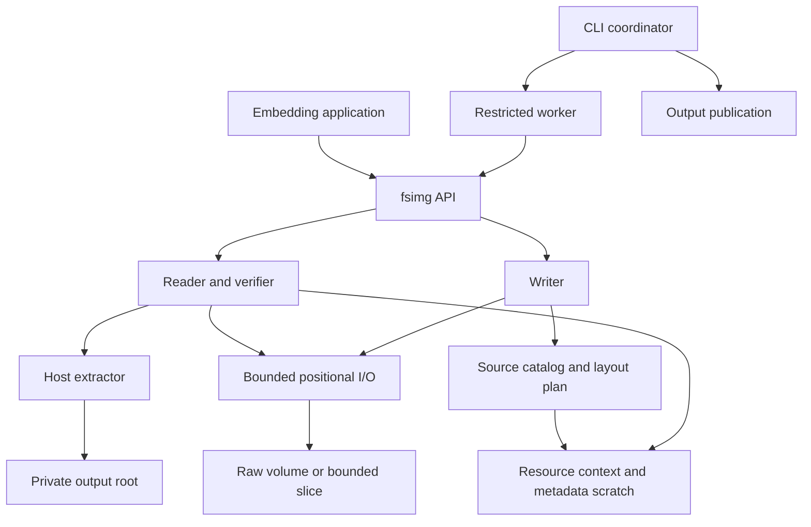

# fsimg architecture and product specification

## Product and scope

**fsimg** is the project name and command name. Its C library is also part of
fsimg; the installed linker artifact is conventionally `libfsimg` and the
public header is `fsimg.h`. New project-owned code is BSD-2-Clause. Public
functions and constants use `fsimg_` and `FSIMG_`; all project-defined C types
have `_t` typedefs, including opaque handles. The creation object is a
**writer**.

fsimg creates, inspects, lists, verifies, and extracts filesystem volumes
without mounting them. It accepts regular image files, explicitly bounded
regions of those files, memory supplied by an embedding application, and
positional I/O callbacks. The default CLI handles regular files, not devices.
It requires no privileges, kernel filesystem driver, or external formatter.

The format contract covers FAT12, FAT16, FAT32, exFAT, the qualified QNX6
Power-Safe profiles and QNX4 with independent read and write support. The CLI is
tar-like: the modes `c` (create), `x` (extract, or one member to stdout with
`-O`), `t` (list), `W` (verify, also combined as `cW`) and `i` (info), plus
`--formats` for capabilities, with `-f` naming the image. Each format
declares supported features; no mode claims support based only on
recognizing a boot record.

The supported host baseline is a 64-bit FreeBSD, Linux, or macOS environment
with C11, 64-bit file offsets, and positional file I/O. A format's legal limits,
the adapter's representable range, and configured resource limits all apply.
Using `uint64_t` does not promise that a host can create a file of every
representable size. Windows and 32-bit hosts require separate portability work.

The CLI build requires complete descriptor closure during process startup,
provided by `POSIX_SPAWN_CLOEXEC_DEFAULT` or
`posix_spawn_file_actions_addclosefrom_np`. Configure checks this capability
before accepting the host: a successful build must not install a command that
cannot safely start its required worker and output relay. Descriptor-limit
loops do not establish closure because open descriptors can outlive a lowered
limit. This requirement uses native OS/libc interfaces, without a helper library.

The product does not modify existing volumes, emulate a POSIX filesystem,
repair corruption, replay journals, or mount images. Partition tables,
disk-image containers, compression, stream input and whole-disk composition
are covered by the [layer design](design-layers.md): an image is a stack of
slots, filesystem inside partition scheme inside container, with compression
applied separately to the whole; emission is random-access into a staged
result followed by one sequential transcode, and reading peels each layer
down to a bounded I/O slice, so filesystem drivers never see a layer. A
bounded volume slice is supported independently of partition discovery.
Additional filesystems and archive integration have separate designs and
acceptance gates. These scope boundaries do not justify shortcuts in the
common API.

## Priorities and design choices

The [principles](principles.md) govern tradeoffs. In particular:

* Large payload support alone is insufficient: catalogs, FATs, bitmaps,
  directories, and fragmentation indexes also have bounded resident storage.
* Metadata scratch files are an explicit resource. They contain records,
  indexes, and sort runs, never a second image or copied file payloads. The
  only payload-sized temporary files are the spool and the raw intermediate,
  two separately named and budgeted resources whose placement the
  [storage design](design-storage.md#resource-model) states.
* CLI image parsing runs in an isolated worker. The default uses OS confinement
  when available and warns when it is unavailable. A required mode refuses
  unconfined execution. In-process library calls provide the same validation
  but do not sandbox their host application.
* Extraction writes beneath one destination that the coordinator has proven
  empty: a fresh directory it creates exclusively inside the user's `-C`
  directory, or with `-E` an existing empty directory, verified on its
  opened descriptor as the
  [security specification](design-security.md#safe-extraction) describes.
  Merging into a populated tree, overwriting files, and restoring privileged
  metadata are outside the extraction contract.
* A writer consumes known-length, repeatable sources. It freezes its catalog
  before planning and emits one image. Removing mutation and retry states
  makes failure and source ownership easier to reason about.
* External sorting and paged arrays serve metadata workloads. There is no
  embedded database, persistent transaction log, or general-purpose storage
  engine for disposable planning data.

## Components and data flow



| Owner | Owns | Does not own |
| --- | --- | --- |
| Resource context | All fsimg allocations, scratch files, limits, counters, cancellation | Application allocations and global process policy |
| I/O adapter | Byte ranges, exact I/O, host offset conversion, zeroing, knowledge of which of its own ranges read as zero | Filesystem geometry or image paths |
| Source catalog | Target entries, stable source identities, external ordering | File payload storage |
| Writer | Collection, immutable planning, emission order, sink initialization, payload copying and its source lifecycle | Format placement or metadata encoding; editing an existing image |
| Reader | Probe dispatch, directory preparation and namespace validation, traversal and selection, current entry, logical content delivery | Format fields or name folding; host path creation |
| Format driver | Descriptor and capabilities, probe, on-disk codecs, feature checks, directory decoding and comparison keys, content resolution, geometry, layout and encoding | Traversal, paths, limits, source access, raw sinks, ambient host access, independent caches, publication |
| Extractor | Destination path validation, safe file creation, safe metadata policy | Parsing raw filesystem structures |
| Output coordinator | Staging, finalization, no-replace publication, outcome reporting; shared by library helpers and CLI | Format parsing |
| CLI coordinator | Trusted operands, descriptor preparation, worker lifecycle | Parsing image bytes or acting on worker-supplied host paths |
| Sandbox adapter | Platform confinement and verified capability reporting | Format-specific exceptions |

## Contracts

### Bounded resources

Every dynamically sized library allocation goes through one resource context.
All caches, live objects, directory state, sort buffers, diagnostics, and I/O
buffers share its budget. A driver cannot allocate a second budget privately.
Allocation is charged before use; failure preserves accounting and produces
`FSIMG_ELIMIT` or `FSIMG_ENOMEM`, as appropriate.

Let `V` be logical volume bytes, `N` entries, `C` allocation units, `F` fragments,
`D` directory depth, `P` actual payload bytes transferred, and `M` the memory
budget. Library-controlled resident allocations are at most `M`, independent
of `V`, `N`, `C`, and `F`. Depth and individual record length are separately
bounded. Scratch storage can grow with metadata and is limited separately.
The detailed algorithms and complexity bounds are in
[storage and algorithms](design-storage.md).

Defaults are product policy, not a measurement claim:

| Limit | Default | Meaning |
| --- | --- | --- |
| Memory | 256 MiB | All live fsimg allocations in a context; minimum supported budget 16 MiB |
| Scratch | 64 GiB | Sum of logical lengths of live scratch files, including simultaneous merge inputs and outputs |
| Spool | 64 GiB | Logical bytes of the spool file holding a stream or compressed input, defined in the [layer design](design-layers.md) |
| Entries | 10,000,000 | Entries admitted or visited in one operation |
| Directory depth | 256 | Components below the volume root |
| Image path | 64 KiB | Encoded UTF-8 bytes, including separators and terminating NUL |
| Open descriptors | 128 | Aggregate descriptors owned by a context, further limited by host availability |
| Extracted logical bytes | Selected volume length | Sum of file lengths, including holes and repeated references; caller may explicitly change it |
| Created output bytes | Planned length | Logical bytes of the staged output plus, while a transcode holds both, the raw intermediate: the plan sums the disk length and the layers' worst-case encoded length, and an explicit lower limit fails before anything is written, naming both parts; a stream holds the raw intermediate too, so it is charged the same way |
| Diagnostic frame | 64 KiB | Maximum single worker control message |

Limits are configurable and failures identify the exhausted resource. Lower
host limits can cause earlier failure; an advertised path/depth maximum is not
a promise to exceed another budget. Zero in an initialized options structure
means the documented default, not unlimited. No input field raises a budget.
Counters use checked arithmetic and never wrap.

An operation spans a writer's complete lifetime or a reader's complete session,
including every incremental add, iteration, content, and verification call.
Per-call quota resets are forbidden. Context memory, scratch, and descriptor
limits aggregate across its live handles. An embedding application that creates
separate contexts owns the aggregate deployment policy across those contexts.
Metadata objects borrow their reader/writer's session rather than starting new
work counters; repeated metadata operations cannot reset its quota. The context
owns their shared page cache and aggregate resident/scratch reservations, so
neither opening another object nor leaving sparse pages untouched bypasses a
budget.

Memory accounting excludes application-owned callback state and buffers,
executable/shared-library mappings, allocator bookkeeping, thread stacks, and
the kernel page cache. These exclusions are reported honestly. RSS is measured
as a separate acceptance criterion. The CLI uses a bounded control process
and one single-threaded parser worker, plus one bounded output relay so blocked
stdout/stderr sinks cannot block supervision, and for a stream read one input
relay: at most four processes. The relays own no library cache.
The process RSS allowance includes the relays. Caches do not multiply by CPU count.
Resource exhaustion cannot trigger an unbounded fallback. With scratch
disabled, an operation either fits in memory or fails with `FSIMG_ELIMIT`.

All CLI text uses the output relay, including commands without a parser worker
and post-publication summaries. A bounded producer feeds the same queue and
supervision loop as worker events. An image read from standard input goes
the other way through an input relay: a child from the same executable
holding only the standard input descriptor and one pipe to the worker, under
the same supervision and deadline, carrying bytes it never interprets; those
bytes are image payload, not text, and are charged to the spool limit by the
worker, not to the ledger. Both relays run unconfined: each holds only the
descriptors it copies between and interprets nothing, so the
[security design](design-security.md#coordinator-and-worker) confines the
parser worker alone. One absolute monotonic deadline spans command
preparation, worker processing, publication and successful output; phase changes
cannot restart its time allowance. After failure, diagnostic delivery receives
at most two seconds, with one further two-second stderr-only attempt if stdout
cannot carry the report. These attempts perform no parsing or publication.
Child termination retains its bounded shutdown grace. The [CLI design](design-cli.md) owns parsing and
streaming representation. Cleanup of private scratch is descriptor-relative,
does not follow links or recurse into worker-created directories, and has a
finite entry bound; incomplete cleanup reports the retained location.

Human presentation and structured records share the bounded formatter and relay.
Human commands use their exit status for completion; JSON retains its explicit
final completion record. The formatter retains one fixed verification result so
human success is emitted only after worker exit and required finalization.
Optional metadata-loss samples are bounded examples, while the worker's final
aggregate counts affected fields. Quiet presentation never suppresses required
sandbox warnings or uncertain/retained-output diagnostics. The CLI design owns
the command-specific presentation rules.

The coordinator owns one output ledger for the complete command, borrowed by
every relay phase. It records queued formatted bytes and confirmed stdout/stderr
bytes; raw member bytes and a streamed image retain their independent logical-output ceiling. The text
ceiling derives only from trusted entry/path limits: at most
`entries * (6 * path_bytes + 4096) + 1 MiB`, capped at `UINT64_MAX` with checked
arithmetic. The factor six bounds JSON escaping and the per-entry allowance
covers fixed metadata. Fixed records, logarithmically sampled progress, loss
examples and final diagnostics fit the fixed allowance; its last 128 KiB is
reserved for failure reports. This bounds text without changing logical-file
quota semantics or introducing an arbitrary short timeout on gigantic jobs.
Publication outcomes take precedence over a partial stdout prefix; otherwise
any confirmed prefix remains incomplete after a later phase fails.

### Byte and object boundaries

All volume access uses checked, slice-relative positional I/O. The common
layer validates `offset <= length` and `count <= length - offset` before
translation to the backing object; nested slice construction checks its own
range. Drivers never receive an unrestricted backing descriptor. Disk values
are decoded explicitly, without casting bytes to native C structs.

Slices translate directly to a backing object and a checked base offset, so
slice nesting does not introduce recursive I/O or an unbounded traversal stack.
Public FD adapters duplicate borrowed descriptors. Private constructors consume
already reserved, library-owned descriptors without duplication, so confined
workers can wrap newly created output and scratch files without gaining a
descriptor-duplication syscall capability. A private read-only constructor
instead borrows a descriptor that library code keeps open for longer than the
object, such as a regular-file source root held by the root registry; freeing
the object leaves the descriptor open. Every path shares flag, type, and range
validation, and every descriptor counts once in the context's descriptor
accounting, against its owner.

Knowledge of zero contents is an operation of every I/O object, not a
property of holding a descriptor: each object reports the next range at or
after an offset that it knows reads as zero, from what it is. A file fsimg
created empty answers from the record of the ranges written through it, a
container's disk from its chunk index, an assembled disk from its regions, a
caller's object through an optional callback, and a read-only file fsimg did
not write, an external file whichever constructor built its object, from the
host's hole report after one sync of the file, bounded by the length the
query observes, a file observed shorter being a changed input, and never
for the chunk holding its last byte, which is always read so that a file
still short there fails.
fsimg never asks the host whether a file it wrote has holes: a
host hole report describes storage, not contents, and has been wrong for
written, unsynced data (OpenZFS issue 15526), whereas what fsimg wrote is a
fact it owns. For a user's file fsimg has no fact of its own, so it accepts
the host's report once the file is synced, a workaround for that fault class
rather than a fix, and reads every byte when the sync fails. Under Capsicum
the sync right goes only to a descriptor that is asked: the CLI's read jobs
never ask their image input for zero ranges, so neither it nor the spool
carries the right. Only a fresh file's record lets zeroing skip a write;
a zero-range answer, the host's or a callback's, spares reads alone, so the
accepted risk of the host's report cannot leave a stale byte in a reused
output. Because the record is per range, emitters need neither an order nor
a "still zero" state to keep a fresh output sparse. The
[hole design](design-holes.md) owns the record, the operation, each object's
answer and the decision's rationale.

Offsets, logical sizes, counts, and persistent record references use
`uint64_t`. Buffer lengths use `size_t` only after a checked conversion.
Adapters reject values outside their host range before invoking OS calls.
Partial I/O advances only by confirmed bytes; zero progress before the expected
end is an error. Interruption, cancellation, and final flush failures propagate.

### Writer and reader independence

A format descriptor has independently optional reader and writer operations
and is the only holder of its format's identity and capabilities. Common
lifecycle and reporting code never branches on a format. Detection uses one
bounded probe contract. The [format contracts](design-formats.md#format-descriptors-and-profiles)
define descriptors and probing. The reader is a lazy iterator with content
access to its current entry. The writer consumes a complete logical catalog,
not necessarily an in-memory tree. Shared code supplies I/O, resources, codecs,
source access, and diagnostics; format-specific geometry and allocation models
remain with the driver.

Each common reader and writer mechanism has one owner, so drivers carry no
traversal, delivery, or copy lifecycle:

* The [prepared-directory design](design-directories.md) lets a driver
  prepare a directory: framing, metadata, and comparison keys. Common code
  validates the namespace before any child is exposed, and one walker owns
  traversal, paths, limits, and selection.
* The [logical content design](design-content.md) has drivers resolve offsets
  to validated extents. One common operation delivers bytes and zeros and
  preserves confirmed progress. A shared extent index is optional.
* The [emission design](design-emission.md) has the common writer perform
  pre-mutation checks, sink initialization, and complete source copies. Drivers
  write encoded metadata and request copies into planned regions.

These boundaries share infrastructure without a common reader/writer object
graph or mutable filesystem model.

The [layer design](design-layers.md) wraps a finished volume in a partition
scheme, a container and compression, and unwraps them on reading. Layers are
applied around the common writer and reader, never inside a driver: the
writer emits into a staged random-access result and one sequential transcode
produces the final file or stream; the reader decodes a stream or
compressed input into a spool file first, then peels each layer down to a
bounded I/O slice, which the filesystem driver opens as it opens a raw
image. The design also owns `--partition` selection and the spool budget.

The [sources and catalogs design](design-sources.md) defines common collection,
source identity and reopening, and immutable catalog preparation independently
of format planning. Common collection uses private interfaces; public writer
construction selects an accepted format driver.
The [manifest design](design-mtree.md) adds a third source root, an mtree(5)
manifest with an optional content directory, whose parser appends the same entry
and source records as the host scanner, so merging, planning, reopening and
emission do not distinguish it; it also defines the manifest the extractor
writes.
The [FAT reader design](design-fat-reader.md) defines FAT directory decoding,
alias keys, chain resolution, and full allocation verification.
The [FAT writer design](design-fat-writer.md) defines independent paged layout
records, deterministic alias reservations, geometry selection, and emission.
The [exFAT design](design-exfat.md) defines independent bitmap allocation,
embedded name mappings, entry sets, and initialized-data semantics.
The [QNX6 design](design-qnx6.md) defines snapshot selection, uniform block
trees, snapshot-aware allocation verification, and independent new-image
construction, and the [QNX6 driver design](design-qnx6-driver.md) maps them
onto the driver's modules, the shared extent index, two extent domains that
separate the system reservation from content, and fixed planning passes. Its
on-disk snapshots do not introduce a mutable filesystem or
change the output coordinator's publication ownership. Native write-after-create
qualification gates writer support because read-only compatibility cannot
establish safe free-space and system-metadata state.
The [QNX4 design](design-qnx4.md) defines geometry derived from the slice
length, closed acceptance tables fixed by native observation, physical record
identity with links resolved only into the `.inodes` table, hidden
format-owned files, and a writer that reproduces the native formatter's
default layout with one extent per object; the
[QNX4 driver design](design-qnx4-driver.md) maps them onto one extent walker
feeding the shared extent index, a bitmap pager fixed by geometry, and the
same planning and emission passes. The same native write-after-create
qualification gates its writer.
Static format operations own their private reader state and writer plan extension.
The common plan holds only its writer and public summary; the selected driver
destroys the complete plan once. This keeps lifecycle and source/publication
contracts common without making FAT geometry a requirement of other formats.

Automotive HDD compatibility is a composition-level claim. Individual format
drivers consume bounded volumes; they neither infer a filesystem from an OEM
name nor own partition discovery, boot code, or other volumes. A replacement
Porsche HDD requires a qualified disk layout and every constituent filesystem,
including QNX4 where present. The [POSIX metadata design](design-metadata.md)
is the one common representation of owner, mode, change time, symbolic links
and FIFOs: a format advertises a field or kind only through its capability
record, planning applies one loss policy to every field, and hardlink
topology has no representation until a design adds one. Fidelity claims do not
weaken the safe extractor's file/directory-only contract. This keeps device
compatibility evidence separate from a successful filesystem parse.

Plan initialized payload counts describe format-initialized file extents,
excluding metadata. They are distinct from logical length, allocated capacity,
and actual transferred bytes. Uninitialized logical tails read as zero through
every content interface, even when their backing storage contains other bytes.

Collection records source references, validation orders and checks entries,
planning fixes geometry and extents, and emission copies content directly to
final offsets. Plan data may be disk-backed. Nothing requires an allocation
table or an extent vector for the entire volume in RAM.

### Source consistency

Sources have declared lengths and repeatable positional reads. Host scanning
does not follow symlinks. Reopened files are checked against recorded identity,
type, size, and change metadata before and after copying. Changed sources fail
the operation; partial output is not published.

The immutable catalog owns each source's kind, reference, and declared length.
Source access accepts a stable catalog ID and obtains those values through the
catalog's validated indexed-read boundary. A caller cannot substitute a source
descriptor or pair an entry snapshot with a different writer. The writer owns
one current source, its I/O handle, and its failure cleanup; source operations
preserve the current catalog-inspection snapshot.

These checks detect changes visible in the recorded host metadata. Writes can
share coarse timestamps, and metadata-preserving changes can be invisible.
The checks are not an atomic snapshot of a concurrently modified tree. Callers requiring snapshot consistency
provide immutable files, a filesystem snapshot, or an equivalently stable
source provider. Hashing alone does not create a snapshot. No security promise
depends on mtime being impossible to restore.

### Names and metadata

Volume time-basis reporting describes a format-level interpretation. A volume
whose fields carry independent time bases reports PER_TIMESTAMP; callers inspect
each timestamp's UTC, known-offset, or wall-clock basis. The volume summary does
not claim that observed fields differ, and PER_TIMESTAMP is not a valid basis
for an individual timestamp. This avoids inventing a common zone for exFAT
fields whose offset-valid flags can differ within one entry.

Image paths are absolute UTF-8 paths rooted at `/`. Format drivers validate
components, encoding, case comparison, and name collisions. A host pathname is
a different value with a different trust boundary. Normalization never turns
an invalid or escaping host name into an accepted one silently.

Selection resolves components through the format's validated lookup namespace,
including its case rules and aliases. A common bounded selector owns resolution
and subtree traversal. It compares the driver's key for a query component with
the same keys that namespace validation proved unambiguous. Resolved
paths retain displayed image names, so extraction never copies an alias or
case-normalized query spelling onto the host. Off-branch directories are skipped
after their parent's namespace is validated, without reading their payloads or
constructing a whole-volume path index.

Metadata has explicit validity bits. Entry kinds, supported attributes,
timestamp resolution, and naming limits are capabilities, not assumed POSIX
semantics. A required attribute that cannot be represented is an error.
Optional omission requires an explicit policy and a bounded, structured loss
report. The ordinary host-tree import selects content, hierarchy, and
representable timestamps; it does not promise to preserve every `stat` field.
UTC and known-offset timestamp seconds denote UTC instants relative to the Unix
epoch; the latter retains its original offset separately. Unknown-offset wall
times encode calendar fields as if UTC without asserting a zone. This keeps
generic metadata independent of the host timezone while preserving the basis
needed by format codecs and extraction policy.

### Extraction and sandboxing

All parsers treat input as hostile, including probes and listing commands.
The CLI worker receives only prepared capabilities and establishes available
confinement before reading image bytes. A confined image-reading worker has no
network, shell, external formatter, device access, or arbitrary host path
service. Creation has a distinct source-root profile: it restricts filesystem
authority but cannot universally prevent opening special nodes already beneath
an authorized source root. Its additional checks and deployment limits are
explicit in the security specification.
Unavailable confinement produces an explicit warning in automatic mode and an
error in required mode. Partial or unexpected setup failure is an error in
either mode. The parent does not execute requests to open names supplied by
the worker.

Extraction accepts only regular files and directories in its safe profile,
writes only beneath a destination proven empty before the worker starts,
and never follows image-derived symlinks.
Image paths are validated component by component, and files are created
exclusively relative to directory descriptors. Details and platform guarantees
are defined by the [security specification](design-security.md).
The [extraction and worker design](design-extraction-worker.md) defines
descriptor ownership, postorder finalization, and the readiness/protocol boundary.

### Output and determinism

Writer output covers every logical byte with either defined data or a proven
zero range. A hole is safe only when the adapter guarantees its zero contents,
which the [hole design](design-holes.md) defines; skipping a write into a
reused file is not zeroing. The default CLI publishes a
completed image without replacing an existing pathname. A caller-supplied raw
I/O sink can contain partial output after failure and must be discarded.

A writer allocates every logical byte of a file in the image it plans; no
writer stores a file sparsely. Emission writes a file's data ranges and
leaves its zero ranges to the zeroed or fresh volume beneath them. A file
therefore never occupies less of
the planned volume than its logical size, which the
[manifest design's digest cost](design-mtree.md#digests) depends on: the
bytes a generated file's claimed digest covers are bounded by the planned
volume and the output limit. A writer that stored holes would have to
bound that hashing another way.

Before any output resize, zeroing, or write, built-in adapters compare output
backing identity with all collected host sources and reject an inode alias.
Slices retain backing identity and translated ranges. Opaque callback sources
and sinks require the caller to guarantee disjoint storage; that trusted-code
obligation is explicit and cannot be inferred from distinct object pointers.

Extraction's fresh output directory can remain partially populated on failure.
This is stated explicitly; directory-wide atomic publication is not promised.
The CLI preserves private access permissions on a failed destination and reports
its location. Existing trees are never modified to simulate rollback.

Reproducible mode fixes ordering, timestamp policy, identifiers, and all padding.
The same logical inputs and options yield identical image bytes regardless of
host directory order, locale, memory budget, merge fan-in, or scratch location.
Reproducibility does not imply source immutability or output durability.

Cancellation is checked at the shared publication boundary after flushing and
closing the staged file. Once linking succeeds, cancellation before directory
sync completion reports published output with uncertain durability; it cannot
restore an absent-output outcome or justify retrying publication.

### Errors, ownership, and compatibility

The [C API](design-api.md) defines structured, per-call errors and explicit
lifetimes. The library has no global error buffer, implicit output, process
termination, environment-dependent behavior, or automatic sandbox transition.
Each handle is used serially; independent contexts can run concurrently.
Callbacks cannot re-enter their active context.

Public options have size/version initialization rules. Unknown flags and
unsupported required capabilities fail explicitly. Private driver interfaces
are not a plugin ABI. There is no dynamic driver loading in the product
contract. A format feature is advertised only after its acceptance tests pass.

### Specification-driven testing

The [specification-driven test harness](design-spec-testing.md) classifies
each failed CLI invocation by the integer `code` of its `--json` error record,
mapped to the `fsimg_status_t` names in `include/fsimg.h`. The CLI emits one
bounded error record per failed command, and that code is the contract between
fsimg and the harness. The exit status separates only success, failure and invalid
syntax, and the prose `status` string is not an interface. The harness relies
on these codes, which image content can cause:

* `FSIMG_EFORMAT`: no single decoder was selected, because none claims the
  image, several do, or a forced format contradicts the variant the image
  declares;
* `FSIMG_ECORRUPT`: at a reading command, a claimed image is corrupt. At
  `c` it reports inconsistent scratch data, a fault;
* `FSIMG_EUNSUPPORTED`: fsimg or the host lacks a feature or capability. The
  image can cause it with a feature outside the supported profile; the host
  can cause it with unavailable required confinement, no publication without
  replacement, a name the destination cannot represent, or an object of a
  kind fsimg does not read where it is given, such as a symbolic link or
  FIFO as an operand, manifest, image or `-E` directory.

It also relies on these fault codes:

* `FSIMG_EIO`: an I/O, process-spawn or worker-protocol failure, such as a
  failed read or write on the image, scratch, destination or output, an
  unexpected end of file, or a worker that died or broke the protocol before
  its final frame;
* `FSIMG_ESTATE`: an internal-state or contract failure, including a worker
  that exited with the sanitizer runtime's reserved status.

On a working host, image content never causes `FSIMG_EIO` or `FSIMG_ESTATE`,
so neither is a verdict. Because `FSIMG_EUNSUPPORTED` also has host causes,
the harness establishes the host's capabilities before it reads that code as
a verdict on an image. At reading commands, `FSIMG_ECORRUPT` and
`FSIMG_ERANGE` can also report inconsistent scratch metadata, such as
verification's external sort reading back a bad run, so a scratch defect can
satisfy an image expectation.

## Dependencies and implementation organization

The core library and ordinary CLI depend on libc, host OS interfaces and
one third-party library, the system zlib. zlib is required, never vendored:
compressed DMG chunks and gzip are basic layer features, not optional
extras; zlib's permissive license matches the project's; it is the system
library on macOS and FreeBSD and standard on every Linux distribution; and
linking the system copy means its security fixes arrive with the host,
which matters because inflate parses untrusted images. Configure fails
clearly without it. OS sandbox calls are native adapters, not dependencies
on libseccomp or a container runtime. Optional archive integration cannot
become necessary for raw-image operations. Imported code and generated
tables receive file-level provenance and license review; test tools do not
imply permission to copy them.

The build uses Autoconf, Automake, and Libtool as development tools. Release
archives contain generated build machinery; users need a C compiler, make,
and standard host utilities. Public headers are C11 and C++ includable, do not
include `config.h`, and expose no platform sandbox headers.

```text
include/fsimg.h       public API
lib/core/            context, errors, accounting, progress
lib/io/              bounded adapters and exact I/O
lib/meta/            records, paged arrays, external sorting, extent index
lib/source/          descriptor-relative scanning and source reopening
lib/write/           writer lifecycle and common emission
lib/read/            reader lifecycle and verification
lib/extract/         safe host extraction
lib/output/          shared staging, finalization, publication
lib/layers/          partition schemes, containers, compression, spooling
lib/formats/fat/     FAT codecs, reader, writer
lib/formats/exfat/   exFAT codecs, reader, writer
lib/formats/qnx6/    QNX6 codecs, reader, writer, profile verification
lib/formats/qnx4/    QNX4 codecs, reader, writer, verification
compat/             host portability
cmd/fsimg/          CLI, worker protocol, sandbox, coordinator
test/               unit, integration, adversarial, resource tests
fuzz/               bounded parser and protocol targets
```

## Acceptance contract

A release meets functional, security, and resource requirements together:

* Independent tools accept generated FAT/exFAT images; externally generated
  fragmented images list and extract correctly. Supported metadata and content
  survive round trips, and unsupported features produce specific errors.
* A 128 TiB sparse exFAT volume with a small directory tree can be created,
  opened, listed, and inspected with a 64 MiB library budget. A multi-terabyte
  zero source and initialized/zero content boundary exercise 64-bit lengths.
  Hosts unable to represent those sparse files run the logical adapter tests
  and explicitly skip, rather than pass, the physical-file case.
* A generated catalog of ten million entries spread across legal directories
  plans within 256 MiB, using bounded scratch. A single very wide directory and
  a highly fragmented file exercise metadata behavior separately from payload
  size. Scale tests are scheduled separately from fast developer checks.
* Increasing logical volume size by 1,000 times with fixed live metadata does
  not increase resident allocation limits or cause reads of unused payload
  space. Increasing entries or fragments spills metadata instead of RAM.
* For non-sanitized scale runs, peak combined CLI/worker RSS is no more than
  the configured library budget plus a measured 64 MiB process allowance on
  the supported CI hosts. Allocator accounting must stay within the exact
  budget; RSS failures are investigated, not waived by that distinction.
* Sequential content extraction advances chains once, batches adjacent ranges,
  and has no quadratic restart behavior. Benchmarks record bytes, I/O calls,
  metadata passes, peak memory, scratch peak, and wall time on named fixtures.
  No universal throughput number substitutes for these measurements.
* Traversal attacks, corruption, allocation/I/O failure, resource exhaustion,
  sandbox denial, cancellation, and interrupted publication have regression
  coverage. Sanitizers and independent architectural/security review are
  required as described in [the implementation plan](../docs/implementation-plan.md).

Detailed requirements are in the [API](design-api.md),
[storage](design-storage.md), [security](design-security.md),
[format](design-formats.md), [layer](design-layers.md), and
[CLI](design-cli.md) specifications.
